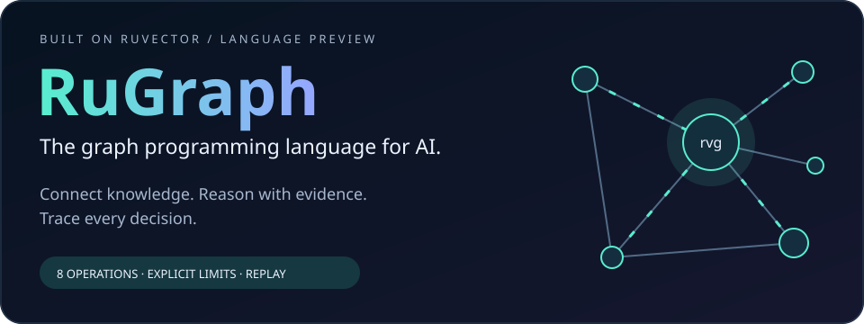
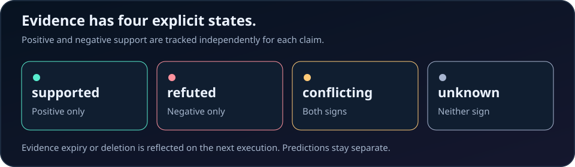
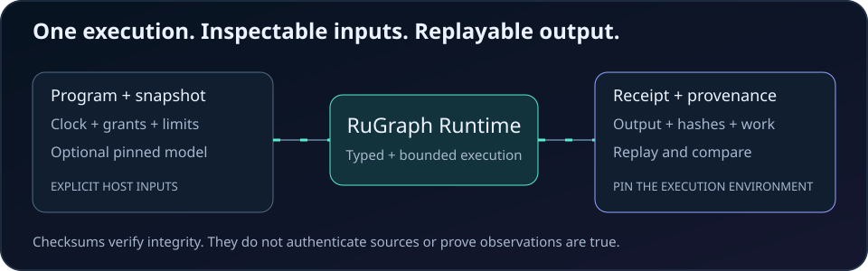

# RuGraph

**The graph programming language for AI. Built on RuVector.**

Connect knowledge. Reason with evidence. Trace every decision.

RuGraph combines graph traversal, vector search, learned predictions, and explicit
evidence in bounded programs you can inspect and replay. Use it to diagnose
service dependencies, reconcile agent memory, or assess claims whose evidence
can conflict or expire. These are application patterns, not accuracy guarantees.

[Run an example](#run-the-example) · [Eight operations](#operations) · [Replay](#cli-and-replay) · [Native runtime](../ruvector-language-native/README.md) · [Specification](../../docs/research/graph-language/SPEC.md)

Text programs and strict JSON compile to the same typed representation. Rust,
JavaScript, TypeScript, and Python callers share the same execution semantics.

This is version 0.1.0 with wire schema version 1. It is an executable first
release, not a general purpose language or a Cypher/GQL implementation.

## Run the example

From the repository root, with Rust 1.90.0 installed:

```bash
cargo +1.90.0 build --locked --manifest-path crates/ruvector-language/Cargo.toml
crates/ruvector-language/target/debug/rvg-core check crates/ruvector-language/examples/incident.rvg
crates/ruvector-language/target/debug/rvg-core run crates/ruvector-language/examples/incident.rvg \
  --snapshot crates/ruvector-language/examples/snapshot.json \
  --context crates/ruvector-language/examples/context.json
```

The example follows outgoing `DEPENDS_ON` edges from `api`. A current positive
`Failing` observation supports `Degraded` for `database`; an explicit negative
observation refutes `Failing` for `cache`. Missing evidence produces `unknown`.
Each decision includes its selected observation, source, and rule identifiers.

```text
program diagnose {
  effect graph.read;
  effect decision.emit;
  budget 100000;
  let service = select ["api"];
  let dependencies = traverse service "DEPENDS_ON" depth 2;
  let errors = observe dependencies "Failing" within 300;
  let impacts = infer [errors] using ["failure_implies_degraded"];
  let decisions = assess impacts;
  emit decisions;
}
```

The context supplies the clock, granted capabilities, work budget and result
limit. A program can request a capability but cannot grant it to itself. At
`now = 1100`, this fixture's observations expire and its decisions become
`unknown` on the next execution.



## Operations

| Text form | Input | Output |
|---|---|---|
| `nodes "Service"` | Snapshot | Node set |
| `select ["api"]` | Snapshot | Node set |
| `traverse n "DEPENDS_ON" depth 2` | Node set | Node set including seeds |
| `similar n [0.1, 0.2] top 5` | Node set | Nodes ranked by exact cosine |
| `observe n "Failing" within 300` | Node set | Signed observations and evidence domain |
| `infer [e] using ["failure_rule"]` | Observed or derived evidence | Signed Horn closure |
| `predict n "Cause" model "incident_v1" top 3` | Node set | Typed prediction batch |
| `assess e` | Observed or derived evidence | Four valued decisions |

Predictions cannot flow into `infer` or `assess`. A score is not an observation.
Both positive and negative support yields `conflicting`; neither yields
`unknown`. Rules require explicit signed premises and do not infer falsity from
absence. Rules operate on the same subject and can chain to a fixed point.



## CLI and replay

```text
rvg-core check PROGRAM
rvg-core compile PROGRAM
rvg-core run PROGRAM --snapshot SNAPSHOT --context CONTEXT
rvg-core run --request REQUEST
rvg-core replay --request REQUEST --receipt RECEIPT
rvg-core verify RECEIPT
```

Use `-` for one stdin input. `PROGRAM` is text or strict program JSON. `REQUEST`
is `{ "program": ..., "snapshot": ..., "context": ... }`. Successful execution
prints one JSON receipt. Errors print structured JSON to stderr and exit with
code 2. No partial successful result is emitted when a bound is exceeded.

`compile` produces canonical program JSON. The receipt identifies program,
snapshot and context hashes, logical time, work charged, output, and its own
SHA256 checksum. `verify` checks checksum integrity only. `replay` recomputes
the result and requires the complete receipt to match. Neither command proves
the truth of an observation or authenticates its source.

Replay requires identical inputs and model artifact, the same language version,
and compatible floating point behavior. Pin the toolchain and target when
archiving receipts. A new snapshot is recomputed from scratch, which retracts
conclusions when observations are deleted or expire.

## Counterfactual evidence audits

Ask what changes if a source disappears or a graph edge is removed. RuGraph
recomputes each intervention independently and reports changed decisions, witness
changes, and receipt hashes. Redundant evidence can preserve a conclusion even
when the selected witness is removed. Missing retrieval results are distinct
from an `unknown` assessment.

```text
rvg-core audit --request request.json --audit-options options.json
```

The same operation is available as `client.audit(request, options)` in both SDKs.
Audits accept 1 to 64 explicit observation, source or edge interventions, reserve
an aggregate execution budget, and exclude model predictions. They measure
sensitivity to supplied inputs, not real world causality or source authenticity.

[Run the agent memory application and benchmark](../../docs/research/graph-language/FRONTIER.md)
· [Audit architecture](../../docs/adr/ADR-GL-006-bounded-counterfactual-audits.md)

## Use from Rust

```rust,ignore
use ruvector_language::{parser, runtime, Context, Snapshot};

fn decide(source: &str, snapshot: &Snapshot, context: &Context)
    -> ruvector_language::Result<ruvector_language::Receipt>
{
    let program = parser::parse(source)?;
    runtime::execute(&program, snapshot, context, None)
}
```

The library uses an explicit snapshot and clock. It performs no network,
filesystem, shell, model download or external provider operations. The CLI owns
file access. A host can supply a trusted `Predictor`; the native adapter uses
RuVector's real KGE implementation.

## Repeated Rust host queries

Prepare an immutable snapshot once to reuse validated indexes and its canonical
hash. Each query still checks its program, clock, capabilities and limits.

```rust,ignore
use ruvector_language::runtime::PreparedSnapshot;
let prepared = PreparedSnapshot::new(&snapshot)?;
let receipt = prepared.execute(&program, &context, None)?;
```

Prepared and ordinary execution produce identical receipts and logical work
charges. This optimizes actual repeated-query cost without changing budget
semantics. The snapshot remains immutably borrowed; rebuild preparation after
updates. Models are invoked anew on every query. Preparation is currently a Rust
host API; CLI/SDK subprocesses and counterfactual trials retain full execution.
[Design and bounds](../../docs/adr/ADR-GL-007-immutable-prepared-snapshots.md).

Exact cosine ranking selects the top K before sorting the winners, and
intermediate node sets borrow snapshot IDs. Every candidate is still validated
and scored. Deterministic work and byte limits retain their prior conservative
charges, so existing receipts remain compatible. See the
[paired performance evidence](../../docs/research/graph-language/ACCEPTANCE.md).

## Native graph and model support

[The native crate](../ruvector-language-native/README.md) provides `rvg`, which
shares the same CLI and adds `--models MODELS.json`, plus `rvg-model` for offline
training, evaluation and explicit promotion. It captures a real `GraphDB`
through `capture_quiescent` under a caller owned writer gate. KGE ranking uses
the actual HolE or RotatE scorer and reports model revision and hash.

The minimal `rvg-core` binary reports `PROVIDER_UNAVAILABLE` for prediction
without a provider, or `MODEL_UNAVAILABLE` if asked to load models. Model
artifacts and executable paths are trusted host configuration.
Models are not trained or promoted during program evaluation.

## JavaScript, TypeScript and Python

Process bindings use the same executable and wire schema:

* [JavaScript and TypeScript SDK](../../npm/packages/graph-language/README.md)
* [Python SDK](../../python/ruvector-language/README.md)

## Validation and scope

Run the complete acceptance command from the repository root:

```bash
bash scripts/test-graph-language.sh
bash scripts/smoke-graph-language-packages.sh
```

See the [specification](../../docs/research/graph-language/SPEC.md),
[acceptance report](../../docs/research/graph-language/ACCEPTANCE.md), and
[architecture decisions](../../docs/adr/ADR-GL-001-rugraph-language-and-ir.md).

Version 1 uses immutable snapshots, exhaustive vector/KGE ranking and bounded
same subject rules. It does not include graph mutation, arbitrary tools, LLM
calls, distributed execution, incremental truth maintenance, learned query
planning or calibrated uncertainty. Exact ranking describes evaluation of the
chosen scorer, not predictive accuracy. No research novelty claim is made.

## Project identity and compatibility

RuGraph is the language; RuVector supplies graph and model infrastructure. The
native command is `rvg`, the core command is `rvg-core`, and source files use
`.rvg`. Existing crate names, SDK package names, imports, and
`RUVECTOR_LANGUAGE_BIN` remain stable in this branding update. Install from the
repository using the commands above; this README does not announce a registry
release or a separate repository.

The SVG illustrations animate without scripts or external resources. They retain
all labels as static images and disable motion when reduced motion is requested.

Licensed under [MIT](../../LICENSE).
