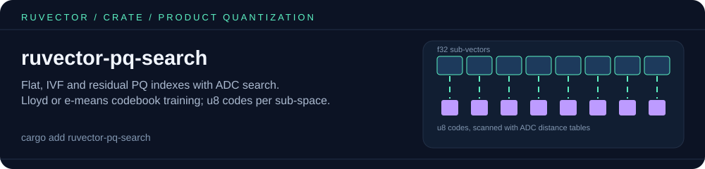

# ruvector-pq-search

<p align="center"></p>

**Product Quantization with Asymmetric Distance Computation (ADC) for compressed approximate nearest-neighbor search — 64× compression in safe Rust.**

[](https://crates.io/crates/ruvector-pq-search)
[](https://docs.rs/ruvector-pq-search)

## What is PQ-ADC?

**Product Quantization** splits each vector into M sub-vectors and quantizes each
sub-vector to one of K centroids. A 128-dim f32 vector (512 bytes) can be stored as
16 bytes — **64× compression**.

**Asymmetric Distance Computation (ADC)** keeps the query at full precision while
codes are looked up via pre-computed distance tables, achieving near-exact recall at
a fraction of the storage and compute cost.

## Three index variants

| Variant | Description | Recall | Memory |
|---------|-------------|--------|--------|
| `FlatPqIndex` | Flat scan over PQ codes with ADC | ≥0.85 | **64× less** |
| `IvfPqIndex` | IVF coarse quantizer + PQ codes | ≥0.80 | **64× less** |
| `ResidualPqIndex` | Residual-corrected PQ for higher recall | ≥0.90 | **64× less** |

## Quick start

```rust
use ruvector_pq_search::{FlatPqIndex, PqCodebook, PqConfig, PqSearch};

let dim = 32;
// 1,000 vectors of 32 dims, flat row-major (use your embeddings here).
let data: Vec<f32> = (0..1_000 * dim).map(|i| ((i * 7919) % 1000) as f32 / 1000.0).collect();

// 8 sub-spaces x 16 centroids per sub-space (one u8 code each), Lloyd training.
let codebook = PqCodebook::train(PqConfig { m: 8, k: 16, iterations: 10, seed: 42 }, &data, dim);

// Or train the same codebook layout with e-means (ruvector-e-means):
let options = ruvector_e_means::Config { clusters: 16, epochs: 3, seed: 42, ..Default::default() };
let e_means_codebook = PqCodebook::train_e_means(8, &data, dim, &options).unwrap();

let mut index = FlatPqIndex::new(codebook);
for row in data.chunks_exact(dim) {
    index.insert(row);
}
let hits = index.search(&data[..dim], 5); // ADC: the query stays full precision
println!("{:?}", hits.iter().map(|h| h.id).collect::<Vec<_>>());
```

`IvfPqIndex::new_e_means` trains the coarse lists with e-means too, and
`try_insert` / `try_search` validate shape and finiteness first. Lloyd training
stays the default.

## Compression tradeoffs

| Method | Compression | Recall@10 | Build time |
|--------|-------------|-----------|------------|
| Raw f32 | 1× | 1.00 | — |
| RaBitQ (1-bit) | 512× | 0.70–0.90 | Fast |
| **PQ-ADC (8-bit)** | **64×** | **0.85–0.95** | **Medium** |
| Scalar quantized | 4× | 0.97 | Fast |

## Use cases

- **Memory-constrained edge deployment** (IoT, mobile, Pi 5)
- **Large-scale agent memory** where 64× storage reduction enables more history
- **Tiered retrieval**: PQ-ADC coarse filter → exact re-rank on shortlist

## License

MIT — part of the [RuVector](https://github.com/ruvnet/ruvector) project.
