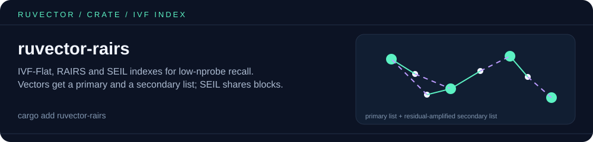

# ruvector-rairs

<p align="center"></p>

Inverted-file (IVF) indexes that keep recall high at low `nprobe`. Each vector
goes to its primary list and to a residual-amplified secondary list, so
neighbours near a cell boundary are still found when few lists are probed.

| Index | Assignment | Layout |
|---|---|---|
| `IvfFlat` | single | flat lists (baseline) |
| `RairsStrict` | primary + secondary | flat lists |
| `RairsSeil` | primary + secondary | shared 32-vector blocks, deduplicated at query time |

All three implement `AnnIndex`. Train with Lloyd's k-means (`train`) or with the
shared e-means optimizer (`train_e_means`, via `ruvector-e-means`).

## Quick start

```rust
use ruvector_rairs::{AnnIndex, RairsSeil};

let dim = 16;
// 2,000 vectors of 16 dims (use your embeddings here).
let corpus: Vec<Vec<f32>> = (0..2_000)
    .map(|i| (0..dim).map(|d| ((i * 31 + d * 7) % 97) as f32 / 97.0).collect())
    .collect();

// 32 lists, 10 Lloyd iterations, seed 42, RAIR lambda 1.0.
let mut index = RairsSeil::new(dim, 32, 10, 42, 1.0);
index.train(&corpus).unwrap();
// Or: index.train_e_means(&corpus, &ruvector_e_means::Config { clusters: 32, ..Default::default() })
index.add(&corpus).unwrap();

let hits = index.search(&corpus[0], 5, 4).unwrap(); // k = 5, nprobe = 4
println!("{:?}", hits.iter().map(|h| h.id).collect::<Vec<_>>());
```

The "RAIRS / SEIL" names follow the design notes in ADR-193; treat this crate as
an original implementation of redundant assignment and judge it on the
benchmarks in `src/main.rs`.

## License

MIT. Part of [RuVector](https://github.com/ruvnet/ruvector), see [ruv.io](https://ruv.io).
