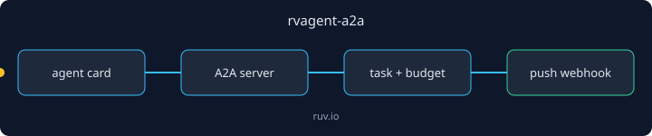

<p align="center"></p>

# rvagent-a2a

Agent2Agent (A2A) protocol for Rust agents: JSON-RPC 2.0 over HTTP, `/.well-known/agent.json` discovery, SSE streaming and HMAC-signed push webhooks, with signed agent cards, task policy, a global budget and a recursion guard.

Environments: Rust 2021, any platform tokio supports. It is a library; mount `server::A2aServer` into your own axum binary.

## Quickstart

```bash
cargo new a2a-demo && cd a2a-demo
cargo add rvagent-a2a
```

Replace `src/main.rs` with:

```rust
fn main() {
    println!("rvagent-a2a {}", rvagent_a2a::VERSION);
}
```

Run `cargo run`. Expected output:

```text
rvagent-a2a 0.1.1
```

## Next step

Drive it from a terminal with [rvagent-cli](https://crates.io/crates/rvagent-cli) (`rvagent a2a serve`).

## Works with / Used by

Depends on `rvagent-core` and `rvagent-middleware`. Used by `rvagent-cli`.

---

Built by [rUv](https://ruv.io) · [ruv.io](https://ruv.io) · [Source](https://github.com/ruvnet/ruvector/tree/main/crates/rvAgent/rvagent-a2a)
