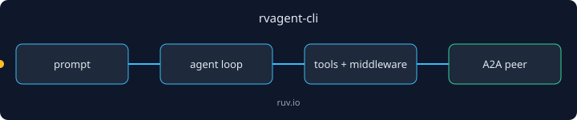

<p align="center"></p>

# rvagent-cli

`rvagent` is a terminal coding agent: interactive chat, one-shot runs, session management, MCP tools and A2A peer operations (serve, discover, send-task).

Environments: Rust 2021, Linux, macOS and Windows with a recent stable toolchain.

## Quickstart

```bash
cargo install rvagent-cli
rvagent --version
```

Expected output:

```text
rvagent 0.1.2
```

Then run `rvagent run "<prompt>"` for a single prompt or `rvagent chat` for an interactive session.

## Next step

Serve or call peers with the A2A library, [rvagent-a2a](https://crates.io/crates/rvagent-a2a).

## Works with / Used by

Depends on `rvagent-core`, `rvagent-backends`, `rvagent-middleware`, `rvagent-tools`, `rvagent-subagents` and `rvagent-a2a`.

---

Built by [rUv](https://ruv.io) · [ruv.io](https://ruv.io) · [Source](https://github.com/ruvnet/ruvector/tree/main/crates/rvAgent/rvagent-cli)
