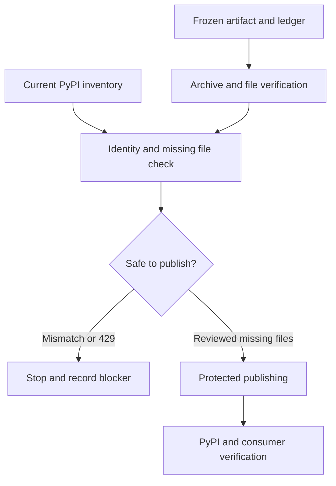

# ADR: Recover the frozen Python portfolio release

Status: Superseded as the delivery plan; original recovery remains incomplete and security-blocked
Date: October 12, 2026; disposition amended October 26, 2026
Scope: Immutable companion 0.2.0 recovery and successor native 0.1.5 / companion 0.2.1 delivery candidate

## Context

The initial portfolio release partially reached PyPI. A new-project HTTP 429 interrupted publication. Package names, versions and actual published files must be inspected again before any upload. A successful wheel upload does not imply its source distribution or another package was uploaded.

The original companion artifacts require `ruvector==0.1.3`. Current main changes the same companion version to depend on runtime 0.1.4. Rebuilding 0.2.0 from current main would silently mix release identities and cannot repair the original release faithfully.

The stopped historical supervisor had a deadline ending October 11 at 22:35 UTC. Its receipt is useful evidence, not proof that no other publisher is running. Recovery must establish one current publisher owner from live process state, workflow runs, private Slack claims and existing receipts.

## Current disposition — October 26, 2026

Use corrected native `ruvector==0.1.5` and all eleven companion `0.2.1`
distributions as the successor delivery candidate. This settles which release
line receives delivery work; it does not authorize a main merge, tag, registry
upload, or claim that the successor is published. Independent review and
explicit release authorization still apply to the final candidate commit.

The original `0.2.0` release remains **partially published, incomplete and
security-blocked**. Stop pursuing its missing uploads under the old recovery
plan. Preserve existing public files, the frozen ledger, original artifacts and
stopped-supervisor receipts. Do not rebuild bytes under the old identities,
resume the supervisor, start another publisher, or yank/delete existing files
as part of this disposition.

The [frozen-native-audit failure](https://github.com/ruvnet/RuVector/actions/runs/40187182674/job/121150740695)
checks source `fccf36e9a76d35bce6750dfd3b25802cae3d683b`, whose native dependency
closure contains `tokio 1.52.3`. It correctly rejects RUSTSEC-2026-0386
(`AsyncFd` I/O safety). The successor uses `tokio 1.54.1` and passed its separate
native audit. Preserve the frozen audit and its failure; a corrected successor
cannot make the immutable historical bytes safe or turn that result into a pass.
No advisory exception or workflow skip is introduced by this amendment.

An October 26 public-registry read found eight original `0.2.0` wheels and no
sdists; rvf, rvf-wasm and sona `0.2.0` were absent. Native `0.1.5` and all eleven
companion `0.2.1` versions were absent. These are dated observations, not a
publication receipt. The old new-project HTTP 429 is not proven cleared by
elapsed time or a version change. Reconcile the single publisher owner, registry
state and retained receipts before any separately authorized publication.

### Successor release ordering remains an explicit prerequisite

Native must be public and verified before companions are published. The current
native and portfolio workflows independently select publication when their
versions change on main; the portfolio job does **not** depend on completion of
native publication. Thus a merge of both version changes does not guarantee
native-first delivery. Before approving that merge, use a separately reviewed
native-only then companion-only landing plan, or implement and qualify a real
native-publication dependency. A manual portfolio dispatch is build-only; the
existing matching portfolio-tag route is a separate release action requiring
its own authorization. This disposition dispatches none of these paths.

After an approved ordered release, reconcile exact public versions/files and
hashes, then run clean supported-platform installs and dependency checks. Keep
candidate qualification, publication, and public consumer verification separate.

## Original recovery contract — retained, not the current delivery plan

The following original-file identity and safety requirements remain intact for
historical verification. They do not override the security block above or grant
authority to retry recovery.

The frozen release identity is:

| Field | Exact value |
| --- | --- |
| Source commit | `fccf36e9a76d35bce6750dfd3b25802cae3d683b` |
| Companion version | `0.2.0` |
| Required native runtime | `0.1.3` |
| GitHub Actions run | `38169271248` |
| Artifact ID | `11713787141` |
| Artifact archive SHA256 | `b4c92cae86c753305abef7aad395fdd9d91c7e84c3c887342defa7a3e4607241` |
| Expected companion artifacts | 22 files across 11 distributions |

The [frozen inventory](../../python/portfolio/frozen-release-0.2.0.json) records each expected filename, byte size and SHA256. It provides release identity; it does not authorize publication.

A recovery implementation must:

1. Confirm no live publisher already owns this release; claim the scoped branch and package work in the existing private Slack thread.
2. Download the original artifact by immutable run and artifact identity. Verify the archive checksum and all 22 member checksums against the committed inventory. Reject path traversal, extra members, missing members and mismatched bytes.
3. Fetch the current PyPI JSON for every expected distribution/version. An existing expected filename must match its frozen SHA256. Unexpected release filenames or mismatches stop recovery.
4. Stage only files missing from PyPI. Stage nothing when all expected files are already present. Avoid `skip-existing` as a substitute for preflight identity verification.
5. Require independent review and repository release checks before using the protected `pypi` environment. Publish through the established GitHub Actions identity without broadening secrets, changing protection or bypassing approval.
6. Stop on HTTP 429. There is no confirmed upload cooldown here. Do not infer that the separate documented Trusted Publisher registration limit applies to this upload. Reinspect state and receipts before a later authorized attempt.
7. Requery PyPI after publication, verify every expected filename and hash, and execute installed-artifact consumer tests. Record implementation, checks, merge, publication and verification separately.

A transport failure or ambiguous upload response requires read-only reconciliation first. A manifest cannot establish whether a network side effect completed.

## Architecture

## Tutorial acceptance

The companion [attention tutorial](../../python/portfolio/tutorials/README.md) uses only published `ruvector-attention==0.2.0`, runtime `ruvector==0.1.3` and NumPy 2.2.6. Its exact code passed a clean PyPI install on CPython 3.10.22, Linux x86_64 and glibc 2.39 on October 12, 2026. It checks the native weighted sum against a float64 reference and rejects invalid dimensions and nonfinite queries.

This smoke test does not prove all portfolio files are published, benchmark performance or establish fresh macOS/Windows execution. The example does not download models, generate text or train parameters.

## Consequences and alternatives

Frozen-file recovery preserves original published wheel metadata and avoids duplicate version content. Original artifacts must remain available and independently verified. If the archive becomes unavailable or its checksum differs, recovery stops; a reviewed new version is preferable to rebuilding historical bytes.

Rebuilding from current main was rejected because the runtime dependency changed without changing the companion version. Blindly repeating the supervisor was rejected because it could duplicate a publisher and obscure partial side effects. Ignoring HTTP 429 or modifying credentials was rejected because neither repairs the release gate.

Rollback means stopping promotion and preserving the recorded inventory. PyPI files are not overwritten. Any later defect requires a reviewed release correction under package policy; successful publication is not treated as reversible file replacement.

## Evidence and references

- [Original portfolio PR #1188](https://github.com/ruvnet/RuVector/pull/1188)
- [Frozen source](https://github.com/ruvnet/RuVector/tree/fccf36e9a76d35bce6750dfd3b25802cae3d683b/python/portfolio)
- [Original artifact run](https://github.com/ruvnet/RuVector/actions/runs/38169271248)
- [Security boundaries](../../python/portfolio/SECURITY.md)
- [Frozen file inventory](../../python/portfolio/frozen-release-0.2.0.json)
