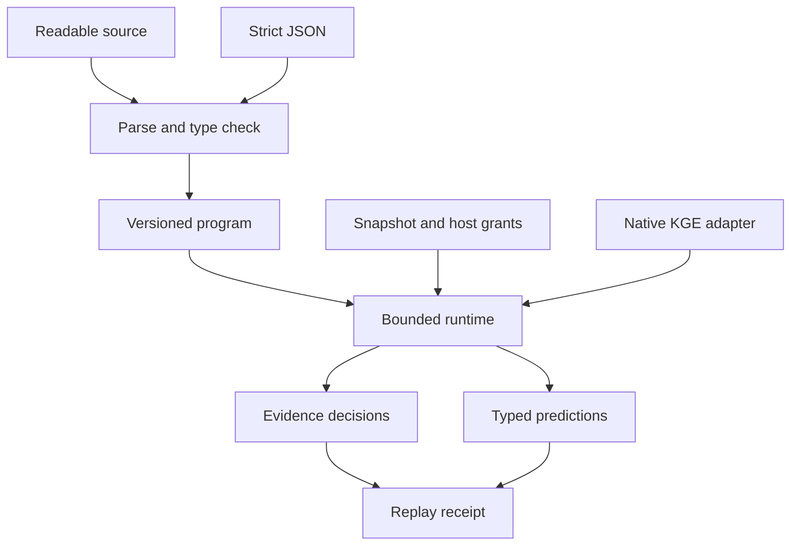

# RuGraph version 1 specification

Package version: 0.1.0. Wire version: 1. Status: executable reference implementation.

## Purpose and architecture

RuGraph describes bounded graph computations whose outputs preserve the
distinction between observations, derived evidence and model predictions.
Readable source and strict JSON share one typed Program representation. Rust,
JavaScript, TypeScript and Python execute the same Rust runtime.



The snapshot is immutable during one execution. The context supplies time and
capabilities. An embedded trusted predictor may perform model computation. The
core runtime has no ambient network, filesystem, shell, clock or provider access.

## Surface syntax

```text
program NAME {
  effect graph.read;
  effect model.predict;
  effect decision.emit;
  budget UNSIGNED_INTEGER;
  let NAME = OPERATION;
  ...
  emit NAME;
}
```

`//` comments end at newline. Strings use JSON quoting and escaping. Identifiers
match `[A-Za-z_][A-Za-z0-9_]*` and contain at most 128 bytes. Binding definitions
are ordered and unique. References must point to earlier bindings. A program
has one final emit. Effect declarations cannot repeat. The compiler rejects
unknown versions, fields, syntax, operators and type flows.

| Operation | Text arguments | Static result |
|---|---|---|
| nodes | `"label"` | Nodes |
| select | `["id", ...]` | Nodes |
| traverse | `binding "relation" depth integer` | Nodes |
| similar | `binding [finite_float, ...] top integer` | Nodes |
| observe | `binding "predicate" within integer` | Observations |
| infer | `[binding, ...] using ["rule_id", ...]` | Derived evidence |
| predict | `binding "relation" model "model_id" top integer` | Predictions |
| assess | `binding` | Decisions |

Traversal, similarity, observation and prediction consume nodes. Inference and
assessment consume observations or derived evidence. Only decisions or
predictions can be emitted. Programs declare `decision.emit`; graph operations
declare `graph.read`; prediction additionally declares `model.predict`.

JSON schema is the public Rust types in
[`types.rs`](../../../crates/ruvector-language/src/types.rs). JSON steps flatten
their operation, for example:

```json
{
  "version": 1,
  "name": "observe_service",
  "effects": ["graph.read", "decision.emit"],
  "budget": 100000,
  "steps": [
    {"bind": "n", "op": "select", "ids": ["api"]},
    {"bind": "e", "op": "observe", "input": "n", "predicate": "Failing", "within": 300},
    {"bind": "d", "op": "assess", "input": "e"}
  ],
  "emit": "d"
}
```

Duplicate keys, including nested or escaped duplicates, fail before typed
deserialization. Duplicate effects fail before set conversion. Generic JSON
input is at most 16 MiB with depth 64; programs are at most 1 MiB. The compiler
also enforces a 1 MiB serialized limit for Rust constructed programs.

## Graph semantics

Nodes have an ID, one label, JSON properties and an optional finite f32 vector.
Binary edges reference existing endpoints and have an ID and relation. Duplicate
record IDs and dangling edges are invalid. Selecting an unknown ID fails.

Traversal follows outgoing edges with the specified relation, includes the
seeds at distance zero, deduplicates nodes and terminates on cycles. Similarity
uses exact cosine ranking with stable ID tie breaks. It rejects a zero query or
dimension mismatch, and skips missing or zero candidate vectors. Exhaustive
ranking is bounded by work and result limits.

## Evidence and time

An observation has a signed boolean value, subject, predicate, source, unique ID,
observation time and expiry. It is live only when:

```text
observed_at <= now < expires_at
now - observed_at <= within
```

Freshness contributes an effective expiry of
`min(expires_at, observed_at + within + 1)`, with saturating integer arithmetic.
All timestamps and windows use one host chosen integer unit; examples use seconds.
The runtime never invents a wall clock value.

The evidence domain retains every selected subject and requested predicate even
when no observation matches. Assessment yields:

| Positive support | Negative support | Status |
|---|---|---|
| Yes | No | supported |
| No | Yes | refuted |
| Yes | Yes | conflicting |
| No | No | unknown |

These statuses describe admitted evidence, not objective truth or probabilities.
A source identifier provides lineage; it does not authenticate or establish
independence of the source.

## Rules and retraction

Rules are finite conjunctions of explicitly signed predicates about the same
subject. Their conclusions are signed predicates. Inference computes a fixed
point over selected rules and input evidence; absence never satisfies a negative
premise. Unsupported cycles cannot create evidence.

Original observations remain distinct witnesses. A new supported signed fact
receives one deterministic canonical derivation, preserving the union of original
observation IDs, source IDs and rule IDs and the minimum expiry of its premises.
This does not enumerate every alternative proof. Input domains remain present
and selected rule conclusions add domains even when unsupported.

Each execution recomputes from its snapshot and clock. Deletion and expiry
therefore retract dependent conclusions without an incremental cache. Another
surviving witness can replace a deleted canonical witness on the next execution.

## Predictions and model lifecycle

The native adapter uses actual RuVector HolE or RotatE scoring over all entities
in a validated model vocabulary. A batch records model name, revision, artifact
hash, exact ranking flag, work and candidates. Prediction objects may refer to
entities outside the graph snapshot. They remain predictions and cannot become
evidence through inference or assessment.

Offline training uses the native Trainer, explicit split data, seed and bounded
configuration. Evaluation rejects train/evaluation overlap and unseen vocabulary.
Promotion is an explicit operation producing a new model bundle. Hashes and
metrics inside imported candidate files are not authenticated; the operator must
trust their producer or rerun the evaluation. No online self modification occurs.

## Execution authority and bounds

The program's declared effects must be a subset of host granted capabilities.
Execution charges deterministic units against
`min(program.budget, context.max_steps)`. These units account for validation,
indexing, scans, graph expansion, vector arithmetic, sorting, rule work,
provenance and native scoring. They are not milliseconds or exact CPU cycles.
Bounded parsing and static checking occur before runtime accounting.

| Boundary | Version 1 ceiling |
|---|---|
| Program operations | 1,024 |
| Vector dimensions | 4,096 |
| Traversal depth | 64 |
| Program list length or top k | 10,000 |
| Program or host work budget | 1,000,000,000 |
| Snapshot records combined | 100,000 |
| Snapshot serialized bytes | 16 MiB |
| Property nesting | 32 |
| Property values or rule premises | 100,000 each |
| Host result limit | 1 through 100,000 |
| Retained binding payload estimate | 16 MiB |

Result and provenance limits apply separately to collection sizes and reference
counts. Host configured result limits can be substantially lower than hard
ceilings. All error paths discard intermediate results. Bounds limit admitted
data and algorithmic work; they are not a formal memory safety or termination
proof for arbitrary host supplied Predictor code. Process clients additionally
apply timeout and output limits.

## Canonicalization and replay

Program struct field order and effect set order are fixed. Operation and program
array order are significant. Snapshot records are sorted by ID, rule premises
are sorted, and property object keys are recursively sorted; property arrays
retain order. This makes record insertion order and object key insertion order
irrelevant without claiming algebraic equivalence between distinct programs.

The receipt contains version, program/snapshot/context SHA256 hashes, snapshot
revision, logical time, work and typed output. Its checksum excludes the
`receipt_hash` field. Verification checks integrity only. Replay reexecutes and
requires complete receipt equality. Hashes are not signatures or evidence of
empirical truth. Pin the implementation and floating point environment for
archival reproducibility; cross platform FFT equality is not guaranteed.

## Deliberate exclusions

This version does not implement arbitrary graph mutation, tool calls, LLM
orchestration, probabilistic inference, automatic confidence calibration,
cross subject rule variables, incremental truth maintenance, distributed
execution, ANN planning, general purpose loops or a native code compiler.
It is a complete implementation of the bounded language specified here.

## Host counterfactual audit extension

The additive audit API does not add a language operation or change receipt wire
version 1. See [ADR-GL-006](../../adr/ADR-GL-006-bounded-counterfactual-audits.md)
for its separate version 1 report contract and [FRONTIER.md](FRONTIER.md) for CLI
and SDK examples. Audit is restricted to decision programs without prediction
steps. Each intervention is independent of the others.

## Prepared Rust host execution

`runtime::PreparedSnapshot` borrows a validated immutable snapshot and reuses its
indexes and canonical hash across queries. It changes actual preparation cost,
not language semantics or deterministic work. Every query uses fresh program,
context and optional provider calls. Complete receipts match ordinary execution.
This is not a process SDK cache or incremental graph update facility. See
[ADR-GL-007](../../adr/ADR-GL-007-immutable-prepared-snapshots.md).
