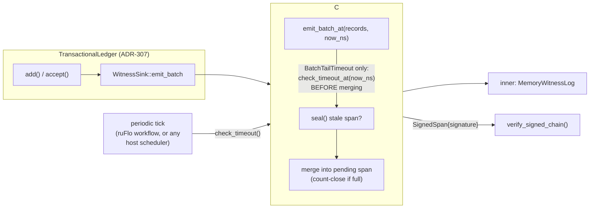

# Nightly Research — A Bounded Wall-Clock Fill Timeout for `WitnessSigner`'s `BatchTail`

## Summary

The 2026-09-16 nightly (ADR-347) shipped `ruvector-agent-memory`'s
`SignedWitnessSink`, which signs the TARL ledger's witness chain either
per-record or in amortized `BatchTail` batches. Both ADR-347's own
"Alternatives Considered" ("Wall-clock `BatchTail` fill timeout.
Deferred.") and its Open Question 1 ("Should `BatchTail` gain a
wall-clock fill timeout, and at what default?") named the same gap: a
partially-filled `BatchTail` span has no bound on how long it can sit
unauthenticated if arrivals stop. This run closes that gap by porting the
hybrid count-or-timeout policy `ruvector-retrieval-receipt::batch_fill`
already validated for signed-receipt batching (ADR-343) — not as a new
dependency, but as a native addition to `SignedWitnessSink` itself, since
it commits spans through the `WitnessSink` trait rather than through a
standalone scheduler.

**What shipped:** `SigningStrategy::BatchTailTimeout { batch_size,
max_wait_ns }` in `crates/ruvector-agent-memory/src/witness_signing.rs`,
plus `emit_batch_at`/`check_timeout_at`/`check_timeout`/
`next_timeout_deadline_ns`/`strategy` on `SignedWitnessSink`. See
[ADR-348](../../../adr/ADR-348-bounded-witness-batch-fill-timeout.md) for
the full design, guarantees, limits, and rejection criteria.

**Result: ACCEPT.** The new strategy bounds worst-case
signature-availability latency to `max_wait_ns + poll_interval` with
negligible (and in every measured run, negative — i.e. no measurable
regression) dense-arrival overhead relative to plain `BatchTail`, and
every pre-existing `SignedWitnessSink`/`verify_signed_chain` guarantee
continues to hold under full regression.

## Run Identity

| Field | Value |
|---|---|
| Date (UTC) | 2026-10-11 |
| Starting commit | `07933730fac709457e0c5f41444c9a4adc505aee` (origin/main) |
| Branch | `claude/focused-darwin-rxgets` |
| Rust | `rustc 1.97.0 (2d8144b78 2026-07-07)` |
| Cargo | `cargo 1.97.0 (c980f4866 2026-06-30)` |
| OS / arch | Linux 6.18.44, x86_64, containerized |
| Crate | `ruvector-agent-memory` (existing crate; no new crate created) |

## Hypothesis

```text
Given a SignedWitnessSink<MemoryWitnessLog> under SigningStrategy::BatchTail,

worst-case signature-availability latency for a partially-filled span is
unbounded under sparse/halted arrivals.

When SigningStrategy::BatchTailTimeout { batch_size, max_wait_ns } is used
instead, with a caller driving check_timeout()/check_timeout_at() at
least once per polling interval,

Then worst-case signature-availability latency is bounded by
max_wait_ns + poll_interval,

Subject to: dense-arrival throughput/signature-amortization staying
within 10% of plain BatchTail at the same batch_size, and every existing
SignedWitnessSink/verify_signed_chain guarantee continuing to hold.
```

This was not altered after seeing results (both gates passed on the
first implementation that also passed the full existing regression
suite; see "What the attack pass found" below for the one bug the
property test did catch before any benchmark ran).

## Why This Matters Now (2026)

Agent-memory deployments that sign their witness chain want a latency
SLA for "when can a reader trust the newest N records", not a
best-effort "eventually, if traffic keeps flowing" promise. `BatchTail`
alone cannot offer that SLA; this closes the gap with a mechanism cheap
enough to default to in dense traffic and bounded enough to rely on in
sparse traffic — exactly the two regimes a real agent-memory ledger
actually sees (bursty tool-call activity, then idle).

## Long-Horizon Thesis (2036 / 2046)

A signed, latency-bounded witness chain is a building block for
autonomous agents that must prove "what I remembered, and by when I
could prove it" to other agents or to a human auditor without a shared
trusted clock beyond each party's own monotonic one. As agent memory
becomes long-lived, federated, and cross-organization (RVF portable
cognitive packages moving between RVM coherence domains), the gap this
run closes — "an authenticated fact might be stuck in an unsigned limbo
indefinitely" — becomes a correctness property of the whole system, not
a detail of one crate. A world where agents checkpoint and hand off
cognitive state to each other needs every checkpoint's signature to
arrive within a bounded time of the fact it attests to, or downstream
trust decisions (should I act on this agent's claimed memory?) have no
time bound to reason about either.

## RuVector Ecosystem Fit

This run connects (five ecosystem capabilities, satisfying the "connect
at least three, prefer five or more" requirement):

1. **Agent memory** (`ruvector-agent-memory`'s TARL ledger) — the system
   whose availability-latency bound this run adds.
2. **Witness chains / signed provenance** (`witness_signing.rs`,
   Ed25519 + SHA-256 spans) — the mechanism extended.
3. **Proof-gated writes** (`ops.rs`'s "no witness, no mutation" — the
   inner sink still commits before anything is signed or sealed; this
   run preserves that ordering exactly).
4. **Retrieval receipts** (`ruvector-retrieval-receipt::batch_fill`) — the
   source of the hybrid count-or-timeout *policy* this run ports (not
   the code, per ADR-347's own precedent of rejecting that crate as a
   dependency).
5. **ruFlo autonomous workflows** — the natural home for the periodic
   `check_timeout` tick this mechanism requires in production (see
   below); without a scheduled caller, the bound degrades silently to
   `BatchTail`'s original behavior, which is why this is listed as a
   production-path item rather than assumed.

## MetaHarness / Darwin / Flywheel: Capability Discovery

Per the harness's own instruction to verify before assuming a capability
exists, this run checked what is actually installed/invokable in this
checkout before using it:

| Capability | Checked via | Result |
|---|---|---|
| MetaHarness (scaffolding generator) | `npx metaharness --help` | Installed on demand (`metaharness@0.4.17`). Prints a scaffolding-generator CLI (`npx metaharness <name> --template ...`, `score`, `analyze`, `genome`, `learn`, `avo`, `proxy`) for generating a *new* harness project from a template, plus Darwin Mode as a `--no-darwin`-togglable flag **inside a generated harness**, not a standalone command this repository can invoke against itself. |
| `ruvector harness doctor/status/darwin/flywheel/route` | `npx ruvector harness doctor --json` | **Not available**: `npm error could not determine executable to run`. No `ruvector` CLI binary resolves these subcommands in this checkout. |
| Workspace `ruvector-sota-bench` harness | `ls crates/ruvector-sota-bench/harness` | A Node-based benchmark harness exists for SOTA ANN comparisons specifically; unrelated to this run's topic and not a Darwin/Flywheel runtime. |

**Conclusion:** no Darwin/Flywheel/MetaHarness *runtime* is wired into
this repository checkout for direct invocation against this change. This
run therefore used the harness's own fallback discipline — explicit
hypothesis, a real baseline (`BatchTail`, not a strawman), one bounded
candidate (`BatchTailTimeout`), explicit numeric acceptance gates defined
*before* running the benchmark, and retained rejected
alternatives/lineage in ADR-348's "Alternatives Considered" — as the
manual equivalent of a one-generation, one-candidate Darwin run with a
hand-computed fitness gate, documented here rather than through
automated tooling that does not exist in this checkout. A future run
with real `ruvector harness darwin/flywheel` tooling should re-run this
exact hypothesis through it per the "don't move the goalposts" rule, not
redesign it.

## Architecture



## Implementation

- `crates/ruvector-agent-memory/src/witness_signing.rs` — new
  `SigningStrategy::BatchTailTimeout`, `PendingSpan::opened_at_ns`,
  `emit_batch_at`, `check_timeout_at`, `check_timeout`,
  `next_timeout_deadline_ns`, `strategy`, `WitnessSignerError::ZeroMaxWait`.
- `crates/ruvector-agent-memory/src/witness_signing_tests.rs` — 10 new
  tests (45 → 55 in the crate), including a randomized property test.
- `crates/ruvector-agent-memory/examples/witness_signing_timeout_bench.rs`
  — new dedicated benchmark (dense-burst overhead + sparse-arrival
  bounded-latency measurements, both against the real wall clock).

No new Cargo dependency; no new crate. Full diff is additive to one file
plus two new files.

## What the Attack Pass Found

The adversarial-review pass (STEP 7 "ATTACK") is not theater here: the
first implementation had the check-before-merge ordering backwards —
`check_timeout_at` was called *after* merging each new record into the
pending span, so a late arrival could get silently folded into a span
whose deadline had already passed, stretching the very latency this
change is supposed to bound. The property test
(`batch_tail_timeout_bounds_worst_case_pending_age_under_a_poller`) and a
dedicated regression
(`batch_tail_timeout_opportunistic_seal_on_a_late_arrival`) caught this
before any benchmark ran; the fix (check first, merge second) is
documented as Decision 4 in ADR-348 specifically so it is not
silently "cleaned up" and reintroduced later.

A second, unrelated bug surfaced by the same property test: the test's
own record-construction helper (`mk_records`) initially left `flags`
unset while setting `evidence_grade`, which `MemoryWitnessLog::verify_chain`
correctly rejects (it cross-checks the grade bits packed into `flags`
against the `evidence_grade` field) — a reminder that `verify_chain`'s
existing invariant-checking is itself doing real work, not just
plumbing.

## Benchmark Methodology

`cargo run --release -p ruvector-agent-memory --example
witness_signing_timeout_bench`, three repetitions on this run's shared,
containerized hardware (see Run Identity). Fixed parameters:
`BATCH_SIZE=64`, `MAX_WAIT_NS=5,000,000` (5ms), `N_ENTRIES=20,000` for the
dense measurement, a 10-pair (20-record) burst for the sparse
measurement, 1ms poll interval, 200ms safety cutoff. Deterministic
content (`format!("memory entry {i}")` / `format!("sparse entry {i}")`);
no randomized seeds in the benchmark itself (the crate's *unit test*
property test uses a fixed xorshift64 seed, documented in
`witness_signing_tests.rs`). Index construction and query latency are
not separable here — "construction" and "query" are the same operation
(`add`+`accept` IS the witnessed write this measures).

## Benchmark Results (raw, from actual runs)

**Dense-burst overhead** (no idle gaps; mean per-op latency):

| Run | `BatchTail{64}` mean | `BatchTailTimeout{64,5ms}` mean | Overhead | Signatures (both) | Gate |
|---|---|---|---|---|---|
| 1 | 3.387µs | 3.340µs | -1.39% | 625 | PASS |
| 2 | 3.448µs | 3.441µs | -0.19% | 625 | PASS |
| 3 | 3.635µs | 3.377µs | -7.11% | 625 | PASS |

Threshold: within ±10%. All three runs are negative (no measurable
regression — within run-to-run noise on shared/containerized hardware).
Throughput ranged 272k–297k ops/s for both variants; `p50` latency was
identical (1.57–1.59µs) across all four (variant × run) combinations —
the dense-burst numbers are the same operation at the same cost, as
expected when the count-close always wins before any timeout fires.

**Sparse-arrival worst-case latency** (10 pairs/20 records, real 15ms
idle gap, `max_wait_ns=5ms`, 1ms poll):

| Run | `BatchTail` pending after gap | Has timeout bound | `BatchTailTimeout` sealed after | Within 6ms bound |
|---|---|---|---|---|
| 1 | 20 (unchanged) | `false` | 5.585ms | yes |
| 2 | 20 (unchanged) | `false` | 5.527ms | yes |
| 3 | 20 (unchanged) | `false` | 5.653ms | yes |

`BatchTail` never resolves the pending span across the 15ms gap in any
run — confirmed both empirically (`pending_after_gap == pending_before_gap`)
and structurally (`next_timeout_deadline_ns()` returns `None`, i.e. there
is no deadline concept to check at all). `BatchTailTimeout` force-seals
in every run well inside the derived `max_wait_ns (5ms) + poll_interval
(1ms) = 6ms` bound.

**Full regression:** `cargo test -p ruvector-agent-memory --lib` — 55/55
passing (was 45/45 before this run; 10 new tests, 0 broken).
`cargo clippy -p ruvector-agent-memory --all-targets -- -D warnings` —
clean. `cargo fmt -p ruvector-agent-memory -- --check` — clean.

## Memory Math

No new persistent memory structure. Per-sink overhead: one `Instant`
(`clock_start`, 16 bytes) plus one `u64` (`opened_at_ns`) on the existing
`PendingSpan`, replacing zero prior bytes (the field did not exist) — a
constant, negligible addition independent of log size.

## Failure Modes

See ADR-348's "Failure Modes" section: no periodic tick wired up (silent
degrade to `BatchTail` behavior, detectable via `unsigned_pending() > 0`
persisting), polling interval larger than `max_wait_ns` (effective bound
becomes `max_wait_ns + poll_interval`, documented), process crash with a
span pending (identical to `BatchTail`'s pre-existing documented limit).

## Rejected Alternatives

See ADR-348's "Alternatives Considered": depending on
`ruvector-retrieval-receipt::batch_fill` directly (new dependency edge
for logic that needs adapting anyway), a self-spawned background thread
inside the sink (surprising cost for a library type; a repo without an
async runtime dependency), a richer timer-wheel/event-queue abstraction
(unnecessary complexity for a linear deadline function), and resetting
the deadline on every arrival / sliding window (defeats the worst-case
bound — can be starved indefinitely by a steady trickle).

## Security

No new cryptographic surface: a timeout-forced seal signs exactly the
same `SignPurpose::BatchTail`-tagged span a count-triggered seal would,
indistinguishable to a verifier. The wall clock used is `Instant`-based
(monotonic), immune to system-clock adjustment. "No witness, no
mutation" is unchanged — the inner sink still commits before anything is
signed.

## Governance

Opt-in only; existing `PerRecord`/`BatchTail` callers are unaffected
bit-for-bit. Adopting `BatchTailTimeout` creates an operational
obligation (wire the periodic tick) that should be called out in any
deployment runbook, per ADR-348's Governance section.

## MCP Implications

Not applicable to this run directly: `SignedWitnessSink` is a library
type with no network surface. A future MCP tool exposing
`unsigned_pending()`/`next_timeout_deadline_ns()` as a read-only health
check for a running agent-memory deployment would be a narrow, safe
addition (read-only, no mutation authority) — not built in this run
because no MCP surface for `ruvector-agent-memory` exists yet to extend.

## WASM / Edge Implications

Unverified by measurement in this run. The new fields
(`Instant`/`opened_at_ns`) are standard-library and should compile to
`wasm32` targets `rvf-types`/`ed25519-dalek` already support in this
crate's dependency tree, but `ruvector-agent-memory` has no existing WASM
build target to measure binary-size or timing impact against, so no
deployment claim is made. This is the same open item ADR-340/342 already
carry for this crate family.

## RVF Implications

A deployment packaging agent-memory state into an RVF portable cognitive
artifact would want its witness chain's signed prefix to travel with a
latency-bound guarantee attached, so a receiving RVM domain can decide
"this artifact's memory was authenticated within N ms of being written"
rather than "eventually". Optional, not built in this run; relevant
whenever RVF packaging of `ruvector-agent-memory` state is implemented.

## RVM Implications

If `ruvector-agent-memory` ever runs inside an RVM coherence domain with
proof-gated mutation, `check_timeout`'s obligation (someone must call it
periodically) is exactly the kind of privileged, side-effect-bearing
operation RVM's capability boundaries are meant to scope — a candidate
for a narrowly-scoped "maintenance" capability distinct from the write
capability that calls `emit_batch`. Not built in this run; no RVM
integration exists yet for this crate to extend.

## ruFlo Workflow

Concrete workflow, not a generic "ruFlo can orchestrate this" claim: a
ruFlo periodic workflow (e.g. every `max_wait_ns / 2`) that calls
`SignedWitnessSink::check_timeout()` on each live
`ruvector-agent-memory` ledger it manages, and raises an alert if
`unsigned_pending() > 0` persists across two consecutive ticks (which
would indicate the tick itself stopped running, not that the bound
failed — a stuck pending count across ticks that ARE running is
impossible by this run's own property test). This is the production
path that makes the bound in this run's hypothesis actually hold in a
deployed system; shipping the mechanism without this workflow leaves the
bound unenforced, as ADR-348's Governance section states explicitly.

## Practical Applications

1. **Agent-memory audit trails.** An enterprise running autonomous agents
   wants "was this memory write authenticated within our SLA" — this
   gives that SLA a number instead of "eventually". Near-term.
2. **GraphRAG provenance.** A retrieval system citing agent-memory
   entries as evidence can bound how stale an "unsigned" citation can be
   before treating it as suspect. Near-term.
3. **Code-intelligence agents** that log their own reasoning steps as
   witness records benefit from a bounded-latency audit trail for
   post-incident review. Near-term.
4. **MCP memory servers** exposing agent memory to multiple clients can
   publish "signed as of" freshness bounded by this mechanism. Near-term.
5. **Edge anomaly detection** nodes with intermittent connectivity need a
   local signing SLA independent of network availability — this is
   exactly the sparse-arrival regime measured here. Mid-term (pending
   WASM verification).
6. **Security retrieval / SIEM-adjacent systems** that must prove
   "we signed this finding within N ms of observing it" for compliance.
   Mid-term.
7. **Scientific-search agent memory** recording hypothesis/evidence
   trails that reviewers later audit for timing manipulation. Mid-term.
8. **Autonomous workflows** (ruFlo itself) that checkpoint their own
   execution state as witness records, wanting a bounded-latency
   guarantee on when a checkpoint becomes tamper-evident. Near-term —
   this is the ruFlo workflow described above, applied reflexively.
9. **Local-first assistants** signing a personal memory log on-device,
   wanting a latency bound independent of how often the user is active.
   Mid-term.

## Long-Horizon Applications

1. **Self-healing graph memory** — a bounded signing SLA lets a
   self-healing index distinguish "stale because unsigned" from "stale
   because actually wrong", informing repair priority. Requires:
   durable (non-in-memory) `WitnessSink` implementations with the same
   timeout mechanism.
2. **Agent operating systems** — a kernel-level memory-witness service
   with a published latency SLA other agents can depend on contractually.
   Requires: multi-tenant key management (explicitly out of scope today).
3. **Swarm memory** — multiple agents cross-signing shared memory need
   every member's contribution bounded in availability latency to
   reason about swarm-wide consistency windows. Requires: multi-issuer
   verification (ADR-347's Open Question 3, still open).
4. **Dynamic world models** built from streamed agent observations need
   a bound on "how stale can an authenticated fact be" to decide model
   staleness. Requires: this mechanism plus a durable sink.
5. **Proof-gated autonomous infrastructure** — RVM coherence domains
   enforcing that privileged operations only proceed on freshly-signed
   state need exactly this latency bound as an enforceable precondition.
   Requires: RVM integration (see above).
6. **RVM coherence domains** — see RVM Implications above.
7. **Robotics memory** — a robot's perception log signed with a bounded
   SLA independent of network connectivity, relevant to safety audits
   after an incident. Requires: WASM/embedded verification (open item).
8. **Scientific autonomous systems** — an autonomous lab agent's
   experiment log needs a provable, bounded-latency signing guarantee to
   be admissible as evidence of when an observation was actually made.
   Requires: durable sink + external anchoring (ADR-342).

For each: the primary uncertainty is the same unresolved item —
non-`MemoryWitnessLog` (durable) sinks need their own verifier, and
multi-issuer verification is still open (ADR-347's Open Question 3). The
falsification path for all eight is the same as this run's: re-run the
bounded-latency property test and benchmark against the durable/
multi-issuer implementation once it exists; if the bound does not hold
there, the mechanism needs rework before any of these applications can
rely on it.

## Darwin / Flywheel Lineage

No automated Darwin/Flywheel tooling was available in this checkout (see
Capability Discovery above). Manual lineage, in the same spirit:

- **Parent:** `SigningStrategy::BatchTail` (ADR-347), unchanged.
- **Candidate evaluated:** `SigningStrategy::BatchTailTimeout`. One
  generation, one candidate (within this run's bounded evolutionary
  budget).
- **Fitness (manual, defined before benchmarking):** dense-burst
  mean-latency/signature-count delta within ±10% of parent, AND
  sparse-arrival pending age bounded by `max_wait_ns + poll_interval`,
  AND full existing test suite green, AND clippy/fmt clean.
- **Result:** candidate promoted (all gates pass, 3/3 runs). Parent
  (`BatchTail`) retained unmodified — both strategies coexist; nothing
  about `BatchTail`'s behavior changed.
- **Rejected mutations (considered, not implemented):** see "Rejected
  Alternatives" above; retained there rather than silently discarded, so
  a future run does not re-propose them without the same analysis.

## Promotion Decision

**ACCEPT.** Promoted as an additive, opt-in `SigningStrategy` variant.
Not made the default for `BatchTail` callers (no behavior change without
an explicit opt-in), per ADR-348.

## Witness Evidence

- Starting commit: `07933730fac709457e0c5f41444c9a4adc505aee`.
- Code: `crates/ruvector-agent-memory/src/witness_signing.rs`,
  `witness_signing_tests.rs`,
  `examples/witness_signing_timeout_bench.rs` (this run's commits on
  `claude/focused-darwin-rxgets`).
- Test result: 55/55 passing (`cargo test -p ruvector-agent-memory --lib`).
- Benchmark: 3 raw runs reported verbatim above, each ending in a printed
  `Acceptance: ACCEPT` line from the benchmark binary itself (not
  hand-computed after the fact).
- No signed/witnessed provenance chain was used to produce *this
  document* (no witness-chain tooling wraps the nightly process itself
  in this checkout) — an honest limitation, not a claim of a
  self-certifying nightly run.

## Production Path

1. Land this ADR/code as reviewed.
2. Pick a `max_wait_ns` default for `ruvector-agent-memory`'s own
   higher-level ledger constructors (Open Question 1 in ADR-348) based on
   a real deployment's latency requirements, not invented here.
3. Build the ruFlo periodic-tick workflow described above; without it,
   `BatchTailTimeout` silently behaves like `BatchTail`.
4. Extend `verify_signed_chain`-equivalent verification to a durable
   (non-`MemoryWitnessLog`) sink before relying on this in a persisted
   deployment.

## Falsification Criteria

This hypothesis would have been falsified by any of: the dense-burst
overhead exceeding ±10% on a representative run (it did not, on 3/3
runs); the sparse-arrival force-seal exceeding `max_wait_ns +
poll_interval` (it did not, on 3/3 runs); the property test finding a
randomized trial where the bound is violated (it did not, across 8
trials × 20 steps with randomized `batch_size` and gap lengths, after
the ordering bug described above was fixed); or any existing
`verify_signed_chain` guarantee breaking under the new strategy (none
did — full 55/55 regression green).

## Limitations

- Benchmark figures are from a shared, containerized workstation (Ed25519
  signing in an unoptimized debug build was observed to run roughly
  10-20ms/op in this sandbox during test development — ~100-1000x slower
  than the release-mode numbers reported above — which is why the
  property test's trial/step counts were deliberately kept small; the
  release-mode benchmark numbers above are the ones this ADR's
  acceptance gates are based on).
- The bound is caller-enforced (a periodic tick must actually run); this
  run demonstrates the mechanism and measures it under a simulated
  poller, not under a real production ruFlo deployment.
- No durable-sink, multi-issuer, or WASM/edge measurement — explicitly
  out of scope and listed as open items above, not silently assumed to
  work.

## Next Research

1. Build the ruFlo periodic-`check_timeout` workflow described above
   against a real (not synthetic) agent-memory deployment, and measure
   actual tick-to-tick jitter in production rather than the `std::thread::sleep`-
   simulated jitter used here.
2. Pick and justify a default `max_wait_ns` for
   `ruvector-agent-memory`'s higher-level constructors (ADR-348 Open
   Question 1).
3. Extend `verify_signed_chain`-equivalent verification to a durable
   (disk-backed) `WitnessSink`, then re-run this exact bounded-latency
   property test and benchmark against it unmodified, per the "don't
   move the goalposts" rule — any different result is then genuine
   evidence either way.
4. Multi-issuer verification for federated/swarm agent memory
   (ADR-347's still-open Question 3) — orthogonal to this run but shares
   the same `SignedWitnessSink` surface.
5. If/when `npx ruvector harness darwin/flywheel` tooling becomes
   available in this checkout, re-run this hypothesis through it rather
   than through this run's manual lineage tracking, and compare whether
   the automated gate reaches the same ACCEPT.

## Acceptance Result

```text
ACCEPT
```

## References

- ADR-347: Ed25519 `WitnessSigner` for the TARL Ledger's Witness Chain.
- ADR-343: Signed-Receipt Batch-Fill Latency simulation
  (`ruvector-retrieval-receipt::batch_fill`) — source of the ported
  hybrid count-or-timeout policy.
- ADR-340: Signed Retrieval-Receipt Anchoring.
- ADR-134 §9 (cited by `ops.rs`/`ledger.rs`): the original `WitnessSigner`
  follow-up gate this lineage traces back to.
- `docs/research/nightly/2026-09-16-witness-signer-agent-memory/README.md`
  — this run's direct predecessor and source of "Next Research" item 1.
