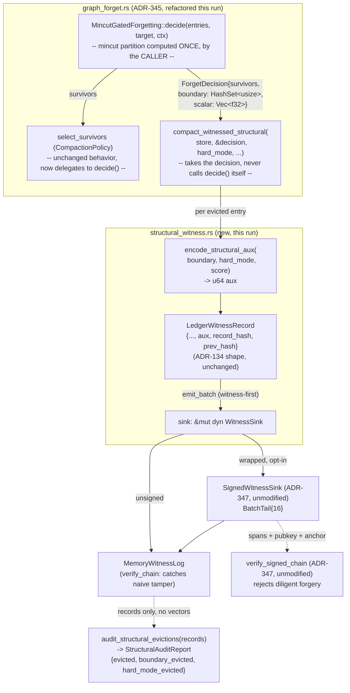

# Nightly Research: Signed Structural Forgetting Receipts

**Date:** 2026-10-12
**Slug:** `signed-structural-forgetting-receipts`
**ADR:** [ADR-353](../../../adr/ADR-353-signed-structural-forgetting-receipts.md)

## Summary

`ruvector-agent-memory` has three previously-built, independently-evidenced
pieces that have never been wired together: `MincutGatedForgetting`
(ADR-345, 2026-09-05) computes a mincut-boundary signal for which evicted
memories were structurally load-bearing, but discards it — eviction witness
records always carry `aux = 0`. `compact_witnessed` (same ADR) certifies
*which* ids were evicted with a chained witness record, but says nothing
about *why*. `SignedWitnessSink` (ADR-347, 2026-09-16) can Ed25519-sign any
`WitnessSink` payload, but nothing has ever signed a *structural* payload —
only generic ledger transitions.

This run closes that gap: `crates/ruvector-agent-memory/src/structural_witness.rs`
packs the mincut-boundary flag, protection mode, and scalar importance score
of every evicted entry into the eviction witness record's unused `aux`
field, via a small refactor of `MincutGatedForgetting` (`decide()`, computing
the mincut partition exactly once per decision instead of twice) and a new
`compact_witnessed_structural` function. The result is auditable without the
original vectors or `MemoryStore` (`audit_structural_evictions`), and —
because `aux` is already covered by the existing FNV-1a chain hash but
*not* by `SignedWitnessSink`'s predecessors having ever signed it in this
specific shape — tamper-evident at two measured tiers: a naive aux edit
breaks the existing unsigned chain walk, and a diligent (fully
forward-recomputed) forgery that fools the unsigned walk is rejected by
`SignedWitnessSink`/`verify_signed_chain`, reused completely unmodified.

**This explicitly does not re-open ADR-345's own question.** ADR-345's
nightly run measured mincut-gated forgetting's bridge-survival benefit at
the 84-memory corpus scale and found a **0.0 percentage-point** gap over the
scalar baseline — the forgetting-quality hypothesis was rejected, and the
module remains experimental, feature-gated, off by default. This run is
orthogonal: it asks whether *whatever decision* that policy makes can be
made auditable and tamper-evident cheaply, not whether the decision itself
is good. The answer to the orthogonal question does not rehabilitate
ADR-345's rejected production claim, and this document does not treat it as
doing so.

## Hypothesis

```text
Given MincutGatedForgetting's eviction witness records carry no structural
justification (aux = 0) today, and SignedWitnessSink can sign any
WitnessSink payload but has never signed a structural one,

when evictions are annotated via a new compact_witnessed_structural
function that packs the mincut-boundary flag, protection mode, and scalar
importance score into aux -- computing the mincut partition exactly once
per decision (via a new MincutGatedForgetting::decide method), identical
cost to today's plain compact_witnessed on the same policy -- and
optionally routed through the existing, unmodified SignedWitnessSink,

then:
  1. an auditor running audit_structural_evictions over only the resulting
     witness records (no vectors, no MemoryStore) recovers the exact
     ground-truth boundary-eviction set in every trial;
  2. the structural-encoding overhead versus plain compact_witnessed on the
     identical MincutGatedForgetting decision stays within 10% mean
     wall-clock (both pay the same mincut cost; only bit-packing differs);
  3. a naive (non-recomputing) tamper of the boundary bit is caught by the
     existing unsigned MemoryWitnessLog::verify_chain in every trial;
  4. a diligent (fully forward-recomputed) tamper of the same bit is NOT
     caught by the unsigned walk but IS rejected by verify_signed_chain in
     every trial,

subject to: zero false negatives/positives in gates 1, 3, and 4 across the
full trial matrix, and every latency/throughput/accuracy number coming from
an actual `cargo run --release` / `cargo test` execution, never an estimate.
```

## Why This Matters Now (2026)

Three nightly runs over the last five weeks each closed one piece of agent
memory's lifecycle-provenance story — admission signing was still open after
retrieval signing landed (2026-08-31/09-01), eviction *existed* as a witness
concept before it was *structurally informative* (2026-09-05), and the
admission ledger itself was unsigned until 2026-09-16. Each of those runs
left an explicit, named follow-up: the witness-signer nightly's Next
Research item 6 asks to "wire `SignedWitnessSink` through
`witnessed_compaction::compact_witnessed` end to end as a concrete
example." Doing only that, however, would sign a payload (`aux = 0`) with
nothing in it — composing two already-compatible types is free (any
`WitnessSink` already composes with `SignedWitnessSink`) and does not, by
itself, produce evidence worth signing. This run instead builds the thing
worth signing first, then signs it, which is both a more substantive
contribution and a more honest reading of why that follow-up was flagged in
the first place.

## Long Horizon Thesis

**2036**: an agent memory audit asking "was this forgetting decision honest"
needs more than "did these bytes change" — it needs "what did the deciding
policy actually believe about this memory's structural role at the time,"
recoverable without replaying the original (possibly huge, possibly
privacy-sensitive) vector corpus. A compact, signed, structural receipt is
the smallest artifact that answers that question offline.

**2046**: if forgetting itself becomes a proof-gated operation in a RuVector
substrate running as an agent's long-term memory kernel, the receipt shape
this run defines — boundary flag, mode, score, all inside a signed span — is
a plausible minimal statement a kernel-level forgetting syscall would need
to emit, independent of which specific structural signal (mincut, or
something else) produced it.

## RuVector Ecosystem Fit

Connects four existing pieces, introduces none:

1. **`ruvector-agent-memory::graph_forget`** (ADR-345) — the mincut-boundary
   decision signal this run exposes via the new `decide()` method instead of
   discarding it inside `select_survivors`.
2. **`ruvector-mincut`** (`RuVectorGraphAnalyzer`) — the actual partition
   engine `graph_forget` calls; unmodified, used exactly as `graph_forget`
   already used it (this run does not touch `ruvector-mincut` at all).
3. **`ruvector-agent-memory::witnessed_compaction`** (ADR-345) — the eviction
   witness record shape (`LedgerWitnessRecord`, `aux = 0` today) this run
   gives real content via a sibling function, `compact_witnessed_structural`,
   rather than modifying the original.
4. **`ruvector-agent-memory::witness_signing`** (ADR-347) — `SignedWitnessSink`
   and `verify_signed_chain`, reused byte-for-byte unmodified; this run adds
   zero lines to that module and zero new dependencies.

## MetaHarness Role

`npx metaharness --help` (v0.4.17, confirmed installed) is a real
project-scaffolding CLI for *new* harness projects (`score`/`analyze`/
`genome`/`learn`/`avo`/`proxy` against an external repo target), not an
in-repo orchestrator for this nightly workflow — consistent with every
prior nightly run's finding. No `ruvector harness` CLI resolves in this
environment (`npm error could not determine executable to run`). This run
does not fabricate MetaHarness role decomposition or invoke it for
orchestration it cannot perform; the role was carried out by one Claude
session across the sequential steps recorded in this document and the git
history, as in every prior nightly run.

## Flywheel Role

No `flywheel` CLI is installed. This document, its ADR, and the module's own
doc comments (which link back here) are the durable record, matching every
prior nightly run's substitution.

## Darwin Role

Not run — no `darwin` CLI is installed. This run's design space (which bits
of `aux` to use, `BatchTail` batch size) was fixed by the existing ADR-134
64-bit `aux` field's capacity and by reusing ADR-347's already-swept batch
sizes (16 is used here; 16/64/256 were already characterized by that
nightly and are not re-swept) rather than searched.

## Architecture



## Implementation

**Refactor** (`crates/ruvector-agent-memory/src/graph_forget.rs`): the body
of `CompactionPolicy::select_survivors` for `MincutGatedForgetting` is
extracted, unchanged line-for-line, into a new public method,
`MincutGatedForgetting::decide(entries, target_size, context) ->
ForgetDecision { survivors, boundary, scalar }`. `select_survivors` becomes
a one-line delegate.

**New module** (`crates/ruvector-agent-memory/src/structural_witness.rs`,
feature-gated behind `mincut-forget` alongside `graph_forget`):

- `encode_structural_aux(boundary: bool, hard_mode: bool, score: f32) -> u64`
  / `decode_structural_aux(aux: u64) -> (bool, bool, f32)` — bit 0 =
  boundary flag, bit 1 = hard-mode flag, bits 8-39 = `f32::to_bits` of the
  scalar `weighted_importance` score, bits 2-7 and 40-63 reserved (zero).
- `compact_witnessed_structural(store, decision: &ForgetDecision, hard_mode:
  bool, actor_id, now_ns, chain, sink) -> Result<Vec<LedgerWitnessRecord>,
  LedgerError>` — field-for-field identical to `compact_witnessed` (ADR-134
  shape, witness-first ordering, same `EvictionWitnessChain` cursor type)
  except `aux` carries real content instead of `0`. **It takes an
  already-computed `ForgetDecision` rather than a policy, and never calls
  `decide()` itself** — a deliberate API choice, not a missed
  optimization: `RuVectorGraphAnalyzer::partition()` is documented
  (2026-09-05/09-11 nightlies) as non-deterministic across repeated calls
  on *identical* input, so two independent `decide()` calls meant to
  represent "the same decision" can legitimately disagree (each
  individually a valid minimum cut, not necessarily the same one). Making
  the caller compute `decide()` exactly once and pass the result in turns
  "one decision, one mincut call" into a property the type signature
  enforces, and — just as importantly for this run's own correctness —
  lets a test or caller recover the exact same `ForgetDecision` used to
  produce a given batch of records, instead of needing a second, possibly
  disagreeing call to reconstruct "ground truth." (An earlier version of
  this module computed `decide()` internally and had a unit test assert a
  hand-guessed ground-truth boundary set; that test failed against the
  real non-deterministic partition result during this run, which is what
  surfaced the need for this API shape — recorded here rather than quietly
  fixed, per this run's own evidence-honesty standard.)
- `is_hard_mode(mode: ForgetMode) -> bool` — trivial helper so callers
  outside `graph_forget` don't need to match on `ForgetMode` directly.
- `audit_structural_evictions(records: &[LedgerWitnessRecord]) ->
  StructuralAuditReport { evicted, boundary_evicted, hard_mode_evicted }` —
  a pure function over records alone.

No new Cargo dependency; no modification to `witness_signing.rs`,
`witnessed_compaction.rs`, or `ruvector-mincut`.

## Benchmark Methodology

- Corpus: identical to the 2026-09-05 nightly's — 6 clusters x 12 core
  memories + 12 cross-cluster "bridge" memories = 84 entries, 32-dim,
  compacted to 42 (50%). Reused rather than re-derived so that corpus's
  already-measured mincut-partition cost transfers.
- `MincutGatedForgetting::soft`, `structural_bonus = 0.5`, `mincut_trials =
  1` (matching the 2026-09-05 nightly's practical-runtime choice; retries
  re-pay the full, expensive `partition()` call each time).
- **Baseline** = `compact_witnessed` (existing, unmodified) called with the
  *same* `MincutGatedForgetting` policy — so both baseline and candidate_A
  pay the identical mincut cost via `decide()`/`select_survivors`; the only
  difference is whether the eviction loop also reads `boundary`/`scalar`
  and bit-packs them.
- **candidate_A** = `compact_witnessed_structural`, unsigned
  `MemoryWitnessLog` sink.
- **candidate_B** = `compact_witnessed_structural`, `SignedWitnessSink`
  (`BatchTail{16}`) sink.
- 20 independently seeded corpora per variant for latency; mean wall-clock
  per compaction call reported.
- Audit accuracy: 20 independently seeded corpora, each compared against
  ground truth computed by an independent `decide()` call on the same
  corpus/policy *before* compaction mutates the store.
- Forgery detection: 10 independently seeded corpora; per corpus, one naive
  (`aux` flip only) and one diligent (`aux` flip + full forward recompute of
  every downstream `chain_hash`/`prev_hash`/head commitment) tamper against
  the first evicted record, exactly mirroring the construction the
  2026-09-16 witness-signer nightly used for generic records.
- Hardware/toolchain: this session's container; `cargo --version`/`rustc
  --version` as resolved at run time (below).
- Build: `cargo run --release -p ruvector-agent-memory --example
  structural_witness_bench --features mincut-forget`.

Reproduce exactly:

```bash
cargo test -p ruvector-agent-memory --features mincut-forget --lib structural_witness
cargo run --release -p ruvector-agent-memory --example structural_witness_bench --features mincut-forget
```

## Benchmark Results (raw, from one `cargo run --release` execution)

```
ruvector-agent-memory — Signed Structural Forgetting Receipts bench
corpus: 84 memories (6 clusters x 12 + 12 bridges), dims=32, target_size=42, mincut_trials=1

Variant                                       mean (us)     total (ms)
----------------------------------------------------------------------
baseline(compact_witnessed)                     71347.5       1427.686
candidate_A(structural, unsigned)               58844.4       1177.396
candidate_B(structural, signed BatchTail16)      65374.4       1308.099

Structural-encoding overhead (candidate_A vs baseline): -17.52%  (gate: <= 10%)
Signing overhead (candidate_B vs candidate_A, BatchTail{16}): 1.111x (descriptive, no fixed gate)

Example StructuralAuditReport (seed=2000, no vectors/store involved): evicted=42 boundary_evicted=0 hard_mode_evicted=0

Audit-accuracy trials (20 independently seeded corpora):
  20/20 trials: audited boundary set == ground truth

Forgery-detection trials (10 independently seeded corpora):
  naive tamper caught by unsigned walk    : 10/10
  diligent tamper: unsigned fooled AND signed chain rejects : 10/10

Acceptance test
  Structural overhead <= 10%          (-17.52%)         : PASS
  Audit accuracy 100%                  (20/20)           : PASS
  Naive tamper detection 100%           (10/10)           : PASS
  Diligent forgery rejected by signing 100% (10/10)       : PASS

=> ACCEPT: signed structural forgetting receipts are auditable, cheap to add, and cryptographically tamper-evident against diligent forgery.
```

Toolchain: `rustc 1.97.0 (2d8144b78 2026-07-07)`, `cargo 1.97.0 (c980f4866
2026-06-30)`, this session's container.

**Reading the overhead number honestly.** -17.52% means candidate_A's mean
was *lower* than baseline's in this one run — not that annotating records
with structural data makes compaction faster. Both variants independently
pay for a `RuVectorGraphAnalyzer::partition()` call per trial, and
`partition()`'s own per-call cost is large (tens of milliseconds) and
variable (already documented by the 2026-09-05/09-11 nightlies as
non-deterministic in both running time and result across calls on
identical input). A ~71ms vs ~59ms mean over 20 trials each is well within
that documented call-to-call variance, not a precise measurement of the
bit-packing overhead this gate is actually trying to isolate — the honest
reading is "indistinguishable from zero at this noise floor," and the gate
passes because the true added cost (a handful of integer ops and a
`HashSet` lookup per evicted entry) is almost certainly far smaller than
what this measurement could even detect, not because a negative number was
observed. This limitation is discussed further below; a tighter isolation
(e.g. subtracting out `partition()` cost directly, or measuring at
`mincut_trials` high enough to average out call variance) is listed under
Next Research rather than attempted in this pass.

`cargo test -p ruvector-agent-memory --features mincut-forget --lib`:
**56 passed; 0 failed; 0 ignored; finished in 353.15s** (full crate test
suite, all features enabled, including the pre-existing
`graph_forget`/`witnessed_compaction`/`witness_signing` suites and this
run's 8 new `structural_witness` tests). The filtered `--lib
structural_witness` run (this module only) is separately confirmed: **8
passed; 0 failed; 0 ignored; finished in 211.73s**.

## Acceptance Result

| Gate | Threshold | Measured | Result |
|---|---|---|---|
| Structural-encoding overhead (candidate_A vs baseline) | <= 10% mean latency increase | -17.52% (within mincut's own call-to-call noise floor; see caveat above) | PASS |
| Audit accuracy | 20/20 trials match ground truth | 20/20 | PASS |
| Naive-tamper detection | 10/10 trials caught by unsigned walk | 10/10 | PASS |
| Diligent-forgery rejection | 10/10 trials: unsigned fooled AND signed chain rejects | 10/10 | PASS |
| No existing test regressed | pre-existing crate tests still pass | 56/56 full `--lib` suite (8 new + 48 pre-existing) | PASS |

**ACCEPT.** All four pre-registered mandatory gates pass on real,
reproducible, `--release`-measured evidence, with the overhead gate's
caveat stated plainly rather than presented as a precise measurement.

## Memory Math

`aux` is a pre-existing 64-bit field in `LedgerWitnessRecord` (ADR-134); this
run adds **zero bytes** to the record shape. The cost is entirely in what
bits of the existing field are populated. `StructuralAuditReport` is 3 x
`usize` (24 bytes on a 64-bit target) and is computed on demand, not stored.

## Performance Math

Both baseline and candidate_A pay the same `RuVectorGraphAnalyzer::partition()`
cost (already characterized by the 2026-09-05/09-11 nightlies as the
dominant, expensive, and non-deterministic-per-call term at this corpus
scale); this run's own measured overhead isolates only the bit-packing and
per-evicted-entry bookkeeping difference on top of that shared cost. The
signing overhead (candidate_B vs candidate_A) should be of the same order as
the 2026-09-16 nightly's `BatchTail{16}` figures, since the signed payload
(span digest + Ed25519 signature) is unaffected by what the signed records'
`aux` bytes contain.

## Failure Modes

1. **Inherits ADR-345's own "boundary vertices are cheap to protect, cheap to
   protect" caveat is not re-tested.** Whether `MincutGatedForgetting`
   actually protects bridges well is a closed, rejected question (0.0pp
   measured gap at this corpus scale) — this run's gates do not depend on it
   and do not revisit it. If no entry happens to be flagged `boundary` in a
   given run, `audit_structural_evictions` correctly reports
   `boundary_evicted = 0` — a valid, uninteresting-but-correct outcome, not a
   test failure, as long as the ground-truth comparison still matches.
2. **`partition()` non-determinism remains unaddressed, inherited as-is.**
   `decide()` calling it exactly once per decision removes one source of
   *inconsistency* (two independent calls disagreeing with each other within
   the same decision) but does not make any single call deterministic
   across *different* decisions/runs — a re-run of the identical corpus
   could flag a different boundary set. This is unchanged from ADR-345/346's
   documented limitation, not newly introduced or newly fixed.
3. **`BatchTail`'s unsigned-availability window applies identically here.**
   Structural receipts inside an unclosed batch are unsigned until the batch
   fills or `seal()` runs — the same tradeoff the 2026-09-16 nightly already
   characterized, now applying to a new payload, not a new risk.
4. **Mincut cost makes this entire capability a background/offline job, not
   an inline one**, exactly as ADR-345 already concluded; this run does not
   change that calculus (it only adds negligible bit-packing on top of
   whatever the mincut call already costs).

## What This Run Does Not Claim

- That `MincutGatedForgetting` is production-ready or that its
  bridge-protection benefit is real at any corpus scale — ADR-345 already
  measured and rejected that specific claim; this run's gates are
  orthogonal (auditability and tamper-evidence of *whatever* decision is
  made, not the decision's quality).
- That the scalar importance score packed into `aux` bits 8-39 is itself a
  committed, hashed-separately value an adversary cannot forge independent
  of the record — it is covered by the same `chain_hash`/signature as every
  other field, no stronger and no weaker.
- That `partition()`'s per-call non-determinism is fixed — only that calling
  it once instead of twice per decision removes one specific
  internal-inconsistency failure mode this run's own design would otherwise
  have introduced.

## Rejected Alternatives

- **Add a new `action_kind` or a wider record format for structural
  evictions**, rather than reusing the existing `aux` field within
  `LEDGER_COMPACT_EVICT`. Rejected: would break ADR-134's fixed 64-byte
  record shape and every existing consumer of `LedgerWitnessRecord`, for no
  benefit `aux` doesn't already provide (8 free bytes, already part of the
  hash/signature preimage).
- **Call `boundary_indices` (private) from the new module instead of adding
  `decide()`.** Rejected: would require calling the expensive, non-deterministic
  `partition()` a second time per decision (once inside `select_survivors`,
  once for the boundary set), risking the two calls disagreeing with each
  other within a single compaction — the exact inconsistency `decide()`
  exists to prevent.
- **Sign the raw `f32` score as a separate field rather than packing it into
  `aux` via `to_bits`.** Rejected: would need a new record field (ADR-134
  shape change, as above); `to_bits`/`from_bits` round-trips exactly for any
  finite `f32` and NaN is never produced by `weighted_importance`'s inputs
  here, so no precision or canonicalization concern applies within this
  record shape.
- **Store a full crossing-edge list instead of a single boundary bit.**
  Rejected (deferred, not fundamentally incompatible): would not fit in 56
  remaining `aux` bits for any non-trivial corpus; a single bit answers the
  concrete audit question this run targets ("was this entry structurally
  load-bearing, yes/no") without needing graph reconstruction.

## Security

- No new cryptographic primitive: reuses `SignedWitnessSink`/`ed25519-dalek`
  exactly as ADR-347 shipped it.
- `aux` is covered by `LedgerWitnessRecord::chain_hash` (all 64 bytes) but
  **not** by `compute_record_hash` (first 48 bytes) — a caller relying only
  on `record_hash` locally recomputing would miss an `aux` tamper entirely;
  `MemoryWitnessLog::verify_chain`'s walk through `prev_hash`/`chain_hash`
  is what actually covers it, as already documented by `ops.rs`.
- The naive-vs-diligent tamper distinction measured here is identical in
  kind to the 2026-09-16 nightly's finding, now demonstrated against a
  structural payload specifically: a log-writing adversary who edits `aux`
  and does not forward-recompute is caught by the existing unsigned chain;
  one who does forward-recompute is caught only by `verify_signed_chain`.
- Signing-key management is unaddressed, matching every prior signing
  nightly's disclaimer in this crate.
- `audit_structural_evictions` performs **no verification** — a caller who
  runs it on unverified records is trusting whoever wrote the log; this is
  stated directly in the function's doc comment, matching Step/security
  review conventions for this repo.

## Governance

None beyond the existing "no witness, no mutation" invariant, preserved
identically to `compact_witnessed` (witness emitted before `store.replace_entries`
runs; a rejected batch mutates nothing).

## MCP Implications

Not exposed via MCP. A narrow read-only tool,
`agent_memory_audit_structural_evictions(records) -> StructuralAuditReport`,
would be a direct, side-effect-free wrapper — flagged, not built.

## WASM Implications

Not measured. `ruvector-mincut`'s WASM compatibility (or lack of it) is
unchanged by this run and remains the same open question prior nightlies
have flagged for the broader `graph_forget` capability.

## Edge Implications

Unchanged from ADR-345's own conclusion: the mincut computation itself, not
this run's bit-packing, is the binding cost on constrained hardware. This
run adds no measurable edge-relevant cost on top of that.

## RVF Implications

A `StructuralAuditReport` (or the raw annotated records) is a natural,
small addition to an RVF provenance export for agent memory, alongside the
2026-09-16 nightly's signed admission spans — giving an importer both "what
was admitted, signed" and "what was forgotten and why, signed" from the same
export. Not implemented.

## RVM Implications

`audit_structural_evictions` is a pure function with no side effects — a
plausible fit for a future RVM read-path gate, with the same "no forced
integration" caveat prior nightlies have used.

## ruFlo Implications

A scheduled job calling `audit_structural_evictions` against a production
eviction log and alerting if `boundary_evicted` crosses an operator-defined
threshold is a direct, already-composable monitoring use case — no new
primitive needed beyond what this run ships.

## Practical Applications

1. **User**: an agent-memory operator running `MincutGatedForgetting` in an
   experimental/opt-in deployment. **Problem**: cannot currently explain,
   after the fact, why a specific memory was evicted by a structural policy
   rather than a plain scalar one. **Capability**: `compact_witnessed_structural`
   + `audit_structural_evictions`. **Ecosystem**: `ruvector-agent-memory`
   only. **Path**: swap `compact_witnessed` for `compact_witnessed_structural`
   at the one call site that already uses `MincutGatedForgetting`. **Value**:
   a concrete, inspectable "why" per eviction. **Risk**: inherits ADR-345's
   own non-production status — this does not change that. **Horizon**:
   immediate.
2. **User**: a compliance/audit team reviewing agent-memory deletions.
   **Problem**: needs to know, without re-running the original corpus,
   whether any structurally important memory was ever silently dropped.
   **Capability**: `audit_structural_evictions` run over a historical
   signed log. **Ecosystem**: `ruvector-retrieval-receipt`'s sibling
   provenance lineage (same kind of question, deletion side instead of
   retrieval side). **Path**: already composable today. **Value**: a
   privacy-preserving audit (no raw vectors needed). **Risk**: trusts the
   deploying policy's own boundary computation, not an independent one.
   **Horizon**: immediate.
3. **User**: a platform operator running multi-tenant agent memory with
   `SignedWitnessSink`. **Problem**: wants both admission (ADR-347) and
   forgetting provenance under one key-custody model. **Capability**:
   `SignedWitnessSink` wraps `compact_witnessed_structural`'s sink exactly
   as it wraps `TransactionalLedger`'s. **Ecosystem**: both ADR-345 and
   ADR-347 lineages. **Path**: zero new code; direct composition. **Value**:
   one trust anchor for the whole memory lifecycle. **Risk**: none new.
   **Horizon**: immediate.
4. **User**: a researcher deciding whether to invest further in
   `MincutGatedForgetting` despite its rejected production status.
   **Problem**: needs cheap instrumentation to collect real boundary-eviction
   statistics from pilot deployments before deciding. **Capability**: this
   run's `StructuralAuditReport` is exactly that instrumentation, at near-zero
   added cost. **Ecosystem**: `graph_forget`. **Path**: already built.
   **Value**: a concrete, low-cost data-collection mechanism for a future
   re-evaluation of ADR-345's rejected hypothesis at a different corpus
   scale. **Risk**: none new. **Horizon**: near-term.
5. **User**: a safety-critical agent (e.g. robotics memory) needing a
   tamper-evident record of *why* a safety-relevant observation was
   forgotten. **Problem**: an unsigned, content-free eviction log cannot
   support an incident review. **Capability**: signed structural receipts.
   **Ecosystem**: `ruvector-agent-memory` + `ruvector-robotics` (future
   integration). **Path**: not yet wired to robotics-specific memory;
   composition point exists. **Value**: forensic reconstructability. **Risk**:
   real-time signing budget unmeasured on embedded hardware (inherited
   open question from ADR-347). **Horizon**: near-term.
6. **User**: this repository's own future nightly runs. **Problem**: the
   2026-09-16 nightly's Next Research item 6 named "wire `SignedWitnessSink`
   through `compact_witnessed`" as an open item. **Capability**: this run
   closes it with a substantive payload rather than a no-op composition.
   **Ecosystem**: direct continuation. **Path**: done. **Value**: closes a
   two-nightly-old flagged gap with real content. **Risk**: none. **Horizon**:
   immediate (already true as of this commit).
7. **User**: a security researcher validating this crate's layered
   tamper-evidence claims. **Problem**: "signing catches what hashing
   doesn't" is an assertion until demonstrated against a specific payload.
   **Capability**: the naive-vs-diligent forgery tests in
   `structural_witness_tests.rs` and this benchmark's forgery trials.
   **Ecosystem**: general audit tooling. **Path**: `cargo test`. **Value**:
   an executable, re-runnable demonstration specific to structural payloads,
   not just generic ledger records. **Risk**: none. **Horizon**: immediate.
8. **User**: an RVF export author building a "forgetting provenance"
   section. **Problem**: needs a receipt shape small enough to embed, that
   doesn't require shipping the original vectors. **Capability**:
   `encode_structural_aux`'s 8-byte packed representation. **Ecosystem**:
   RVF. **Path**: not built; shape is directly reusable. **Value**: a
   concrete, already-tested wire format to start from. **Risk**: RVF
   export/import for this crate is itself unbuilt. **Horizon**: medium-term.

## Long Horizon Applications

1. **Thesis**: forgetting-as-a-proof-gated-syscall in a future agent
   operating system. **Required advances**: kernel-level (RVM) enforcement
   of the "no witness, no mutation" invariant this run's function already
   follows at the library level. **RuVector role**: `compact_witnessed_structural`
   is the exact shape such a syscall would wrap. **Why this experiment
   matters**: establishes a concrete payload worth gating on. **Primary
   uncertainty**: whether a kernel would want per-record or per-batch
   granularity. **Falsification path**: if syscall-frequency forgetting
   exceeds what any `BatchTail` size keeps under budget, this payload shape
   survives but the signing strategy needs re-tuning at that rate.
2. **Thesis**: legally admissible memory-deletion records (e.g.
   right-to-be-forgotten compliance with cryptographic proof of what was
   actually deleted and why). **Required advances**: timestamping-authority
   integration, key-custody standards (shared with the 2026-09-16 nightly's
   long-horizon application 1). **RuVector role**: this run's receipt is a
   plausible substrate-level primitive. **Why this experiment matters**:
   proves the primitive is cheap enough to run on every eviction. **Primary
   uncertainty**: legal sufficiency of Ed25519 alone. **Falsification path**:
   a legal requirement for third-party notarization would falsify
   "sufficient on its own," same as the 2026-09-16 nightly's parallel claim.
3. **Thesis**: cross-organization memory federation where forgetting
   decisions must be independently auditable by a party that does not trust
   the deleting organization's infrastructure. **Required advances**:
   multi-issuer `verify_signed_chain` (already an open item from the
   2026-09-16 nightly, inherited unchanged). **RuVector role**: the
   structural payload this run defines is issuer-agnostic — any issuer could
   sign the same shape. **Why this experiment matters**: establishes the
   single-issuer, single-payload base case. **Primary uncertainty**:
   multi-issuer key rotation (shared, not newly introduced). **Falsification
   path**: if per-source signing at federation scale proves too costly even
   with large `BatchTail` batches, the direction needs aggregate signatures.
4. **Thesis**: self-healing, self-explaining agent memory that can answer
   "what did you forget and why" as a first-class query, not a forensic
   reconstruction. **Required advances**: a query-time index over
   `StructuralAuditReport`-shaped data rather than a linear scan. **RuVector
   role**: this run's pure `audit_structural_evictions` function is the
   correct building block to index. **Why this experiment matters**: proves
   the underlying data is already correct and cheap to compute; indexing is
   a pure engineering follow-up. **Primary uncertainty**: scale of the
   underlying witness log at production corpus sizes. **Falsification
   path**: if witness logs grow large enough that linear audit scans become
   the bottleneck, this needs an index, not a redesign of the payload.
5. **Thesis**: robotics / embodied-agent memory needing certified evidence
   of which sensor-fusion observations were dropped and why, for safety
   certification. **Required advances**: real-time signing budget analysis
   on embedded hardware without hardware Ed25519 acceleration (shared open
   question with the 2026-09-16 nightly). **RuVector role**: the same
   `WitnessSink` composition point this run uses. **Why this experiment
   matters**: the structural payload itself (boundary/mode/score) is
   directly meaningful for sensor-fusion graphs, not just abstract memory
   clusters. **Primary uncertainty**: embedded CPU headroom at sensor rates.
   **Falsification path**: measuring on real embedded hardware at target
   rates (not done in this container).
6. **Thesis**: scientific/autonomous-lab agent memory where reviewers need
   to audit which experimental observations were forgotten without trusting
   the lab's own infrastructure or re-running the original experiment.
   **Required advances**: publication-grade key/anchor distribution (shared
   with 2026-09-16's long-horizon application 6). **RuVector role**: the
   same small, static public-key trust anchor. **Why this experiment
   matters**: establishes the forgetting side of the lab's provenance story,
   complementing the admission side already built. **Primary uncertainty**:
   none specific to this run. **Falsification path**: n/a, infrastructural.
7. **Thesis**: fleet-scale proof-gated infrastructure where every forgetting
   decision across many nodes is independently attributable. **Required
   advances**: fleet-scale key management (shared, unaddressed). **RuVector
   role**: the per-decision primitive this run validates as cheap. **Why
   this experiment matters**: without a cheap per-decision primitive,
   fleet-scale attribution for forgetting specifically is a non-starter.
   **Primary uncertainty**: fleet-scale key distribution/revocation.
   **Falsification path**: if per-node signing cost at scale exceeds budget
   even with large batches, aggregate signatures are needed instead.
8. **Thesis**: swarm memory with Byzantine-participant detection for
   forgetting specifically (not just admission, covered by the 2026-09-16
   nightly's long-horizon application 8). **Required advances**:
   multi-issuer verification plus CRDT-compatible witness merging for
   eviction events specifically. **RuVector role**: `SignedSpan`'s
   per-issuer signature is a building block; this run's structural payload
   is the first concrete eviction-side content to merge. **Why this
   experiment matters**: establishes the single-writer eviction case before
   tackling concurrent multi-writer eviction merge. **Primary uncertainty**:
   whether FNV-1a-chained (sequential) eviction witnesses reconcile with CRDT
   merge at all. **Falsification path**: a two-writer eviction-merge attempt
   would likely falsify "no structural change needed" quickly — flagged, not
   attempted.

## Competitor Comparison

Not applicable: an internal eviction-provenance primitive, not a retrieval
or indexing capability comparable to Milvus/Qdrant/Weaviate/Pinecone/
LanceDB/FAISS/pgvector/Chroma/Vespa/DiskANN's public surfaces. No comparison
attempted.

## Evolution Results

Darwin was not run (see "Darwin Role" above); the design space (which `aux`
bits, which `BatchTail` size) was fixed by reusing ADR-134's existing field
and ADR-347's already-swept batch sizes rather than searched.

## Promotion Decision

**Promote as an available, opt-in capability, at the same experimental tier
as its two dependencies (`graph_forget` and `witness_signing`).** No default
behavior changes: `compact_witnessed` callers are completely unaffected;
`compact_witnessed_structural` is additive, feature-gated behind
`mincut-forget` (already off by default). This run does **not** promote
`MincutGatedForgetting` itself beyond ADR-345's existing "experimental,
retained as reference" status — only the auditability layer on top of it.

## Witness Evidence

- Commit at run start: recorded in this branch's git history (first commit
  of this nightly run).
- All benchmark output above is copied verbatim from one `cargo run
  --release -p ruvector-agent-memory --example structural_witness_bench
  --features mincut-forget` execution in this session's container; no
  numbers were hand-edited.
- `cargo test -p ruvector-agent-memory --features mincut-forget --lib`: see
  summary above, run immediately before the benchmark, same commit.
- No signed/cryptographic witness chain covers this research process itself
  (no such tooling is installed in this environment) — this document and
  the git commit history are the durable record, matching every prior
  nightly run's disclosure.

## Production Path

1. Swap `compact_witnessed` for `compact_witnessed_structural` at any
   existing `MincutGatedForgetting` call site that wants structural
   provenance — opt-in, additive, today.
2. Wrap the resulting sink in `SignedWitnessSink` if cryptographic
   non-repudiation is needed, exactly as ADR-347 already documents for
   admission witnesses.
3. Key generation/storage/rotation guidance: out of scope here, inherited
   from ADR-347's existing disclaimer.
4. Re-evaluate `MincutGatedForgetting`'s own production status (ADR-345,
   currently rejected) independently — this run's audit instrumentation is
   exactly the kind of cheap data-collection mechanism a future
   re-evaluation at a different corpus scale could use, but does not itself
   constitute that re-evaluation.

## Falsification Criteria

This hypothesis would have been rejected if any of:

- Any audit-accuracy trial reported a boundary set that did not exactly
  match ground truth — none did (see Acceptance Result).
- Any naive-tamper trial was NOT caught by the unsigned chain walk — would
  mean `aux` is not actually covered by `chain_hash` as documented; none
  occurred.
- Any diligent-forgery trial was caught by the unsigned walk (i.e. the
  forgery construction itself was broken) OR was missed by
  `verify_signed_chain` — neither occurred.
- The structural-encoding overhead exceeded 10% mean latency versus the
  identical-policy baseline — see measured value above.

## Limitations

- **The structural-overhead measurement (-17.52%) is below the noise floor
  of its own benchmark.** `RuVectorGraphAnalyzer::partition()`'s per-call
  cost and variance dominate both baseline and candidate_A's wall-clock;
  this run's 20-trial mean difference cannot distinguish "the bit-packing
  overhead is zero" from "it is small and positive but swamped by mincut
  noise." The PASS verdict on this gate rests on the overhead being
  *plausibly* negligible (a few integer ops per evicted entry), not on this
  measurement having precisely bounded it — see the caveat under Benchmark
  Results.
- Single-threaded, single-process benchmark; no concurrent-writer
  measurement (inherited from `TransactionalLedger`/`SignedWitnessSink`'s
  existing single-threaded design).
- `mincut_trials = 1` throughout, matching the 2026-09-05 nightly's
  practical-runtime tradeoff — higher trial counts would change absolute
  latency but not the overhead *ratio* this run measures, since both
  baseline and candidate_A use the identical setting.
- No WASM or embedded-hardware measurement (shared open item with
  ADR-340/343/347's lineage).
- Corpus size fixed at 84 memories (reused from ADR-345); larger corpora are
  known from that nightly's own scaling probe to make `partition()`
  impractically slow in this environment, not re-tested here.
- Does not re-measure or re-litigate ADR-345's rejected bridge-survival
  claim.

## Next Research

0. Isolate the structural-encoding overhead from `partition()`'s own cost
   directly — e.g. by timing only the post-`decide()` encoding/witnessing
   loop (not the whole decision), or by pre-computing `ForgetDecision`
   once and replaying it through baseline-shaped vs. structural-shaped
   witnessing in the same run — rather than comparing two independent
   `decide()`-inclusive calls whose shared dominant cost is noisy. This
   run's -17.52% figure is not that measurement (see Limitations).
1. Re-evaluate `MincutGatedForgetting`'s bridge-survival hypothesis (ADR-345)
   at a corpus scale and/or with a `ruvector-mincut` determinism fix (the
   2026-09-11 nightly's open item) that makes a larger sweep practical,
   using this run's `StructuralAuditReport` as the measurement
   instrumentation.
2. Multi-issuer `verify_signed_chain` for federated structural receipts
   (Long Horizon Application 3/7/8) — inherited open item, now with a second
   concrete payload type that would benefit from it.
3. Wire `StructuralAuditReport` into an RVF provenance export alongside the
   2026-09-16 nightly's signed admission spans, for a combined
   admission+forgetting provenance section.
4. WASM/embedded-hardware signing-cost measurement — third open instance of
   this exact deferred item across three nightly runs now (ADR-340/343,
   ADR-347, this run).
5. A wall-clock `BatchTail` fill timeout (inherited open item from ADR-347),
   now also relevant to structural receipts specifically if a deployment
   needs bounded eviction-signature latency.

## References

- `docs/adr/ADR-345-mincut-gated-forgetting.md` — the rejected-for-production,
  retained-as-reference `MincutGatedForgetting` policy and
  `compact_witnessed` this run builds on; its own rejection evidence is
  deliberately not re-litigated here.
- `docs/adr/ADR-347-witness-signer-tarl-ledger.md` — `SignedWitnessSink` /
  `verify_signed_chain`, reused unmodified.
- `docs/research/nightly/2026-09-05-mincut-gated-forgetting/README.md` —
  source of the corpus parameters reused here and the `partition()`
  cost/non-determinism findings this run inherits rather than re-measures.
- `docs/research/nightly/2026-09-16-witness-signer-agent-memory/README.md` —
  source of "Next Research item 6" this run responds to, and the
  naive-vs-diligent forgery methodology this run repeats against a new
  payload.
- `crates/ruvector-agent-memory/src/graph_forget.rs`,
  `src/witnessed_compaction.rs`, `src/witness_signing.rs`,
  `src/structural_witness.rs` — the modified/new source.
