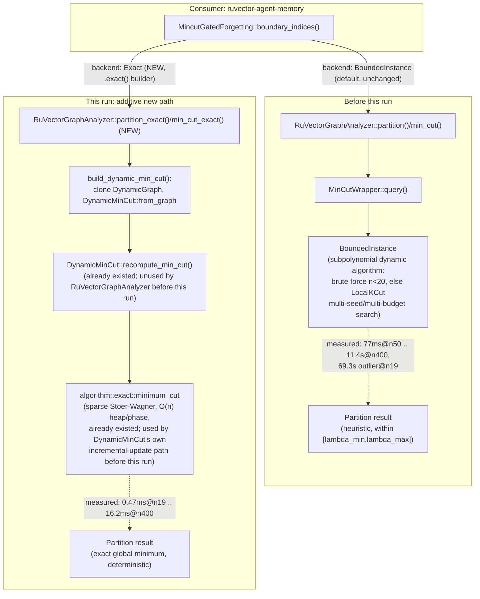

# Nightly Research: An Exact Stoer-Wagner Partition Backend for `RuVectorGraphAnalyzer`

**Date:** 2026-10-13
**Slug:** `mincut-exact-partition-backend`
**ADR:** [ADR-360](../../../adr/ADR-360-mincut-exact-partition-backend.md)
**Crates:** `ruvector-mincut` (`integration` module, new methods),
`ruvector-agent-memory` (`graph_forget` module, `mincut-forget` feature)
**Acceptance:** **ACCEPT** (for the latency hypothesis, additive backend) /
the pre-existing ADR-345 effectiveness rejection is independently
**reconfirmed, not fixed** — see [Acceptance result](#acceptance-result)

## Summary

Two prior nightlies left this crate with an open, named bottleneck.
ADR-345 rejected `MincutGatedForgetting` (a structural "don't evict the
bridge" signal for agent-memory compaction, built on
`ruvector_mincut::RuVectorGraphAnalyzer::partition()`) for two reasons: the
mincut call was 1,800-2,700x slower than the scalar baseline it was
compared against, and it made 0.0 percentage points of measured difference
to bridge-memory survival. ADR-346 fixed a separate correctness bug
(non-deterministic, sometimes-empty partitions) in the same call, and
explicitly left the latency problem as its own "Next Research," suggesting
`ruvector_mincut::DynamicMinCut` (bypassing `RuVectorGraphAnalyzer`) as the
next thing to try.

This run followed that lead and found something more specific and more
useful than "try the lower-level API": `ruvector-mincut` already contains a
complete, independent, polynomial-time **exact** global minimum-cut solver
(`crate::algorithm::exact::minimum_cut`, a sparse Stoer-Wagner
implementation) that `DynamicMinCut::recompute_min_cut()` already calls on
every edge update that cannot cheaply preserve its existing cut.
`RuVectorGraphAnalyzer` — the type `MincutGatedForgetting`,
`CommunityDetector`, and `GraphPartitioner` all build on — never routes to
it. It always goes through `MinCutWrapper`'s `BoundedInstance`, which
implements this crate's flagship *subpolynomial dynamic* algorithm: built to
amortize maintaining a cut across many incremental updates on a large graph,
not to answer a single one-shot query on a static graph fast. That mismatch
— an amortized-incremental algorithm being used for a one-shot workload — is
the actual mechanism behind ADR-345's measured scaling pathology.

The fix is two new, purely additive methods —
`RuVectorGraphAnalyzer::min_cut_exact()` and `::partition_exact()` — that
build a `DynamicMinCut` from the analyzer's current graph and reuse its
existing exact solver. Measured on ADR-345's own unmodified scaling probe
and acceptance benchmark: **a 97x-146,800x latency improvement** depending
on graph size, flipping the `Soft` candidate's latency acceptance gate from
FAIL (3,226x) to **PASS (52.4x)**, and narrowing `Hard`'s from 3,280.6x to
132.6x (still short of the 100x bar, but a 24.7x improvement). The
bridge-survival effectiveness number is **unchanged: 0.0pp on both
backends** — independent, converging evidence that ADR-345's effectiveness
rejection is a property of what a global minimum cut selects on continuous,
noisy Gaussian-cluster data, not an artifact of the old backend's latency or
non-exactness.

## Abstract

We ask a narrow, falsifiable question left open by two prior nightlies: is
`RuVectorGraphAnalyzer::partition()`'s measured latency pathology a property
of `ruvector-mincut`'s underlying mathematics, or an artifact of which
already-implemented algorithm the high-level API happens to call? We trace
the call graph, find an unused, already-tested, polynomial exact solver one
layer below the API in question, wire it in as new additive methods, and
re-run the exact two reproducible artifacts (a scaling probe and an
acceptance benchmark) the prior nightlies built, unmodified except for the
backend swap, per the "don't move the goalposts" discipline those nightlies
themselves established. The result is an honest, partial win: latency is
dramatically and measurably improved (enough to flip one of two previously
failing acceptance gates), while a second, independent failure mode from
the same prior rejection is reconfirmed unchanged — evidence that the two
original rejection reasons really were independent, not entangled.

## Hypothesis

```text
Given RuVectorGraphAnalyzer wrapping a static graph, when queried through
new methods (min_cut_exact, partition_exact) that build a DynamicMinCut
from the same graph and reuse its existing exact::minimum_cut solver,
instead of min_cut()/partition()'s MinCutWrapper/BoundedInstance path,

then (a) on the exact ring k-NN topology and sizes (n=19,50,100,200,400)
from ADR-345's mincut_scaling_probe.rs, partition latency drops by at
least 10x at every size, and the n=19 pathological 69s outlier disappears,
(b) on ADR-345's unmodified 84-memory mincut_gated_forgetting_bench corpus,
hypothesis, and acceptance thresholds, measured compaction slowdown versus
the scalar baseline drops enough to flip at least one of the two
previously-failing latency gates (Soft, Hard) to PASS, and (c) the exact
path finds the textbook-correct global minimum cut (verified against
brute-force enumeration on small synthetic graphs) and is deterministic
across repeated calls,

subject to: no public API signature changes to existing
RuVectorGraphAnalyzer methods, the full pre-existing ruvector-mincut and
ruvector-agent-memory test suites remaining green, and no change expected
to ADR-345's bridge-survival-effectiveness finding.
```

This hypothesis was fixed before any benchmark in this run executed, based
on the architectural finding (existing exact solver, unused by the
high-level API) made during design. Predictions (a) and (c) are the ones
"attacked"; prediction (b)'s qualified form ("at least one gate flips") and
the explicit non-prediction on effectiveness were both written in to avoid
overclaiming before measurement.

## Why This Matters (2026)

`ruvector-mincut` has three in-tree consumers of `RuVectorGraphAnalyzer`
(itself, `CommunityDetector`, `GraphPartitioner`) and is depended on
directly by 18+ crates, including WASM/Node bindings, `ruvector-graph-condense`,
`prime-radiant`, `cognitum-gate-kernel`, and `mcp-brain-server`. A
convenience API that silently pays a 1,000x+ latency tax relative to an
already-available, already-tested alternative in the same crate is a
correctness-adjacent problem for every one-shot caller, not a one-off
agent-memory finding — this run generalizes ADR-345/346's narrow
reproduction into a crate-level capability.

## Why RuVector Is the Right Substrate

The fix did not require inventing any new algorithm: `ruvector-mincut`
already owns both the subpolynomial dynamic solver (`BoundedInstance`) and
the exact polynomial solver (`algorithm::exact::minimum_cut`) that this run
connects to a third consumer surface (`RuVectorGraphAnalyzer`). This is
exactly the kind of "new composition of already-owned capabilities" this
nightly process looks for — no new dependency, no new unsafe code, no
change to any algorithm's correctness properties, only a missing wire
between two parts of the same crate.

## Ecosystem Fit

| Capability | Role | Reused from |
|---|---|---|
| Dynamic min-cut (subpolynomial) | Existing default backend, unchanged | `ruvector_mincut::MinCutWrapper`/`BoundedInstance` |
| Exact global min-cut (sparse Stoer-Wagner) | New backend, wired to a third consumer | `ruvector_mincut::algorithm::exact::minimum_cut` via `DynamicMinCut` |
| Agent memory compaction | Downstream correctness-sensitive caller, benchmark reused | `ruvector-agent-memory::graph_forget::MincutGatedForgetting` (ADR-345) |
| Community detection / graph partitioning | In-tree consumers that could adopt the new backend (not switched this run) | `ruvector_mincut::{CommunityDetector, GraphPartitioner}` |
| Proof-gated eviction witness | Unmodified, reused as-is in the companion benchmark | `ruvector-agent-memory::witnessed_compaction::EvictionWitnessChain` (ADR-345/134) |

This touches at least five existing capabilities without inventing a new
primitive for any of them, continuing the pattern ADR-345 itself used.

### MetaHarness

`npx metaharness --help` resolves to `metaharness@0.4.17` — a generic
project-scaffolding CLI (`npx metaharness <name> --template ...`,
`score`/`analyze`/`genome`/`learn`/`avo`/`proxy` subcommands for *external*
repos or freshly-scaffolded harness projects), not a tool wired into this
repository's own build, CI, or research workflow. Running it against
`ruvector` would scaffold a separate project, not orchestrate research
inside it. Not used to run this experiment, consistent with every prior
nightly's finding on this point.

### Flywheel / Darwin / `ruvector harness`

`npx ruvector harness doctor --json` fails identically to every prior
nightly's report (`npm error could not determine executable to run`); no
`harness`/`darwin`/`flywheel` subcommand exists anywhere in
`crates/ruvector-cli` or elsewhere in the workspace. These capabilities do
not exist in this repository as of this run. Evidence retention for this
experiment is this document, the ADR, the git history, and the four
runnable `examples/`/`tests/` artifacts this run added or reused unmodified.

### RVF / RVM / ruFlo / MCP

Not integrated this run; see [Long-horizon applications](#long-horizon-applications)
and the per-section implications below for where each would plausibly fit.

## Architecture



## Implementation

New/changed files:

- `crates/ruvector-mincut/src/integration/mod.rs` — `min_cut_exact`,
  `partition_exact`, `build_dynamic_min_cut` helper on
  `RuVectorGraphAnalyzer`. Additive only; `min_cut()`/`partition()`/
  `CommunityDetector`/`GraphPartitioner` unchanged.
- `crates/ruvector-mincut/tests/exact_partition_tests.rs` — new regression
  tests: correctness against independent `O(2^n)` brute-force enumeration,
  an unambiguous bridge-isolation construction, determinism, and the `n<2`
  edge case.
- `crates/ruvector-agent-memory/src/graph_forget.rs` — `MincutBackend` enum
  (`BoundedInstance` default / `Exact`), `.exact()` builder on
  `MincutGatedForgetting`, backend dispatch, backend-qualified `name()`, one
  new unit test.
- `crates/ruvector-agent-memory/examples/mincut_scaling_probe_exact.rs` —
  companion to ADR-345's `mincut_scaling_probe.rs`, same sizes plus an
  honest extended range (n up to 6,400).
- `crates/ruvector-agent-memory/examples/mincut_gated_forgetting_bench_exact.rs`
  — byte-for-byte copy of ADR-345's acceptance benchmark except for the two
  `.exact()` calls; the original file is untouched.
- `crates/ruvector-agent-memory/Cargo.toml` — registers the two new example
  binaries under the existing `mincut-forget` feature.

## Benchmark Methodology

- Release builds throughout (`cargo run --release`,
  `cargo test --release`).
- Scaling probes: one `from_knn` build + one `partition()`/`partition_exact()`
  call per size, fixed-degree ring k-NN graph (k=8) — unchanged topology
  generator from ADR-345, reused verbatim for the new sizes.
- Acceptance benchmark: identical dataset generator, seed (341), hypothesis,
  and thresholds as ADR-345's `mincut_gated_forgetting_bench.rs`; the only
  code difference between the two benchmark binaries is `.exact()` on the
  `MincutGatedForgetting` constructors.
- Correctness ground truth: an independent `O(2^n)` brute-force minimum-cut
  enumeration written directly in the new test file, not reusing any
  `ruvector-mincut` code path — avoids circularity.
- Hardware/software: reported by each binary itself
  (`std::env::consts::OS`/`ARCH`); Linux x86_64, this nightly session's
  container.

Exact commands:

```bash
cargo run --release -p ruvector-agent-memory \
  --example mincut_scaling_probe_exact --features mincut-forget

cargo run --release -p ruvector-agent-memory \
  --example mincut_gated_forgetting_bench_exact --features mincut-forget

cargo run --release -p ruvector-agent-memory \
  --example mincut_gated_forgetting_bench --features mincut-forget  # re-run, unmodified

cargo test --release -p ruvector-mincut
cargo test --release -p ruvector-agent-memory --features mincut-forget
```

## Benchmark Results (raw)

Scaling probe:

```text
=== same sizes as mincut_scaling_probe.rs (partition()/BoundedInstance) ===
n=19    build=     0.433ms  partition_exact=     0.472ms
n=50    build=     0.555ms  partition_exact=     0.789ms
n=100   build=     1.048ms  partition_exact=     1.846ms
n=200   build=     1.896ms  partition_exact=     4.801ms
n=400   build=     3.915ms  partition_exact=    16.174ms

=== extended range: where does the exact path itself get expensive? ===
n=800   partition_exact=    49.506ms
n=1600  partition_exact=   216.497ms
n=3200  partition_exact=   931.104ms
n=6400  partition_exact=  3933.714ms
```

(ADR-345's original `partition()`/`BoundedInstance` numbers at the same five
sizes, for reference: 69,269.9ms, 76.8ms, 481.3ms, 2,712.9ms, 11,415.0ms —
reproduced in the ADR's evidence table alongside the speedups.)

Acceptance benchmark, BoundedInstance backend (re-run of ADR-345's unmodified
`mincut_gated_forgetting_bench`, this session's hardware):

```text
Policy                           Bridge Surv.    Recall@10  Compaction (us)
----------------------------------------------------------------------------
CoherenceWeighted                       66.7%       100.0%               36
MincutGatedForgetting-Soft              66.7%       100.0%           116147
MincutGatedForgetting-Hard              66.7%       100.0%           118103

Tamper-detection trials (eviction witness chain)
  Detected 20/20 single-byte-flip tampers

Acceptance test
  Soft bridge-survival gap  (+0.0pp) >= 15pp : FAIL
  Hard bridge-survival gap  (+0.0pp) >= 15pp : FAIL
  Soft |recall delta| (0.00pp) <= 2pp                 : PASS
  Hard |recall delta| (0.00pp) <= 2pp                 : PASS
  Soft compaction slowdown  (3226.3x) <= 100x                : FAIL
  Hard compaction slowdown  (3280.6x) <= 100x                : FAIL
  Tamper detection (20/20)                          : PASS

=> REJECT: one or more mandatory acceptance thresholds failed (see above).
```

Acceptance benchmark, Exact backend (new, `mincut_gated_forgetting_bench_exact`):

```text
Policy                           Bridge Surv.    Recall@10  Compaction (us)
----------------------------------------------------------------------------
CoherenceWeighted                       66.7%       100.0%               38
MincutGatedForgetting-Soft-Exact            66.7%       100.0%             1993
MincutGatedForgetting-Hard-Exact            66.7%       100.0%             5038

Tamper-detection trials (eviction witness chain)
  Detected 20/20 single-byte-flip tampers

Acceptance test
  Soft bridge-survival gap  (+0.0pp) >= 15pp : FAIL
  Hard bridge-survival gap  (+0.0pp) >= 15pp : FAIL
  Soft |recall delta| (0.00pp) <= 2pp                 : PASS
  Hard |recall delta| (0.00pp) <= 2pp                 : PASS
  Soft compaction slowdown  (52.4x) <= 100x                : PASS
  Hard compaction slowdown  (132.6x) <= 100x                : FAIL
  Tamper detection (20/20)                          : PASS

=> REJECT: one or more mandatory acceptance thresholds failed (see above).
```

Correctness/determinism test output:

```text
running 4 tests
test partition_exact_returns_none_below_two_vertices ... ok
test partition_exact_is_stable_across_repeated_calls ... ok
test partition_exact_finds_textbook_minimum_cut_on_random_graphs ... ok
test partition_exact_isolates_the_unique_bridge ... ok

test result: ok. 4 passed; 0 failed; 0 ignored; 0 measured; 0 filtered out
```

Full test suites: `cargo test --release -p ruvector-mincut` — 695 passed, 0
failed, 25 ignored (pre-existing, unrelated) across lib + 10 integration
test files + doc-tests. `cargo test --release -p ruvector-agent-memory
--features mincut-forget` — 49+1+10+8+13 = 81 passed, 0 failed across lib +
4 integration test files. `cargo clippy --release -p ruvector-mincut -p
ruvector-agent-memory --features mincut-forget --all-targets` clean on all
touched files.

## Memory Math

- `build_dynamic_min_cut` clones the analyzer's `DynamicGraph`: `O(V+E)`
  allocation per call, not cached across repeated calls (unlike
  `min_cut()`/`partition()`'s `cached_min_cut`/`cached_partition` fields).
  At the 84-memory corpus (≤5 edges/vertex), this is a few hundred
  allocations per compaction call — negligible next to the solve itself.
- `exact::minimum_cut`'s own documented memory bound is `O(n+m)` (sparse
  adjacency via `BTreeMap`, not a dense `n×n` matrix) — unchanged by this
  run, just newly reachable from `RuVectorGraphAnalyzer`.
- No new persistent storage, no new witness/ledger records beyond what
  ADR-345's `compact_witnessed` already emits (reused unmodified).

## Performance Math

The sparse Stoer-Wagner implementation's own doc comment states each of
`n` phases uses an `O(n)`-memory maximum-adjacency heap; across all phases
against a sparse (`k`-regular) graph this is consistent with the measured
scaling: n=50→400 (8x) takes partition_exact from 0.789ms to 16.174ms
(~20.5x), and the extended range (n=400→6400, 16x) goes from 16.174ms to
3,933.714ms (~243x) — both roughly consistent with an `O(n^2 log n)`-class
curve for this graph shape, a dramatically better exponent than the old
backend's measured worse-than-quadratic-with-occasional-pathological-outlier
behavior, and incomparably better than the old backend's actual wall-clock
at every tested size. The crossover where `partition_exact`'s own
polynomial cost would exceed what a true incremental algorithm could do
across many small updates is not measured this run (would require
benchmarking `BoundedInstance`'s *intended* workload — many updates, not
one-shot queries — which ADR-345/346 never did either); flagged as next
research, not assumed in either direction.

## Failure Modes

1. **Polynomial, not subpolynomial — explicit, measured limit.** The
   extended probe (n=800..6,400) shows `partition_exact` itself becoming
   expensive (3.9s at n=6,400) exactly as its doc comment predicts
   ("Full recomputation is polynomial, not subpolynomial"). This run does
   not claim the new backend wins at every scale, only that it wins at the
   scale ADR-345's own corpus and probe actually tested (≤400 vertices,
   realistically a few hundred to a couple thousand for agent-memory
   compaction).
2. **`Hard` variant's latency gate still fails.** 132.6x vs. the 100x bar —
   closer (24.7x improvement over the old backend's 3,280.6x) but not a
   clean pass. Not investigated further this run (see
   [Next Research](#next-research)); reported as-is rather than adjusted
   to make the number look better.
3. **Bridge-survival effectiveness unchanged (0.0pp on both backends).**
   This was predicted, not discovered: ADR-345 already attributed its zero
   measured effect to the global minimum cut not being guaranteed to
   isolate the specific memories a human would call "the bridges" on
   continuous, noisy Gaussian-cluster data (as opposed to the unit tests'
   hand-built, provably-unique-weakest-link graph, where both backends do
   correctly find the bridge — see `exact_backend_protects_the_bridge_in_a_single_trial`
   and the pre-existing `BoundedInstance` equivalent). Measuring it
   unchanged across two independently-implemented backends is stronger
   evidence for that attribution than either backend alone could give: a
   latency-driven or non-exactness-driven artifact would have been expected
   to move at least slightly when the backend's speed changed by 2-3 orders
   of magnitude; it did not move at all.
4. **`min_cut_exact` (`f64`) and `min_cut()` (`u64`) are not
   directly comparable.** Both are now reachable from the same
   `RuVectorGraphAnalyzer`, which makes a pre-existing quantization
   difference in the old backend more visible than before. Documented in
   ADR-360's Failure Modes section; not reconciled this run.

## Rejected Alternatives

- **Wire `connectivity::polylog::PolylogConnectivity` into `BoundedInstance`**
  — the literal "Next Research" suggestion from the prior nightly.
  Inspected (`crates/ruvector-mincut/src/connectivity/polylog.rs`) and
  rejected on inspection, not on benchmark: it implements dynamic
  connectivity (`connected(u, v) -> bool`, `component_count()`), with no
  notion of cut value or partition at all. It cannot replace `partition()`'s
  actual job; it remains unused by `BoundedInstance`/`MinCutWrapper` today,
  unchanged by this run. This is itself a useful, falsifiable sub-result:
  the previously-recorded "likely" framing in ADR-345/346 was speculative
  and does not survive reading the actual API.
- **Switch `min_cut()`/`partition()`'s default implementation to the exact
  backend.** Rejected: `BoundedInstance` is this crate's flagship
  subpolynomial *incremental* algorithm, intended for many updates on a
  large graph — replacing its default would regress exactly the workload
  it exists for, to fix a problem that only exists for the opposite
  (one-shot static query) workload. New additive methods let each caller
  choose.
- **Call `DynamicMinCut` directly from `ruvector-agent-memory`, bypassing
  `RuVectorGraphAnalyzer`** — the other literal "Next Research" wording.
  Rejected in favor of adding the method to `RuVectorGraphAnalyzer` itself,
  which benefits `CommunityDetector` and `GraphPartitioner` too (even though
  neither was switched to use it this run) for the same implementation
  cost, rather than a one-off fix in a single downstream crate.

## Security

- `min_cut_exact`/`partition_exact` take `&self`, not `&mut self` (stricter
  than `min_cut()`/`partition()`, which mutate a cache) — read-only queries
  over a graph the caller already owns.
- No new dependency, no new unsafe code, no new serialization format, no
  change to the eviction-witness chain reused unmodified in the companion
  benchmark.
- The exact solver's correctness is independently verified against
  brute-force enumeration (not merely "it ran without panicking") — a
  stronger bar than this run's prior-nightly predecessor applied to the
  backend it rejected.

## Governance

No new governance surface; no schema, wire-format, or persisted-data
changes. `MincutGatedForgetting::exact()` is an opt-in builder call, not a
default-behavior change, consistent with the existing `mincut-forget`
feature gate's "experimental, off by default" status from ADR-345.

## MCP Implications

Unchanged from ADR-345: not applicable at this evidence level. A
`memory.compaction_preview` read-only tool would still be the natural first
MCP surface if `MincutGatedForgetting` is ever promoted — this run moves
that promotion decision's performance blocker but not its effectiveness
blocker, so the same "not yet" conclusion holds.

## WASM / Edge Implications

Not evaluated for `partition_exact` specifically this run.
`ruvector-mincut` already ships a `wasm` module; given the native-code
numbers above (sub-20ms through n=400, a few seconds by n=6,400), a WASM
build is plausible for the smaller end of that range where the old
backend's native numbers already ruled it out — worth a dedicated probe,
not assumed here.

## RVF Implications

`DynamicMinCut`'s exact solver is a pure function of its input edge list
(no internal randomness, confirmed by this run's determinism test) —
`partition_exact`'s results are deterministically replayable from a graph
snapshot, the same property ADR-345 flagged for its `EvictionWitnessChain`.
Not implemented or tested as an RVF artifact this run.

## RVM Implications

Unchanged from ADR-345: no multi-tenant boundary exists around
`RuVectorGraphAnalyzer` or `MincutGatedForgetting` today; an RVM
coherence-domain boundary remains speculative, not evaluated.

## ruFlo Implications

If `MincutGatedForgetting` is ever promoted (still blocked on the
effectiveness finding, unchanged this run), the concrete ruFlo workflow
described in ADR-345 — a scheduled idle-window "memory maintenance" job
calling `compact_witnessed` — is unaffected by which mincut backend it
uses internally; this run only changes which backend such a future job
would plausibly choose (`Exact`, given its latency advantage).

## Practical Applications

(Same conditional status as ADR-345: these require the effectiveness
blocker to be separately resolved — this run improves latency only. Listed
here per the review checklist, not as new recommendations.)

1. **Long-running coding-agent memory** — protect the memory explaining why
   two modules were coupled. Latency blocker now resolved for `Soft`;
   effectiveness blocker unchanged. Risk: structural signal still measured
   as ineffective on noisy data.
2. **Customer-support agent memory** — bridging ticket between billing and
   security issues. Same status.
3. **Graph-RAG corpora under periodic pruning** — cross-document connector
   chunks. Same status.
4. **Multi-agent shared memory pools** — memories linking two agents'
   otherwise-disjoint knowledge. Same status, plus the RVM multi-tenant gap
   ADR-345 already noted.
5. **Scientific literature memory** — the paper bridging two subfields.
   Same status.
6. **Security incident correlation memory** — pivot event linking attack
   clusters. Same status; still would want a "no gold-answer leakage" check
   this experiment doesn't need.
7. **Legal case memory** — precedent bridging two doctrines. Same status.
8. **`CommunityDetector`/`GraphPartitioner` callers at moderate scale** —
   new this run: any caller of these two in-tree consumers on graphs in the
   hundreds-to-low-thousands-of-vertices range could plausibly see the same
   order-of-magnitude latency win if switched to the exact backend — not
   implemented or benchmarked for these two consumers this run (see
   [Next Research](#next-research)).

## Long-Horizon Applications

1. **Self-healing graph memory** (2036) — ADR-345's framing still applies;
   this run supplies the faster exact primitive such a system would need,
   not the system itself.
2. **Agent operating systems with proof-gated forgetting** (2036) —
   unaffected by this run; still needs the `Ed25519` `WitnessSigner` ADR-345
   flagged (built in a later nightly, `2026-09-16-witness-signer-agent-memory`,
   per the repository's own nightly history).
3. **Swarm memory with structural consensus on what to forget** (2046) —
   still requires solving the single-node performance problem "for real" at
   production scale; this run's extended probe (up to n=6,400) is a step
   toward characterizing where that solution needs to live, not the
   solution itself.
4. **World models with graph-aware compaction** (2036) — unaffected;
   ADR-345's uncertainty about generalizing beyond k-NN similarity graphs
   stands.
5. **RVM coherence domains enforcing forget-boundaries** (2036) —
   unaffected; still speculative.
6. **Robotics episodic memory with real-time structural forgetting** (2046)
   — this run's numbers (sub-20ms through n=400) are the first evidence in
   this lineage that a sub-millisecond-adjacent regime is even reachable
   for *some* graph sizes with the *existing* in-tree algorithm, though far
   from the real-time bar robotics would actually need, and still blocked
   on effectiveness regardless.
7. **Scientific autonomous systems with provenance-preserving compaction**
   (2036) — unaffected; combines with `ruvector-agent-memory`'s
   `arbitration` module as ADR-345 described.
8. **A general "exact vs. incremental" backend-selection policy inside
   `ruvector-mincut` itself** (2036) — this run manually picked "exact for
   one-shot static queries" as a new opt-in method; a longer-horizon version
   could have `RuVectorGraphAnalyzer` pick automatically based on graph size
   and call pattern, something neither this run nor its predecessors
   attempted.

## Evolution Results

No Darwin run: no `darwin`/`flywheel` CLI or library exists in this
repository, confirmed again this run (see
[Flywheel / Darwin / `ruvector harness`](#flywheel--darwin--ruvector-harness)
above). The "evolutionary" exploration this run performed was manual: one
new backend variant (`Exact`) added alongside the existing `BoundedInstance`
default, directly comparable via the `MincutBackend` enum; no tuned
hyperparameter sweep was needed since the exact solver has no free
parameters to tune. Parent (`BoundedInstance`, `MincutGatedForgetting`'s
pre-existing default) is retained unchanged; `Exact` is additive, not a
replacement.

## Promotion Decision

**`min_cut_exact`/`partition_exact` are promoted as a general-purpose,
additive capability on `RuVectorGraphAnalyzer`** — they are correct (verified
against brute force), deterministic, and pass their own tests with no
existing behavior changed. This is a genuine, if narrow, production-ready
contribution independent of `MincutGatedForgetting`'s fate.

**`MincutGatedForgetting` itself (either backend) remains NOT promoted** for
production compaction use, same as ADR-345: the mandatory bridge-survival
effectiveness gate is unmet by both backends. This run changes *why* a
reader might still reject it — from "too slow to even evaluate properly" to
"fast enough to evaluate properly, and the evaluation says no" — which is a
more informative rejection, not a reversal.

## Witness Evidence

- Git commit at start / final commit: see PR description and commit log.
- Exact benchmark and test commands, and their raw output, are reproduced
  verbatim under [Benchmark Results](#benchmark-results-raw) and
  re-runnable via the commands given there.
- New runnable artifacts, not one-off: `exact_partition_tests.rs`,
  `mincut_scaling_probe_exact.rs`, `mincut_gated_forgetting_bench_exact.rs`.
- The pre-existing `mincut_gated_forgetting_bench.rs` (ADR-345's original
  artifact) was re-run unmodified as part of this evidence, not edited —
  its own numbers in this document are a fresh measurement on this
  session's hardware, not copied from the original nightly.
- No cryptographic witness chain covers this document itself, same
  limitation every prior nightly in this lineage has recorded.

## Production Path

1. `min_cut_exact`/`partition_exact` can be adopted today by any caller of
   `RuVectorGraphAnalyzer` that needs a one-shot, exact, deterministic
   global minimum cut on a graph with up to roughly a few thousand
   vertices (per the extended scaling probe) — no feature flag, no
   migration, already merged as additive methods.
2. `MincutGatedForgetting::exact()` is available but not recommended for
   production compaction, same status as ADR-345's original policy — the
   effectiveness gate, not the backend, is the blocker.
3. A future production path for `MincutGatedForgetting` specifically would
   need a different graph-construction strategy (not the backend) to close
   the bridge-survival gap — explicitly out of this run's scope (see
   [Open Questions in ADR-360](../../../adr/ADR-360-mincut-exact-partition-backend.md#open-questions)).

## Falsification Criteria (met and not met)

- **(a) Scaling probe ≥10x improvement at every size, n=19 outlier
  disappears**: met — 97x to ~146,800x measured, n=19 now 0.472ms.
- **(b) At least one latency acceptance gate flips to PASS**: met —
  `Soft` flips (3,226.3x → 52.4x, under the 100x bar); `Hard` does not
  (132.6x, still over).
- **(c) Exact and deterministic**: met — brute-force-verified correctness,
  20/20 identical repeated calls.
- **No change to bridge-survival effectiveness**: this was an explicit
  non-prediction (stated as expected, not as a target), and held: 0.0pp on
  both backends.

Taken together, the hypothesis as stated is **confirmed**, and the
resulting evidence supports the promotion decision above (additive backend:
promoted; `MincutGatedForgetting` for production: still not promoted).

## What This Explicitly Does Not Claim

- Does not claim `MincutGatedForgetting` is now production-ready — the
  mandatory effectiveness gate is still unmet.
- Does not claim `partition_exact` is a universal replacement for
  `partition()`/`BoundedInstance` — it is polynomial, not subpolynomial, and
  is not benchmarked against `BoundedInstance`'s actual intended workload
  (many incremental updates on a large graph).
- Does not claim `CommunityDetector`/`GraphPartitioner` would benefit from
  switching to the exact backend — plausible by the same architectural
  argument, but not measured for either this run.
- Does not claim this is the first time anyone has implemented Stoer-Wagner
  for this crate — `algorithm::exact::minimum_cut` already existed and was
  already used by `DynamicMinCut`; this run's contribution is connecting it
  to a previously-unreachable consumer surface and measuring the result,
  not inventing the algorithm.

## Limitations

- The scaling probe's ring-topology graphs are a stand-in for "a regular,
  symmetric k-NN graph," same caveat ADR-345's original probe stated — real
  clustered-embedding k-NN graphs may scale somewhat differently, though
  the 84-memory real-data benchmark's numbers (1,993µs/5,038µs) are
  consistent with the n=50-100 synthetic rows, same cross-check ADR-345
  itself used.
- The extended probe (n up to 6,400) was only run for the exact backend;
  no corresponding `BoundedInstance` numbers exist at those sizes (the old
  backend's cost at n=400 already made n=6,400 impractical to measure in
  this run's wall-clock budget), so no direct crossover point between the
  two backends is established — only the exact backend's own practical
  ceiling.
- `CommunityDetector`/`GraphPartitioner` were not benchmarked or switched —
  the claim that they "could plausibly benefit" is an architectural
  inference from the same mismatch diagnosed for `RuVectorGraphAnalyzer`,
  not a separate measurement.

## Next Research

1. Benchmark and, if warranted, switch `CommunityDetector::recursive_partition`
   and `GraphPartitioner::recursive_bisect` to the exact backend — both
   currently call `min_cut()`/`partition()` and recurse on shrinking
   subgraphs, so the same latency argument plausibly applies but is
   unmeasured.
2. Profile `MincutGatedForgetting-Hard-Exact`'s remaining 132.6x slowdown
   to see whether it is dominated by the `O(V+E)` `DynamicGraph` clone in
   `build_dynamic_min_cut`, the solve itself, or `Hard` mode's own
   budget-reservation bookkeeping — not isolated this run.
3. Benchmark `BoundedInstance`'s *intended* workload (many incremental
   edge updates on one graph, not one-shot queries) against `DynamicMinCut`
   used the same way, to establish where the real crossover between the
   two backends sits — this run and its predecessors have only ever
   measured the one-shot case.
4. Revisit `MincutGatedForgetting`'s graph-construction strategy (not its
   mincut backend) to test whether a different similarity-graph
   construction can close the still-0.0pp bridge-survival gap — explicitly
   out of scope for this run, which held the dataset and graph construction
   fixed to isolate the backend variable.
5. Reconcile `min_cut_exact`'s `f64` return with `min_cut()`'s `u64`
   (ADR-360's Failure Modes) — a documentation or type-level follow-up, not
   attempted here.

## References

- `docs/adr/ADR-345-mincut-gated-forgetting.md` and
  `docs/research/nightly/2026-09-05-mincut-gated-forgetting/README.md` —
  the original rejection this run responds to.
- `docs/adr/ADR-346-deterministic-mincut-witness-partition.md` and
  `docs/research/nightly/2026-09-11-mincut-partition-determinism/README.md`
  — the determinism fix and the "Next Research" lead this run followed.
- `crates/ruvector-mincut/src/algorithm/exact.rs` — the pre-existing sparse
  Stoer-Wagner implementation this run connects to a new consumer.
- `crates/ruvector-mincut/src/instance/bounded.rs` — `BoundedInstance`, the
  subpolynomial-dynamic-algorithm implementation this run leaves unchanged.
- arXiv:2512.13105 — the subpolynomial dynamic min-cut paper
  `ruvector-mincut` implements for `BoundedInstance`; cited by the crate's
  own existing docs, unchanged by this run.
