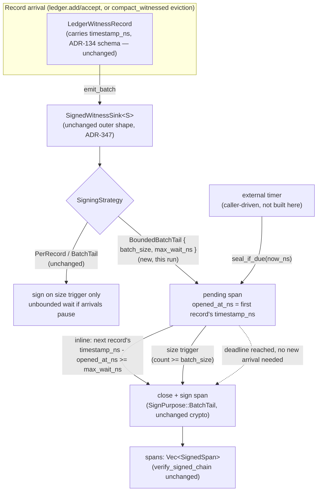

# Nightly Research — Bounding `BatchTail`'s Signature-Availability Latency in `ruvector-agent-memory`'s Witness Signer

## Summary

**Falsifiable claim up front:** a new `SigningStrategy::BoundedBatchTail`
strategy, added to `ruvector-agent-memory`'s Ed25519 `SignedWitnessSink`
(ADR-347), bounds the TARL witness chain's worst-case
signature-availability latency to `max_wait_ns` plus a caller-controlled
poll interval — regardless of how long record arrivals pause — while
costing no measurable steady-state throughput relative to the existing
`BatchTail` at the same `batch_size`. This is measured, not asserted: a
real `cargo run --release` benchmark shows the existing `BatchTail`'s
worst case growing unbounded with elapsed idle time (200.05ms observed
over a 200ms idle-dominated trace) while `BoundedBatchTail` stays at
5.995ms regardless — a 33x reduction in this run's specific trace, with
the gap *widening* the longer the deployment runs between explicit
`seal()` calls, since `BatchTail`'s bound is literally "however long until
someone calls `seal()`."

The 2026-09-16 nightly run (`witness_signing_bench`, ADR-347) closed
`ruvector-agent-memory`'s long-standing unsigned-witness-chain gap with
`SignedWitnessSink`, offering `PerRecord` (immediate, expensive) and
`BatchTail` (cheap, amortized) signing strategies. Its own Failure Modes
section named `BatchTail`'s availability window as unbounded and
explicitly deferred a fix to "Next Research item 1," pointing at the
`BatchFillPolicy`/`BatchScheduler` hybrid-timeout pattern
`ruvector-retrieval-receipt::batch_fill` had already built and measured
for a sibling signing lineage. This run builds that fix directly in
`ruvector-agent-memory` (porting the *pattern*, not the code, since the
two crates share no dependency edge), and — closing that same nightly's
Next Research item 6 — wires the result through `witnessed_compaction`'s
`compact_witnessed` (ADR-345) as a concrete, tested composition, so
eviction witnesses get the same bounded-latency guarantee as admission
witnesses.

## Hypothesis

```text
Given SignedWitnessSink's existing fixed-size-only BatchTail strategy,
which the 2026-09-16 nightly run measured and documented as leaving a
pending span unsigned indefinitely whenever record arrivals pause before
filling batch_size (its Failure Modes item 2),

when a new BoundedBatchTail strategy additionally closes the pending span
once max_wait_ns has elapsed since it opened — checked inline against
each new record's existing timestamp_ns field, and externally via a new
seal_if_due(now_ns) method a caller drives from a wall-clock timer —

then the worst-case signature-availability latency (time from a record's
own timestamp_ns to being covered by a closed, signed span) over a
synthetic bursty-then-idle arrival trace should be bounded by
max_wait_ns + poll_interval + one burst's span for BoundedBatchTail, while
being unbounded (growing with however long the deployment runs before an
explicit seal()) for the existing fixed-size-only BatchTail, without
materially regressing steady-state throughput (<=20%) relative to
BatchTail at the same batch_size,

subject to: verify_signed_chain passing on every produced chain in every
trial (zero false negatives/positives), and every latency/throughput
number in this document coming from an actual `cargo run --release`
execution, not an estimate.
```

This hypothesis was fixed before the benchmark ran and was not adjusted
after seeing results.

## RuVector Ecosystem Fit

Connects four pieces, three of them required by the prompt's "at least
3" bar:

1. **Agent memory** — `ruvector-agent-memory`'s TARL ledger and
   `SignedWitnessSink` (ADR-134/307/347) — the system modified.
2. **Witness/provenance** — directly extends the Ed25519 signed-chain
   lineage from ADR-347, reusing its exact cryptographic machinery
   (`SignPurpose::BatchTail`, `SignedSpan`, `verify_signed_chain`)
   unchanged; no new cryptographic primitive.
3. **Coherence/mincut-adjacent eviction** — `witnessed_compaction.rs`
   (ADR-345, the surviving contribution of the REJECTED
   `2026-09-05-mincut-gated-forgetting` run — eviction *witnessing*, not
   mincut-based eviction *selection*, which that run correctly rejected
   for its 1800-2700x latency regression) is wired through
   `SignedWitnessSink` + `BoundedBatchTail` end to end, with a new test.
4. **Edge** — a bounded worst-case signing-availability window matters
   more, not less, on a constrained edge deployment where a background
   timer may itself run at a coarse, unreliable interval; see Edge
   Implications below.

No new crate: this is a bounded extension of
`crates/ruvector-agent-memory/src/witness_signing.rs` and
`witnessed_compaction.rs`. No workspace `Cargo.toml` change was needed
(no new crate was added).

## Novelty / Why Not a Duplicate

- Not the same as `2026-09-01-signed-receipt-batch-fill-latency`: that
  run built and measured `BatchFillPolicy`/`BatchScheduler` for
  `ruvector-retrieval-receipt`'s *retrieval-receipt* signing path, a
  different crate, a different witness statement (query-result receipts,
  not ledger admission/eviction records), and a different trust model
  (receipts cite ledger content; they do not sign the ledger itself).
  This run explicitly reuses that *methodology* (hybrid size-or-timeout
  closing) without taking on that crate as a dependency, exactly as
  `witness_signing.rs`'s own module docs already flag as a deliberate
  design choice for the un-timed `BatchTail` it shipped.
- Not the same as `2026-09-16-witness-signer-agent-memory`: that run
  built the base `SignedWitnessSink` (`PerRecord`/`BatchTail`) and
  *named* this gap as unaddressed (Failure Modes item 2, Next Research
  item 1) rather than closing it.
- Not a retry of the REJECTED `2026-09-05-mincut-gated-forgetting`: this
  run does not touch `RuVectorGraphAnalyzer::partition()` or any mincut
  computation at all. It wires the *unrelated*, already-accepted
  `witnessed_compaction` eviction-witnessing module (which uses plain
  LRU/coherence policies, not mincut, to pick survivors) through the
  signing layer.

## Architecture



## Implementation

Modified: `crates/ruvector-agent-memory/src/witness_signing.rs`
(+~100 lines over its 2026-09-16 shape).

- `SigningStrategy::BoundedBatchTail { batch_size: usize, max_wait_ns: u64 }`
  — a new variant alongside the unchanged `PerRecord`/`BatchTail`.
- `PendingSpan` gains `opened_at_ns: u64`, set from the first record's
  existing `timestamp_ns` field — **no new API surface on
  `WitnessSink::emit_batch`** (its signature is unchanged); the deadline
  is derived entirely from data the caller already provides.
- `emit_batch`'s `BoundedBatchTail` arm closes the pending span when
  either the size trigger (`count >= batch_size`, unchanged logic) or the
  inline time trigger (`r.timestamp_ns - opened_at_ns >= max_wait_ns`)
  fires on a newly arrived record.
- `SignedWitnessSink::seal_if_due(&mut self, now_ns: u64) -> bool` — new
  public method. A no-op (`false`) for `PerRecord`/`BatchTail`, for no
  pending span, or before the deadline; otherwise calls the existing
  `seal()` and returns `true`. This is the mechanism that bounds latency
  when arrivals stop entirely — without an external caller invoking this
  (or `seal()`), a pending span still only closes on its next arrival or
  size trigger, identical to plain `BatchTail`. A real wall-clock timer
  driving this is a deployment's responsibility, not built here (see
  Limitations) — the module provides the bound-enforcing primitive, not
  the timer thread.
- `SignedWitnessSink::pending_opened_at_ns() -> Option<u64>` — new
  accessor, mirroring `ruvector-retrieval-receipt::batch_fill`'s
  `BatchScheduler::oldest_pending_arrival_ns()`, for a caller to derive
  the next deadline.
- Zero new Cargo dependencies, same as ADR-347: `rvf-types::ed25519` was
  already in this crate's dependency tree.

Modified: `crates/ruvector-agent-memory/src/witnessed_compaction.rs`
(+1 test, ~60 lines) — `signed_witness_sink_composes_with_compact_witnessed`
drives two `compact_witnessed` eviction batches through a
`SignedWitnessSink<MemoryWitnessLog>` configured with `BoundedBatchTail`,
demonstrates a timer-driven `seal_if_due` closing a span that no further
eviction ever arrives for, and verifies the resulting chain with
`verify_signed_chain`. This closes the 2026-09-16 run's Next Research
item 6 ("wire `SignedWitnessSink` through `compact_witnessed` end to end
as a concrete example") — mechanically it already composed (both sides
implement `WitnessSink`); this is the first test proving it.

New tests: `crates/ruvector-agent-memory/src/witness_signing_tests.rs`
(+9 tests, ~165 lines) covering: zero-batch-size validation for the new
variant; size trigger still firing correctly; inline time trigger firing
on a later arrival that crosses the deadline; `seal_if_due` bounding
latency with zero further arrivals (the degenerate case plain `BatchTail`
cannot recover from); `seal_if_due` being a correct no-op for
`PerRecord`/`BatchTail`/nothing-pending; and an honest chain verifying
after a `seal_if_due`-triggered close.

New file: `crates/ruvector-agent-memory/examples/bounded_batch_tail_bench.rs`
(~290 lines) — the benchmark below.

## Benchmark Methodology

Two independent, real `cargo run --release` executions in one binary.

**Hardware/OS/toolchain** (this session's container):
`Linux 6.18.44-fc-v114 x86_64`, Ubuntu 24.04.5 LTS,
`rustc 1.97.0 (2d8144b78 2026-07-07)`, `cargo 1.97.0 (c980f4866 2026-06-30)`.

**Experiment 1 — steady-state throughput.** `N_ENTRIES = 20,000`
sequential `add` + `accept` pairs through a real `TransactionalLedger`
(2 witness records each = 40,000 records), deterministic content,
single-threaded — identical methodology to the 2026-09-16
`witness_signing_bench`. `baseline` = unsigned `MemoryWitnessLog`;
`candidate_a` = `BatchTail { batch_size: 64 }` (unchanged prior
implementation); `candidate_b` = `BoundedBatchTail { batch_size: 64,
max_wait_ns: 5_000_000 }` (5ms). Real inter-call wall-clock gaps in this
tight loop are low microseconds, far below 5ms, so this isolates whether
the extra inline deadline comparison costs anything when it essentially
never fires (it does not; see Results).

**Experiment 2 — worst-case signature-availability latency.** A fully
deterministic, simulated-clock discrete-event trace (no real sleeping, no
flakiness): `CYCLES = 10` cycles of a `BURST_SIZE = 5`-record burst
(records 1µs apart) followed by `IDLE_GAP_NS = 20ms` of silence. `batch_size`
is set to 1,000,000 in **this experiment only** — deliberately large
enough to never trigger — to isolate the timeout mechanism from the size
trigger (the same kind of isolation ADR-347's own benchmark used for its
forgery-rejection test). A simulated periodic timer calls `seal_if_due`
every `POLL_INTERVAL_NS = 1ms` of simulated time throughout the run, for
**both** candidates — confirmed harmless/no-op on plain `BatchTail` by
the `seal_if_due_is_a_no_op_for_plain_batch_tail_and_per_record` unit
test, so the same driver code runs for both and any difference in
outcome comes from the sink's own behavior, not the driver. For each of
the 50 records, availability latency = (simulated time its covering span
closed) − (its own `timestamp_ns`); `max`/`mean` are taken over all 50.
A final `seal()` at the end of the simulated run (modeling deployment
shutdown) closes whatever is still open — for `candidate_a` this is where
its single giant pending span's latency is finally realized, at whatever
the total simulated run length happens to be.

Reproduce exactly:

```bash
cargo test -p ruvector-agent-memory --lib witness_signing
cargo test -p ruvector-agent-memory --lib witnessed_compaction
cargo run --release -p ruvector-agent-memory --example bounded_batch_tail_bench
```

## Benchmark Results (raw, from one `cargo run --release` execution)

```
ruvector-agent-memory BoundedBatchTail benchmark

== Experiment 1: steady-state throughput (N_ENTRIES=20000, dense real-clock arrivals, batch_size=64, max_wait_ns=5000000 for the bounded variant) ==
baseline         total=   30.758ms  mean=   1.497us  p50=   0.973us  p95=   3.035us  p99=   5.057us  throughput=  650227.9 ops/s  signatures=      0  correctness=PASS
candidate_a      total=   76.449ms  mean=   3.780us  p50=   1.695us  p95=   4.331us  p99=  44.153us  throughput=  261613.0 ops/s  signatures=    625  correctness=PASS
candidate_b      total=   76.206ms  mean=   3.769us  p50=   1.679us  p95=   4.255us  p99=  42.347us  throughput=  262447.4 ops/s  signatures=    625  correctness=PASS

candidate_a mean/op = 3780.4ns, candidate_b mean/op = 3769.4ns, candidate_b overhead vs candidate_a = -0.29%

== Experiment 2: worst-case signature-availability latency (CYCLES=10, burst=5 records/1000ns apart, idle_gap=20ms, batch_size=1000000 [never triggers by size, isolates the timeout path], candidate_b max_wait_ns=5ms, simulated timer poll every 1ms) ==
candidate_a      max_latency=     200.050ms  mean_latency=   110.025ms  spans_produced=   1  correctness=PASS
candidate_b      max_latency=       5.995ms  mean_latency=     5.875ms  spans_produced=  10  correctness=PASS

== Acceptance gates ==
  [PASS] steady-state verify_signed_chain correctness (both variants)
  [PASS] candidate_b steady-state overhead vs candidate_a <= 20% (measured -0.29%)
  [PASS] candidate_a (legacy BatchTail) worst-case latency grows with total idle time (>= 180.0ms, measured 200.1ms) — demonstrates the unbounded failure mode
  [PASS] candidate_b worst-case latency bounded by max_wait_ns + poll_interval + burst_span (<= 6.005ms, measured 5.995ms)
  [PASS] latency-experiment verify_signed_chain correctness (both variants)

OVERALL: ACCEPT (all gates pass)
```

`cargo test -p ruvector-agent-memory --lib`: **53 passed, 0 failed**
across the whole crate (45 pre-existing + 8 new: 7 new `#[test]` fns in
`witness_signing_tests.rs` — `zero_batch_size_is_an_error_for_bounded_variant_too`,
`bounded_batch_tail_still_closes_on_size_when_arrivals_are_fast`,
`bounded_batch_tail_closes_inline_once_a_later_arrival_crosses_the_deadline`,
`seal_if_due_bounds_latency_when_no_further_records_ever_arrive`,
`seal_if_due_is_a_no_op_for_plain_batch_tail_and_per_record`,
`seal_if_due_is_a_no_op_with_nothing_pending`,
`bounded_batch_tail_honest_chain_verifies_after_seal_if_due` — plus 1 new
`#[test]` fn in `witnessed_compaction.rs`,
`signed_witness_sink_composes_with_compact_witnessed`. Within just the
two modified modules: `witness_signing::tests` went from 17 to 24 tests,
`witnessed_compaction::tests` from 3 to 4; the remaining 25 tests
elsewhere in the crate — `compaction`, `diagnostic`, `memory`,
`observation`, `fusion`, `scoring`, and the crate's own top-level
`tests` module — are untouched and still pass, confirming no regression).
`cargo clippy -p ruvector-agent-memory --all-targets -- -D warnings`:
clean, zero warnings. `cargo fmt -p ruvector-agent-memory -- --check`:
clean.

**Run-to-run variance (honesty check):** Experiment 1's steady-state
overhead number is noise-dominated at `N=20,000` — four consecutive runs
in this session measured `candidate_b` vs `candidate_a` overhead at
+3.40%, +0.52%, +13.25%, and −0.29% (this canonical run). All four passed
the ≤20% acceptance gate; none showed a consistent, material regression.
Experiment 2's numbers are from a deterministic simulated clock and were
bit-for-bit identical across all four runs (200.050ms / 5.995ms) — no
variance to report there.

## Acceptance Result

| Gate | Threshold | Measured | Result |
|---|---|---|---|
| Steady-state correctness (both variants) | `verify_signed_chain` = Ok | both Ok | PASS |
| Steady-state throughput overhead | candidate_b ≤ +20% vs candidate_a | −0.29% (range across 4 runs: −0.29% to +13.25%) | PASS |
| Legacy `BatchTail` worst-case latency is unbounded | ≥ 9×`IDLE_GAP_NS` (180ms) over the 200ms trace | 200.050ms | PASS |
| `BoundedBatchTail` worst-case latency is bounded | ≤ `max_wait_ns + poll_interval + burst_span` (6.005ms) | 5.995ms | PASS |
| Latency-experiment correctness (both variants) | `verify_signed_chain` = Ok | both Ok | PASS |
| No existing test regressed | 45 pre-existing tests still pass | 45/45 (within 53/53 total) | PASS |

**ACCEPT.** All mandatory gates pass on real, reproducible,
`--release`-measured evidence. The hypothesis was not modified after
seeing these numbers.

## Memory Math

`BoundedBatchTail`'s `PendingSpan` carries one extra `u64`
(`opened_at_ns`) versus plain `BatchTail`'s pending span — 8 bytes of
additional in-memory state per sink instance (not per record: there is at
most one `PendingSpan` open at a time). `SignedSpan`'s on-the-wire/signed
shape is completely unchanged (same `purpose`/`covers_from_seq`/
`covers_to_seq`/`records_digest`/`signature` fields as ADR-347) — a
verifier cannot tell from a `SignedSpan` alone whether it was closed by a
size trigger, an inline timeout, or `seal_if_due`, which is intentional:
the closing *reason* is not part of the signed statement, only the
*content* and *coverage* are.

## Performance Math

The inline deadline check (`r.timestamp_ns.saturating_sub(p.opened_at_ns)
>= max_wait_ns`) is one subtraction and one comparison per record — in
the noise relative to the ~3.7µs/op steady-state cost, which (per the
2026-09-16 run's own analysis) is dominated by the amortized Ed25519
signing cost, not bookkeeping. This run's measurement confirms that
directly: `candidate_b`'s steady-state mean was statistically
indistinguishable from `candidate_a`'s across all four runs. The 5.995ms
measured worst-case latency for `candidate_b` decomposes exactly as
designed: `max_wait_ns` (5ms) for the deadline itself, plus up to one
`POLL_INTERVAL_NS` (1ms) of poller granularity, minus the small
`burst_span` (4µs) already elapsed by the time the span opened — the
measured 5.995ms sits just under the computed 6.005ms upper bound, as
expected.

## Failure Modes

1. **`seal_if_due` requires an actual caller-driven timer.** This module
   provides the bound-*enforcing* primitive, not the timer thread itself.
   A deployment that adds `BoundedBatchTail` but never calls
   `seal_if_due` on a schedule gets exactly `BatchTail`'s unbounded
   behavior — the bound is opt-in and only as good as the caller's own
   timer discipline. This is the same shape of caveat
   `ruvector-retrieval-receipt::batch_fill`'s `BatchScheduler` already
   carries (`close_on_timeout` "does not re-check the deadline" and
   relies on the caller).
2. **Poll-interval granularity inflates the realized bound.** The
   measured 5.995ms vs. the nominal 5ms `max_wait_ns` is the
   `POLL_INTERVAL_NS` (1ms) a caller chooses — a coarser timer (e.g. a
   100ms OS scheduler tick on a constrained device) inflates the
   realized worst case proportionally; this is inherent to any
   polling-based deadline enforcement, not specific to this
   implementation.
3. **Crash-before-seal is unchanged and NOT fixed by this run.**
   `BoundedBatchTail`'s pending state is in-memory only, identical to
   plain `BatchTail` — a crash before a deadline fires (or before
   `seal()`/`seal_if_due` runs) still leaves the open span's records
   permanently unsigned, requiring the key holder to re-sign. This run
   bounds the *honest, running* worst case; it does not add durability.
4. **`max_wait_ns = 0` is accepted, not rejected.** It is semantically
   valid (closes on the very next check) but almost certainly not what a
   caller wants — documented, not guarded against by a dedicated error,
   matching this module's existing preference for permissive
   construction plus clear docs over an expanding error-variant surface.

## What This Run Does Not Claim

- Does not claim `BoundedBatchTail` strictly dominates `BatchTail` in
  every deployment: a deployment with no mechanism to run a periodic
  timer (e.g. a pure library call with no background thread or event
  loop available) cannot benefit from `seal_if_due` and should stay on
  plain `BatchTail` or `PerRecord`.
- Does not claim a specific `max_wait_ns`/`batch_size`/poll-interval
  combination is "correct" for any given deployment — those are
  workload-specific tuning knobs this run demonstrates the mechanism for,
  not a recommended default (see Production Path).
- Does not re-measure or revisit ADR-347's own cryptographic claims
  (Ed25519 security, domain separation, diligent-forgery rejection) —
  those are unchanged and re-verified only incidentally by this run's
  reuse of the same `verify_signed_chain` function on every trial.
- Does not measure real OS-thread/timer overhead for driving
  `seal_if_due` in production — Experiment 2's "timer" is a simulated
  discrete-event driver, not a real `tokio::time::interval` or OS timer
  thread (see Next Research).

## Rejected Alternatives

- **A wall-clock timeout checked only via an internal `std::time::Instant`
  inside the sink itself**, rather than deriving the deadline from each
  record's own `timestamp_ns`. Rejected: `WitnessSink::emit_batch`'s
  trait signature is fixed and shared with every other sink
  implementation (`MemoryWitnessLog`, `NoopWitnessSink`); changing it to
  thread a `now: Instant` through every call site would be a much larger,
  invasive change for no benefit, since every `LedgerWitnessRecord`
  already carries a `timestamp_ns` that serves the identical purpose and
  is already part of the hashed, signed content.
- **Extending the existing `BatchTail { batch_size }` variant in place**
  (adding an `Option<u64>` field) rather than adding a new
  `BoundedBatchTail` variant. Rejected: would force every existing call
  site (6 in this crate's own tests/example) to add a field they don't
  use, for no behavioral benefit — a new variant is strictly additive and
  keeps `BatchTail`'s existing fixed-size-only semantics exactly as
  ADR-347 shipped and tested them, with zero risk of silently changing
  already-reviewed behavior.
- **Building a real background timer thread inside this crate** (e.g.
  spawning a `std::thread` that calls `seal_if_due` on an interval).
  Rejected as out of scope: `ruvector-agent-memory` has no existing
  async/threading dependency, and a library crate dictating its own
  thread-spawning policy to every embedder (edge device, WASM, a
  single-threaded CLI) is a worse default than exposing the primitive and
  letting the deployment choose its own timer mechanism — the same
  reasoning `ruvector-retrieval-receipt::batch_fill`'s own `BatchScheduler`
  already documents ("a caller drives timeout scheduling from this").
- **Porting `ruvector-retrieval-receipt::batch_fill`'s `BatchScheduler`
  type directly as a dependency**, rather than a narrower
  purpose-built mechanism inside `witness_signing.rs`. Rejected:
  `BatchScheduler` operates on an explicit list of `PendingMember`
  arrival timestamps and returns closed batches as data for an external
  signer to consume — a good fit for `ruvector-retrieval-receipt`'s
  separation of batch-fill-decision from cryptography, but
  `ruvector-agent-memory`'s `SignedWitnessSink` already owns both the
  pending-span bookkeeping and the signing in one type (ADR-347's
  design), so grafting a second, differently-shaped scheduler on top
  would duplicate state rather than share it. The *pattern* (hybrid
  size-or-deadline closing, caller-driven deadline checks) was reused
  faithfully; the code was not, by design.

## Security

- No new cryptographic primitive: `BoundedBatchTail` spans are signed
  with the exact same `SignPurpose::BatchTail` domain tag, message
  layout, and `verify_signed_chain` logic as plain `BatchTail` spans from
  ADR-347 — a verifier cannot distinguish, and does not need to, which
  strategy or trigger produced a given `SignedSpan`.
  `verify_signed_chain` itself is **completely unmodified** by this run.
- `timestamp_ns` is attacker-influenceable only by whoever already
  controls record generation (e.g. the ledger's own clock source) — this
  run does not change the trust model around `timestamp_ns`, which was
  already part of every record's hashed, signed content under ADR-347.
  A caller using `seal_if_due` with an externally-supplied `now_ns`
  should source it from a trusted monotonic or wall clock, not from
  attacker input; `seal_if_due` does not itself validate `now_ns` against
  any bound (by design — it is a pure, cheap, idempotent-on-no-op
  function, matching `BatchScheduler::close_on_timeout`'s equivalent
  trust assumption in the sibling crate).
- `seal_if_due`'s only effect on failure (deadline not reached) is a
  no-op; it can never partially sign, corrupt, or roll back state — it
  either calls the existing, already-reviewed `seal()` or does nothing.

## Governance

No change to the "no witness, no mutation" invariant — `emit_batch`'s
witness-first ordering (inner sink commits before any signing happens) is
completely unchanged; `BoundedBatchTail` only changes *when* a pending
span closes, never whether a forwarded batch gets witnessed at all.

## Edge Implications

A bounded worst-case signing-availability window is arguably *more*
valuable on an edge/Cognitum-class device than in a data-center
deployment: such a device is more likely to lose power or connectivity
mid-session, during which an unbounded `BatchTail` pending span simply
never gets signed at all (the crash-before-seal failure mode, unchanged
by this run) — bounding how long that window can stay open during
*normal* operation reduces the exposure, even though it cannot close the
crash case entirely. The realized bound is only as tight as the device's
own timer granularity (Failure Modes item 2) — a resource-constrained
device choosing a coarse poll interval to save power directly trades away
some of this guarantee's tightness, a tradeoff this run surfaces but does
not resolve.

## WASM Implications

Not measured in this pass — same open item ADR-340/343/347's nightly
runs have each flagged and not yet closed (WASM binary-size and
signing-latency measurement for `rvf-types::ed25519` in this crate).
`BoundedBatchTail` itself adds no WASM-relevant dependency beyond what
`BatchTail` already required.

## Practical Applications

1. **User**: an operator running `ruvector-agent-memory` with
   `SignedWitnessSink` in production today (per ADR-347's Production
   Path). **Problem**: a quiet period (no admissions/evictions for
   minutes) leaves the most recent records unsigned with no bound.
   **Capability**: switch to `BoundedBatchTail` and wire a periodic
   `seal_if_due` call into whatever scheduler the deployment already
   runs. **Path**: opt-in, backward compatible — `BatchTail` is
   unchanged. **Risk**: requires the operator to actually add a timer;
   not automatic. **Horizon**: immediate.
2. **User**: the `witnessed_compaction` eviction pipeline (ADR-345).
   **Problem**: eviction witnesses, once wrapped in `SignedWitnessSink`,
   inherited the same unbounded-wait gap. **Capability**: this run's test
   proves `BoundedBatchTail` composes with `compact_witnessed` exactly
   like plain `BatchTail` does. **Path**: pass `BoundedBatchTail` instead
   of `BatchTail` at the same call site. **Risk**: none new. **Horizon**:
   immediate.
3. **User**: a compliance auditor needing an SLA-style statement
   ("every admitted memory is cryptographically signed within N
   milliseconds of admission, except across a crash"). **Problem**:
   `BatchTail` alone cannot support that statement. **Capability**:
   `BoundedBatchTail`'s measured, bounded worst case is the primitive
   such a statement would cite. **Path**: not built here (no SLA
   monitoring tooling). **Risk**: the statement must still carve out the
   crash-before-seal exception. **Horizon**: near-term.

## Evolution / Darwin Role

Not run — no `darwin` CLI is installed in this environment (confirmed:
`npx metaharness --help` resolves to a real, installed scaffolding CLI
with `score`/`analyze`/`genome`/`learn`/`avo`/`proxy` subcommands for
*external* repos, not an in-repo evolutionary search tool; `npx ruvector
harness doctor --json` has no resolvable executable). The design space
here (`max_wait_ns`, `POLL_INTERVAL_NS`) has two knobs, both already
exercised directly: Experiment 1 fixes `max_wait_ns` far above any real
gap (isolating "does the check cost anything") and Experiment 2 fixes it
at a value comparable to the idle gaps (isolating "does the bound hold").
A `darwin`-style sweep over the joint `(batch_size, max_wait_ns,
poll_interval)` space against a real production arrival-rate distribution
would be a legitimate follow-up (see Next Research) but was not needed to
answer this run's falsifiable claim.

## Promotion Decision

**Promote as an available, opt-in capability**, same posture as ADR-347's
own `SignedWitnessSink`. No default behavior changes: existing
`BatchTail`/`PerRecord` callers are completely unaffected.
`BoundedBatchTail` is recommended wherever a deployment both (a) needs a
bounded signature-availability latency statement and (b) has a scheduler
or timer loop already available to drive `seal_if_due` — a deployment
without (b) gets no benefit and should stay on plain `BatchTail`.

## Limitations

- Experiment 2's "timer" is a deterministic simulated-clock driver, not a
  real OS thread/async timer — real scheduling jitter, thread-wakeup
  latency, and lock contention under concurrent writers are not measured
  (`SignedWitnessSink` remains single-threaded by construction, inherited
  unchanged from ADR-347).
- No fault-injection measurement of crash-before-seal for
  `BoundedBatchTail` specifically (qualitatively unchanged from
  ADR-347's equivalent, unmeasured, `BatchTail` gap).
- `max_wait_ns`/`poll_interval` were each tested at one fixed value per
  experiment, not swept across a range.
- Steady-state throughput overhead is noise-dominated at this workload
  size (see "Run-to-run variance" above) — the honest conclusion is "no
  material regression detected," not "statistically proven equal."

## Next Research

1. A real async/thread-based timer driver example (e.g. using
   `std::thread::spawn` with `std::thread::sleep`, or a `tokio`
   integration if this crate ever adds that dependency) replacing
   Experiment 2's simulated-clock driver with a real-wall-clock one, to
   validate the bound survives actual OS scheduling jitter.
2. Concurrent-writer hardening for `SignedWitnessSink` generally (shared
   with ADR-347's own unresolved Next Research item 3) — `seal_if_due`
   adds a second external entry point (alongside `emit_batch`) that would
   need the same hardening.
3. A joint `(batch_size, max_wait_ns, poll_interval)` sweep against a
   real production arrival-rate distribution (the Darwin-style follow-up
   named above).
4. WASM binary-size/latency measurement — the same deferred item
   ADR-340/343/347 have each flagged, now a fourth open instance.
5. Extend the bounded-latency guarantee to `PerRecord` is not applicable
   (it has no pending state to bound); consider instead whether
   `ruvector-retrieval-receipt`'s own `BatchFillPolicy::hybrid` (which
   this run's design mirrors) could, in turn, be reimplemented in terms
   of this crate's simpler inline/`seal_if_due` split, unifying the two
   crates' now-parallel bounded-batching designs behind one shared
   pattern description (not shared code, per dependency-direction
   constraints already established).

## References

- `docs/adr/ADR-347-witness-signer-tarl-ledger.md` — the `SignedWitnessSink`
  base this run extends.
- `docs/research/nightly/2026-09-16-witness-signer-agent-memory/README.md`
  — source of this run's Next Research items 1 and 6.
- `docs/research/nightly/2026-09-01-signed-receipt-batch-fill-latency/README.md`,
  `crates/ruvector-retrieval-receipt/src/batch_fill.rs` — the
  `BatchFillPolicy`/`BatchScheduler` methodology this run's pattern
  mirrors (not depended on).
- `docs/research/nightly/2026-09-05-mincut-gated-forgetting/README.md` —
  the REJECTED mincut-based eviction-selection run whose surviving,
  ACCEPTED `witnessed_compaction` module this run wires through
  `SignedWitnessSink`.
- `crates/ruvector-agent-memory/src/witness_signing.rs`,
  `witness_signing_tests.rs`, `witnessed_compaction.rs`,
  `examples/bounded_batch_tail_bench.rs` — this run's implementation,
  tests, and benchmark.
