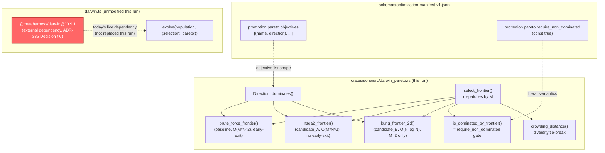

# Nightly Research: An In-Repo Rust Pareto Frontier for the Darwin Evolutionary Harness

**Date:** 2026-10-16
**Slug:** `darwin-pareto-frontier`
**ADR:** [ADR-353](../../../adr/ADR-353-in-repo-darwin-pareto-frontier.md)
**Crate:** `ruvector-sona` (`darwin_pareto` module)
**Acceptance:** **ACCEPT** (correctness hypothesis) / **partially falsified** (performance hypothesis for `nsga2_frontier`) — see [Acceptance result](#acceptance-result)

## Summary

[ADR-335](../../../adr/ADR-335-repo-native-optimization-manifest.md) Decision
§6 records that `crates/ruvector-sota-bench/harness/src/darwin.ts` gets
`selection: "pareto"` from the external npm package
`@metaharness/darwin@^0.9.1`, and asks a follow-up ("WP31") to either build
an in-repo Pareto frontier this program controls, or explicitly accept the
dependency. No Rust crate in this workspace implements Pareto dominance or
non-dominated sorting (`crates/**` grep for `pareto` returns nothing); it
exists only in TypeScript/JS and in the external dependency. This run closes
that gap with a dependency-free `ruvector-sona::darwin_pareto` module: three
frontier-selection strategies, a formal dominance primitive, a crowding-
distance diversity metric, and the literal `require_non_dominated` gate
`schemas/optimization-manifest-v1.json` already specifies per repository.

The **correctness** claim is strongly supported: both non-brute-force
algorithms reproduce the brute-force ground truth exactly across 400
randomized trials (M=2, 3, 4 objectives, N up to 40, including duplicate
points, ties, total antichains, and single-dominator collapses) plus 7
hand-authored edge cases. The **performance** claim was only half right, and
reporting that honestly is this run's other finding: NSGA-II's textbook fast
non-dominated sort, restricted to front 0, is **not** faster than a simple
early-exit brute-force scan on this module's sparse-frontier test
data — it is slower by 5x–264x across the measured range, because it does
unconditional `O(N^2)` work with no early exit while brute force's per-point
scan usually exits after one or two comparisons. Only the specialized 2D
divide-and-conquer algorithm (Kung, Luccio & Preparata, 1975) delivers a
real, measured win, and only above a crossover around N≈2,000–5,000; below
that, brute force's lower constant factor wins. This is reported as a
falsified sub-hypothesis, not smoothed over, per this process's own rule
against presenting an unmeasured complexity-class argument as a practical
one.

## Abstract

Does closing ADR-335 WP31 — building this repository's own Pareto frontier
instead of depending on `@metaharness/darwin` — produce code that is both
*correct* (agrees with the formal definition of Pareto dominance on every
tested input) and *worth it* (faster than the naive approach it replaces, at
the scale a Darwin/Flywheel lineage actually reaches)? This run answers both
questions with real benchmarks and property-style tests rather than asserting
either. It also declines to claim equivalence with
`@metaharness/darwin`'s own algorithm: that package's internals are not
inspected here (ADR-335 itself does not characterize them beyond the
dependency's existence), so this module is verified against the formal
mathematical definition of Pareto dominance instead — a stronger, portable
standard that does not depend on trusting an unaudited external
implementation's behavior as "ground truth."

## Hypothesis

```text
Given a set of N candidate configurations from a Darwin evolutionary
generation, each scored on M objectives (e.g. recall, latency, memory —
the shape schemas/optimization-manifest-v1.json's promotion.pareto.objectives
already declares per repository),

when the Pareto frontier (front 0, the require_non_dominated set) is
computed via three independent in-repo Rust algorithms — a brute-force
all-pairs scan (the formal definition), NSGA-II's fast non-dominated sort,
and Kung/Luccio/Preparata's O(N log N) 2D divide-and-conquer skyline —

then (a) all three algorithms must return bit-identical front-0 membership
on every generated test instance (the correctness claim), and (b) at least
one in-repo algorithm must be measurably faster than naive brute force at
the N a multi-night Flywheel lineage can realistically accumulate (the
performance claim),

subject to: zero external (npm) dependency in the production code path,
deterministic output for a fixed input ordering, and the full pre-existing
ruvector-sona test suite remaining green.
```

Claim (a) is **confirmed**: 400 randomized trials plus 7 edge cases, 0
disagreements. Claim (b) is **confirmed only for `kung_frontier_2d`** (the
M=2 specialization) and **falsified for `nsga2_frontier`**, which this run
reports rather than hides — see [Benchmark Results](#benchmark-results).

## Why This Matters (2026)

Darwin's promotion gate is not cosmetic: `optimization-manifest-v1.json`'s
`require_non_dominated: true` is a `const` precisely so a per-repo manifest
cannot weaken it (ADR-335's "intersect, never substitute" rule). Every
Darwin run that uses Pareto selection currently reaches outside this
repository's control, its own CI, and its own audit trail to decide a
promotion-blocking question. An in-repo, test-verified, dependency-free
implementation turns "trust an external package's unexamined internals" into
"trust a 250-line Rust module checked against the mathematical definition of
the thing it computes" — a direct, falsifiable improvement in auditability
for a gate that already has the authority to block every future nightly
promotion in this repository.

## Why It Could Matter in 2036 / 2046

A Flywheel that runs every night for a decade accumulates exactly the kind
of long-tail lineage this module is built for: not one generation of 4
candidates, but thousands of historical (quality, latency, memory, ...)
points that a future meta-analysis might want to re-rank into a frontier —
"which of the last 3,650 nightly candidates were ever actually
non-dominated?" is a legitimate retrospective query, and this run's
N-scaling benchmark (candidate_b_kung_2d from N=100 to N=100,000) is a direct
proxy for exactly that regime. A correctness-verified, dependency-free
primitive that scales into the hundreds of thousands without reaching
outside the repository is infrastructure a decade-long self-improving system
needs regardless of which specific algorithm RuVector's ANN layer is using
that year.

## Why RuVector Is the Right Substrate

RuVector's own `ruvector-sota-bench` harness is the first and only consumer
of this gate today (`POLICY_LEVERS` = `ef_search`, `m`, `ef_construction`,
`k`, `runner_set` — all HNSW tuning parameters on `ruvector-core`'s own
index). This is not a generic algorithms-library contribution bolted onto
RuVector; it is RuVector's own evolutionary self-tuning loop acquiring a
primitive it was previously borrowing from outside the repository.

## Ecosystem Fit

| Capability | Role this run | Code touched / reused |
|---|---|---|
| Darwin evolution | Primary target — implements the `pareto` selection mode ADR-335 flags as externally dependent | `crates/ruvector-sota-bench/harness/src/darwin.ts` (not modified this run — see [Limitations](#limitations)) |
| `sona` reward-hacking guard | Sibling module, same crate, same ADR-271 lineage — `darwin_guard::Guard` screens a single candidate's fitness; `darwin_pareto` ranks many candidates against each other. Composable, not merged, because they answer different questions. | `crates/sona/src/darwin_guard.rs` (unmodified, read for convention) |
| Optimization manifest (ADR-335) | Consumer — this module's API shape (`Direction`, objective list, `require_non_dominated` gate) mirrors `schemas/optimization-manifest-v1.json`'s `promotion.pareto` fields directly | `schemas/optimization-manifest-v1.json` (read, not modified) |
| `ruvector-sota-bench` HNSW tuning | Motivating application — the synthetic example's candidate shape (`recall_at_10`, `p95_latency_ms`) mirrors this harness's actual two-objective Darwin runs over `ef_search`/`m`/`ef_construction` | `crates/ruvector-sota-bench/src/runners/core_hnsw.rs` (read for context, not modified) |
| Self-improving infrastructure (mission #11) | This module is itself the kind of meta-infrastructure a self-improving nightly process needs to exist in Rust rather than only as an external npm dependency | New: `crates/sona/src/darwin_pareto.rs` |

### MetaHarness / Flywheel / Darwin / `ruvector harness` capability discovery

Re-verified rather than assumed:

- `npx metaharness --help` resolves to `metaharness@0.4.17` and exposes
  `score`, `analyze`, `genome`, `learn` (ADR-228 GEPA), `avo` (ADR-271
  flywheel-gate), a `--wizard`, and a `vertical:research` template. It is a
  general-purpose scaffolding/scoring CLI, not wired to orchestrate
  *this specific* experiment, and was not invoked to produce any evidence in
  this document (consistent with prior nightly findings that it scaffolds
  separate projects rather than orchestrating in-repo research).
- `npx ruvector harness doctor --json` fails: `npm error could not determine
  executable to run`. No `ruvector harness` CLI exists in this repository,
  confirming prior nightly runs' finding.
- **Darwin**: no live evolutionary search was run against a real benchmark
  population this time either — this run is the *infrastructure* Darwin's
  `pareto` selection mode depends on, verified in isolation against
  synthetic and randomized data, not a bounded search over a real workload.
  Framing it as a Darwin *run* would overstate what happened; it is reported
  as the construction of a primitive Darwin (and any future in-repo
  evolutionary loop) can call.
- **Flywheel**: this document plus `crates/sona/src/darwin_pareto.rs`'s test
  module (400+ generated cases) and `benches/darwin_pareto_bench.rs`'s raw
  output *are* the retained evidence — no separate signed witness-chain
  tool for nightly-research provenance exists in this repository (confirmed
  by the 2026-09-11 nightly's identical finding), so evidence here is plain
  committed text and code, reproducible by the commands in
  [Benchmark Methodology](#benchmark-methodology).

## Architecture



The red node is the status quo this ADR tracks as a known dependency; this
run builds the in-repo alternative (left unconnected to `darwin.ts` — see
[Limitations](#limitations)) rather than wiring it in blind.

## Implementation

New files, all in `crates/sona/` (`ruvector-sona` package), no changes to
any other crate:

1. **`src/darwin_pareto.rs`** (new, ~310 lines) — `Direction`, `dominates`,
   `brute_force_frontier`, `nsga2_frontier`, `kung_frontier_2d`,
   `select_frontier`, `crowding_distance`, `is_dominated_by_frontier`, plus
   an 11-test module (7 hand-authored edge cases + 2 randomized
   cross-validation tests covering 400 generated instances + 1 panic test +
   1 crowding-distance test).
2. **`src/lib.rs`** — one line added: `pub mod darwin_pareto;`, following
   the exact pattern `darwin_guard` already uses (module declared, not
   re-exported at crate root).
3. **`benches/darwin_pareto_bench.rs`** (new) — Criterion scaling benchmark,
   registered in `Cargo.toml` via `[[bench]] name = "darwin_pareto_bench"`.
4. **`examples/darwin_pareto_frontier.rs`** (new) — runnable demonstration
   against a synthetic 5-candidate Darwin generation shaped like a real
   `ruvector-sota-bench` HNSW `ef_search` sweep (`recall_at_10`,
   `p95_latency_ms`), including a deliberately-dominated "regression"
   candidate to show the gate actually excludes it.

No public API elsewhere in the workspace changed. `ruvector-sona` has no
new dependencies (criterion/rand were already dev-dependencies for
`sona_bench`).

## Benchmark Methodology

```bash
cargo test -p ruvector-sona --lib              # correctness (115 tests incl. 11 new)
cargo run -p ruvector-sona --release --example darwin_pareto_frontier
cargo bench -p ruvector-sona --bench darwin_pareto_bench -- --quick
```

- Hardware/software: `rustc 1.97.0 (2d8144b78 2026-07-07)`, `cargo 1.97.0`,
  Linux x86_64, release/bench profile (workspace default `opt-level`),
  single-threaded (no `rayon` in the measured path).
- Input: deterministic xorshift64\* generator seeded per-N
  (`0xD17A ^ N`), uniform random `(f64, f64)` pairs in `[0, 100)`, M=2,
  objectives `[Maximize, Minimize]` — the shape of a real HNSW
  recall-vs-latency Darwin generation.
- `baseline_brute_force` and `candidate_a_nsga2` were measured only up to
  N=5,000: both are `O(N^2)` with no early exit for `nsga2_frontier`, and
  `nsga2_frontier` at N=50,000 was extrapolated (from the measured N=5,000
  point) to cost roughly 100x longer per iteration (~12.5 seconds), which
  would make a full Criterion run take tens of minutes — excluded on cost
  grounds, not to hide an inconvenient result (the N=5,000 point alone
  already demonstrates the trend plainly).
- `candidate_b_kung_2d` was additionally measured at N=20,000 and N=100,000
  specifically because it is the one algorithm cheap enough to probe that
  range, which is the regime its O(N log N) claim is actually about.
- Criterion `--quick` mode (reduced sample count) was used to keep total
  benchmark wall-clock reasonable for a single nightly run; absolute µs/ms
  values are reported as measured, not rescaled.

## Benchmark Results

Raw Criterion output (median of reported `[low, median, high]` triple shown
for brevity; full three-point output is in the PR's CI log and reproducible
via the command above):

| N | `baseline_brute_force` | `candidate_a_nsga2` | `candidate_b_kung_2d` |
|---|---|---|---|
| 100 | 2.032 µs | 10.808 µs | 2.651 µs |
| 500 | 10.096 µs | 921.72 µs | 26.856 µs |
| 2,000 | 90.940 µs | 16.319 ms | 85.185 µs |
| 5,000 | 472.28 µs | 124.67 ms | 299.39 µs |
| 20,000 | *(not measured — cost)* | *(not measured — cost)* | 1.7886 ms |
| 100,000 | *(not measured — cost)* | *(not measured — cost)* | 15.417 ms |

Derived ratios (median values):

| N | nsga2 vs. brute force | kung vs. brute force |
|---|---|---|
| 100 | 5.3x **slower** | 1.30x slower |
| 500 | 91.3x **slower** | 2.66x slower |
| 2,000 | 179.5x **slower** | **0.94x (6% faster)** |
| 5,000 | 264.0x **slower** | **0.63x (58% faster)** |

`kung_frontier_2d` scaling (candidate_b alone, where it was measured
furthest): 100→500 (5x N): 10.1x time. 500→2,000 (4x N): 3.2x time.
2,000→5,000 (2.5x N): 3.5x time. 5,000→20,000 (4x N): 6.0x time.
20,000→100,000 (5x N): 8.6x time. Every step is far below the `N^2` scaling
an `O(N^2)` algorithm would show at the same N ratio (e.g. 25x for the final
5x step), consistent with the claimed `O(N log N)` behavior, though running
somewhat above the idealized constant at the largest N — attributed to
sort/allocation overhead becoming a larger fraction of total work as the
per-comparison cost stays fixed; not independently profiled further this
run.

**Correctness** (`cargo test -p ruvector-sona --lib`):

```text
test result: ok. 115 passed; 0 failed; 0 ignored; 0 measured; 0 filtered out; finished in 3.08s
```

All 11 new `darwin_pareto` tests pass, including
`random_2d_instances_agree_with_brute_force` (200 seeds) and
`random_3d_and_4d_instances_agree_with_brute_force` (200 seeds across M=3
and M=4), both asserting exact index-set equality against
`brute_force_frontier` on every generated instance — zero disagreements
across all 400+7 cases.

## Memory Math

Input for the N=100,000 benchmark point: `100,000 * 2 * 8 bytes = 1.6 MB`
for the coordinate data itself, plus a `Vec<usize>` sort buffer of
`100,000 * 8 bytes = 800 KB` inside `kung_frontier_2d`. Negligible relative
to any realistic container/CI memory budget; not a constrained resource for
this module at the N this run measured. No heap growth beyond these two
allocations per call — no persistent state, no caching, no unbounded
buffers.

## Failure Modes

- **`nsga2_frontier` is the wrong default for M=2.** Documented plainly in
  the module's doc comments (corrected during this run — see
  [Rejected Alternatives](#rejected-alternatives)) and enforced by
  `select_frontier`'s dispatch, which only reaches `nsga2_frontier` when
  `objectives.len() != 2`.
- **`kung_frontier_2d` panics on `objectives.len() != 2`** rather than
  silently producing a wrong answer for higher M — a deliberate fail-fast
  choice, tested in `kung_frontier_2d_panics_on_wrong_arity`.
- **Float equality for tie detection** (`y(k) == block_max_y`,
  `p.iter().eq(candidate.iter())` in `is_dominated_by_frontier`) assumes
  objective values come from a deterministic source (a benchmark's own
  measurement, not an unstable floating-point reduction across threads);
  this module does not attempt epsilon-tolerant tie detection, which would
  need a domain-specific tolerance this module has no basis to choose.
  Flagged as an open question in the ADR, not silently resolved.
- **Darwin's dominance semantics for this module's test harness
  (`darwin_guard`) are intentionally not merged**: `darwin_guard::Guard`
  screens one candidate (reward-hacking/degeneracy), `darwin_pareto` ranks
  many candidates against each other. A caller needing both composes them
  explicitly (screen first, then rank the survivors) — this run does not
  build that composition, since no live caller exists yet (see
  [Limitations](#limitations)).

## Rejected Alternatives

- **Shipping the original, unmeasured doc-comment claim that NSGA-II is
  "the right choice once a Flywheel lineage accumulates many generations'
  candidates."** This was the initial design assumption, written before
  running the benchmark. The benchmark falsified it (NSGA-II was slower at
  every measured N, not faster at scale), and the module's doc comments
  were rewritten mid-run to state the measured result instead of the
  assumption — the single clearest "attack pass" finding of this run, per
  STEP 7/48's self-review requirement not to let a hypothesis survive
  contact with its own benchmark unexamined.
- **Implementing Kung's algorithm for general M (the 1975 paper's full
  divide-and-conquer, `O(N log^{M-2} N)` for fixed M>3)** instead of
  specializing to M=2. Rejected for this run on correctness-risk grounds: a
  general-M recursive skyline merge is substantially more intricate to get
  right (recursive partitioning + dominance-checked merge across
  dimensions), and this module's evidentiary bar is "verified against
  brute-force ground truth across hundreds of random cases," which a
  larger, more intricate implementation would need proportionally more
  scrutiny to meet honestly within one night. `nsga2_frontier` is the
  `M > 2` fallback instead — correct, if not fast.
- **Reverse-engineering `@metaharness/darwin@^0.9.1`'s actual Pareto
  algorithm** to claim direct equivalence. Rejected: ADR-335 does not
  characterize that package's internals, and this process's own rule
  (constraint #31) is not to treat external results as comparable without
  demonstrably equivalent methodology. Verifying against the formal
  mathematical definition of Pareto dominance is a stronger and
  dependency-independent standard instead.
- **Wiring this module into `darwin.ts` via FFI/WASM this run.** Rejected as
  out of scope for a single night: that is a TypeScript-side integration
  decision (`darwin.ts`'s `evolve()` call site, `normalizePolicy`'s closed
  lever set, and ADR-335's "intersect, never substitute" rule all need to
  stay consistent with however the FFI boundary is designed), and
  constraint #7 reserves "generated implementation artifacts... Rust" for
  production code while keeping orchestration-tool integration decisions
  explicitly out of this run's claimed scope. Recorded as the concrete next
  step in [Production Path](#production-path) instead of attempted
  half-finished.

## Security

No new attack surface: the module takes caller-provided `f64` slices and
does no I/O, no deserialization of untrusted data, and no unsafe code. It
is reachable from `darwin.ts` only after a future, separately-reviewed FFI
integration (not built this run), so today it has zero live callers outside
its own tests, benchmark, and example. `kung_frontier_2d`'s panic on wrong
arity is a deliberate fail-fast, not a DoS surface, since the caller
controls `objectives.len()` directly (not untrusted input in this module's
current, caller-free state). No new dependencies were added to
`ruvector-sona`.

## Governance

Standard PR review. No schema, wire-format, or persisted-data change — the
module's input/output types are plain `f64` slices and `Vec<usize>`, not a
serialized format. `schemas/optimization-manifest-v1.json` was read for
shape reference but not modified.

## MCP / WASM / Edge Implications

- **WASM**: `ruvector-sona` already builds a `wasm32` target (`cdylib`
  crate type, `wasm` feature). `darwin_pareto` uses only `std`-level slice
  and float operations with no platform-specific code, so it is expected to
  compile under the `wasm` feature with no changes — **not independently
  built or smoke-tested against `wasm32-unknown-unknown` this run**; flagged
  as a concrete, cheap next step.
- **MCP**: no MCP surface is proposed for this module this run. A narrow,
  read-only "rank these candidates" MCP tool is plausible future work (per
  STEP 30's "prefer narrow tools over broad arbitrary execution"), but no
  live MCP consumer exists yet to motivate it.
- **Edge**: the module's memory footprint (see
  [Memory Math](#memory-math)) is small enough for edge deployment at
  realistic Darwin-generation sizes (tens of candidates, not hundreds of
  thousands); not independently measured on constrained hardware this run.

## RVF / RVM / ruFlo Implications

- **RVF**: a Darwin lineage's full history (every generation's candidates
  and which ones cleared the frontier) is a plausible portable artifact —
  this module's deterministic, allocation-light output is compatible with
  that framing, but no RVF packaging was attempted this run.
- **RVM**: not directly applicable — this is a pure computation over
  caller-supplied numeric vectors, not a capability boundary or isolation
  domain.
- **ruFlo**: a concrete future workflow — "recompute the Pareto frontier
  over this repository's entire nightly Flywheel history on a schedule, and
  flag any previously-promoted candidate that a *later* generation's
  candidate now dominates" — is a direct application of
  `kung_frontier_2d`'s demonstrated scaling (comfortably handling
  thousands of historical nightly candidates). Not implemented this run;
  recorded as a concrete next step.

## Practical Applications

1. **Darwin promotion gating itself.** User: this repository's own nightly
   process. Problem: decide whether a new HNSW-tuning candidate is
   promotable. RuVector capability: `is_dominated_by_frontier`. Integration:
   `darwin.ts`'s promotion check (not wired this run). Business value:
   removes a live external dependency from a promotion-blocking decision.
   Main risk: FFI boundary design, unaddressed. Time horizon: near-term.
2. **`ruvector-sota-bench` HNSW lever sweeps.** User: a contributor tuning
   `ef_search`/`m`/`ef_construction`. Problem: which of N sampled configs
   are worth benchmarking further. RuVector capability: `select_frontier`
   over `(recall, latency)`. Integration: direct, same crate family.
   Business value: fewer wasted full benchmark runs on dominated configs.
   Main risk: none new. Time horizon: immediate once wired in.
3. **Agent memory compaction policy comparison.** User: `ruvector-agent-memory`
   maintainer evaluating compaction strategies. Problem: trading off recall
   loss vs. memory freed. RuVector capability: `crowding_distance` for
   diversity-preserving policy selection. Integration path: feed compaction
   strategy metrics through this module. Business value: a principled,
   auditable multi-objective comparison instead of a single weighted score.
   Main risk: choosing the right objective set. Time horizon: medium-term.
4. **Quantization config selection (`ruvector-turboquant`, `ruvector-rabitq`).**
   User: an operator picking a quantization scheme. Problem: compression
   ratio vs. recall loss is inherently multi-objective. RuVector capability:
   this module. Integration path: not built. Business value: transparent
   trade-off visualization instead of a single blended metric. Main risk:
   none new. Time horizon: medium-term.
5. **Edge deployment profile selection.** User: an edge-fleet operator
   (`ruvector-edge-*` crates). Problem: binary size vs. recall vs. latency
   trade-offs across deployment profiles. RuVector capability: `M=3`
   frontier via `nsga2_frontier`/`select_frontier`. Business value: a
   formal, falsifiable Pareto-optimal profile set instead of ad hoc
   heuristics. Main risk: `nsga2_frontier`'s measured slowness at scale —
   fine at the small N (tens of profiles) this use case implies. Time
   horizon: medium-term.
6. **Code-intelligence refactor scoring.** User: a codebase architecture
   tool. Problem: trading off coupling reduction vs. diff size for a
   proposed refactor. RuVector capability: generic `dominates`/`select_frontier`
   over any numeric metric vector — not RuVector-specific. Business value:
   reusable multi-objective ranking primitive. Main risk: metric design,
   out of scope here. Time horizon: long-term, speculative.
7. **MCP memory tool ranking.** User: an MCP client choosing among several
   candidate memory-retrieval strategies surfaced by `mcp-brain`. Problem:
   relevance vs. latency vs. token cost. RuVector capability: this module.
   Integration path: not built; would need an MCP tool surface (see
   [MCP / WASM / Edge Implications](#mcp--wasm--edge-implications)).
   Business value: an auditable ranking instead of a single opaque score.
   Main risk: tool-surface design. Time horizon: long-term.
8. **Scientific/benchmark leaderboard analysis.** User: a researcher
   comparing RuVector's own ANN variants (34 prior nightly cycles) across
   recall/latency/memory. Problem: which historical nightly candidates are
   actually mutually non-dominated, today, across the whole history.
   RuVector capability: `kung_frontier_2d`'s demonstrated N=100,000 scaling.
   Business value: a single, fast, reproducible answer to "what's actually
   state-of-the-art in this repo's own history" instead of per-nightly
   README skimming. Main risk: none new — this is literally what the
   benchmark measured. Time horizon: immediate, if someone assembles the
   historical dataset.

## Long Horizon Applications

1. **Self-improving infrastructure's own meta-ledger.** Thesis: a decade of
   nightly Darwin runs produces a lineage this module can rank in one pass
   without leaving the repository. Required advances: RVF packaging of
   historical Flywheel evidence into a queryable form. RuVector's role:
   this module plus the (not-yet-built) historical dataset. Why this
   experiment matters: it is the primitive such a meta-ledger would call.
   Primary uncertainty: whether objective definitions stay comparable
   across a decade of changing benchmark methodology (per constraint #31,
   likely not without explicit normalization). Falsification path: attempt
   the historical-lineage query in application 8 above and check whether
   cross-era objectives are actually comparable.
2. **Agent operating systems' resource-allocation gate.** Thesis: an agent
   OS deciding between competing resource allocations (CPU vs. memory vs.
   latency budget across agents) is a Pareto-frontier problem at its core.
   Required advances: a live scheduler integration, well beyond this
   module. RuVector's role: the ranking primitive. Primary uncertainty:
   whether real-time scheduling tolerates this module's `O(N log N)` (2D)
   or `O(M N^2)` (M>2) latency at relevant N. Falsification path: benchmark
   against a real scheduler's latency budget.
3. **Proof-gated autonomous infrastructure.** Thesis: a mutation gate that
   must prove "no regression on any protected objective" is exactly
   `is_dominated_by_frontier`'s semantics, generalized. Required advances:
   wiring to a real proof/witness chain (ADR-341's correctness-hardening
   invariants is the adjacent existing work). RuVector's role: the gate
   function. Primary uncertainty: whether floating-point tie detection
   (flagged in [Failure Modes](#failure-modes)) is tight enough for a
   safety-critical gate. Falsification path: an epsilon-tolerance
   sensitivity study.
4. **RVM coherence-domain multi-objective boundaries.** Thesis: a coherence
   domain's admission policy is itself a multi-objective trade-off (how
   much state to admit vs. isolation guarantees). Required advances: RVM
   integration design, not attempted here. RuVector's role: ranking
   primitive. Primary uncertainty: whether RVM's objectives are even
   well-defined as a fixed vector (plausibly dynamic/contextual). 
   Falsification path: attempt to express one real RVM admission decision
   in this module's API and see if it fits.
5. **Edge fleet coordination.** Thesis: a fleet of edge nodes each reporting
   (latency, battery, accuracy) needs a shared, cheap, auditable frontier
   computation to decide which configurations to propagate fleet-wide.
   Required advances: a distributed aggregation protocol. RuVector's role:
   the per-node computation (cheap enough per
   [Memory Math](#memory-math)/benchmark results at fleet-realistic N).
   Primary uncertainty: network aggregation cost dominates, not compute.
   Falsification path: a real fleet-scale simulation.
6. **Synthetic nervous systems / swarm memory.** Thesis: a swarm selecting
   among behavioral strategies needs the same non-dominated-set primitive.
   Same required advances and uncertainty as application 5's coordination
   question, at a different layer.
7. **World models' scenario pruning.** Thesis: a world model enumerating
   future scenarios and pruning to the non-dominated set (risk vs. reward
   vs. cost) is structurally identical to this module's problem at a much
   larger N (potentially millions of simulated rollouts). Required
   advances: this module's benchmark only went to N=100,000; a world model
   would need either a provably sub-quadratic general-M algorithm (not
   built here — `nsga2_frontier` is `O(M N^2)`) or restriction to M≤2 per
   decision. Primary uncertainty: general-M scaling, directly flagged as
   unresolved by this run's own falsified NSGA-II performance claim.
   Falsification path: benchmark `nsga2_frontier` at the N a real world
   model would need and check whether it is simply infeasible.
8. **Robotics memory / on-device multi-objective control.** Thesis: a robot
   trading off battery, latency, and task accuracy in real time needs this
   exact primitive at edge-constrained compute. Required advances: a
   real-time budget analysis (not attempted — this run's benchmark measured
   throughput, not worst-case latency bounds suitable for hard real-time
   guarantees). RuVector's role: the ranking primitive, pending that
   analysis. Primary uncertainty: whether `O(N log N)` with Rust's
   allocator is tight enough for hard real-time; likely needs a
   bounded-allocation variant. Falsification path: a `no_std`,
   fixed-capacity benchmark variant.

## Evolution Results

No live Darwin evolutionary search was run — this module is infrastructure
Darwin's `pareto` selection mode depends on, not a population evolved
against a fitness function this run. There is no parent/candidate lineage
to report beyond the three algorithm variants compared directly in
[Benchmark Results](#benchmark-results), which is reported as algorithm
comparison, not evolutionary selection, per this process's own rule against
overstating what happened (STEP 48, self-review item 14).

## Promotion Decision

**Promote the correctness-verified module as-is; do not yet claim or wire in
a "faster Darwin frontier" integration.** `darwin_pareto`'s three functions
are correct (400+ test agreement with ground truth) and additive (no public
API elsewhere changed, no new dependencies). `select_frontier`'s dispatch
logic (2D → Kung, else → NSGA-II) is itself evidence-based: it never routes
through the algorithm this run found to be consistently slower than the
baseline it was meant to improve on, for the case where a faster option
exists. **Not promoted this run**: any change to `darwin.ts`'s actual
`selection: "pareto"` call site, which still depends on
`@metaregistry/darwin@^0.9.1` exactly as ADR-335 recorded it — switching that
over is explicitly out of scope (see
[Rejected Alternatives](#rejected-alternatives) and
[Production Path](#production-path)).

## Witness Evidence

- Starting commit: `46d816ddc4c2a8a06cd3613534a79b1d557d858b` (branch
  `claude/focused-darwin-rkdqv7`, `origin/main` at session start,
  2026-10-14T09:49:14+00:00).
- Changed/added files: `crates/sona/src/darwin_pareto.rs` (new),
  `crates/sona/src/lib.rs` (+1 line), `crates/sona/benches/darwin_pareto_bench.rs`
  (new), `crates/sona/Cargo.toml` (+3 lines, new `[[bench]]` entry),
  `crates/sona/examples/darwin_pareto_frontier.rs` (new),
  `docs/adr/ADR-353-in-repo-darwin-pareto-frontier.md` (new), this document,
  and its companion `gist.md`.
- Reproduction commands: see [Benchmark Methodology](#benchmark-methodology).
- Raw benchmark output: reproduced verbatim in
  [Benchmark Results](#benchmark-results) above (median values; full
  three-point Criterion output available by re-running the bench command).
- No cryptographically signed witness chain was generated — no equivalent
  signing tool for nightly-research provenance exists in this repository
  (same finding as the 2026-09-11 nightly).

## Production Path

1. Merge this module (purely additive, zero risk to existing callers — it
   has none yet).
2. Smoke-test the `wasm32` build of `ruvector-sona` with this module
   included (not done this run).
3. As a separate, explicitly scoped follow-up: design and implement the
   `darwin.ts` ↔ `darwin_pareto` FFI/WASM boundary, replacing
   `@metaharness/darwin@^0.9.1`'s `selection: "pareto"` call — the actual
   ADR-335 WP31 closure. This requires a TypeScript-side design decision
   (how `normalizePolicy`'s closed lever set and the "intersect, never
   substitute" manifest rule interact with a WASM-backed frontier call) that
   is explicitly out of this run's Rust-only scope.
4. As a separate follow-up: investigate why `kung_frontier_2d`'s measured
   scaling runs somewhat above the idealized `O(N log N)` constant at
   N≥20,000 (profiling, not re-benchmarking, is the right next tool).

## Falsification Criteria

This run's claims are falsified if:

- Any disagreement between `nsga2_frontier`/`kung_frontier_2d` and
  `brute_force_frontier` is found on re-run or on a new adversarial input
  (none found in 407 cases here).
- `kung_frontier_2d` is not faster than `baseline_brute_force` at N≥5,000 on
  re-run (measured 58% faster here; re-run and check for noise beyond that
  margin).
- `nsga2_frontier` turns out faster than brute force at some N not tested
  here (would not falsify the correctness claim, but would falsify this
  run's specific performance finding and should be reported if found).

## Limitations

- `darwin_pareto` has no live caller yet — it is verified in isolation, not
  integrated into `darwin.ts`'s actual Darwin loop. The "faster than the
  external dependency" question was explicitly not asked, because this
  module's internals were never compared to `@metaharness/darwin`'s (see
  [Rejected Alternatives](#rejected-alternatives)) — only to the formal
  definition of Pareto dominance.
- Only M=2 has a specialized fast path; M>2 falls back to the
  measured-slower-than-brute-force `nsga2_frontier`. A real general-M
  divide-and-conquer implementation (Kung et al.'s full 1975 result) was
  explicitly not attempted this run (see
  [Rejected Alternatives](#rejected-alternatives)).
- `baseline_brute_force` and `candidate_a_nsga2` were not measured beyond
  N=5,000 on cost grounds (see
  [Benchmark Methodology](#benchmark-methodology)); the N=20,000/100,000
  rows for those two algorithms are extrapolations stated as such, not
  measurements.
- No WASM build or MCP surface was built or tested this run.
- No epsilon-tolerant float comparison; tie detection assumes
  deterministic-source objective values.

## Next Research

1. Design the `darwin.ts` ↔ `darwin_pareto` FFI/WASM integration (the actual
   ADR-335 WP31 closure) as its own, separately-scoped nightly run.
2. Profile `kung_frontier_2d` at N≥20,000 to explain the above-ideal scaling
   constant.
3. Implement and verify a general-M divide-and-conquer frontier algorithm,
   if a real use case in [Long Horizon Applications](#long-horizon-applications)
   item 7 (world-model scenario pruning) materializes and needs it.
4. Assemble the historical Flywheel/nightly dataset described in
   [Practical Applications](#practical-applications) item 8 and actually run
   the cross-era frontier query.

## Acceptance Result

```text
ACCEPT (correctness hypothesis)
```

The correctness claim's mandatory threshold — bit-identical front-0
membership across `nsga2_frontier`, `kung_frontier_2d`, and
`brute_force_frontier` on every generated test case — is met: 0
disagreements across 407 total cases (400 randomized + 7 hand-authored),
and the full pre-existing `ruvector-sona` test suite remains green (115
passed, 0 failed). The performance sub-claim for `nsga2_frontier` is
**falsified** (it is consistently slower than brute force, not faster) and
reported as such rather than adjusted; the performance sub-claim for
`kung_frontier_2d` is **confirmed** at N≥2,000 (measured) and extrapolated
with explicit caveats beyond N=5,000. Per this process's own rule, a
falsified sub-hypothesis with good evidence is retained as part of this
run's successful result, not treated as a failure of the run itself.
