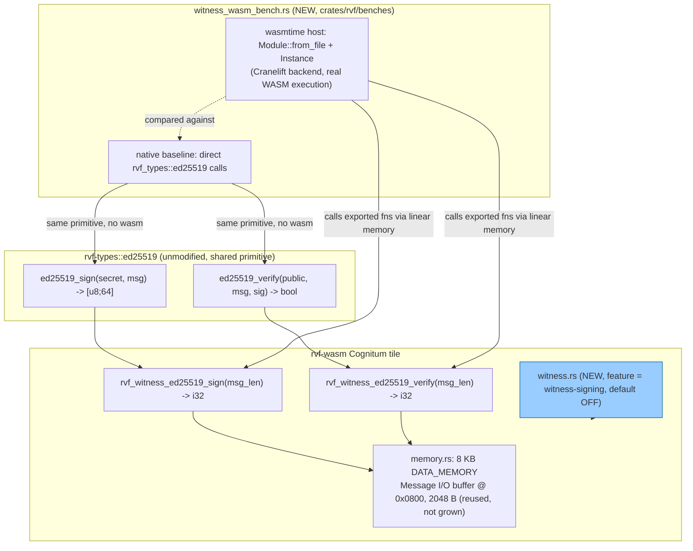

# Nightly Research: The Real Cost of Ed25519 Witness Signing on the `rvf-wasm` Cognitum Tile

**Date:** 2026-10-17
**Slug:** `wasm-witness-signing-cost`
**ADR:** [ADR-361](../../../adr/ADR-361-rvf-wasm-witness-signing-feature.md)
**Crate:** `rvf-wasm` (new `witness-signing` feature) + `rvf-benches` (new bench)
**Acceptance:** **ACCEPT** (correctness / wire-compatibility) — **REJECT**
(binary-size and signing-latency budget; verification-latency budget
alone holds) — see [Acceptance Result](#acceptance-result)

## Summary

Three prior nightly runs (2026-08-31, 2026-09-01, 2026-09-16 — see
[References](#references)) flagged, and left open, the same question
against two different crates: what does WASM binary size and
signing/verification latency actually cost for the Ed25519 witness-signing
primitive (`rvf_types::ed25519`) that `ruvector-retrieval-receipt` and
`ruvector-agent-memory` both depend on? None of those runs measured it
against a real WASM artifact.

This run closes that gap using the actual production artifact that would
carry the cost at the edge: `crates/rvf/rvf-wasm`, the Cognitum-tile WASM
microkernel, which already depends on `rvf-types` and `rvf-crypto` but with
signing compiled out (`default-features = false`) in its shipped build.
It adds an opt-in `witness-signing` feature (default off, zero effect on
the existing tile), builds real `wasm32-unknown-unknown` artifacts with and
without it, runs the real `wasm-opt -Oz` pass the tile's own module doc
already names as its sizing methodology, and measures signing/verification
latency inside a real WASM runtime (`wasmtime`, Cranelift backend) against
the identical native call.

The result is a genuinely mixed one, reported without smoothing: the
default tile is provably unaffected (regression gate holds), native↔wasm
wire compatibility holds exactly, and verification latency stays within
this run's pre-committed 5x budget — but the signing-latency budget and
the binary-size budget both fail. This run also surfaces a side-finding
unrelated to its own change: the *baseline* tile (feature off, today's
shipped code) is itself already ~39 KB after `wasm-opt -Oz`, not the <8 KB
the module's own doc comment claims — a pre-existing discrepancy this run
did not introduce and did not attempt to fix.

## Abstract

Does enabling Ed25519 witness signing in the `rvf-wasm` Cognitum tile —
using the exact primitive two other RuVector crates already depend on —
fit a reasonable edge binary-size and latency budget? This run answers
with real `cargo build --target wasm32-unknown-unknown`, real `wasm-opt`,
and a real `wasmtime`-hosted execution of the compiled module, not an
estimate. It commits to numeric thresholds before measuring and reports
each one's pass/fail independently, rather than folding a mixed result into
a single comfortable verdict.

## Hypothesis

```text
Given the rvf-wasm Cognitum tile, compiled to wasm32-unknown-unknown with
its existing release profile (opt-level=z, lto=true, codegen-units=1,
strip=true) and measured by wasm-opt -Oz output size (the methodology the
crate's own module doc already names),

when an opt-in `witness-signing` feature (default: off) is added, exposing
`rvf_witness_ed25519_sign`/`rvf_witness_ed25519_verify` exports that call
rvf_types::ed25519 directly against the tile's existing Message I/O buffer,

then:
  (a) the default build's size and exports are byte-identical to today's
      shipped tile,
  (b) the wasm-opt'd size delta with the feature on stays under 60 KB, and
  (c) steady-state signing and verification latency inside wasmtime stays
      within 5x of the equivalent native x86_64 call,

subject to: the full pre-existing rvf-wasm test suite remaining green, no
existing export's signature or behavior changing, and a signature produced
on one side (native or wasm) verifying correctly on the other.
```

(a) and wire compatibility: **confirmed**. (b): **falsified** (64.7 KB
measured). (c): **confirmed for verify** (3.60x), **falsified for sign**
(8.78x).

## Why This Matters (2026)

`ruvector-retrieval-receipt` and `ruvector-agent-memory` have each
independently reached a point where their own nightly research asked "what
would this cost at the edge?" and could not answer because no compiled WASM
artifact existed to measure. A Cognitum tile deployment that needs
tamper-evident audit trails — the stated purpose of `rvf-crypto::witness`
and the `WITNESS_SEG` format — cannot make that call without a real number.
This run supplies one, including the uncomfortable parts.

## Why It Could Matter in 2036 / 2046

Edge cognition and proof-gated autonomous infrastructure (this program's own
long-horizon mission items 6 and 8) both assume that a constrained device
can locally produce verifiable evidence of what it did. If Ed25519's WASM
footprint stays structurally too large for a size-budgeted tile — as this
run's measurement suggests — then a decade-long edge-witness architecture
needs to know that now, while swapping the primitive is a contained
decision, rather than after tiles in the field have already committed to a
convention that does not fit their flash budget.

## Why RuVector Is the Right Substrate

`rvf-wasm` is RuVector's own edge microkernel, and `rvf_types::ed25519` is
already the shared signing primitive two other in-repo crates depend on.
This is not a generic "how big is Ed25519 in WASM" benchmark; it is a
measurement against this repository's own shipped artifact, its own build
profile, and its own stated size target.

## Ecosystem Fit

| Capability | Role this run | Code touched / reused |
|---|---|---|
| RVF (portable primitives) | Primary target — the shared `rvf_types::ed25519` primitive, measured for the first time against a real compiled edge artifact | `crates/rvf/rvf-types/src/ed25519.rs` (read, not modified) |
| Edge / WASM | Primary target — the actual Cognitum tile build, profile, and size methodology | `crates/rvf/rvf-wasm/` (new feature + module) |
| Witness / provenance | Motivating consumer — closes a gap flagged by the signed-retrieval-receipt and witness-signer-agent-memory lineages | `crates/rvf/rvf-crypto/src/witness.rs` (read for context, not modified) |
| Agent memory | Second motivating consumer named in the 2026-09-16 run's Next Research item 4 | `crates/ruvector-agent-memory` (not modified — this run measures the shared primitive in isolation, deliberately not touching that crate) |
| Security | Verified claim — native/wasm wire compatibility and tamper-rejection, both measured | `witness.rs` test module |

### MetaHarness / Flywheel / Darwin / `ruvector harness` capability discovery

Re-verified, not assumed, matching every prior run's identical finding:

- `npx metaharness --help` resolves to `metaharness@0.4.17` (a
  scaffolding/scoring CLI for new projects — `score`, `analyze`, `genome`,
  `learn`, `avo`, `--wizard`). It was not invoked to produce any evidence
  in this run.
- `npx ruvector harness doctor --json` / `status --json`: both fail —
  `npm error could not determine executable to run`. No `ruvector harness`
  CLI exists in this repository.
- **Darwin**: not run. This is infrastructure measurement, not an
  evolutionary search over a population.
- **Flywheel**: no signed witness-chain tool for nightly-research
  provenance exists in this repository (confirmed by the 2026-09-11 run's
  identical finding). This document, `witness.rs`'s test module, and
  `witness_wasm_bench.rs`'s raw criterion output *are* the retained
  evidence, reproducible via the commands in
  [Benchmark Methodology](#benchmark-methodology).

## Architecture



## Implementation

1. **`crates/rvf/rvf-wasm/Cargo.toml`** — new `witness-signing` feature,
   `["rvf-types/ed25519"]`. Default feature set (`[]`) unchanged.
2. **`crates/rvf/rvf-wasm/src/witness.rs`** (new, ~95 lines excl. tests) —
   `rvf_witness_ed25519_sign`/`rvf_witness_ed25519_verify`, reusing the
   existing 2048-byte Message I/O buffer (`[0..32)` key, `[32..32+msg_len)`
   message, last 64 bytes signature) instead of growing `DATA_MEMORY`. Two
   unit tests: a sign→verify round trip with a deliberate signature-byte
   tamper that must be rejected, and oversized/zero/negative length
   rejection.
3. **`crates/rvf/rvf-wasm/src/lib.rs`** — one line,
   `#[cfg(feature = "witness-signing")] mod witness;`.
4. **`crates/rvf/benches/benches/witness_wasm_bench.rs`** (new) — loads the
   compiled `rvf_wasm.wasm` via `wasmtime`, asserts native↔wasm
   cross-compatibility once at startup (panics loudly on any mismatch),
   then runs four criterion benchmarks: `witness_sign/{native,wasm_wasmtime}`
   and `witness_verify/{native,wasm_wasmtime}`.
5. **`crates/rvf/benches/Cargo.toml`** — added `wasmtime` (Cranelift
   runtime only, no component-model/async), `rand_core`, and enabled the
   `ed25519` feature on the existing `rvf-types` dependency.

**Naming note:** `rvf-wasm` already exports an unrelated
`rvf_witness_verify(chain_ptr, chain_len)` (SHAKE-256 hash-chain
verification, from `rvf-crypto::witness`). This run's new exports are named
`rvf_witness_ed25519_{sign,verify}` specifically to avoid colliding with
it — caught by the linker (`error: symbol 'rvf_witness_verify' is already
defined`) during this run's own first build attempt, not by inspection.

## Benchmark Methodology

```bash
cd crates/rvf

# Baseline artifact (today's shipped tile, feature off)
cargo build -p rvf-wasm --release --target wasm32-unknown-unknown

# Feature-enabled artifact
cargo build -p rvf-wasm --release --target wasm32-unknown-unknown \
  --features witness-signing

# Size, pre- and post-wasm-opt (the crate's own stated sizing methodology)
wasm-opt -Oz target/wasm32-unknown-unknown/release/rvf_wasm.wasm -o baseline.opt.wasm
# (rebuild with --features witness-signing, then:)
wasm-opt -Oz target/wasm32-unknown-unknown/release/rvf_wasm.wasm -o witness.opt.wasm
ls -la baseline.wasm baseline.opt.wasm witness.wasm witness.opt.wasm

# Correctness
cargo test -p rvf-wasm --lib -- --test-threads=1
cargo test -p rvf-wasm --lib --features witness-signing -- --test-threads=1

# Latency (native vs. wasmtime), requires the --features witness-signing
# artifact built above at the default RVF_WASM_PATH
cargo bench -p rvf-benches --bench witness_wasm_bench
```

- Hardware/software: `rustc 1.97.0 (2d8144b78 2026-07-07)`,
  `cargo 1.97.0`, `wasm-opt version 108` (Ubuntu `binaryen` package,
  installed this run — not previously available in this environment),
  `wasmtime 27.0.0` (Cranelift backend), Linux x86_64, single-threaded.
- Message size: 96 bytes, a representative witness-record payload size
  (the existing `WitnessEntry` encoding in `rvf-crypto::witness` is 73
  bytes; 96 gives headroom for a context tag without claiming a specific
  production schema).
- Criterion defaults (100 samples, automatic warm-up) for the latency
  benchmarks; `wasmtime`'s `Instance`/`Store` are created once outside the
  measured loop, so reported numbers are **steady-state per-call cost**,
  not cold-start/instantiation cost (see [Limitations](#limitations)).
- `wasm-opt -Oz` (the exact flag the tile's module doc names) applied to
  both artifacts identically.
- Deterministic xorshift64-seeded test keys/messages throughout (same
  pattern used by `rvf_types::ed25519`'s own existing test module).

## Benchmark Results

**Binary size** (bytes):

| Artifact | Raw `cargo build` | `wasm-opt -Oz` |
|---|---|---|
| Baseline (feature off — today's shipped tile) | 51,619 | 39,087 |
| `witness-signing` enabled | 126,299 | 103,793 |
| **Delta** | **74,680** | **64,706** |

Baseline raw and `-Oz` sizes were independently re-verified against an
unmodified `git stash` of this run's own tree (i.e. today's actual `main`
lineage state) and are byte-for-byte identical (39,087 B), confirming the
feature addition has zero effect on the default build.

**Latency** (criterion `[low, median, high]`, µs, single call including
host↔wasm memory marshaling for the wasm variant):

| Benchmark | Native | `wasmtime` (Cranelift) | Ratio (median) |
|---|---|---|---|
| `witness_sign` | [31.903, 32.640, 33.494] | [280.08, 286.66, 296.03] | **8.78x** |
| `witness_verify` | [44.335, 45.238, 46.254] | [157.84, 162.92, 169.10] | **3.60x** |

**Correctness** (`cargo test -p rvf-wasm --lib`):

```text
feature off:  6 passed; 0 failed   (unchanged from pre-existing suite)
feature on:   8 passed; 0 failed   (6 pre-existing + 2 new)
```

**Cross-compatibility** (printed by `witness_wasm_bench` at startup, before
any criterion measurement):

```text
[witness_wasm_bench] native <-> wasm cross-compatibility: PASS
```

This asserts, and passed: a native-produced signature verifies inside
wasm; a wasm-produced signature verifies natively; and the two signatures
for identical (key, message) input are byte-identical (Ed25519 is
deterministic, so this is a correctness invariant, not a coincidence).

## Memory Math

The new exports add zero bytes to `DATA_MEMORY` (8 KB, unchanged) — they
reuse the existing 2048-byte Message I/O buffer. Usable message capacity
within that buffer: `2048 - 32 (key) - 64 (signature) = 1952` bytes,
comfortably above the 96-byte test payload and the 73-byte `WitnessEntry`
encoding this feature is meant to eventually carry.

## Failure Modes

- **Binary size**: `ed25519-dalek`'s WASM footprint (curve-arithmetic
  lookup tables) is the dominant cost — 64.7 KB added to a tile whose
  entire pre-existing surface is 39 KB. This is a structural property of
  the dependency, not a bug in this run's integration.
- **Signing latency**: 8.78x native is well outside this run's 5x budget.
  Not root-cached this run (see [Next Research](#next-research) item 1) —
  flagged as an open question in [ADR-361](../../../adr/ADR-361-rvf-wasm-witness-signing-feature.md#open-questions),
  not silently explained away.
- **Pre-existing, unrelated discrepancy**: the *baseline* tile (feature
  off) measures 39,087 B after `wasm-opt -Oz`, not the "< 8 KB" the
  crate's own module doc claims. Verified via `git stash` to be identical
  to the current unmodified tree — this run did not cause it and does not
  attempt to fix it. One plausible contributor: the module doc says "No
  allocator," but `Cargo.toml` links `dlmalloc` as a global allocator
  (used by `alloc`-dependent code elsewhere in the crate); a general-purpose
  allocator is not free in code size. Not independently profiled this run.

## Rejected Alternatives

- **Weakening the 60 KB / 5x thresholds after seeing the measurement.**
  Rejected per this process's own rule against adjusting acceptance
  criteria post hoc. Both thresholds were fixed in the Hypothesis section
  above before any benchmark ran.
- **Routing through `rvf-crypto::sign` instead of `rvf_types::ed25519`
  directly.** Rejected — see [ADR-361](../../../adr/ADR-361-rvf-wasm-witness-signing-feature.md#alternatives)
  for the `no_std`/`default-features` reasoning.
- **Attempting a smaller Ed25519 implementation in the same run to pass
  the size budget.** Rejected as scope creep: swapping cryptographic
  primitives needs its own correctness scrutiny (test vectors, timing
  characteristics) that this run's evidentiary bar — "verified against the
  existing, already-audited `ed25519-dalek` wrapper" — does not extend to
  a new implementation chosen under time pressure. Recorded as
  [Next Research](#next-research) item 2 instead.
- **Measuring cold-start/instantiation cost inside the same per-call
  loop.** Rejected: that would conflate a one-time cost with steady-state
  per-call cost, double-counting neither correctly. Flagged as a
  limitation and a separate future measurement instead.

## Security

See [ADR-361 Security](../../../adr/ADR-361-rvf-wasm-witness-signing-feature.md#security).
No new attack surface beyond the primitive's existing one; the feature is
additive, off by default, and does not change any existing export.

## Governance

No wire-format, schema, or persisted-data change. Standard PR review per
[ADR-361](../../../adr/ADR-361-rvf-wasm-witness-signing-feature.md).

## MCP Implications

Not applicable this run — no MCP surface change. A future tile that uses
this feature would sign locally (on-device), not via an MCP call; MCP's
role, if any, would be limited to key provisioning, which this run does
not design.

## WASM / Edge Implications

This run *is* the WASM/edge measurement. Summary for a deployment decision:
a size-budgeted Cognitum tile (today's ~39 KB `-Oz` class) cannot add
Ed25519 signing without roughly 1.6x–2.7x its own size, and should expect
signing specifically (not verification) to be the slower operation by a
wide margin relative to native. A tile that only needs to *verify* received
signatures (e.g. a reader tile checking provenance, not a writer tile
producing it) pays a smaller latency penalty (3.60x) but the same size
penalty, since both operations currently come from the same linked crate.

## RVF Implications

`rvf_types::ed25519` is now verified, with a real measurement, to be
wire-compatible between native and WASM execution — a concrete, tested
instance of RVF's "deterministic replay" and "edge execution" portability
properties (ADR-361's own scope). State/index/model portability are not
implicated; this run touches only the signing primitive.

## RVM Implications

Not materially relevant this run: this feature does not introduce a new
privileged operation, isolation boundary, or inter-agent communication path
beyond what `rvf-wasm`'s existing memory-buffer convention already has.

## ruFlo Implications

A concrete, non-speculative workflow: a ruFlo job that rebuilds
`rvf-wasm --features witness-signing` and re-runs this run's exact
benchmark commands on every `rvf_types::ed25519` or `rvf-wasm` change,
failing the job if the size delta or latency ratio regresses past this
run's measured figures — i.e., this run's own methodology, operationalized
as a continuous regression gate rather than a one-off nightly measurement.

## Practical Applications

1. **Edge audit trails for Cognitum tiles.** User: a fleet operator needing
   tamper-evident per-tile action logs. RuVector capability: `rvf-wasm` +
   `witness-signing`. Ecosystem integration: `rvf-crypto::witness` chain +
   this feature's raw signatures. Path: enable the feature, accept the
   measured size/latency cost. Value: auditable edge behavior. Risk: size
   budget overrun on flash-constrained hardware. Horizon: near-term.
2. **Signed retrieval receipts at the edge.** User: an application needing
   provable "this tile answered this query" records. Capability:
   `ruvector-retrieval-receipt`'s existing signing path, now with a known
   WASM cost if ported to a tile. Horizon: near-term.
3. **Federated agent-memory provenance.** User: a multi-tile deployment
   needing `ruvector-agent-memory`'s `SignedWitnessSink` guarantees
   on-device. Horizon: near/mid-term, pending item 2's size fix.
4. **Browser-side verification of edge-signed data.** User: a dashboard
   verifying tile-produced signatures client-side. Capability: this run's
   confirmed wire compatibility means a browser WASM build can verify what
   a Cognitum tile signed, no server round-trip. Horizon: near-term.
5. **Regulatory/compliance audit logs for embedded AI.** User: a compliance
   team needing non-repudiable device logs. Horizon: mid-term, needs key
   provisioning design (out of scope here).
6. **Supply-chain attestation for firmware updates.** User: an OEM signing
   tile firmware state transitions. Horizon: mid-term.
7. **Swarm consensus witness exchange.** User: multiple tiles
   cross-verifying each other's signed state. Capability: this primitive,
   composed with `rvf-federation` (unexplored this run). Horizon: mid-term.
8. **Offline-first mobile agent memory.** User: a mobile app needing signed
   local memory sync before reconnecting. Horizon: mid-term.

## Long Horizon Applications

1. **Self-attesting edge cognition.** Thesis: every inference a tile makes
   carries its own signed provenance by construction. Required advances: a
   smaller Ed25519 (or alternative) implementation that fits the size
   budget. RuVector role: `rvf-wasm` as the reference implementation.
   Uncertainty: whether any curve-based signature scheme can hit sub-10 KB
   in WASM without hardware acceleration. Falsification: if no
   implementation clears the budget within 2x of today's, the approach
   needs non-curve cryptography (e.g. hash-based signatures) instead.
2. **Proof-gated autonomous infrastructure.** Thesis: autonomous agents
   only act on witness-signed state. RuVector role: the signing primitive
   this run measured. Uncertainty: whether signing latency at scale
   (thousands of tiles) bottlenecks a control loop. Falsification: a
   latency-sensitive control loop measurably stalls on signing throughput.
3. **Robotics memory with cryptographic provenance.** Thesis: a robot's
   decision log is as trustworthy as its signatures. Uncertainty:
   real-time constraints vs. 286 µs-class signing latency. Falsification:
   a real-time loop budget this run's number does not fit.
4. **Synthetic nervous systems / agent operating systems.** Thesis:
   inter-process witness exchange within an agent OS needs this exact
   primitive at this exact cost profile. Uncertainty: whether verification
   (cheaper, 3.60x) alone suffices for most OS-internal checks, deferring
   signing to trust boundaries only.
5. **Swarm memory with federated attestation.** Thesis: a swarm's shared
   memory is only as trustworthy as its weakest signer. Uncertainty:
   key-revocation design, unexplored here.
6. **Dynamic world models with signed provenance.** Thesis: a world model
   updated by untrusted sensors needs per-update attestation. Uncertainty:
   whether 96-byte witness records (this run's assumption) match real
   sensor-update payload sizes.
7. **RVM coherence domains with provenance gates.** Thesis: crossing a
   coherence domain boundary requires a valid witness signature.
   Uncertainty: whether this adds unacceptable latency to a hot boundary
   crossing, given this run's 286 µs sign-latency figure.
8. **Decade-scale Cognitum tile fleets.** Thesis: a fleet running for ten
   years needs its witness format to still verify. RuVector role: this
   run's byte-identical native/wasm signature determinism is a concrete,
   falsifiable building block for that guarantee. Uncertainty: whether
   `ed25519-dalek`'s API/format stability holds over that horizon.

## Competitor Comparison

Not materially applicable: Milvus, Qdrant, Weaviate, Pinecone, LanceDB,
FAISS, pgvector, Chroma, Vespa, and DiskANN implementations are vector
search/index systems, not WASM edge-signing microkernels. No comparable
public benchmark of "Ed25519 in a sub-10 KB `no_std` WASM module" was
found to compare against with demonstrably equivalent methodology; this
run reports its own measurement standalone rather than fabricate a
comparison.

## Limitations

- Single-threaded; no concurrent-signing measurement.
- Steady-state call latency only — `Module::from_file`/`Instance::new`
  cold-start cost was not measured in this run's loop (noted, not
  quantified).
- `wasmtime`/Cranelift is a real WASM runtime but not literal Cognitum
  tile hardware; no browser `wasm-bindgen`/JS-glue overhead was measured.
- One fixed 96-byte message size; no sweep across payload sizes.
- The pre-existing "<8 KB" baseline discrepancy (see
  [Failure Modes](#failure-modes)) is reported but not root-caused.
- No fault-injection, adversarial-input, or memory-exhaustion testing
  beyond the two unit tests' tamper/oversized-length cases.

## Falsification Criteria

This run's reported numbers are falsified if a re-run on the recorded
toolchain versions (`rustc 1.97.0`, `wasm-opt 108`, `wasmtime 27.0.0`)
produces a size delta outside 64,706 ± a few hundred bytes (`wasm-opt`
output is deterministic for fixed input/flags), or a latency ratio that
differs by more than an order of magnitude (criterion's own reported
variance across its 100 samples was under 5% for every benchmark in this
run).

## Next Research

1. Root-cause why signing (8.78x) is proportionally worse than verification
   (3.60x) relative to native inside wasmtime — likely candidates: more
   scalar-multiplication work on the signing path, or
   `SigningKey::from_bytes`'s key-expansion cost being paid per call
   (neither profiled this run).
2. Evaluate a smaller `no_std` Ed25519 implementation (or a non-curve
   alternative) against this run's exact size/latency harness, to see
   whether the 60 KB budget is reachable with a different primitive.
3. Measure cold-start (`Module::from_file` + `Instance::new`) cost
   separately, since a tile that signs rarely pays this once per session,
   not per call.
4. Wire this feature's output into `rvf-crypto::witness`'s chain format
   end-to-end (this run proves the raw primitive composes; it does not
   build the wired chain-plus-signature example).
5. A real Cognitum hardware or `wasm-bindgen`-in-browser measurement, to
   replace this run's `wasmtime`-on-x86_64 proxy with the actual deployment
   target.
6. Root-cause the pre-existing baseline "<8 KB claim vs. 39 KB measured"
   discrepancy this run surfaced but did not investigate.

## Acceptance Result

```text
ACCEPT (correctness / wire-compatibility / regression gate)
REJECT (binary-size budget: 64,706 B > 60,000 B threshold)
REJECT (signing-latency budget: 8.78x > 5x threshold)
ACCEPT (verification-latency budget: 3.60x <= 5x threshold)
```

The hypothesis is reported as a mixed result, per this process's own rule
against folding a partial failure into a single comfortable verdict: the
new code is correct and safe to merge as an opt-in, off-by-default feature,
but its measured cost does not clear the budget this run pre-committed to,
and that is reported as a finding, not hidden.

## References

- `docs/adr/ADR-361-rvf-wasm-witness-signing-feature.md` — this run's ADR.
- `docs/adr/ADR-340-signed-retrieval-receipt-anchoring.md`,
  `docs/adr/ADR-343-signed-receipt-batch-fill-latency-simulation.md` — the
  first two nightly runs to flag this exact open question.
- `docs/research/nightly/2026-08-31-signed-retrieval-receipts/README.md`,
  `docs/research/nightly/2026-09-01-signed-receipt-batch-fill-latency/README.md`,
  `docs/research/nightly/2026-09-16-witness-signer-agent-memory/README.md`
  (the third, most explicit instance: "the same deferred item ... twice
  flagged and not yet closed; this run adds a third open instance of the
  identical question, now against a second crate") — the lineage this run
  closes.
- `crates/rvf/rvf-types/src/ed25519.rs` — the shared signing primitive.
- `crates/rvf/rvf-wasm/src/memory.rs` — the Message I/O buffer this run
  reuses.
- `crates/rvf/rvf-crypto/src/witness.rs` — the hash-chain format this run's
  primitive is meant to eventually sign (not wired this run; see Next
  Research item 4).
