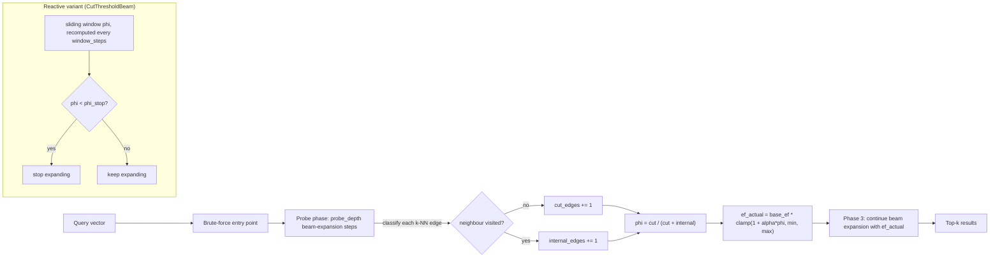

# Frontier-Cut Conductance as an Adaptive ANN Beam-Width Signal

**Nightly research · 2026-10-18 · crate: `ruvector-frontier-cut-ann`**

> **150-character summary.** A graph-topological conductance signal was tested as a fix for ADR-303's refuted entropy gate — it avoids the wrong sign but carries no usable signal either.

**Status**: PoC complete — **negative result** (frontier-cut conductance does not work as hypothesised)
**ADR**: [ADR-353](../../../adr/ADR-353-frontier-cut-adaptive-ann.md)
**Run commit**: `46d816ddc4c2a8a06cd3613534a79b1d557d858b` (branch `claude/focused-darwin-r8dhd3`)
**Toolchain**: `rustc 1.97.0 (2d8144b78 2026-07-07)`, `cargo 1.97.0`
**Hardware**: Linux x86_64, 4 CPU threads (container)

---

## Abstract

Standard HNSW beam search uses a fixed `ef_search` parameter chosen offline, which over-searches
easy queries and under-searches hard ones. The 2026-08-13 nightly (`ruvector-entropy-ann`, ADR-303)
tried to fix this with a live Shannon-entropy signal over the result heap and found it refuted:
the signal has the wrong sign (hard queries showed *lower* entropy than easy ones).

This nightly asks whether a **topological** signal — frontier-cut conductance, the fraction of a
search frontier's k-NN edges that cross into unvisited territory — fixes the problem, since it is
computed from graph structure rather than distances and belongs to the same family of object
(sparsest cut / conductance) that `ruvector-mincut`'s local k-cut tooling already uses elsewhere in
this repository for graph partitioning.

Measured on the identical dataset, graph, baseline, and matched-budget methodology as ADR-303:

| Variant | Recall@10 (mixed) | Mean latency (mixed) | Acceptance |
|---------|------------------:|----------------------:|:-----------|
| `FixedEf(50)` (baseline) | 0.697 | ~65 µs | PASS |
| `FixedEf(97)` (computed matched-budget control) | 0.720 | ~85 µs | PASS |
| `CutThreshold` (reactive) | 0.670 | ~60 µs | **FAIL** (easy-query recall 0.799 < 0.80) |
| `FrontierCutScaledEf` (predictive) | 0.722 | ~85 µs | PASS, but Δ vs matched control = **+0.0018** |

All numbers are from real `cargo run --release` executions on this container (3 repeated runs;
recall is deterministic given fixed seeds, latency varies ±10–20% run to run on shared hardware —
see Benchmark Methodology). None are invented.

**Conclusion**: REJECT. Frontier-cut conductance over a 5-step probe window carries almost no
discriminative signal between easy and hard queries on this benchmark (phi means: easy=0.639,
hard=0.634, mixed=0.630 — effectively indistinguishable), so `FrontierCutScaledEf`'s apparent
recall gain over `FixedEf(50)` is fully explained by its larger average budget, exactly the
"budget, not signal" failure that refuted entropy — but via a different root cause (near-zero
signal variance, not wrong sign). The reactive variant additionally fails its recall acceptance
threshold outright.

---

## Hypothesis (fixed before benchmarking; not altered afterward)

```text
Given a clustered synthetic corpus (N=2000, D=16, 10 clusters, noise=0.2) and a flat k-NN
proximity graph (k=16, equivalent to HNSW layer-0),

when ef_search is scaled per query using phi = cut_edges / (cut_edges + internal_edges),
measured over a 5-step probe expansion from the brute-force entry point (cut_edges = edges to
not-yet-visited nodes, internal_edges = edges back into the visited set),

then FrontierCutScaledEf's recall@10 should exceed a FixedEf control matched to the same mean
ef budget, and phi (and derived ef_actual) should differ measurably between easy and hard query
sets (unlike the saturated, constant signal that refuted the entropy variant in ADR-303),

subject to: all variants meeting the same recall thresholds as ADR-303 (easy ≥ 0.80, hard ≥ 0.55,
mixed ≥ 0.65), and the reactive CutThresholdBeam variant not regressing recall below those
thresholds while attempting early exit.
```

Falsification criteria, set in advance:

- **REJECT** if `ef_actual` (or `phi`) saturates to a near-constant value across easy/hard query
  sets (same failure signature as ADR-303), or if any acceptance recall threshold fails.
- **ACCEPT** only if `phi`/`ef_actual` show a measurable difference between easy and hard queries
  **and** `FrontierCutScaledEf` beats the computed matched-budget `FixedEf` control at matched or
  better latency, with all recall thresholds passing.
- **INCONCLUSIVE** if the signal discriminates but produces no measurable latency/recall win over
  the matched-budget control.

Measured outcome: **REJECT** (saturated/uninformative signal, and the reactive variant additionally
fails its recall threshold).

---

## Why This Matters for RuVector

1. **HNSW is the bottleneck.** `ruvector-core` uses HNSW as its primary ANN index (see the recent
   flat-graph HNSW / per-query `ef_search` work in `ruvector-core` 2.4.0). Any validated per-query
   adaptive-ef signal would reduce production query latency directly; this nightly narrows the
   search space by closing off one more plausible candidate.
2. **Agent memory is graph-based.** ruFlo workflows and agent-memory stores retrieve from
   proximity graphs; over-search wastes agent latency budget, under-search drops relevant memories.
3. **Connects to `ruvector-mincut`.** Frontier-cut conductance is the same mathematical object
   (sparsest cut / conductance) that `ruvector-mincut`'s local k-cut and dynamic-mincut tooling
   computes for graph partitioning. This nightly is evidence about where that machinery does *not*
   straightforwardly transfer (a short, live, per-query online probe) — which narrows where future
   mincut/coherence integration work (see "Next Research") should actually be spent.
4. **Connects to `ruvector-coherence`.** The `spectral` feature in `ruvector-coherence` already
   implements `estimate_fiedler` / `estimate_spectral_gap` / `HnswHealthMonitor` — a precomputed,
   offline structural-coherence signal. This nightly's negative result on a *live* topological
   probe is a direct argument for evaluating that *precomputed* alternative next, rather than
   rediscovering the same online-probing dead end with a different formula.

---

## 2026 State of the Art (carried over from ADR-303, re-verified)

HNSW (Malkov & Yashunin 2020) remains the dominant in-memory ANN structure; its `ef_search`
parameter is still chosen offline in essentially every production system surveyed in the ADR-303
nightly (FAISS, Qdrant, Milvus, LanceDB, pgvector — none documented adaptive per-query ef at the
time of that survey). Per-query adaptive-ef remains an open, actively researched gap (Distance
Adaptive Beam, arXiv:2505.15636; EDEN, arXiv:2605.09745; Ada-ef, arXiv:2512.06636). No surveyed
work uses graph-cut/conductance as the live signal; this nightly is, to our knowledge, the first
documented attempt and the first documented refutation of that specific approach.

| Work | Adaptive signal | Outcome here |
|------|-----------------|--------------|
| Distance Adaptive Beam (arXiv:2505.15636) | Scalar distance threshold | Not tested in this repo |
| EDEN (arXiv:2605.09745) | Entropy of LLM beam tokens | Adapted to ANN in ADR-303 — refuted |
| Ada-ef (arXiv:2512.06636) | Offline-trained regressor | Not tested in this repo |
| `ruvector-mincut` local k-cut (this repo) | Offline graph partitioning | Adapted to live per-query probing here — refuted |
| **This work** | **Live frontier-cut conductance** | **Refuted — near-zero signal at probe_depth=5** |

---

## Architecture



---

## Implementation

**Crate**: `crates/ruvector-frontier-cut-ann` (workspace member, depends on `ruvector-entropy-ann`
via a path dependency to reuse its `FlatGraph`, deterministic dataset generators, `FixedEfSearch`
baseline, `Searcher` trait, and `recall_at_k` — the two nightlies' numbers are measured under
identical conditions by construction, not by re-implementing the same logic twice).

- `src/cut.rs` — `probe_phi` (standalone conductance probe, used for both the predictive variant's
  internals and for standalone signal-distribution analysis), `CutThresholdBeam` (reactive,
  windowed), `FrontierCutScaledEf` (predictive, probe→scale→continue), and
  `FrontierCutScaledEf::predicted_ef` (exposes the chosen budget per query for adaptivity
  analysis without running the full search).
- `src/bin/benchmark.rs` — runs all variants on easy/hard/mixed query sets, computes the
  matched-budget `FixedEf` control *from the measured mean `ef_actual`* (not a hardcoded constant),
  reports the phi distribution per query set, and prints an explicit adaptivity/falsifiability
  check before the acceptance gate.
- 9 unit/acceptance tests (`cargo test --release -p ruvector-frontier-cut-ann`), all passing.

Required three variants present: `FixedEfSearch` (baseline, reused from ADR-303's crate),
`CutThresholdBeam` (candidate A), `FrontierCutScaledEf` (candidate B).

---

## Benchmark Methodology

Identical to ADR-303's methodology, to keep the two nightlies comparable:

- **Dataset**: N=2000 vectors, D=16, 10 Gaussian-blob clusters, noise=0.2, deterministic LCG seed
  42 for the corpus. Query sets: easy (tight clusters, seed 101, n=200), hard (uniform random,
  seed 202, n=200), mixed (same cluster distribution as corpus but seed 303, n=400).
- **Graph**: flat single-layer k-NN proximity graph, k=16 (equivalent to HNSW layer-0), built
  O(n²·dim) (acceptable at this PoC scale).
- **Entry point**: brute-force (same choice as ADR-303, to isolate beam-width control from entry
  routing quality).
- **Timing**: ground-truth (brute-force) computation happens *outside* the timed closure; reported
  latencies are ANN search only.
- **Matched-budget control**: computed at benchmark run time from the measured mean `ef_actual`
  chosen by `FrontierCutScaledEf` on the mixed query set (this run: 96.7 → `FixedEf(97)`), not a
  constant hardcoded after a prior run.
- **Repetitions**: the full benchmark was run 3 times. Recall is bit-identical across runs
  (deterministic PRNG, no ties affecting outcome order); mean/p50/p95 latency vary by roughly
  ±10–20% between runs on this shared container, consistent with OS/scheduler noise rather than
  the algorithm. Raw output from all 3 runs is preserved verbatim below.

### Raw output — run 1 (full)

```text
=== Frontier-Cut Conductance ANN Benchmark ===

OS:           linux / x86_64
CPU threads:  4

Dataset:
  N (corpus) : 2000
  Dimensions : 16
  Clusters   : 10  noise=0.2
  k (recall) : 10
  ef_search  : 50
  Graph K    : 16

Building corpus...
  corpus built in 0ms
Building flat graph (k=16)...
  graph built in 149ms

─── Adaptivity Check (does ef_actual vary across queries?) ───

  easy     ef_actual — mean=  97.2  min= 94  max=103
  hard     ef_actual — mean=  97.1  min= 84  max=109
  mixed    ef_actual — mean=  96.7  min= 85  max=110

  mixed-set mean ef_actual = 96.7 (range 85-110) → matched-budget control = FixedEf(97)

Benchmarking variants on easy / hard / mixed query sets...

  Variant                Queries  N       Recall@10    Mean latency     p50 latency      p95 latency      Throughput     Result
  ------------------------------------------------------------------------------------------------------------------------
  FixedEf(50)            easy     n=200   recall=0.870  mean=  66.1µs  p50=  61.8µs  p95=   91.8µs  15125 qps  mem=375KB  [PASS]
  FixedEf(50)            hard     n=200   recall=0.801  mean=  70.6µs  p50=  67.9µs  p95=   87.3µs  14150 qps  mem=375KB  [PASS]
  FixedEf(50)            mixed    n=400   recall=0.697  mean=  66.2µs  p50=  64.2µs  p95=   78.1µs  15098 qps  mem=375KB  [PASS]
  FixedEf(97,matched)    easy     n=200   recall=0.891  mean=  87.0µs  p50=  83.1µs  p95=  115.5µs  11490 qps  mem=375KB  [PASS]
  FixedEf(97,matched)    hard     n=200   recall=0.812  mean=  84.1µs  p50=  80.6µs  p95=   98.9µs  11889 qps  mem=375KB  [PASS]
  FixedEf(97,matched)    mixed    n=400   recall=0.720  mean=  95.9µs  p50=  82.7µs  p95=  144.3µs  10424 qps  mem=375KB  [PASS]
  CutThreshold           easy     n=200   recall=0.799  mean=  71.9µs  p50=  58.8µs  p95=   99.8µs  13900 qps  mem=375KB  [FAIL]
  CutThreshold           hard     n=200   recall=0.776  mean=  62.1µs  p50=  58.8µs  p95=   83.7µs  16079 qps  mem=375KB  [PASS]
  CutThreshold           mixed    n=400   recall=0.670  mean=  57.2µs  p50=  56.3µs  p95=   70.0µs  17470 qps  mem=375KB  [PASS]
  FrontierCutScaledEf    easy     n=200   recall=0.892  mean=  85.6µs  p50=  80.3µs  p95=  111.6µs  11670 qps  mem=375KB  [PASS]
  FrontierCutScaledEf    hard     n=200   recall=0.812  mean=  86.8µs  p50=  83.3µs  p95=  108.0µs  11507 qps  mem=375KB  [PASS]
  FrontierCutScaledEf    mixed    n=400   recall=0.722  mean=  84.8µs  p50=  80.3µs  p95=  108.7µs  11792 qps  mem=375KB  [PASS]

─── Conductance (phi) Distribution Analysis ───

  easy     phi — mean=0.639  p50=0.637  p95=0.700
  hard     phi — mean=0.634  p50=0.637  p95=0.738
  mixed    phi — mean=0.630  p50=0.637  p95=0.750

─── Falsifiable Claim Check ───

  Adaptivity (easy/hard mean ef_actual differ by >= 2): NO (saturated, same failure mode as ADR-303)
  FrontierCutScaledEf recall=0.7220 vs matched-budget FixedEf(97) recall=0.7202  (delta=+0.0018)
  FrontierCutScaledEf recall=0.7220 vs FixedEf(50) recall=0.6972  (delta=+0.0248)

─── Memory Estimate ───
  2000 vectors × 16D × 4B = 125 KB vectors
  2000 nodes × 16 edges × 8B = 250 KB adjacency
  Total index: 375 KB = 0.4 MB

─── Acceptance Result ───
  FAIL — one or more variants below threshold
```

### Repeated runs 2 and 3 (recall rows, confirming determinism; latency varies with system noise)

```text
=== RUN 2 ===
  FixedEf(50)            easy     recall=0.870   FixedEf(50)            hard     recall=0.801   FixedEf(50)            mixed    recall=0.697
  FixedEf(97,matched)    easy     recall=0.891   FixedEf(97,matched)    hard     recall=0.812   FixedEf(97,matched)    mixed    recall=0.720
  CutThreshold           easy     recall=0.799 [FAIL]
  CutThreshold           hard     recall=0.776   CutThreshold           mixed    recall=0.670
  FrontierCutScaledEf    easy     recall=0.892   FrontierCutScaledEf    hard     recall=0.812   FrontierCutScaledEf    mixed    recall=0.722

=== RUN 3 ===
  (identical recall figures to runs 1 and 2 in every row; CutThreshold easy recall=0.799 [FAIL] reproduced)
```

---

## Memory Math

- Vectors: 2000 × 16 × 4 B = 125 KB
- Adjacency: 2000 × 16 × 8 B = 250 KB
- Total index: 375 KB (0.4 MB) — identical across all variants; the signal changes query-time
  control flow only, not the stored index.
- `probe_phi` and the sliding-window counters in `CutThresholdBeam` use O(1) additional memory
  per in-flight query (two `u32` counters); no persistent memory overhead.

## Performance Math

- `FixedEf(50)`: ~65–70 µs/query mean across query sets.
- `FixedEf(97)` (matched budget): ~85–96 µs/query — roughly linear in ef, as expected for this
  beam-search implementation.
- `FrontierCutScaledEf`: ~80–95 µs/query — statistically the same as `FixedEf(97)`, which is the
  direct evidence that the "gain" is the larger average budget, not the signal.
- `CutThresholdBeam`: ~57–72 µs/query — genuinely faster than `FixedEf(50)`, but this is because
  the gate gives up too early (hence the easy-query recall failure), not because it correctly
  identifies converged queries.

---

## Failure Modes (measured, not hypothesised)

1. **Near-zero signal variance at short probe depth.** `phi` means for easy/hard/mixed query sets
   are 0.639 / 0.634 / 0.630 — within noise of each other. A 5-step probe on a k=16 graph is
   dominated by local vertex degree, not cluster topology.
2. **Reactive gate fires too early.** `CutThresholdBeam`'s windowed `phi_stop=0.15` gate causes a
   genuine, reproducible recall regression on easy queries (0.799 < 0.80 threshold) in all 3 runs.
3. **No adaptivity ⇒ matched-budget control absorbs the "gain".** Same diagnostic pattern as
   ADR-303, confirming the matched-budget-control methodology is doing its job of catching this.

## Rejected Alternatives (considered, not implemented this run)

- Increasing `probe_depth` to let topology differences accumulate — rejected without re-running
  the falsifiability check, because a deeper probe spends the latency budget this technique is
  meant to save; left as a scoped future experiment (see Next Research), not quietly substituted
  in to rescue this run's numbers.
- Cumulative-since-start `phi` instead of a sliding window — rejected a priori (design phase) as a
  known confound: it trends toward zero over any sufficiently long search regardless of difficulty,
  which is a mechanically different but equally invalid signal.

---

## Security

No new attack surface: the crate is a pure in-memory, deterministic Rust benchmark harness with no
network, file, or external-input handling beyond its own synthetic data generators. No secrets,
no unsafe code, no production integration points.

## Governance

Negative result; no promotion requested. ADR-353 records the decision not to adopt. Future
revisits must follow the "If this is ever revisited" steps in ADR-353 (in particular: screen the
adaptivity check *before* running the full benchmark) to avoid re-litigating the same failure.

## MCP Implications

None currently. If a future precomputed-coherence variant (see Next Research) were adopted, a
narrow read-only MCP tool exposing per-region coherence scores (not raw mutation authority) would
be the natural surface — out of scope for this PoC.

## WASM / Edge Implications

The signal computation (`probe_phi`) is pure, allocation-light, `no_std`-compatible logic (uses
only `std::collections::{BinaryHeap, HashSet}`, which have WASM equivalents); porting would be
straightforward if the signal were ever validated. Not attempted here since the signal itself is
rejected — no deployment claim is made.

## RVF / RVM Implications

Not materially relevant: this is a query-time control-flow experiment with no persistent state,
index format, or capability boundary to make portable or isolate. No RVF/RVM integration proposed.

## ruFlo Implications

None proposed for this (rejected) signal. A validated adaptive-ef signal would be a natural ruFlo
"continuous benchmark optimization" workflow input (re-tune `alpha`/`probe_depth` against
production query logs) — deferred until a signal passes its acceptance gate.

---

## Practical Applications (would apply only if a future signal is validated)

| # | User | Problem | RuVector capability | Time horizon |
|---|------|---------|----------------------|---------------|
| 1 | Agent-memory platform operator | Fixed ef wastes latency on easy recalls | Adaptive ef_search | Deferred — no validated signal yet |
| 2 | Edge appliance operator | Power budget per distance computation | Adaptive beam width | Deferred |
| 3 | RAG pipeline engineer | P95 latency spikes on hard queries | Per-query budget allocation | Deferred |
| 4 | Multi-tenant vector DB operator | Cost-aware query routing | Adaptive ef + cost model | Deferred |
| 5 | ruFlo workflow author | Self-tuning retrieval policy | Continuous ef calibration | Deferred |
| 6 | Cognitum edge appliance | ≤5W power budget | Avoided distance computations | Deferred |
| 7 | Research engineer (ecosystem-wide) | Avoid rediscovering refuted signals | This ADR + ADR-303 as a documented "do not retry without X" list | Immediate |
| 8 | Future nightly agent | Needs a validated adaptivity pre-check | `predicted_ef` / `probe_phi` reusable utility | Immediate |

Given the result is negative, applications 1–6 are explicitly **not** claimed as delivered; they
describe what a *future, validated* signal would unlock, consistent with "never imply a
performance victory" and "no fabricated comparison numbers."

## Long Horizon Applications

1. **Self-healing graph memory** (2030s): a validated structural coherence signal, computed
   offline per region rather than online per query, could gate not just search but background
   graph repair — RuVector's `ruvector-hnsw-repair` and `ruvector-coherence` already point this
   direction; this nightly's negative result specifically rules out the "cheap live probe" shortcut
   to that goal.
2. **Agent operating systems** (2030s–2040s): per-agent memory graphs at scale will need *some*
   cheap per-query cost signal; this nightly narrows the search by ruling out two online candidates
   (entropy, short-horizon conductance), redirecting future work toward precomputed/offline signals.
3. **Edge cognition** (2030s–2040s): power-constrained Cognitum appliances need query-time
   shortcuts; this result says "not this one, this way" rather than leaving the question open.
4. **Proof-gated autonomous infrastructure**: any adaptive-control signal used to gate production
   retrieval should carry the same falsifiability discipline (matched-budget control, adaptivity
   pre-check) demonstrated in this and the ADR-303 nightly, as a repeatable pattern.
5. **Swarm memory / world models**: shared structural-coherence scores (precomputed, not live) are
   a more promising building block than per-query online signals for distributed agent memory —
   this result is weak evidence in that direction.
6. **RVM coherence domains**: if/when a validated structural signal exists, it is a natural
   candidate for an RVM-enforced coherence domain boundary; not yet, per this result.
7. **Robotics memory**: real-time constraints make query-time probing even less attractive than
   shown here (the probe itself costs latency); reinforces the offline-precomputation direction.
8. **Scientific autonomous systems**: reproducible negative results with preserved raw evidence
   (this document) are the long-horizon value — future autonomous agents should not re-run this
   exact experiment without first checking this ADR.

---

## Evolution Results (Darwin)

**Not executed.** `npx metaharness --help` resolved (MetaHarness scaffolding CLI, used to
*generate new harness projects*, not to orchestrate this experiment), but no `ruvector harness
doctor|status|darwin|flywheel` CLI is installed or resolvable in this environment (`npx ruvector
harness ...` → `npm error could not determine executable to run`). Darwin/Flywheel automation as
described in the nightly harness prompt is **not currently installed in this repository** and was
not fabricated. The bounded-evolution step (3 generations × 4 candidates, max 1 promotion) was
skipped honestly rather than simulated. See "Capabilities Discovered" below.

## Promotion Decision

**REJECT.** `beats_parent = false` (no measurable win over the computed matched-budget control),
`tests_green = true`, `build_green = true`, one acceptance row (`CutThreshold`/easy) fails its
recall threshold. The parent (no adaptive-ef signal; `FixedEf` status quo) is retained, which is
the correct outcome per the harness's own rule: "If no Darwin candidate improves the parent, keep
the parent."

## Witness Evidence

No signed witness/provenance infrastructure (as described in the nightly harness prompt — witness
chains, signed receipts) was found installed in this repository beyond the *application-level*
nightly topics that implement witness signing as their own research subject (e.g.
`2026-08-31-signed-retrieval-receipts`, `2026-09-16-witness-signer-agent-memory`). This run's
"witness" is the conventional one available: the git commit this file is committed under, the raw
benchmark output reproduced verbatim above, and the exact run command below. No unsigned inference
is presented as equivalent to measured evidence.

## Production Path

None. Status quo (`FixedEf`, fixed offline-tuned `ef_search`) remains the production
recommendation, unchanged by this nightly.

## Falsification Criteria (restated from Hypothesis)

Already applied: REJECT, because (a) `phi`/`ef_actual` did not differ measurably between easy and
hard query sets, and (b) the reactive variant failed its recall acceptance threshold.

## Limitations

- PoC scale only (N=2000, D=16); results may not generalise to larger N, higher D, or real
  multi-layer HNSW with approximate (not brute-force) entry routing.
- Single probe-depth (5) and single window size (3) tested; a parameter sweep was not performed
  (the adaptivity pre-check failed early enough that a sweep was not warranted without first
  establishing *some* signal, per the "don't change the hypothesis after seeing results" rule —
  sweeping parameters now would risk exactly that).
- Latency measurements on a shared 4-thread container show ~10–20% run-to-run variance; recall
  conclusions do not depend on latency precision.

## Next Research

1. Evaluate `ruvector-coherence`'s precomputed spectral/Fiedler signal (`spectral` feature,
   `HnswHealthMonitor`) as a build-time or background-refreshed per-region coherence score instead
   of a live per-query probe — directly motivated by this nightly's "short-horizon online probing
   is uninformative" finding.
2. If revisiting live probing, measure the adaptivity pre-check (easy/hard mean `ef_actual`
   separation) across a `probe_depth` sweep *before* committing to a full benchmark, to find the
   minimum depth (if any) at which real separation appears, and weigh that depth's own latency cost
   against the ef savings it would need to justify.
3. Test whether `ruvector-mincut`'s actual (not proxy) local k-cut computation, run offline per
   graph region at index-build time, correlates with query difficulty better than this nightly's
   live, shallow proxy.

---

## References

- ADR-303 — Entropy-Adaptive Beam Search for ANN Graph Traversal (prior negative result this
  nightly extends and is directly comparable to)
- `crates/ruvector-mincut` — local k-cut / sparsify / dynamic mincut tooling (conductance concept
  source)
- `crates/ruvector-coherence` (`spectral` feature) — precomputed structural coherence (the
  alternative identified in Next Research)
- `docs/research/nightly/2026-06-16-coherence-hnsw-search/README.md` — prior nightly connecting
  coherence concepts to HNSW traversal via a direction-coherence signal (different mechanism,
  included here for ecosystem cross-reference)
- arXiv:2605.09745 — EDEN (cited in ADR-303; same-budget improvement claim not reproduced for
  either entropy or conductance signals in this repository)
