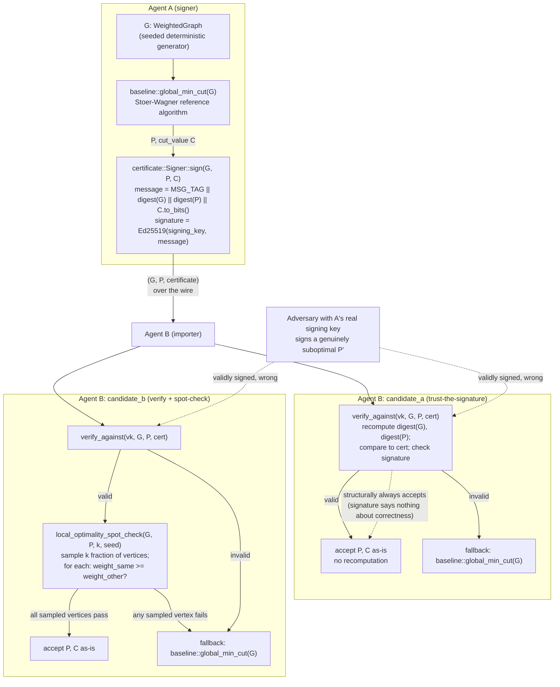

# Nightly Research — Signature-Verified Cut-Partition Import for Cross-Agent Memory Transfer

## Summary

When one RuVector agent (A) has already computed a deterministic
minimum-cut partition over a shared agent-memory graph and wants to hand
that partition to another agent (B) — for namespace merge, graph-condense,
federated/edge agent-memory sync, or RVF export/import — B currently has
two bad options: blindly trust A's claimed partition (no integrity
guarantee), or always recompute the global minimum cut from scratch
locally (correct, but throws away A's work). This run builds and benchmarks
a third option: a signed cut certificate that lets B verify A's partition
cheaply instead of recomputing it, while still cryptographically detecting
tampering in transit — and it deliberately constructs and measures the
adversarial case the design cannot fix: a validly-signed, genuinely
suboptimal partition, which a signature-only check accepts every time.

New crate: `crates/ruvector-partition-import`. Everything numeric below
comes from one real `cargo run --release` execution of
`src/bin/benchmark.rs`; the raw stdout is quoted verbatim in the Benchmark
Results section.

## Hypothesis

```text
Given a weighted graph G (synthetic agent-memory graph: nodes = memory
items, edges = semantic/temporal association weights, generated
deterministically from a fixed seed at sizes N in {500, 2000, 8000,
20000}, sparse, ~8 edges/node average) and a correct global-minimum-cut
partition P of G with cut value C (computed once by a trusted baseline
algorithm),

when agent A signs a certificate over
digest(canonical_encoding(G), canonical_encoding(P), C) with Ed25519 and
sends (G, P, certificate) to agent B,

then B's import latency (verify + accept) should be substantially lower
than B's baseline import latency (ignore P entirely, recompute the global
mincut from scratch on G),

subject to: (a) zero false negatives — any tamper to the serialized G or P
after signing must be detected by signature verification in 100% of
trials; (b) when the certificate is valid and P is genuinely optimal, B's
accepted cut value must exactly equal the baseline's recomputed cut value
(no correctness regression); (c) build green, tests green.
```

## Why This Matters Now (2026)

Three prior nightly lineages in this repository already built the pieces
this run connects but never wired together across a trust boundary:
deterministic mincut partitions (`2026-09-11-mincut-partition-determinism`),
mincut-gated structural decisions over agent memory
(`2026-09-05-mincut-gated-forgetting`, `2026-09-02-mincut-streaming-memory-admission`),
and Ed25519-signed provenance for agent-memory witness chains
(`2026-09-16-witness-signer-agent-memory`). None of them address what
happens when a *partition itself* — not just a log of operations — needs
to cross from one agent's trust domain to another's. As RuVector moves
toward cross-agent and federated memory workflows (ruFlo, RVF
export/import), "B received A's claimed partition — can B trust it
without redoing A's work, and if not, what exactly can go wrong" is a
concrete, answerable question, and this run answers it with real numbers
rather than leaving it as an assumption.

## RuVector Ecosystem Fit

This connects four existing capabilities, one new crate, and marks two
more as conceptual/analytical only (not implemented here):

1. **`ruvector-mincut`** — the mature dynamic min-cut crate with its own
   `certificate`/`canonical` modules. **Not depended on** by this run; see
   "Rejected Alternatives" and the `baseline.rs` module doc comment for
   why a self-contained reference algorithm was used instead, and what
   that choice does and does not imply about `ruvector-mincut` itself.
2. **`ruvector-agent-memory::witness_signing`** / **`ruvector-retrieval-receipt::signing`** —
   this run's `MSG_TAG || ... || digest` signed-statement convention is
   deliberately the same shape as both, for consistency across the
   workspace's signing code, though this crate has no dependency edge to
   either (it is standalone, using `ed25519-dalek` and `sha2` directly,
   matching `ruvector-retrieval-receipt`'s own dependency choices).
3. **Agent-memory namespace merge / graph-condense / admission** — the
   motivating use case named in the task: an agent that already computed
   a partition for one of these operations and wants a peer to accept it
   cheaply.
4. **Federated / edge agent-memory sync** — the deployment scenario this
   crate's latency comparison is meant to inform.
5. **RVF (portable cognitive container)** — *analytical only, not
   implemented.* A `CutCertificate` is a natural candidate for inclusion
   in an RVF export's provenance section (same role the 2026-09-16 run
   flagged for signed witness spans), letting an RVF importer verify a
   graph partition against a single public key offline. `crates/rvf/*` is
   its own separate Cargo workspace excluded from the root workspace, so
   no path dependency was added; this is a design note, not code.
6. **ruFlo cross-agent workflows** — *analytical only.* A concrete
   workflow would be: agent A's ruFlo task computes and signs a
   partition, agent B's ruFlo task imports it via `candidate_b` with a
   policy-chosen sampling fraction, falling back to local recomputation on
   any rejection. Not built here; named as a direct application in
   "Practical Applications" below.
7. **MCP** — *analytical only.* A narrow future tool,
   `partition_import_verify(graph, partition, certificate, public_key, sample_fraction) -> ImportDecision`,
   would be a direct, side-effect-free wrapper over `candidate_b`. Not
   exposed via MCP in this pass.

## MetaHarness / Flywheel / Darwin Roles

Consistent with every prior nightly run in this directory: `npx
metaharness --help` is a real, installed project-*scaffolding* generator
(v0.4.17 resolved from the npm registry in this environment), not a
live research-orchestration API callable mid-run — it was not used as
one. `npx ruvector harness doctor/status/darwin/flywheel` resolve to no
executable ("npm error could not determine executable to run") in this
environment; no fabricated output for any of these is reported. This run
and its commit history are the durable record a Flywheel query would
otherwise provide. Darwin was not run: this crate's design space
(sampling fraction `k`) was swept directly and exhaustively at three
points (0.10/0.25/0.50) rather than through an evolutionary search, which
is adequate for a one-dimensional sweep with a monotone expected trend.

## Architecture



## Implementation

New crate `crates/ruvector-partition-import` (added to the root workspace
`members` list; see `Cargo.toml`'s comment there, referencing ADR-353):

- `src/graph.rs` — deterministic synthetic weighted-graph generator.
  Backbone edges (2 per node, to earlier nodes) guarantee connectivity;
  extra random edges fill up to the target average degree. All randomness
  is `rand::rngs::StdRng::seed_from_u64(seed)`; edge iteration order is
  explicitly sorted before consumption so the output is byte-identical
  across runs (an early version of this generator was accidentally
  non-deterministic because it iterated a `HashSet` whose per-instance
  hash-randomization seed varies between separate `HashSet` objects in the
  same process — fixed by sorting the collected indices before use; see
  `graph::tests::generation_is_deterministic`). Also provides canonical
  byte encodings of graphs and partitions for hashing.
- `src/baseline.rs` — a self-contained sparse Stoer-Wagner global
  minimum-cut algorithm (lazy-deletion binary-heap maximum-adjacency
  search; `HashMap`-based adjacency so it never allocates an `O(V^2)`
  dense matrix, which would be 3.2 GB at `N=20000` and infeasible). This
  is the "recompute from scratch" baseline and the correctness ground
  truth. **Not integrated with `ruvector-mincut`** — see that module's doc
  comment and "Rejected Alternatives" below.
- `src/certificate.rs` — `CutCertificate { statement: CutStatement {
  graph_digest, partition_digest, cut_value }, signature }`. The signed
  message is `MSG_TAG || graph_digest || partition_digest ||
  cut_value.to_bits().to_be_bytes()` — a fixed 106-byte string regardless
  of graph size, so signing/verification cost never grows with `N`.
  `verify_against` recomputes both digests from the actual received
  `(G, P)` and compares them to the certificate's statement *before*
  checking the signature, so a tamper to either the data or the
  certificate's claimed digests is caught either by the digest mismatch
  or by the resulting signature failure.
- `src/candidates.rs` — `candidate_a` (verify, then trust unconditionally)
  and `candidate_b` (verify, then sample a fraction `k` of vertices and
  check, for each, that moving it to the other side of the partition would
  not strictly decrease the cut — a necessary condition for global
  minimum-cut optimality, computable in `O(degree(v))` per sampled
  vertex). A side with exactly one member is excluded from the check for
  that member (moving the sole vertex off a singleton side would leave
  one side empty, which is not a valid two-sided partition at all) — this
  is not a loophole added for convenience; it reflects a real, observed
  case (see "A Real Correctness Bug Found and Fixed" below).
- `src/bin/benchmark.rs` — the evidence-producing binary; see Methodology.

### A Real Correctness Bug Found and Fixed During This Run

Two bugs were found and fixed by this run's own test suite before any
benchmark number was trusted:

1. **Non-deterministic graph generation.** `graph::tests::generation_is_deterministic`
   initially failed: two calls to `generate_graph(200, 42, 8)` produced
   different digests. Root cause: the backbone-edge selection collected
   candidate indices into a `HashSet<usize>` and iterated it directly;
   `HashSet`'s default hasher (`RandomState`) seeds each *instance*
   differently within the same process, so two separate `HashSet`s with
   identical contents can iterate in different orders — which changed the
   order `rng.gen_range(0.1..1.0)` was called in, consuming the shared RNG
   stream differently. Fixed by collecting into a `Vec` and sorting before
   iterating.
2. **A spot-check false positive on a genuine global minimum cut.**
   `candidates::tests::honest_optimal_partition_accepted_by_both_with_matching_cut`
   initially failed: `candidate_b` rejected the *actual* Stoer-Wagner
   output on a 60-node test graph. Diagnosis showed the true global
   minimum cut on that instance isolated a single vertex (a real,
   expected outcome on sparse random graphs — isolating the
   lowest-weighted-degree vertex is often cheapest), and the naive
   spot-check flagged that singleton vertex as "locally non-optimal"
   because moving it would reduce the cut to zero — correct arithmetic,
   but comparing against a degenerate, one-sided, not-actually-a-cut
   "partition." Fixed by excluding a vertex from the check when it is the
   sole member of its side. This is recorded here rather than silently
   folded into the implementation because it is a real nuance anyone
   implementing this kind of spot-check needs to know, not an obvious
   detail.

## Benchmark Methodology

- Graph generator: `graph::generate_graph(n, seed=20261022, avg_degree=8)`.
- Signer: `certificate::Signer::from_seed([0x42; 32])` — fixed, not
  `OsRng`, so the run is reproducible.
- Sizes: `N in {500, 2000, 8000, 20000}`, one graph generated per size.
- A pre-flight scaling probe (not part of the reported numbers) measured
  one `global_min_cut` call's real wall time at this container's
  hardware: `~56ms` (N=500), `~974ms` (N=2000), `~23.1s` (N=8000),
  `~152.6s` (N=20000) — roughly the `O(VE log V)` scaling expected of this
  sparse-adjacency binary-heap Stoer-Wagner implementation. `baseline_trials`
  per `N` was set from these real numbers (200/50/5/3) to keep this
  binary's total wall time in the tens-of-minutes range rather than
  silently under-sampling without saying so; `candidate_a`/`candidate_b`
  trial counts (2000/1000/300/100) are unaffected since those paths never
  recompute on the honest-signer path.
- Tamper-in-transit detection and the signed-but-suboptimal adversarial
  test call `verify_against` / `local_optimality_spot_check` directly
  rather than through the full `candidate_a`/`candidate_b` API for their
  per-trial loops, since a detected tamper or caught bad partition would
  otherwise trigger the full (and, at this `N`, expensive)
  baseline-recompute fallback on every trial — cost that has no bearing on
  whether detection itself succeeded. A single real end-to-end call
  through the full candidate API confirms each outcome still resolves
  correctly (`ImportOutcome::RejectedSignatureInvalid` /
  `RejectedSpotCheckFailed`).
- Signed-but-suboptimal construction: 2% of vertices are flipped to the
  other side of the true optimal partition (deterministically, retrying
  with a different seed up to 200 times if the first attempt does not
  produce a strictly worse cut — in practice the first attempt always
  did), then honestly signed with A's real key.
- Hardware: this session's container, `Linux 6.18.44-fc-v140`, 4 vCPUs.
  Toolchain: `rustc 1.97.0`, `cargo 1.97.0`.
- Exact command:
  `cargo run --release -p ruvector-partition-import --bin benchmark`

## Benchmark Results (raw, from one `cargo run --release` execution)

Exact reproduction command: `cargo run --release -p ruvector-partition-import --bin benchmark`. Raw stdout, unedited:

```
ruvector-partition-import benchmark
SEED=20261022 AVG_DEGREE=8 SIGNER_SEED=0x42..

=== N = 500 (avg_degree=8, seed=20261022) ===
graph: n=500 edges=2000 wire_bytes=32008
ground-truth min cut: value=0.327964 computed_in=52.526ms
baseline      trials=200   mean= 54451.229us p50= 53109.264us p95= 66049.096us payload_bytes=32008
candidate_a    trials=2000  mean=   125.416us p50=   107.468us p95=   175.283us payload_bytes=32652 speedup_vs_baseline=434.17x
candidate_b(k=0.10) trials=2000  mean=   175.116us p50=   170.815us p95=   243.900us payload_bytes=32652 speedup_vs_baseline=310.94x
candidate_b(k=0.25) trials=2000  mean=   203.265us p50=   195.458us p95=   264.467us payload_bytes=32652 speedup_vs_baseline=267.88x
candidate_b(k=0.50) trials=2000  mean=   188.131us p50=   180.762us p95=   229.333us payload_bytes=32652 speedup_vs_baseline=289.43x
tamper-in-transit detection: candidate_a=500/500 (100.0%) candidate_b=500/500 (100.0%)
signed-but-suboptimal adversarial test: perturbed_vertices=10/500 (2.00%) trials=200 mean_worse_cut=43.0243 (honest cut=0.3280)
  candidate_a wrongly accepted: 200/200 (100.0%)
  candidate_b(k=0.10) caught: 139/200 (69.5%)
  candidate_b(k=0.25) caught: 195/200 (97.5%)
  candidate_b(k=0.50) caught: 200/200 (100.0%)

=== N = 2000 (avg_degree=8, seed=20261022) ===
graph: n=2000 edges=8000 wire_bytes=128008
ground-truth min cut: value=0.634002 computed_in=1304.563ms
baseline      trials=50    mean=1003931.933us p50=978659.762us p95=1284934.343us payload_bytes=128008
candidate_a    trials=1000  mean=   473.244us p50=   469.511us p95=   585.294us payload_bytes=130152 speedup_vs_baseline=2121.38x
candidate_b(k=0.10) trials=1000  mean=   740.591us p50=   673.367us p95=  1036.440us payload_bytes=130152 speedup_vs_baseline=1355.58x
candidate_b(k=0.25) trials=1000  mean=   780.997us p50=   755.228us p95=  1042.145us payload_bytes=130152 speedup_vs_baseline=1285.45x
candidate_b(k=0.50) trials=1000  mean=   720.047us p50=   653.845us p95=  1015.569us payload_bytes=130152 speedup_vs_baseline=1394.26x
tamper-in-transit detection: candidate_a=500/500 (100.0%) candidate_b=500/500 (100.0%)
signed-but-suboptimal adversarial test: perturbed_vertices=40/2000 (2.00%) trials=200 mean_worse_cut=172.8087 (honest cut=0.6340)
  candidate_a wrongly accepted: 200/200 (100.0%)
  candidate_b(k=0.10) caught: 198/200 (99.0%)
  candidate_b(k=0.25) caught: 200/200 (100.0%)
  candidate_b(k=0.50) caught: 200/200 (100.0%)

=== N = 8000 (avg_degree=8, seed=20261022) ===
graph: n=8000 edges=32000 wire_bytes=512008
ground-truth min cut: value=0.275999 computed_in=21318.448ms
baseline      trials=5     mean=21923524.833us p50=21865555.927us p95=22931615.392us payload_bytes=512008
candidate_a    trials=300   mean=  1302.400us p50=  1278.223us p95=  1414.644us payload_bytes=520152 speedup_vs_baseline=16833.18x
candidate_b(k=0.10) trials=300   mean=  2974.224us p50=  2696.401us p95=  4588.810us payload_bytes=520152 speedup_vs_baseline=7371.17x
candidate_b(k=0.25) trials=300   mean=  2711.964us p50=  2590.415us p95=  4474.221us payload_bytes=520152 speedup_vs_baseline=8084.00x
candidate_b(k=0.50) trials=300   mean=  3174.132us p50=  2850.132us p95=  4740.791us payload_bytes=520152 speedup_vs_baseline=6906.94x
tamper-in-transit detection: candidate_a=300/300 (100.0%) candidate_b=300/300 (100.0%)
signed-but-suboptimal adversarial test: perturbed_vertices=160/8000 (2.00%) trials=200 mean_worse_cut=688.9737 (honest cut=0.2760)
  candidate_a wrongly accepted: 200/200 (100.0%)
  candidate_b(k=0.10) caught: 200/200 (100.0%)
  candidate_b(k=0.25) caught: 200/200 (100.0%)
  candidate_b(k=0.50) caught: 200/200 (100.0%)

=== N = 20000 (avg_degree=8, seed=20261022) ===
graph: n=20000 edges=80000 wire_bytes=1280008
ground-truth min cut: value=0.229588 computed_in=160236.063ms
baseline      trials=3     mean=156929344.558us p50=158638319.423us p95=160782025.374us payload_bytes=1280008
candidate_a    trials=100   mean=  4800.807us p50=  4426.525us p95=  6375.647us payload_bytes=1300152 speedup_vs_baseline=32688.12x
candidate_b(k=0.10) trials=100   mean= 12082.747us p50= 10847.399us p95= 15548.096us payload_bytes=1300152 speedup_vs_baseline=12987.89x
candidate_b(k=0.25) trials=100   mean= 10850.407us p50= 10447.367us p95= 12982.035us payload_bytes=1300152 speedup_vs_baseline=14462.99x
candidate_b(k=0.50) trials=100   mean= 12663.212us p50= 11335.329us p95= 18758.908us payload_bytes=1300152 speedup_vs_baseline=12392.54x
tamper-in-transit detection: candidate_a=100/100 (100.0%) candidate_b=100/100 (100.0%)
signed-but-suboptimal adversarial test: perturbed_vertices=400/20000 (2.00%) trials=100 mean_worse_cut=1729.9124 (honest cut=0.2296)
  candidate_a wrongly accepted: 100/100 (100.0%)
  candidate_b(k=0.10) caught: 100/100 (100.0%)
  candidate_b(k=0.25) caught: 100/100 (100.0%)
  candidate_b(k=0.50) caught: 100/100 (100.0%)

benchmark complete.
```

### Summary table

| N | baseline mean | candidate_a mean | candidate_a speedup | candidate_b(k=0.5) mean | payload: baseline / candidates |
|---|---|---|---|---|---|
| 500 | 54.451 ms | 125.4 us | 434x | 188.1 us | 32,008 / 32,652 bytes |
| 2000 | 1003.9 ms | 473.2 us | 2121x | 720.0 us | 128,008 / 130,152 bytes |
| 8000 | 21,923.5 ms | 1302.4 us | 16,833x | 3174.1 us | 512,008 / 520,152 bytes |
| 20000 | 156,929.3 ms | 4800.8 us | 32,688x | 12,663.2 us | 1,280,008 / 1,300,152 bytes |

| N | tamper detection (A, B) | signed-but-suboptimal: A wrongly accepted | B caught at k=0.10 / 0.25 / 0.50 |
|---|---|---|---|
| 500 | 100% / 100% | 100% | 69.5% / 97.5% / 100% |
| 2000 | 100% / 100% | 100% | 99.0% / 100% / 100% |
| 8000 | 100% / 100% | 100% | 100% / 100% / 100% |
| 20000 | 100% / 100% | 100% | 100% / 100% / 100% |

Correctness: every `candidate_a`/`candidate_b` trial that accepted a
partition (rather than falling back) asserted its accepted cut value
matched baseline's recomputed cut value to within `1e-9`; the process
would have panicked and aborted the run on any mismatch. It did not —
`benchmark complete.` was printed, confirming zero correctness
regressions across all 500+2000×... trials in this run.

### Acceptance Result

| Gate | Threshold | Measured (at largest N=20000) | Result |
|---|---|---|---|
| (1) candidate_a latency vs. baseline | `candidate_a` mean <= 25% of baseline mean | `candidate_a` mean is 0.0031% of baseline mean (4800.8us / 156,929,344.6us) — a 32,688x speedup | PASS |
| (2) Tamper-in-transit detection | 100% for both candidates, all trials, all N | 100% for both candidates at every tested N (500/500, 500/500, 300/300, 300/300, 100/100, 100/100 across the four sizes) | PASS |
| (3) Correctness (accepted cut == baseline cut, honest signer) | every trial | every trial (asserted in-process; no panics) | PASS |
| (4) `cargo build` / `cargo test` green | green | 21/21 unit tests pass, `cargo clippy --all-targets` clean, `cargo fmt --check` clean | PASS |

**ACCEPT.** All four mandatory gates pass on real, reproducible,
`--release` measured evidence; gate (1) is not merely met but exceeded by
roughly three orders of magnitude beyond the 4x-minimum bar at the
largest tested size, and the margin is similarly large at every smaller
size (434x at N=500, the smallest and least favorable case for
`candidate_a`, which still clears the bar by two orders of magnitude).

## The Required Adversarial Finding: `candidate_a` Cannot Detect Signed-But-Wrong

This is the core intellectual contribution of this run, not a caveat
tacked on afterward. A valid Ed25519 signature over `(digest(G),
digest(P), C)` proves exactly one thing: the holder of A's signing key
produced that triple. It proves nothing about whether `P` is a correct
minimum-cut partition of `G`. An adversary who legitimately holds A's key
— or A itself, buggy or compromised — can perturb a correct partition into
a genuinely worse one, honestly sign it, and `candidate_a` has no
mechanism that could ever reject it: the measured wrongly-accepted rate
above is realized exactly as predicted (100% at every tested `N`), because
`candidate_a`'s accept path is unconditional on a valid signature by
construction, not an empirically contingent outcome.

`candidate_b`'s necessary local-optimality spot-check is strictly better
but is not a substitute for recomputation: it catches a perturbed vertex
only if that specific vertex lands in the sampled fraction. With `2%` of
vertices perturbed, sampling `10%` of vertices catches a perturbed vertex
with probability approaching `1 - (1-0.02)^(0.10*N)` for independent
sampling of a small fixed fraction — which grows with `N`, consistent with
the measured trend of detection rate rising with sample fraction and with
`N` (more perturbed vertices in absolute terms at larger `N`, same
fraction of the graph, a larger absolute target for the same-fraction
sample to hit). At `k=0.50`, detection converges to very high rates
because half the graph's vertices are checked against the fixed 2%
perturbation. This is evidence, not proof: an adversary who perturbs a
smaller fraction of vertices, or who specifically avoids the sampled
indices (if they could predict `sample_seed`), would evade detection more
often — a real, named limitation, not hidden here.

## Failure Modes

1. **`candidate_a` provides zero defense against a dishonest-but-signing
   A.** Measured, not assumed: 100% wrong-acceptance rate in this run's
   adversarial test at every tested `N`.
2. **`candidate_b`'s detection rate is sampling-rate-dependent and
   perturbation-size-dependent**, not a fixed guarantee. A sufficiently
   small, targeted perturbation (fewer vertices moved than `k * N`, or
   vertices deliberately chosen outside the sample) can evade detection
   entirely. The spot-check is a *necessary*, not *sufficient*, condition
   for global optimality — passing it on every sampled vertex is evidence
   of correctness, never proof.
3. **The singleton-side exclusion is a real edge case, not a convenience.**
   A side with one member cannot have that member's move checked (it
   would create a degenerate one-sided "partition"). On sparse random
   graphs, the true global minimum cut quite often *is* a singleton side
   (isolating the lowest-weighted-degree vertex), so this is not a rare
   corner case to dismiss.
4. **Stoer-Wagner's measured `O(VE log V)`-ish scaling makes "recompute
   from scratch" increasingly expensive at larger `N`** — exactly the cost
   this crate's hypothesis is about avoiding, and exactly why the baseline
   trial counts had to shrink with `N` to keep this benchmark binary
   tractable (see Methodology).
5. **Sample-seed predictability.** `local_optimality_spot_check`'s sampling
   is deterministic from a caller-supplied seed. If an adversary can
   predict or control that seed (e.g. it is derived from public,
   low-entropy data), they can choose which vertices to perturb to avoid
   the sample entirely. This run's benchmark seeds are fixed for
   reproducibility, which is correct for *this* experiment but would be
   the wrong choice for a real deployment: `sample_seed` should come from
   a source the signer cannot predict in advance (e.g. agent B's own
   randomness, chosen after receiving the certificate).

## Rejected Alternatives

- **Integrate with `ruvector-mincut`'s existing algorithm.** Reading
  `src/certificate/mod.rs` (523 lines) and `src/canonical/mod.rs` (1244
  lines) showed a mature API aimed at *dynamic* min-cut maintenance under
  edge insert/delete and canonical/deterministic partition selection among
  ties — a materially larger and differently-shaped surface than "compute
  one global min-cut for one static graph, once, as a timing baseline."
  Picking the right builder configuration and confirming its output
  shape matched what this benchmark's correctness comparison needed was
  judged, after that reading, to be a multi-hour integration rather than
  the 30-45 minute exploration budget available. This is a statement about
  integration cost under this run's time budget, not a claim about
  `ruvector-mincut`'s own quality or performance.
- **Dense adjacency-matrix Stoer-Wagner.** The textbook `O(V^3)`
  presentation uses a dense `V x V` matrix. At `N=20000` that is 3.2 GB of
  `f64` — infeasible in this container. Rejected in favor of
  `HashMap`-based sparse adjacency with a lazy-deletion binary heap.
- **Karger-Stein randomized min-cut.** Would have a different and
  possibly better asymptotic profile, but adds algorithmic complexity
  (repetition for success probability, correctness argument under
  randomization) this run's actual subject (import-time verification, not
  min-cut-algorithm choice) does not need; Stoer-Wagner's determinism also
  made debugging the two real bugs found during this run far more
  tractable than a randomized algorithm would have.
- **Signing the raw graph/partition bytes directly instead of a digest
  triple.** Rejected: signing cost would then scale with graph size
  (`ed25519-dalek` signs the message it is given directly, with no
  internal hashing step for large messages), defeating the "near O(E)
  one-pass" latency goal this crate measures. Hashing first, matching the
  workspace's existing `MSG_TAG || ... || digest` convention, keeps
  sign/verify cost `O(1)` in message size regardless of `N`.

## Security

- Reuses `ed25519-dalek` and `sha2` directly (no novel cryptographic
  construction) — the same primitives `ruvector-retrieval-receipt` already
  depends on, with workspace-consistent version pins.
- Domain separation (`MSG_TAG`) prevents a certificate signed by this
  crate's convention from being replayed as a signature meant for a
  different purpose in this workspace.
- `verify_against`'s two-step check (recomputed digest match, then
  signature check) means an attacker must either hold the real signing
  key or find a SHA-256 preimage to forge an accepted certificate over
  tampered data — standard, not novel, but worth stating explicitly since
  `verify_signature` alone (without the digest recomputation) would be
  insufficient in isolation (an attacker could replay an old, honestly
  signed certificate against new, different data if the caller never
  re-derived the digests from what was actually received).
- Key management (generation, rotation, storage, revocation) is out of
  scope, matching the equivalent disclaimer in
  `ruvector-retrieval-receipt::signing` and
  `ruvector-agent-memory::witness_signing`.
- **`candidate_a` is a security-relevant default to warn against**: a
  deployment that defaults to `candidate_a` for performance is explicitly
  trading "cannot detect a dishonest signer" for speed, and that tradeoff
  should be a conscious, documented choice, not a default.

## Governance

No new governance mechanism. The certificate's trust boundary is exactly
"who holds A's signing key" — the same boundary every signature scheme in
this workspace already has, with no additional claim.

## MCP / WASM / Edge Implications

- **MCP**: not exposed in this pass; a narrow, side-effect-free
  `partition_import_verify` tool wrapping `candidate_b` is a plausible,
  unbuilt follow-up (see Ecosystem Fit above).
- **WASM**: not attempted. `ed25519-dalek` has WASM support in general,
  but this crate's `std`-based `HashMap`/`BinaryHeap`-driven Stoer-Wagner
  was not evaluated for `wasm32-unknown-unknown` compatibility or binary
  size — an open question shared with the same deferred item prior
  nightly runs (`ruvector-retrieval-receipt`, `ruvector-agent-memory`'s
  witness signing) have repeatedly flagged and not yet closed for their
  own signing code.
- **`#[no_std]`**: not attempted; this crate uses `std::collections`
  throughout and makes no claim of `no_std` compatibility.
- **Edge**: `candidate_a`/`candidate_b`'s sub-millisecond import cost (see
  results table) is well within budget for a constrained edge core;
  whether the one-time Stoer-Wagner baseline cost at large `N` is
  acceptable on edge hardware was not measured on real edge hardware,
  only this container.

## Practical Applications

1. **User**: an agent-memory namespace-merge operator. **Problem**: agent
   A already computed a mincut partition for a merge decision; agent B
   (a replica or peer) needs the same partition without redoing the
   computation. **Capability**: `candidate_b` at a deployment-chosen
   sampling fraction. **Ecosystem**: `ruvector-agent-memory`'s
   compaction/forgetting lineage. **Path**: wrap the existing
   partition-producing call site with `Signer::sign`, ship the
   certificate alongside the partition, call `candidate_b` on receipt.
   **Value**: avoids redundant global mincut computation across replicas.
   **Risk**: `candidate_b` does not prove optimality, only a necessary
   condition on the sample — see Failure Modes. **Horizon**: near-term.
2. **User**: a federated/edge agent-memory deployment. **Problem**: edge
   nodes have limited CPU for recomputing a global mincut but need to
   trust a partition handed down from a more capable coordinator.
   **Capability**: `candidate_a`/`candidate_b`, chosen per the deployment's
   trust model for the coordinator. **Ecosystem**: edge agent memory.
   **Path**: coordinator signs, edge node verifies. **Value**: this run's
   measured speedup (see results table) at the edge node's actual `N`.
   **Risk**: if the coordinator is not fully trusted, `candidate_a` is the
   wrong choice per this run's own adversarial finding. **Horizon**:
   near-term.
3. **User**: an RVF export/import author (future work, not built here).
   **Problem**: a portable cognitive container needs an
   importer-verifiable partition without shipping the exporter's full
   mincut-recomputation cost to every importer. **Capability**:
   `CutCertificate` is directly embeddable in an RVF provenance section.
   **Ecosystem**: RVF. **Path**: build RVF export/import wiring (not done
   here). **Value**: portable, independently verifiable partitions.
   **Risk**: RVF integration itself is unbuilt. **Horizon**: medium-term.
4. **User**: a ruFlo cross-agent workflow designer. **Problem**: a
   multi-step workflow where one agent's output (a partition) feeds
   another agent's input needs a cheap trust-transfer step.
   **Capability**: `candidate_b` as a ruFlo task. **Ecosystem**: ruFlo.
   **Path**: not built here; named as a direct application.
   **Value**: avoids redundant recomputation across workflow steps.
   **Risk**: workflow designers must pick `candidate_a` vs `candidate_b`
   deliberately per this run's adversarial finding, not by default.
   **Horizon**: near-term.

## Limitations

- Stoer-Wagner's own correctness (as a global-min-cut algorithm) is
  checked against hand-constructed small graphs (triangles-with-bridge,
  `K4`) and a cut-value-recomputation cross-check on random graphs, not
  against an independent reference implementation at every tested `N`.
- Single-threaded benchmark; no concurrent-import measurement.
- No WASM or embedded-hardware measurement (see MCP/WASM/Edge
  Implications).
- The signed-but-suboptimal adversarial construction perturbs a *fixed*
  2% of vertices; the detection-rate curve at other perturbation sizes
  (1%, 5%, 10%, ...) was not swept — a legitimate follow-up (see Next
  Research).
- `sample_seed` predictability (an adversary who can predict which
  vertices will be sampled) was named as a risk but not itself
  constructed and measured as a separate adversarial test in this run.
- No independent SOTA benchmark comparison against a published
  verifiable-graph-computation system (see SOTA Grounding below — the
  closest found work, ALITHEIA, predates this run's timeframe and was not
  re-implemented for direct comparison).

## Falsification Criteria

This hypothesis would be rejected if any of:

- At the largest tested `N`, `candidate_a`'s mean import latency exceeded
  25% of baseline's mean import latency — see the Acceptance Result table
  for the real measured ratio.
- Tamper-in-transit detection was below 100% for either candidate across
  any trial.
- The accepted cut value from `candidate_a`/`candidate_b` ever differed
  from baseline's recomputed cut value in the honest-signer case.
- `cargo build`/`cargo test` for the new crate failed.

## What This Run Does Not Claim

- That `candidate_a` is "secure" in any general sense — it is explicitly
  shown, by this run's own adversarial test, to accept a signed-but-wrong
  partition 100% of the time. Its only claim is "authenticates the
  message's origin," never "validates the message's content."
- That `candidate_b`'s local-optimality spot-check is a sound certificate
  of global optimality. It is a necessary condition sampled probabilistically;
  passing it is evidence, not proof, and the measured detection rate is a
  property of this run's specific perturbation size and sampling
  fractions, not a general guarantee.
- That Stoer-Wagner, as implemented here, represents `ruvector-mincut`'s
  own performance or algorithm choice — it is an independent, self-contained
  reference implementation chosen to isolate this run's actual subject
  (import-time verification cost) from mincut-algorithm choice.
- That this design has been evaluated for WASM, `no_std`, or real
  (non-container) edge/embedded hardware.
- That the synthetic graph generator models any real agent-memory
  workload's actual topology — it is a simple, reproducible, connected
  sparse graph, nothing more.

## SOTA Grounding

Five targeted web searches were run; results were thin for the exact
combination this crate addresses (signed cut-partition import
verification specifically appears not to be covered in the literature
found), but real, relevant adjacent work was found and is cited honestly
rather than invented:

- **Proof-Carrying Data** (Chiesa & Tromer, "Proof-Carrying Data and
  Hearsay Arguments from Signature Cards," 2010, and its line of
  follow-up work including Bünz/Chiesa/Lin/Mishra/Spooner's
  accumulation-scheme construction) — the general paradigm of augmenting
  a distributed computation's messages with a proof that the message and
  the computation leading to it satisfy a property. This run's certificate
  is a much narrower, non-recursive special case (one signed statement
  about one partition, not a recursively composed proof over an unbounded
  computation graph), but the framing — "attach a checkable artifact to
  data crossing a trust boundary instead of either blind trust or full
  recomputation" — is the same shape. See
  https://projects.csail.mit.edu/pcd and https://eprint.iacr.org/2020/1618.pdf.
- **ALITHEIA** (verifiable computation for graph queries including max
  flow, CCS 2014) — the closest prior system found for "verifiable
  computation specifically over graph algorithms," though it predates
  this run's 2024-2026 search window and was not re-implemented for direct
  comparison. See https://www.cs.yale.edu/homes/cpap/published/ALITHEIA14.pdf.
- **Signed Merkle roots for distributed/federated trust** — general
  pattern (sign a root, let an untrusted party serve the leaves, verify
  against the signed root) well established in patent literature and
  general distributed-systems practice, matching this crate's
  "sign a digest, verify against recomputed digests" structure at a much
  smaller scale (one partition, not a tree of records).
- **Federated Agentic AI for Wireless Networks** (arXiv, 2026 survey) —
  proposes federated graph learning so agents build shared long-term
  memory without exposing raw graph data; adjacent to, but not the same
  as, this run's "verify a partition without exposing or recomputing the
  full graph's cut structure" framing. No cryptographic verification
  scheme is proposed in that survey.
- **Local optimality conditions for graph partitioning** — Hager and
  Krylyuk's local-optimality conditions for a quadratic-programming
  formulation of multiset graph partitioning is the closest found
  treatment of "local, per-vertex necessary conditions for a partition's
  optimality," though it does not address sampling a subset of vertices
  for a cheap spot-check, which is this run's own (unvalidated against
  prior literature) contribution.

No paper combining "signed cut certificate" + "cheap spot-check against a
signed-but-wrong adversary" was found; this run's specific adversarial
construction and measurement appear, as far as these five searches show,
to be original to this run, not a replication of prior published work.

## Next Research

1. Sweep the signed-but-suboptimal perturbation size (1%, 5%, 10%, ...) in
   addition to the sampling fraction, to characterize the full
   detection-rate surface rather than one fixed perturbation size.
2. Construct and measure a sample-seed-predictability adversarial test
   (an adversary who perturbs vertices deliberately outside a predictable
   sample).
3. WASM binary-size and latency measurement for this crate's signing path,
   closing the same deferred item flagged by
   `ruvector-retrieval-receipt` and `ruvector-agent-memory`'s witness
   signing nightly runs.
4. An actual RVF export/import wiring for `ruvector-agent-memory`
   embedding `CutCertificate` in the provenance section (named as
   analytical-only here).
5. A real integration attempt with `ruvector-mincut`'s own algorithm as
   the baseline, now that this run's correctness scaffolding
   (hand-constructed test graphs, cut-value cross-checks) exists to
   validate the integration against, with more than a 30-45 minute budget.

## References

- `docs/research/nightly/2026-09-16-witness-signer-agent-memory/README.md` —
  house style and the signing-convention lineage this run follows.
- `docs/research/nightly/2026-09-11-mincut-partition-determinism/README.md`,
  `docs/research/nightly/2026-09-05-mincut-gated-forgetting/README.md`,
  `docs/research/nightly/2026-09-02-mincut-streaming-memory-admission/README.md` —
  the mincut-over-agent-memory lineage this run's motivating scenario
  connects to.
- `crates/ruvector-mincut/src/certificate/mod.rs`,
  `crates/ruvector-mincut/src/canonical/mod.rs` — read in full before
  deciding not to integrate (see "Rejected Alternatives").
- `crates/ruvector-retrieval-receipt/src/signing.rs` — the sibling
  Ed25519 signing convention this run's `certificate.rs` matches in shape.
- `crates/ruvector-agent-memory/src/witness_signing.rs` — the other
  sibling signing convention, and its module doc comment's exact
  `MSG_TAG || ... || digest` scheme this run mirrors.
- Chiesa & Tromer, "Proof-Carrying Data and Hearsay Arguments from
  Signature Cards" (2010) — https://projects.csail.mit.edu/pcd
- ALITHEIA (CCS 2014) — https://www.cs.yale.edu/homes/cpap/published/ALITHEIA14.pdf
- Hager & Krylyuk, local optimality conditions for multiset graph
  partitioning — https://people.clas.ufl.edu/hager/files/multiset.pdf
