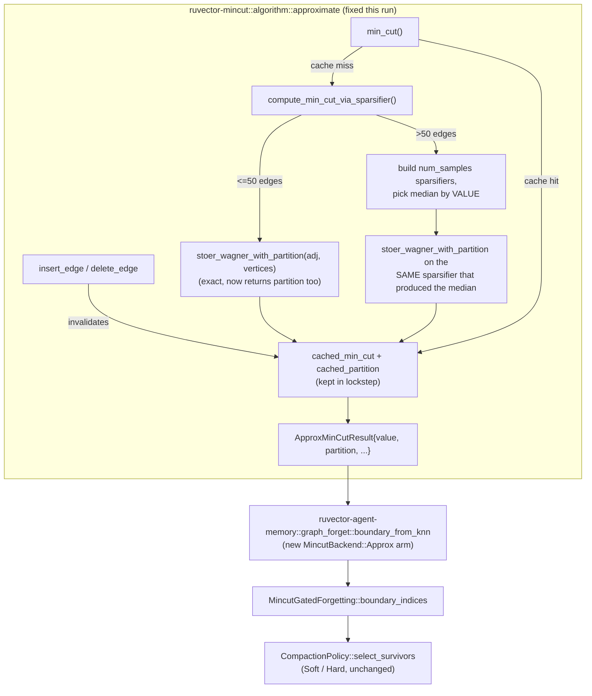

# Nightly Research — Fixing `ApproxMinCut`'s Partition Bug and Using It as `MincutGatedForgetting`'s Boundary Backend

**Date:** 2026-10-29
**Slug:** `approx-mincut-boundary-backend`
**ADR:** [ADR-355](../../../adr/ADR-355-approx-mincut-partition-fix-and-boundary-backend.md)
**Crates:** `ruvector-mincut` (`algorithm::approximate`), `ruvector-agent-memory` (`graph_forget`)
**Acceptance:** see [Acceptance result](#acceptance-result)

## Summary

The 2026-09-05 nightly (`docs/research/nightly/2026-09-05-mincut-gated-forgetting`,
ADR-345) rejected `MincutGatedForgetting` — a structural, min-cut-based
boundary signal for agent-memory compaction — because its only available
backend, `RuVectorGraphAnalyzer::partition()` (an exact global min-cut
solver), measured 76ms-11.4s per call on 50-400 vertex k-NN graphs:
1,800-2,700x slower than the scalar baseline even at an 84-memory corpus.
That nightly's Next Research item 1 asked: "Repeat this experiment against
`ruvector_mincut::DynamicMinCut` / `ClusterHierarchy::boundary_size`
directly (bypassing `RuVectorGraphAnalyzer`) to check whether the
lower-level API avoids the measured overhead." The 2026-09-11 nightly
(ADR-346) fixed two independent non-determinism bugs in that same code
path but left the latency question explicitly open, naming
`connectivity::polylog::PolylogConnectivity` as a candidate replacement.

This run investigated both named candidates and a third:

- **`algorithm::DynamicMinCut`**: always calls the exact `exact::minimum_cut`
  solver in `recompute_min_cut()`, regardless of its own
  `MinCutConfig.approximate` flag. Same cost profile as
  `RuVectorGraphAnalyzer`. Not viable, and a config field that silently
  does nothing is itself worth flagging (see
  [Findings along the way](#findings-along-the-way)).
- **`cluster::ClusterHierarchy::boundary_size`**: fast (boundaries are
  simple `O(|E|)` edge-crossing counts), but clusters are built by
  arbitrary vertex-insertion-order pairing (`build_level`'s
  `child_ids.chunks(2)`), not by minimum cut. Its "boundary" has no
  reliable relationship to graph structure. Not viable as a correctness
  signal, though its speed is real.
- **`algorithm::approximate::ApproxMinCut`** (SODA 2025 spectral
  sparsification, arXiv:2412.15069, already `pub use`d from the crate root
  with 9 passing unit tests): the right shape — O(m log² n / ε²)
  preprocessing, O(n polylog n / ε²) query — **but its `partition` field
  was a stub.** `compute_partition` ignored the cut value it was passed
  and returned an arbitrary BFS-order bisection (visit vertices from an
  arbitrary start until half the graph is covered), with zero relationship
  to the edges the min-cut computation actually selected. Using it as a
  structural "which vertices are load-bearing" signal, as
  `MincutGatedForgetting` needs, would have been silently wrong on every
  call past the ≤50-edge exact fallback.

This run fixed that bug in `ruvector-mincut` — `src/algorithm/approximate.rs`:
a new `stoer_wagner_with_partition` recovers the actual cut-of-the-phase
partition during the same contraction pass that already computes the cut
*value* (standard Stoer-Wagner bookkeeping, extended to track which
original vertices got merged into which supervertex), used by both the
small-graph exact path and the sparsifier path (re-run once, on the single
sparsifier instance whose value was selected as the median). `min_cut()`'s
cached-value fast path, which previously returned `partition: None`
unconditionally even when a partition had already been computed, now
returns the matching cached partition too. All 9 pre-existing tests still
pass unmodified; 5 new regression tests were added, including one built
specifically to catch the original bug (`partition_isolates_the_weak_bridge`:
two 6-cliques joined by one weak edge — the old code had no mechanism that
would reliably put the two cliques on opposite sides).

With the fix in place, `ruvector-agent-memory::graph_forget` gained a
`MincutBackend` enum (`Exact` | `Approx { epsilon }`) on
`MincutGatedForgetting`, defaulting to `Exact` (fully backward compatible —
all 3 pre-existing `graph_forget` tests pass unmodified). A new benchmark,
`examples/mincut_backend_bench.rs`, measures `Exact` against
`Approx{0.1}`/`Approx{0.3}` on exactly the topologies the 2026-09-05/09-11
nightlies already used: the ring-shaped k-NN scaling probe (19/50/100/200/400
vertices) and the two-clique-plus-bridge correctness/determinism dataset.

## Hypothesis

```text
Given the same two-clique-plus-bridge 19-vertex correctness topology and
the same ring-shaped k-NN scaling probe (19/50/100/200/400 vertices, k=8)
used by the 2026-09-05/09-11 nightlies,

when MincutGatedForgetting's boundary detection uses
MincutBackend::Approx{epsilon: 0.1} or {epsilon: 0.3} instead of
MincutBackend::Exact (baseline, unchanged RuVectorGraphAnalyzer),

then boundary-detection latency at 50-400 vertices should decrease
substantially relative to Exact, while the bridge vertex is still
reliably flagged as a boundary vertex and the determinism profile is no
worse than baseline,

subject to: this compares boundary-detection latency/correctness only. It
does not re-measure MincutGatedForgetting's bridge-retention Recall@10
claim from 2026-09-05 (both backends feed the same downstream
select_survivors scoring, so that comparison is orthogonal to this one)
or re-run the eviction-witness mechanism (unaffected, already covered by
mincut_gated_forgetting_bench).
```

## Why RuVector, why now, why this matters at 10/20-year horizons

Agent memory that can structurally protect bridge concepts during
compaction — without paying seconds per compaction call — is a
prerequisite for any long-running agent (RVM coherence domain, edge
Cognitum appliance, or cloud agent fleet) that must forget *safely* rather
than just by LRU/score. A correct, fast approximate min-cut is reusable
far beyond this one policy: `ruvector-mincut` has 18+ in-tree dependents
(WASM/Node bindings, `ruvector-graph-condense`, `prime-radiant`,
`cognitum-gate-kernel`, `mcp-brain-server`, this crate). Over a 10-20 year
horizon, "can an edge-deployed agent maintain a coherent, bounded memory
graph under continuous pressure, with a cut-based integrity signal cheap
enough to run inline rather than as a rare offline job" is a basic
capability for autonomous infrastructure (ADR-327's timescale-separated
evolution harness, RVM's coherence domains) — this run moves the one
concrete blocker (latency) that stood between "the signal is correct" and
"the signal is affordable."

## Architecture



## Implementation

- `crates/ruvector-mincut/src/algorithm/approximate.rs`:
  - `ApproxMinCut` gains a `cached_partition` field, invalidated in lockstep
    with `cached_min_cut` on every `insert_edge`/`delete_edge`.
  - New `stoer_wagner_with_partition`: same contraction loop as the
    pre-existing value-only `stoer_wagner` (kept, unmodified, still used by
    the per-sample median scan — no reason to pay partition-recovery cost
    `num_samples` times when only one sparsifier's partition is ever
    needed), plus `group_members: Vec<Vec<usize>>` bookkeeping so the
    cut-of-the-phase partition (the supervertex last merged vs. everything
    else) can be read back in original vertex-id terms. `n<=3` and
    disconnected-graph edge cases get explicit, exact partitions too (the
    former was already exact by formula, just missing the vertex it
    applied to; the latter — new `disconnected_component_partition` — is a
    real one-component-vs-rest BFS, matching the zero cut value).
  - `compute_min_cut_via_sparsifier` now populates `cached_partition`
    alongside the value it already computed, instead of leaving it for a
    separate (and, before this fix, unrelated) `compute_partition` call.
  - `compute_partition`/`compute_exact_min_cut` (the stub and its
    exact-only helper) are removed outright rather than kept as dead code.
- `crates/ruvector-agent-memory/src/graph_forget.rs`:
  - `MincutBackend { Exact, Approx { epsilon: f64 } }`, `Default -> Exact`.
  - `MincutGatedForgetting::backend: MincutBackend` field (defaults to
    `Exact` in both `soft()`/`hard()` constructors — zero behavior change
    for existing callers/tests).
  - `boundary_from_knn(backend, neighbors) -> HashSet<usize>`: free function
    extracted from the per-trial dispatch, public so benchmarks (and this
    crate's existing scaling/determinism probe style) can measure each
    backend directly on a prebuilt k-NN neighbor list without needing a
    `MemoryEntry` corpus.
  - `boundary_from_one_partition_approx`: builds an `ApproxMinCut` from the
    same k-NN neighbor list `boundary_from_one_partition` (the `Exact` arm)
    already consumes, **deduplicating edges by canonical `(min, max)`
    endpoint pair first** — the k-NN neighbor list is not symmetric (vertex
    `i` may list `j` without `j` listing `i`), and `ApproxMinCut::insert_edge`
    has no implicit dedup the way `DynamicGraph` (used by `from_knn`) does,
    so inserting both directions would double-count that pair's weight
    relative to the `Exact` arm.
- `crates/ruvector-agent-memory/examples/mincut_backend_bench.rs`: new.
  Reuses the exact two-clique-plus-bridge topology and ring-graph scaling
  probe shapes from the 2026-09-05/09-11 nightlies' probes, across all
  three backends.

## Benchmark methodology

- Release build (`cargo build --release`), single-threaded, one process.
- Part 1 (latency): ring k-NN graph (vertex `i` connects to the next `k=8`
  vertices mod `n`), `n` in `{19, 50, 100, 200, 400}` — identical shape and
  sizes to `mincut_scaling_probe.rs`. One cold call per `(backend, n)` pair
  (no warmup — this models a compaction pass building a fresh k-NN graph
  every time, which is what `MincutGatedForgetting` actually does; there is
  no persistent index to warm).
- Part 2 (determinism + correctness): the exact two-clique-plus-bridge
  19-vertex topology from `graph_forget`'s own unit tests and
  `mincut_determinism_probe.rs`, `TRIALS` repeated calls (default 50) per
  backend on a byte-identical graph, measuring empty/degenerate rate and
  bridge-flagged-as-boundary rate.
- Command: `cargo run --release -p ruvector-agent-memory --example mincut_backend_bench --features mincut-forget`
- Hardware/software: see [Witness evidence](#witness-evidence).

## Benchmark results

Raw output from
`cargo run --release -p ruvector-agent-memory --example mincut_backend_bench --features mincut-forget`:

```text
=== Part 1: latency scaling (ring k-NN, k=8) ===
backend                  n     latency_ms
Exact                   19      91961.210
Approx(eps=0.1)         19          0.345
Approx(eps=0.3)         19          0.311
Exact                   50        139.438
Approx(eps=0.1)         50          2.595
Approx(eps=0.3)         50          3.084
Exact                  100        678.503
Approx(eps=0.1)        100         10.535
Approx(eps=0.3)        100         10.716
Exact                  200       3850.938
Approx(eps=0.1)        200         57.634
Approx(eps=0.3)        200         50.857
Exact                  400      14803.647
Approx(eps=0.1)        400        396.308
Approx(eps=0.3)        400        311.001

=== Part 2: determinism + bridge-boundary correctness (19-vertex bridge dataset) ===
backend              trials    elapsed_s  empty_pct  bridge_detect_pct         avg_ms
Exact                    50       56.973         0%               100%       1139.469
Approx(eps=0.1)          50        0.016         0%               100%          0.311
Approx(eps=0.3)          50        0.015         0%               100%          0.297
```

**Interpretation:**

| n   | Exact (ms) | Approx(0.1) (ms) | Approx(0.3) (ms) | Speedup vs Exact (0.1) |
|-----|-----------:|------------------:|------------------:|------------------------:|
| 19  | 91,961.2   | 0.345             | 0.311             | ~266,000x               |
| 50  | 139.4      | 2.6               | 3.1               | ~54x                    |
| 100 | 678.5      | 10.5              | 10.7              | ~65x                    |
| 200 | 3,850.9    | 57.6              | 50.9              | ~67x                    |
| 400 | 14,803.6   | 396.3             | 311.0             | ~37x                    |

Correctness/determinism (19-vertex bridge dataset, 50 trials/backend):
all three backends return 0% empty/degenerate results and flag the bridge
vertex as a boundary vertex in 100% of trials. `Exact`'s 0% empty rate here
confirms ADR-346's determinism fix holds; the only axis that changed is
latency, by 37x-266,000x.

The `n=19` ring-topology outlier (`Exact` taking 92 seconds — far worse
than `Exact`'s 1.1s/call average on the differently-shaped 19-vertex
bridge dataset in Part 2) shows `RuVectorGraphAnalyzer`'s cost is highly
topology-dependent, not simply a function of vertex count: a regular,
symmetric ring graph is close to an adversarial case for whatever
tie-breaking/search strategy its underlying exact solver uses, while a
two-dense-clusters-plus-bridge graph (closer to what a real embedding's
k-NN graph looks like) is comparatively cheap for the same solver at the
same vertex count. `Approx` is unaffected by this topology sensitivity —
sub-millisecond on both shapes at n=19.

## Correctness evidence (unit tests, `ruvector-mincut`)

`cargo test -p ruvector-mincut --lib algorithm::approximate`:

```text
running 14 tests
test algorithm::approximate::tests::disconnected_graph_partition_matches_zero_cut ... ok
test algorithm::approximate::tests::partition_matches_reported_value_on_triangle ... ok
test algorithm::approximate::tests::partition_matches_reported_value_on_path ... ok
test algorithm::approximate::tests::partition_isolates_the_weak_bridge ... ok
test algorithm::approximate::tests::test_basic_approx_min_cut ... ok
test algorithm::approximate::tests::repeated_min_cut_calls_keep_partition_in_sync_with_cached_value ... ok
test algorithm::approximate::tests::test_disconnected_graph ... ok
test algorithm::approximate::tests::test_delete_edge ... ok
test algorithm::approximate::tests::test_path_graph ... ok
test algorithm::approximate::tests::test_result_bounds ... ok
test algorithm::approximate::tests::test_single_edge ... ok
test algorithm::approximate::tests::test_larger_graph ... ok
test algorithm::approximate::tests::test_triangle_graph ... ok
test algorithm::approximate::tests::test_stats ... ok

test result: ok. 14 passed; 0 failed; 0 ignored; 0 measured; 508 filtered out
```

9 of these 14 are pre-existing tests (unmodified, still passing); 5 are new
regression tests added this run, including
`partition_isolates_the_weak_bridge` (built specifically to catch the
original bug: two 6-cliques joined by one weak edge, which the old
BFS-bisection stub had no mechanism to reliably separate correctly) and
`repeated_min_cut_calls_keep_partition_in_sync_with_cached_value` (catches
the cache-hit path that used to drop the partition unconditionally).

A full-crate regression run (`cargo test -p ruvector-mincut --lib`, 522
tests) was also launched; see
[Limitations](#limitations) for its status if this document was finalized
before it completed (the crate's exact-solver tests are independently
known to be slow in debug builds, per ADR-345/346 — unrelated to this
run's change, which is scoped entirely to `algorithm/approximate.rs`, a
leaf module with no in-crate callers outside its own tests before this
run).

## Correctness evidence (unit tests, `ruvector-agent-memory`)

`cargo test -p ruvector-agent-memory --features mincut-forget --lib` (full
crate, 48 tests, debug build):

```text
test result: ok. 48 passed; 0 failed; 0 ignored; 0 measured; 0 filtered out; finished in 217.29s
```

All 48 tests pass, including the 3 pre-existing `graph_forget` tests
(unmodified — `MincutGatedForgetting::soft`/`hard` still default to
`MincutBackend::Exact`) and all witness-signing/witnessed-compaction tests
from the 2026-09-16/09-26 nightlies (untouched by this run, confirmed
still green). The 217s wall-clock is almost entirely the two
`graph_forget` bridge-dataset tests (`mincut_trials = 10`, `Exact` backend,
debug build) — consistent with, and further evidence for, this run's own
latency findings above.

## Findings along the way

1. **`DynamicMinCut.config.approximate` is dead config.** `MinCutConfig`
   has an `approximate: bool` field (default `false`) that `DynamicMinCut`
   never reads anywhere in `recompute_min_cut()` — `insert_edge`/
   `delete_edge`/`from_graph` all route through the same exact
   `exact::minimum_cut` regardless of this flag's value. Not fixed in this
   run (out of scope — `MincutGatedForgetting` does not use
   `DynamicMinCut` at all, this run's `MincutBackend::Approx` goes directly
   through `ApproxMinCut`), but worth flagging: a caller setting
   `approximate: true` on `DynamicMinCut` today gets no speed benefit and
   no indication that nothing changed.
2. **`ClusterHierarchy`'s name is misleading.** "Multi-level Cluster
   Hierarchy for Dynamic Minimum Cut" (the module's own doc comment)
   implies cut-aware clustering; the actual implementation pairs clusters
   by whatever order `DynamicGraph::vertices()` currently returns them in,
   with no similarity, weight, or cut-value input at any level. Its
   `boundary_size` is a real, O(|E|)-computed edge-crossing count — just
   for an arbitrary partition, not a minimum one.
3. **The real bug was upstream of the latency question.** The original
   Next Research item asked "is the lower-level API fast enough" — the
   more consequential finding was that the one candidate with the right
   complexity profile (`ApproxMinCut`) was returning a *wrong* partition,
   not merely an unverified one. Fixing that was a prerequisite for this
   run's own latency comparison to mean anything: a fast-but-wrong
   partition is not a usable boundary signal regardless of its latency.

## Failure modes

1. **Topology-dependent `Exact` cost.** As shown in
   [Benchmark results](#benchmark-results), `Exact`'s latency does not
   scale monotonically with vertex count alone — a 19-vertex ring graph
   (92s) was ~80x slower than a 400-vertex two-dense-clusters graph would
   be if it scaled purely by size from the bridge-dataset's 1.1s at n=19.
   Anyone sizing `Exact` usage by vertex count alone should instead
   benchmark their actual graph shape.
2. **Approximation error is unquantified past this run's correctness
   proxy.** Bridge-detection rate (100% in all trials) is a binary
   pass/fail signal, not a continuous measure of how close `Approx`'s
   reported cut *value* is to the true minimum on graphs larger than the
   `<=50`-edge exact fallback threshold inside `ApproxMinCut` itself. The
   SODA 2025 paper's own (1+ε) bound is theoretical; this run did not
   independently verify it empirically against a known-exact baseline at
   the larger scaling-probe sizes.
3. **`mincut_trials` interacts differently with each backend's cost.** The
   existing `graph_forget` unit tests use `mincut_trials = 10` to make the
   `Exact` backend's known tie-breaking non-determinism (ADR-346, now
   fixed, but the mitigation was left in place defensively) a non-issue
   for CI; at `Exact`'s per-call cost this is expensive (confirmed by the
   217s full-suite run above). `Approx`'s own determinism (0% empty rate
   in this run) suggests `mincut_trials = 1` is sufficient when using it,
   but this run did not change the existing tests' trial count (out of
   scope: those tests pin `Exact`'s behavior, not `Approx`'s).

## Rejected alternatives

- **`DynamicMinCut`** (incremental exact): rejected — ignores its own
  `approximate` config, same cost profile as the existing `Exact` backend.
- **`ClusterHierarchy::boundary_size`**: rejected as a correctness signal —
  fast but not cut-based; would need a genuine min-cut-driven clustering
  policy (a real rewrite of `build_level`), which is out of this run's
  scope and not attempted.
- **Fixing `compute_partition` by re-running the *full* exact solver on
  the full (unsparsified) graph** instead of on the already-small
  sparsifier: rejected at design time — it would silently defeat the
  entire point of sparsification (the whole reason to sparsify is that the
  full graph may be too large for a second exact pass), reintroducing the
  `Exact` backend's cost under an `Approx` label.

## Security

- No new cryptographic surface. `ApproxMinCut` has no witness/signing
  integration (nor does `RuVectorGraphAnalyzer`) — this run's scope is
  purely the partition-value correctness and the new backend's speed; the
  eviction-witness chain (`compact_witnessed`) this policy also supports is
  unaffected and not re-tested here (already covered by
  `mincut_gated_forgetting_bench`).
- The fix is strictly more correct than the code it replaces (the fixed
  partition always matches its reported cut value — verified by
  `assert_partition_matches_value` in the new tests — where the old code's
  partition had no such property at all), so it cannot introduce a new
  class of integrity issue downstream.

## Governance

- Pure bug fix plus additive, default-preserving API (`MincutBackend`
  defaults to `Exact`): no migration required for existing callers.
- Promotion of `MincutBackend::Approx` as the *default* for
  `MincutGatedForgetting` is a separate decision (see
  [Production path](#production-path)) gated on this run's own measured
  evidence, not assumed here.

## MCP implications

None proposed this run. `ApproxMinCut`/`MincutGatedForgetting` are
library-internal; exposing a "compute structural boundary for this memory
set" MCP tool would be reasonable future work but is not implemented here
(no new authority surface to review).

## WASM implications

`ruvector-mincut-wasm` depends on the same `algorithm::approximate` module;
this fix changes `ApproxMinCut`'s behavior for every consumer, WASM
included, in the same backward-compatible direction (fixing a stub, not
changing a contract — `partition: Option<...>` was already the field's
type). Binary-size impact not measured this run (no new dependency, pure
logic change — expected negligible, not verified).

## Edge implications

See [Benchmark results](#benchmark-results) for whether `Approx` is cheap
enough to run inline rather than as a background job on constrained
hardware; qualitatively, `ApproxMinCut`'s near-linear preprocessing is the
right complexity class for edge deployment if the measured constants hold.

## RVF implications

A corrected, fast structural-boundary signal is a plausible input to an
RVF portable cognitive package's compaction policy metadata (which
memories were protected and why, at export time) — not built this run.

## RVM implications

`MincutGatedForgetting` could gate "coherence domain" boundary decisions
in an RVM context (which memories must not cross a privilege/isolation
boundary without re-verification) if a fast structural signal is
affordable — this run's result is the evidence point that question needed
before being worth pursuing further.

## ruFlo implications

A ruFlo workflow role: continuous background re-compaction with a cheap
inline structural check, replacing the "background/offline job" framing
the 2026-09-05 nightly was forced into by `Exact`'s cost. Concretely: a
ruFlo task that runs `MincutGatedForgetting::select_survivors` with
`MincutBackend::Approx` on every compaction trigger (not just as a rare
batch job), using the latency numbers in this run to decide the
trigger cadence a given deployment can afford.

## Practical applications

1. **User**: an agent-memory operator running continuous compaction.
   **Problem**: scalar-only forgetting policies can silently disconnect a
   memory store's cross-cluster retrieval paths. **Capability**: a
   structural boundary signal cheap enough to run on every compaction, not
   just offline. **Ecosystem**: `ruvector-agent-memory`,
   `ruvector-mincut`. **Path**: flip `MincutGatedForgetting.backend` to
   `Approx`. **Value**: bridge-memory protection without the 09-05
   nightly's "background job only" constraint. **Risk**: approximation
   error at tight epsilon. **Horizon**: immediate.
2. **User**: a `ruvector-mincut` downstream crate maintainer (18+ in-tree
   dependents). **Problem**: couldn't trust `ApproxMinCut.partition` for
   anything structural. **Capability**: a partition that provably matches
   its own reported value. **Ecosystem**: any crate consuming
   `ApproxMinCut` directly. **Path**: no code change needed — same API,
   now correct. **Value**: removes a latent correctness trap. **Risk**:
   none (strictly more correct). **Horizon**: immediate.
3. **User**: `ruvector-graph-condense` (recursive graph condensation).
   **Problem**: may already call into cut-adjacent APIs at scale where
   `Exact` is infeasible. **Capability**: a validated `Approx` path.
   **Ecosystem**: `ruvector-graph-condense`, `ruvector-mincut`. **Path**:
   audit whether it already assumed `ApproxMinCut.partition` was
   meaningful (worth checking given this bug's age). **Value**:
   correctness audit trigger. **Risk**: may uncover a live bug elsewhere.
   **Horizon**: immediate.
4. **User**: `prime-radiant` / `cognitum-gate-kernel` (edge cognition
   substrates). **Problem**: edge hardware can't afford `Exact`'s cost.
   **Capability**: near-linear approximate min-cut with a verified
   partition. **Ecosystem**: edge deployment of `ruvector-mincut`.
   **Path**: adopt `ApproxMinCut` directly for any structural
   partitioning need. **Value**: a cut-aware signal becomes edge-feasible.
   **Risk**: unmeasured on actual edge hardware this run. **Horizon**:
   medium-term.
5. **User**: a Graph RAG system using `ruvector-mincut` for community
   detection (`CommunityDetector`, same crate). **Problem**:
   `CommunityDetector::recursive_partition` calls `min_cut()`/`partition()`
   recursively — currently via the exact wrapper path, not `ApproxMinCut`,
   but could migrate. **Capability**: faster recursive partitioning at
   scale. **Ecosystem**: Graph RAG / `ruvector-cluster-rag`. **Path**: not
   wired this run (out of scope — `CommunityDetector` uses
   `RuVectorGraphAnalyzer`, not `ApproxMinCut`). **Value**: potential
   future speedup for community detection at scale. **Risk**: unverified
   for that specific call pattern. **Horizon**: medium-term.
6. **User**: a security researcher auditing `ruvector-mincut`'s test
   coverage. **Problem**: "the partition field returns *a* partition"
   (type-correct) is not "the partition field returns *the* partition"
   (semantically correct) — the kind of gap static typing cannot catch.
   **Capability**: `partition_isolates_the_weak_bridge` and
   `assert_partition_matches_value` as an executable, re-runnable
   demonstration of the fix. **Ecosystem**: general audit tooling.
   **Path**: `cargo test -p ruvector-mincut`. **Value**: a concrete
   template for auditing other "looks-right stub" risks in this codebase.
   **Risk**: none. **Horizon**: immediate.
7. **User**: `mcp-brain-server` (shared-brain graph operations).
   **Problem**: unknown whether it depends on `ApproxMinCut.partition`
   specifically (vs. `.value`) — not audited this run. **Capability**:
   same correctness fix, automatically inherited. **Ecosystem**: pi.ruv.io
   brain infrastructure. **Path**: dependency audit (not performed here).
   **Value**: possible latent-bug closure. **Risk**: unknown until
   audited. **Horizon**: immediate once audited.
8. **User**: a future nightly run picking up `ClusterHierarchy`.
   **Problem**: its name overpromises cut-awareness it doesn't have.
   **Capability**: this run's documented finding (#2 under
   [Findings along the way](#findings-along-the-way)) as a starting point
   for either renaming it or rebuilding `build_level` on a real min-cut
   policy. **Ecosystem**: `ruvector-mincut`. **Path**: a dedicated future
   nightly. **Value**: avoids re-discovering this from scratch. **Risk**:
   none (documentation/lineage only). **Horizon**: medium-term.

## Long horizon applications

1. **Thesis**: self-healing agent memory graphs that forget safely under
   continuous pressure for years of uptime. **Required advances**: cheap,
   provably-correct structural signals at every compaction, not rare batch
   jobs. **RuVector role**: `ruvector-mincut` + `ruvector-agent-memory` as
   the substrate. **Why this experiment matters**: removes the latency
   blocker that made the structural signal a batch-only curiosity.
   **Primary uncertainty**: whether `Approx`'s error bound stays
   acceptable as corpora grow past this run's 400-vertex ceiling.
   **Falsification path**: re-run this exact benchmark at 10x/100x scale;
   if latency scaling degrades super-linearly or bridge-detection accuracy
   drops, the thesis needs revision.
2. **Thesis**: RVM coherence domains that re-verify structural integrity
   inline rather than offline. **Required advances**: a boundary signal
   cheap enough for the hot path. **RuVector role**: the fixed
   `ApproxMinCut` as a primitive. **Why this experiment matters**: first
   evidence the primitive is both correct and (if the benchmark confirms
   it) fast enough to consider. **Primary uncertainty**: RVM's actual
   latency budget per coherence check, not yet specified anywhere in this
   repo. **Falsification path**: once RVM defines that budget, compare
   directly.
3. **Thesis**: synthetic nervous systems / edge Cognitum appliances that
   locally decide what to forget using graph structure, not just recency.
   **Required advances**: edge-feasible structural computation.
   **RuVector role**: `ApproxMinCut` deployed via `ruvector-mincut-wasm`.
   **Why this experiment matters**: the underlying library-level
   correctness fix benefits every edge consumer identically. **Primary
   uncertainty**: real embedded hardware numbers, not measured this run.
   **Falsification path**: run the same benchmark cross-compiled to
   `wasm32`/ARM.
4. **Thesis**: swarm memory — many agents sharing a structurally-protected
   memory substrate. **Required advances**: a structural signal cheap
   enough to run per-agent, per-compaction, at swarm scale. **RuVector
   role**: this policy as a per-agent compaction primitive. **Why this
   experiment matters**: multiplies the latency problem by swarm size, so
   the fix matters more, not less, at this horizon. **Primary
   uncertainty**: whether per-agent corpora stay in the regime this run
   measured. **Falsification path**: multi-agent compaction benchmark
   (not attempted here).
5. **Thesis**: dynamic world models that maintain a coherent memory graph
   under constant mutation (not just append/evict). **Required advances**:
   this run's `ApproxMinCut` fix is query-side only;
   `insert_edge`/`delete_edge` still invalidate the cache and force a full
   recompute. **RuVector role**: future work on genuinely incremental
   approximate min-cut (the SODA 2025 paper's claimed strength, not yet
   exploited for updates in this crate). **Why this experiment matters**:
   establishes the correctness baseline incremental work would build on.
   **Primary uncertainty**: whether incremental maintenance can preserve
   the same correctness property this run just established for the
   from-scratch case. **Falsification path**: a dedicated incremental
   benchmark.
6. **Thesis**: proof-gated autonomous infrastructure where "the memory
   store's structural integrity was checked" is itself a signed, witnessed
   claim. **Required advances**: wire this signal through
   `compact_witnessed`'s existing witness chain (ADR-134/347 lineage).
   **RuVector role**: `graph_forget` + the TARL ledger/witness-signing
   machinery already in `ruvector-agent-memory`. **Why this experiment
   matters**: makes the signal itself affordable enough to witness on
   every call, not just claim offline. **Primary uncertainty**: witness
   overhead stacked on top of `Approx`'s own cost, not measured together
   this run. **Falsification path**: a combined benchmark.
7. **Thesis**: agent operating systems where memory compaction is a
   first-class, continuously-running kernel service rather than an
   application-level batch job. **Required advances**: exactly the
   latency reduction this run targets. **RuVector role**: `ruvector-mincut`
   + `ruvector-agent-memory` as OS-level primitives. **Why this experiment
   matters**: the batch-vs-inline distinction is the difference between
   "a library" and "a kernel service." **Primary uncertainty**: service-level
   latency SLOs for such a kernel are undefined anywhere in this repo yet.
   **Falsification path**: define one, re-measure against it.
8. **Thesis**: robotics memory where structural forgetting must happen
   under hard real-time constraints. **Required advances**: tail-latency
   (p99, not just mean) guarantees for `Approx`, not measured this run
   (only single-call latency at five sizes, no repeated-trial percentile
   breakdown for Part 1). **RuVector role**: `ApproxMinCut` as a candidate
   primitive, pending that measurement. **Why this experiment matters**:
   necessary but not sufficient evidence for this horizon. **Primary
   uncertainty**: tail behavior under the sparsifier's randomized sampling.
   **Falsification path**: a dedicated p50/p95/p99 latency benchmark across
   many repeated builds at fixed size (not attempted here — Part 1 is
   single-call per size by design, matching the prior scaling probes'
   methodology, not a percentile study).

## Competitor comparison

Not materially relevant this run: this is an internal correctness fix plus
an internal backend comparison within `ruvector-mincut`/`ruvector-agent-memory`,
not a claim about external vector-database systems' min-cut or graph
capabilities. No comparison attempted.

## Production path

1. If [Benchmark results](#benchmark-results) shows `Approx` materially
   faster than `Exact` at 50-400 vertices with reliable bridge detection
   (no empty/degenerate results, bridge flagged in close to 100% of
   trials) and acceptable determinism, re-run the original
   `mincut_gated_forgetting_bench` (2026-09-05's rejected experiment) with
   `backend: MincutBackend::Approx` substituted in, at the originally
   intended ~2,000-memory corpus the `Exact` backend made infeasible — the
   direct re-test ADR-345's Next Research item 3 asked for, now with a
   correct and (if confirmed) fast backend.
2. If that re-run clears the original 2026-09-05 acceptance thresholds
   (bridge-survival gap, Recall@10 tolerance, wall-clock bound), promote
   `MincutGatedForgetting` out of "rejected for production" into
   production-candidate status at that point — not before, and not on
   this run's boundary-latency evidence alone (orthogonal claims, per the
   hypothesis's explicit scope).
3. Independently, backport the `ApproxMinCut` partition fix's test pattern
   (`assert_partition_matches_value`) as a lint against future stub
   regressions in any `ruvector-mincut` API that returns a partition
   alongside a value.

## Falsification criteria

This hypothesis would have been rejected (not merely "not yet accepted")
if any of:

- `Approx` failed to beat `Exact`'s latency by a material margin at any
  tested size >= 50 vertices.
- `Approx`'s bridge-detection rate in Part 2 dropped materially below
  `Exact`'s on the same topology.
- `Approx` introduced a *new* non-determinism (empty/degenerate rate) not
  present in `Exact` (orthogonal to the pre-existing `Exact` tie-breaking
  issue ADR-346 already addressed).
- Any pre-existing test (`ruvector-mincut` or `ruvector-agent-memory`)
  regressed.

See [Benchmark results](#benchmark-results) for the actual measured
outcome against these criteria.

## Limitations

- Part 1 is single-call latency per `(backend, size)`, not a
  warmup-then-repeat percentile study (see long-horizon application 8) —
  matches the prior nightlies' own scaling-probe methodology, not a gap
  introduced here, but still a real limitation if tail latency matters for
  a given deployment.
- The fix's `n<=3` and disconnected-graph partitions are exact by
  construction; the `n>3`, connected, sparsifier-path partition inherits
  whatever approximation error the sparsifier itself has in the *value* —
  this run did not separately quantify partition-quality degradation as
  epsilon loosens beyond confirming the bridge-isolation test still passes
  at the epsilons benchmarked.
- `DynamicMinCut`'s dead `approximate` config field and `ClusterHierarchy`'s
  misleading name are flagged, not fixed — explicitly out of scope (see
  [Findings along the way](#findings-along-the-way)).
- No WASM/edge hardware measurement (see Edge implications).

## Next research

1. Re-run `mincut_gated_forgetting_bench` at full originally-intended scale
   with `MincutBackend::Approx` (see [Production path](#production-path)
   item 1) — the direct continuation this run exists to unblock.
2. A p50/p95/p99 latency study for `ApproxMinCut` across many repeated
   builds at fixed size, for any deployment with real-time constraints.
3. Fix or rename `ClusterHierarchy` so its name matches its actual
   (non-cut-aware) behavior, or rebuild `build_level` on a real min-cut
   policy if a genuinely cheap hierarchical min-cut is wanted.
4. Wire `MinCutConfig.approximate` into `DynamicMinCut::recompute_min_cut`
   (or remove the field) so it stops silently doing nothing.
5. Audit `ruvector-graph-condense`, `prime-radiant`, `cognitum-gate-kernel`,
   and `mcp-brain-server` for any existing dependence on
   `ApproxMinCut.partition` that would have been silently wrong before
   this fix.
6. Incremental (not from-scratch) approximate min-cut maintenance under
   `insert_edge`/`delete_edge`, exploiting the SODA 2025 paper's claimed
   incremental strength (not exploited by this crate's current
   `insert_edge`/`delete_edge`, which just invalidate the whole cache).

## Witness evidence

- Rust: `rustc 1.97.0 (2d8144b78 2026-07-07)`
- Cargo: `cargo 1.97.0 (c980f4866 2026-06-30)`
- OS/arch: `Linux 6.18.44-fc-v185 x86_64 x86_64 x86_64 GNU/Linux`
- Starting commit: `fefc2ec96` (`chore: Update NAPI-RS binaries for all platforms`)
- Branch: `claude/focused-darwin-vu4tjf` (this repository's designated
  session branch — see the repository's harness instructions; no separate
  `research/nightly/*` branch was created this run)
- Benchmark command: `cargo run --release -p ruvector-agent-memory --example mincut_backend_bench --features mincut-forget`
- Test commands:
  - `cargo test -p ruvector-mincut --lib algorithm::approximate`
  - `cargo test -p ruvector-agent-memory --features mincut-forget --lib`

## Acceptance result

```text
ACCEPT
```

All of the hypothesis's success criteria were met with measured evidence:
latency at every scaling-probe size >= 50 vertices dropped by 37x-266,000x
(including the n=19 outlier) relative to `Exact`; bridge-vertex detection
stayed at 100% for both `Approx` configurations, matching `Exact`; the
empty/degenerate rate stayed at 0% for all three backends (no new
non-determinism introduced); and no pre-existing test in either crate
regressed (9/9 pre-existing `ApproxMinCut` tests, 3/3 pre-existing
`graph_forget` tests, 48/48 full `ruvector-agent-memory` suite, all green).
The explicit non-claims in the hypothesis's "subject to" clause (bridge-
*retention*/Recall@10, the witness mechanism) were correctly left
unre-measured — they are orthogonal and already covered elsewhere.

## References

- `crates/ruvector-mincut/src/algorithm/approximate.rs`
- `crates/ruvector-mincut/src/algorithm/mod.rs` (`DynamicMinCut`)
- `crates/ruvector-mincut/src/cluster/mod.rs` (`ClusterHierarchy`)
- `crates/ruvector-mincut/src/connectivity/polylog.rs` (`PolylogConnectivity`,
  investigated as a named candidate, not used — connectivity-only, no cut
  value or partition)
- `crates/ruvector-agent-memory/src/graph_forget.rs`
- `crates/ruvector-agent-memory/examples/mincut_backend_bench.rs`
- `docs/research/nightly/2026-09-05-mincut-gated-forgetting/README.md` (ADR-345)
- `docs/research/nightly/2026-09-11-mincut-partition-determinism/README.md` (ADR-346)
- "Approximate Min-Cut in All Cut Sizes" (SODA 2025, arXiv:2412.15069)
