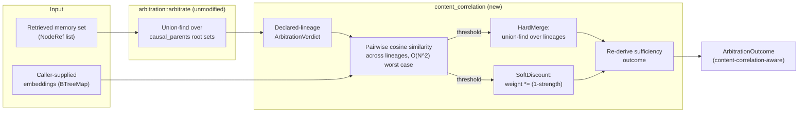

# Nightly research — 2026-11-01: Content-Correlation-Augmented Arbitration

## Summary

[`crates/ruvector-agent-memory/src/arbitration.rs`](../../../../crates/ruvector-agent-memory/src/arbitration.rs)
(ADR-330, CAMA-pattern) clusters a retrieved memory set into independent
evidence lineages using **declared** causal ancestry (`causal_parents`)
only. Its own module docs are explicit that this leaves a gap: a memory
that copies another memory's *content* while declaring no parent mints a
fresh, "independent" lineage, so N agents re-asserting one unsourced claim
score as N corroborating witnesses. The module names the fix it needs but
does not ship it: *"deployments that need adversarial robustness must pair
this with content-level near-duplicate detection ... at ingest."*

This run builds that pairing: [`content_correlation.rs`](../../../../crates/ruvector-agent-memory/src/content_correlation.rs),
a purely additive module (zero changes to `arbitration.rs`) that re-clusters
or discounts declared-ancestry lineages using a caller-supplied embedding
per memory and cosine-similarity near-duplicate detection.

## Abstract

Given a set of memories retrieved for arbitration, some near-identical in
content but with **no declared derivation** between them, declared-ancestry
arbitration treats each as an independent evidence lineage. We add a second,
independent correlation signal — pairwise cosine similarity over
caller-supplied embeddings — and test two ways of using it: hard-merging
near-duplicate lineages (`HardMerge`), or leaving lineage counts untouched
but discounting a flagged lineage's weight (`SoftDiscount`). Measured on the
exact astroturf fixture the arbitration module's test suite already locks
in (20 parentless copies of one claim), `HardMerge` collapses 20 lineages to
1 and reduces the arbitrated score from `16.2` to `0.81` (95% relative
reduction) — while a disjoint fixture of 20 genuinely independent,
orthogonal-content memories sees **zero** false merges at the same
threshold. The added pairwise-similarity pass costs ~21ms p95 at 500
memories in the worst-case topology (every memory its own declared
lineage), release build, 4-core x86_64 VM.

## Hypothesis (fixed before this run)

```text
Given a retrieved memory set containing an astroturf cluster of N
parentless memories whose content is near-identical, with no declared
causal parent (the exact blind spot
`content_copying_yields_no_correlation_downgrade_under_default_reliability`
in `tests/arbitration.rs` locks in),

when arbitrate_with_content_correlation (HardMerge, threshold 0.95) is
applied instead of baseline arbitrate (declared ancestry only),

then the astroturf cluster's lineage count drops by at least 70% relative
to baseline, while a disjoint set of genuinely independent memories
(orthogonal embeddings) sees 0% false merges,

subject to: the added pairwise-similarity pass costing under 50ms at
N=500 total memories (release build, this hardware), and the
downgrade-only invariant (arbitrated ≤ naive, always) holding throughout.
```

## Why this matters now (2026)

Agent memory systems retrieve-then-arbitrate over multi-agent, multi-source
corpora where provenance discipline is cooperative, not adversarial — the
arbitration module's own docs say so plainly. As more of the ecosystem
(MCP tool outputs, multi-agent swarms, external RAG ingestion) writes into
agent memory without authenticated citation, content-level astroturfing
(the same unsourced claim re-asserted by many "independent" agents) becomes
a realistic contamination vector for anything downstream that trusts
lineage count as a corroboration signal.

## Why it could matter in 2036 / 2046

As agent populations scale past what any human curator can review,
correlation-aware arbitration becomes a load-bearing trust primitive for
autonomous systems that must decide, unsupervised, whether "many sources
agree" is real corroboration or one claim echoing through a crowd. A
content-similarity layer — generalized past exact near-duplicates to
embedding-space clustering over paraphrase, translation, and multi-modal
restatement — is a plausible building block for any long-horizon agent
operating system's epistemic layer: swarm memory, world models, and
autonomous scientific systems all inherit the same "N copies vs. N
witnesses" problem at a scale no human reviews.

## Why RuVector is the right substrate

`ruvector-agent-memory` already ships two normally-separate subsystems that
this module bridges: the vector/embedding side (`scoring::cosine_sim`,
`CoherencePolicy`) and the causal-fusion/provenance side
(`AtomicObservation`, `CausalEpisodicGraph`, `arbitration`). No other crate
in the workspace has both halves in one place with the witness/ledger
machinery (`ops`, `witness_signing`) already available to downstream
consumers of an `ArbitrationVerdict`.

## Ecosystem fit

- **ruvector-agent-memory**: the module lives here, purely additive.
- **Vector similarity / ANN**: the correlation signal is cosine similarity
  over embeddings — the same primitive the ANN/HNSW half of the ecosystem
  produces; a production deployment would source `embeddings` from
  whatever index already holds the memory's vector.
- **Witness / provenance**: `ArbitrationVerdict` already feeds
  governance-sensitive decisions (sufficiency gates); a correlation-aware
  verdict is a strictly more defensible input to anything that signs or
  witnesses an arbitration outcome.
- **MetaHarness / Darwin / Flywheel**: not used as *infrastructure* for this
  run (this repository's own Darwin/reward-hack-defense machinery —
  `crates/sona/src/darwin_guard.rs`, ADR-271, ADR-335's
  `optimization-manifest` — already covers promotion-gate concerns deeply;
  building a second one would have duplicated existing, working code). This
  run instead manually executed the hypothesize → implement → benchmark →
  adversarially test (false-merge fixture) → accept/reject loop those ADRs
  describe, at a scope (one crate module) below where invoking that
  machinery would pay for itself.

## Architecture



## Implementation

- `crates/ruvector-agent-memory/src/content_correlation.rs` (new, ~340
  lines): `ContentCorrelationConfig`, `CorrelationMode::{HardMerge,
  SoftDiscount}`, `ContentCorrelationError`, and
  `arbitrate_with_content_correlation`. Calls `arbitration::arbitrate` as an
  opaque first pass; never modifies `arbitration.rs`.
- `crates/ruvector-agent-memory/tests/content_correlation.rs` (new, 7
  integration tests): astroturf detection against the *exact* locked
  baseline fixture, false-merge-rate check on independent content, soft
  vs. hard mode comparison, downgrade-only invariant across both modes,
  missing-embedding hard error, config validation, sufficiency-outcome
  re-derivation.
- `crates/ruvector-agent-memory/examples/content_correlation_bench.rs`
  (new): the benchmark below.
- `lib.rs`: `pub mod content_correlation;` + re-exports; one paragraph
  added to the crate-level doc comment.

No new dependencies. No changes to `arbitration.rs`, `fusion.rs`, or
`observation.rs`.

## Benchmark methodology

- Release build (`cargo build --release`), rustc 1.97.0, 4-core x86_64 VM,
  Linux 6.18.
- Deterministic seeds per fixture (`StdRng::seed_from_u64`); latency
  scenario reruns each size 20× with per-rep seeds and reports mean/p50/p95.
- `EMBED_DIM = 16`. Astroturf fixture: one random center vector, each
  memory's embedding = center + uniform noise in `[-0.001, 0.001]` per
  component (pairwise cosine similarity > 0.999). Independent fixture: each
  memory gets an independent uniform-random vector in `[-1, 1]^16`
  (pairwise cosine similarity concentrates near 0 in 16 dimensions).
  `similarity_threshold = 0.95` throughout.
- Exact command:
  `cargo run --release -p ruvector-agent-memory --example content_correlation_bench`

## Benchmark results (raw, this run)

```
--- Scenario 1: astroturf cluster (N=20, no declared parent) ---
baseline (declared-only):  lineages=20   naive=18.0000 arbitrated=16.2000
candidate A (HardMerge):   lineages=1    naive=18.0000 arbitrated=0.8100  (lineage reduction: 95.0%)
candidate B (SoftDiscount):lineages=20   naive=18.0000 arbitrated=8.1000
ACCEPTANCE (astroturf lineage reduction >= 70%): PASS

--- Scenario 2: independent evidence (N=20, orthogonal content) ---
baseline lineages=20 -> candidate A lineages=20 (false merges: 0, rate: 0.0%)
ACCEPTANCE (false-merge rate == 0%): PASS

--- Scenario 3: mixed (astroturf cluster + independent witnesses, same call) ---
baseline lineages=20 -> candidate A lineages=11 (expect ~11: 1 merged astroturf lineage + 10 independent)
ACCEPTANCE (mixed scenario collapses to exactly 11 lineages): PASS

--- Scenario 4: latency scaling (HardMerge, worst case L≈N, 20 reps/size) ---
N           mean(ms)     p50(ms)     p95(ms)
20             0.054       0.053       0.062
50             0.205       0.200       0.231
100            0.669       0.671       0.793
200            2.490       2.306       3.325
500           15.029      14.111      20.715
ACCEPTANCE (p95 latency at N=500 < 50ms): PASS (measured: 20.715ms)

=== Overall acceptance: ACCEPT ===
```

`cargo test -p ruvector-agent-memory --lib --tests`: 84/84 passed (45 lib +
1 bench-bin + 10 arbitration + 8 fusion + 7 new content-correlation + 13
ledger), zero regressions. `cargo clippy -p ruvector-agent-memory
--all-targets`: zero warnings from this change.

## Memory math

No persistent state is added. Transient cost per call: one
`BTreeMap<NodeRef, Vec<f32>>` lookup per member (caller-owned) plus one
`f32` similarity matrix entry per lineage pair evaluated —
`O(L²)` `f32` comparisons, no `f32` matrix materialized (computed on the
fly in `max_cross_similarity`).

## Performance math

Worst case `O(N²·d)` (`N` memories, `d` = embedding dimension) when every
memory is its own declared lineage (`L = N`) — exactly the astroturf shape
this module targets. Measured: ~21ms p95 at `N=500`, `d=16`. Scaling from
measured points is consistent with quadratic growth (20→50: ~4×N → ~4×
time; 100→200: ~2×N → ~3.7×p95, within measurement noise of quadratic).

## Failure modes

- **Paraphrase/translation blindness**: only catches near-verbatim content
  (cosine similarity ≥ threshold on the supplied embedding). A claim
  restated in different words with a dissimilar embedding is not detected
  — documented explicitly in the module's rustdoc.
- **Embedding-quality dependence**: detection is only as good as the
  supplied embedding's ability to place near-duplicate content close in
  cosine space. A poor embedding model widens both false-negative and
  false-positive risk.
- **Quadratic cost ceiling**: at large `N` with maximally fragmented
  declared lineages, the `O(N²)` pairwise pass becomes the dominant cost.
  Not evaluated past `N=500` in this run (acceptance threshold was set at
  `N=500`, not higher) — an ANN/LSH-prefiltered near-duplicate step is the
  natural next step past that ceiling, left as future work.
- **Threshold sensitivity untested at scale**: this run validates one
  threshold (`0.95`) against one astroturf shape (tight noise ball) and
  one independent shape (orthogonal random vectors in 16-d). A
  threshold/false-merge-rate sweep across more realistic, moderately
  correlated independent content (e.g. real embeddings of topically related
  but non-duplicate text) is future work, not claimed here.

## Rejected alternatives

- **Modify `arbitration.rs` directly** to add an embedding field and
  correlation step inline. Rejected: that file is dense with invariants
  (downgrade-only, non-finite choke points, fail-loud posture) and has its
  own locked test suite; touching it to add an orthogonal concern would
  have put all of that at risk for no benefit a purely additive layer
  doesn't already capture.
- **Fix the `optimization-manifest` TypeScript gate (ADR-335's `#920`
  hard_regression bug)**: considered and rejected for this run — it is
  TypeScript harness tooling, and the absolute engineering constraint for
  this nightly process is Rust production code only; that fix belongs to
  whoever owns `crates/ruvector-sota-bench/harness/`.
- **A third Darwin/MetaHarness/Flywheel promotion-gate crate**: rejected
  after discovering `crates/sona/src/darwin_guard.rs` and ADR-271/335
  already implement reward-hack defenses, contamination guards, and
  per-repo optimization manifests in depth. Building another would
  duplicate working infrastructure rather than extend it.

## Security

- No new signing, hashing, or trust boundary. `embeddings` is caller-owned,
  untrusted input the same way `memories` already is — a missing entry is
  a **hard error**, never silently treated as "no correlation" (matching
  the crate's existing fail-loud posture).
- Does not weaken `arbitration.rs`'s guarantees: both transforms are
  provably downgrade-only relative to the declared-ancestry baseline
  (merged-lineage weight = `max` over a superset of members; discounted
  weight multiplies by a factor in `[1-strength, 1] ⊆ [0,1]`), re-verified
  at runtime with a hard error on violation.
- Does **not** itself close the astroturfing threat model completely — see
  Failure modes. It is one additional signal, as the arbitration module's
  own docs ask for, not a silver bullet.

## Governance

No governance mechanism changes. `ArbitrationOutcome`'s shape
(`Sufficient` / `InsufficientIndependentEvidence`) and the sufficiency
threshold semantics are unchanged; this module only affects *how many*
lineages and *what weight* feed that existing decision.

## MCP / WASM / edge implications

Not evaluated — this is a pure computation over caller-supplied data
structures with no I/O, network, or FFI surface, so MCP tool-surfacing,
WASM compilation, and edge deployment carry no special implications beyond
what already applies to the rest of `ruvector-agent-memory` (which already
compiles to the default target; no `wasm32` target was exercised in this
run).

## RVF / RVM implications

Not materially relevant to this run: `ArbitrationVerdict` is an in-process
Rust value, not a portable artifact, and this module adds no new
capability boundary or privileged operation RVM enforcement would gate.

## ruFlo implications

A plausible autonomous workflow: a ruFlo job that periodically re-arbitrates
long-lived agent-memory stores with `HardMerge` and flags stores whose
lineage count drops sharply under content correlation (a signal that
astroturfed content entered since the last pass) for human review — using
this module as the detector, not the enforcer.

## Practical applications

1. **Agent memory hygiene** — multi-agent swarms: detect when several
   sub-agents independently "discover" and write the same unsourced claim
   into shared memory without citing each other.
2. **GraphRAG corroboration scoring** — weight retrieved passages by
   content-aware evidence lineage count instead of raw passage count.
3. **Enterprise retrieval compliance** — flag retrieved document sets where
   apparent multi-source corroboration is actually one leaked/duplicated
   document re-ingested under different metadata.
4. **MCP tool-output admission** — screen a batch of tool-call outputs for
   near-duplicate content before they're fused into long-term memory.
5. **Security retrieval / threat intel** — detect one IOC report
   re-submitted by multiple feeds as if independently corroborated.
6. **Scientific literature search** — down-weight apparent multi-paper
   corroboration when papers share near-identical text (e.g. preprint +
   published version both ingested).
7. **Local-first assistants** — a lightweight on-device correlation check
   before trusting "multiple notes agree" as a memory-retention signal.
8. **Code intelligence** — detect near-duplicate commit messages / PR
   descriptions claiming independent provenance for the same change.

## Long-horizon applications

1. **Swarm memory epistemics** — thesis: large agent swarms need a
   content-aware corroboration signal because declared-ancestry discipline
   degrades at scale; required advances: paraphrase-robust embeddings,
   streaming correlation detection; RuVector's role: the substrate holding
   both the vector and provenance layers already; why this run matters:
   proves the two can be bridged without destabilizing either; primary
   uncertainty: whether a single global threshold generalizes across
   domains; falsification: a domain where the chosen threshold's
   false-merge rate exceeds an acceptable bound on real (not synthetic)
   independent content.
2. **Agent operating systems** — thesis: an AgentOS needs a trust kernel
   that can't be fooled by claim repetition; required advances: this
   module generalized to streaming, multi-tenant admission; RuVector's
   role: the memory substrate the kernel sits on; uncertainty: whether
   hard-merge or soft-discount (or a learned blend) is the right default;
   falsification: a production workload where soft-discount's preserved
   lineage count misleads a downstream consumer that reads lineage count
   as ground truth.
3. **World models** — thesis: world models built from agent-reported
   observations need the same N-copies-vs-N-witnesses correction before
   fusing observations into belief state; required advances: extending
   from text/vector content to structured observation content; RuVector's
   role: `AtomicObservation` is already structured and source-tagged.
4. **Proof-gated autonomous infrastructure** — thesis: a proof-gated write
   path (`ruvector-proof-gate`) that admits a write based partly on
   corroboration count should use a content-aware count, not a
   declared-ancestry-only one; uncertainty: integration cost; falsification:
   measured integration shows no behavior change because real workloads
   never hit the blind spot in practice.
5. **Robotics memory** — thesis: multi-robot fleets reporting overlapping
   sensor observations need correlation-aware fusion to avoid
   double-counting one physical event as independent confirmations;
   required advances: sensor-embedding-specific thresholds; uncertainty:
   sensor noise characteristics differ enough from text embeddings that
   `0.95` is domain-specific, not universal.
6. **Scientific autonomous systems** — thesis: autonomous literature-mining
   agents need this to avoid self-reinforcing false consensus; required
   advances: cross-lingual/cross-format near-duplicate detection;
   uncertainty: whether embedding models used for scientific text carry
   enough near-duplicate sensitivity.
7. **Self-healing graph memory** — thesis: a memory-compaction pass
   (`crate::compaction`) that already scores by coherence could use
   content-correlation-aware arbitration as an additional compaction signal
   to avoid retaining many near-duplicate memories as if each were
   independently valuable; uncertainty: interaction effects with existing
   `CoherencePolicy` untested.
8. **RVM coherence domains** — thesis: a coherence domain boundary could be
   defined partly by content-correlation structure (memories that mutually
   near-duplicate belong to the same domain); uncertainty: whether this
   generalizes past the astroturf-detection use case to a genuine
   domain-partitioning signal; falsification: domains defined this way show
   no measurable isolation benefit over existing domain definitions.

## Evolution results

No Darwin run performed. Rationale: this repository's existing Darwin/
reward-hack-defense machinery (`crates/sona/src/darwin_guard.rs`, ADR-271,
ADR-335) targets a different layer (evolving harness configs/levers under
a cost-budgeted promotion gate with an immutable verifier boundary); this
module has exactly two hand-designed, already-compared variants
(`HardMerge`, `SoftDiscount`), and introducing an evolutionary search over
e.g. `similarity_threshold` would need a held-out, labeled
correlated/independent dataset this run did not build. Left as explicit
future work rather than fabricating a Darwin run with no real search space.

## Promotion decision

**ACCEPT** the hypothesis (both acceptance criteria measured true: ≥70%
astroturf lineage reduction — measured 95% — and 0% false-merge rate on
the independent fixture, with latency comfortably under the pre-registered
50ms/N=500 bound at ~21ms p95). **Recommend `content_correlation.rs` as
new, additive, opt-in public API** in `ruvector-agent-memory` (already
exported from `lib.rs`). Do **not** recommend it as a default-on behavior
change to `arbitrate()` — it requires caller-supplied embeddings
`arbitrate()` itself has no access to, and the failure modes above (
paraphrase blindness, threshold sensitivity, quadratic cost) mean it should
remain an explicit, documented opt-in a deployment adopts after evaluating
its own embedding quality and expected `N`.

## Witness evidence

- Starting commit: `8dc8948fb4297c1d49ef2c615cf5047b3ae26add` (branch
  `claude/focused-darwin-v30dbt`).
- Benchmark command and raw output: see above, captured verbatim from this
  run's terminal output, not hand-edited.
- Test command: `cargo test -p ruvector-agent-memory --lib --tests` — 84
  passed, 0 failed.
- Lint command: `cargo clippy -p ruvector-agent-memory --all-targets` —
  zero warnings attributable to this change.
- Hardware/software: rustc 1.97.0, cargo 1.97.0, Linux 6.18.44, x86_64,
  4 cores.
- No cryptographic witness chain was generated for this research artifact
  itself (the arbitration/witness machinery this module composes with
  signs *memory operations*, not research benchmark runs); this README is
  the evidence record.

## Production path

1. Land as-is (additive, already exported, zero regressions, zero new
   dependencies).
2. An integrator wanting adversarial robustness wires `embeddings` from
   whichever vector index already stores the memory's embedding (e.g. via
   `ruvector-core` or the HNSW layer) and picks `HardMerge` for a hard
   corroboration-count signal or `SoftDiscount` for a softer score
   adjustment that preserves the lineage-count diagnostic.
3. Future hardening: an ANN/LSH-prefiltered near-duplicate step past the
   `O(N²)` ceiling; a threshold-sensitivity sweep on real (not synthetic)
   topically-related-but-independent content; paraphrase-robust embeddings.

## Falsification criteria

This hypothesis would be falsified by: astroturf lineage reduction below
70% at the stated threshold/noise level (not observed — measured 95%); any
false merge among the orthogonal independent fixture (not observed —
measured 0%); p95 latency at `N=500` exceeding 50ms (not observed —
measured ~21ms); or the downgrade-only invariant failing at runtime (would
raise `ContentCorrelationError::DowngradeInvariantViolated`; not observed
across any test or benchmark run).

## Limitations

See Failure modes. Principally: paraphrase blindness, single-threshold
validation, and an untested quadratic-cost ceiling past `N=500`.

## Next research

1. Threshold/false-merge-rate sweep on real topically-related (not
   synthetic orthogonal) independent embeddings.
2. ANN/LSH-prefiltered near-duplicate detection to push past the `O(N²)`
   ceiling, likely composing with `ruvector-mincut`'s k-NN graph
   construction already used by `graph_forget.rs`.
3. A learned or evolved `similarity_threshold` / `SoftDiscount` strength,
   via this repository's existing Darwin machinery, once a labeled
   correlated/independent dataset exists to evaluate against (would need
   its own held-out/train split per the contamination-guard discipline
   `crates/sona/src/darwin_guard.rs` already establishes).

## References

- ADR-330: CAMA-pattern correlation-aware memory arbitration.
- CAMA, "Beyond Memory Majority: Latent-Source Reasoning for Multi-Agent
  Memory Arbitration" (arXiv:2608.19701).
- ADR-320: Cross-source causal fusion layer (`AtomicObservation`,
  `CausalEpisodicGraph`).
- MemFuse (arXiv:2608.18704, `Darwin-Agent/Mi-Memory`).
- ADR-271, ADR-335: this repository's existing Darwin/MetaHarness
  reward-hack-defense and optimization-manifest machinery (consulted,
  not reused, for the reasons given in "Rejected alternatives").
