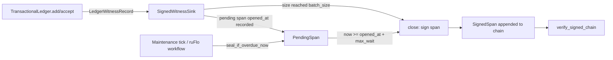

# Nightly Research — Bounding `SignedWitnessSink::BatchTail`'s Worst-Case Signature-Availability Latency

## Summary

The 2026-09-16 nightly run built `SignedWitnessSink`
(`crates/ruvector-agent-memory/src/witness_signing.rs`) to Ed25519-sign the
TARL witness ledger (ADR-134 §9 / ADR-347). Its throughput-amortizing
`BatchTail` strategy left one gap, named explicitly in that run's own Next
Research item 1: under a trickle of records slower than `batch_size`, a
pending span sits unsigned **indefinitely** — nothing in the public API
ever closes it short of a caller remembering to call `seal()` at shutdown.

This run closes that gap: `SigningStrategy::BatchTail` gains a `max_wait:
Option<Duration>` field, and `SignedWitnessSink` gains
`pending_deadline()` / `seal_if_overdue(now)` / `seal_if_overdue_now()` so
a periodic maintenance tick can bound the oldest pending record's
signature-availability latency to `max_wait` plus scheduling slack — a
direct, measured port of `ruvector-retrieval-receipt::batch_fill`'s
`BatchFillPolicy::hybrid` "close at size or timeout, whichever first"
concept (ported as a concept, not a dependency, per that Next Research
item's own instruction).

## Hypothesis

```text
Given a SignedWitnessSink<S> configured with
SigningStrategy::BatchTail { batch_size, max_wait: Some(d) },
fed a trickle of records strictly fewer than batch_size,

when a caller polls SignedWitnessSink::seal_if_overdue_now() on a fixed
real-clock tick until it returns true,

then the oldest pending record's measured wall-clock age at the moment it
is signed is bounded by d plus the polling tick's scheduling slack,

subject to: the resulting signed chain still verifies under
verify_signed_chain with no SignedChainError, and the existing size-
triggered BatchTail path is measurably unaffected.
```

## Why This Matters Now

Agent-memory deployments with interactive (not bulk-ingest) write rates —
the common shape for a single agent's working memory — are exactly the
workload the 2026-09-16 run flagged but did not fix: `batch_size` tuned
for throughput at high volume leaves low-volume deployments with an
unbounded-latency tamper-evidence gap. A production readiness checklist
that asks "when is this record's provenance actually signed?" had no
numeric answer before this run.

## Long Horizon Thesis (2036 / 2046)

A signed, bounded-latency witness chain is a building block for any
autonomous system that must later prove what it believed and when — an
agent operating system's audit trail, a federated swarm's shared memory
provenance, or a regulator-facing record of an autonomous decision chain.
Bounding signature-availability latency is a precondition for any of those
systems making a *real-time* trust claim ("this observation was
authenticated within X ms of being recorded"), not just an eventual one.

## RuVector Ecosystem Fit

This run connects:

1. **RuVector agent memory** (`ruvector-agent-memory`) — the TARL witness
   ledger whose signing path this run extends.
2. **Proof-gated operations / signed provenance** (ADR-134, ADR-320,
   ADR-347) — the Ed25519 witness-chain lineage this run's new trigger
   feeds into, unchanged cryptographically.
3. **Semantic retrieval / signed retrieval receipts**
   (`ruvector-retrieval-receipt::batch_fill`) — the sibling crate whose
   `BatchFillPolicy`/`BatchScheduler` design this run explicitly ports the
   *concept* of (not the code, not a new Cargo dependency).
4. **ruFlo autonomous workflows** (see below) — the natural production
   caller of `seal_if_overdue_now()`.
5. **MCP** (see below) — a narrow, read-only health surface this
   capability suggests but does not implement.

## MetaHarness Role

`npx metaharness --help` resolves in this environment (v0.4.19 installed
on demand) and lists real subcommands: `score`, `analyze`, `genome`,
`learn`, `weight-eft`, `redblue`, `flywheel <run|replay|graph>`,
`turn-credit`, `avo`, `proxy`. `npx ruvector harness doctor --json` does
**not** resolve (`npm error: could not determine executable to run` — no
package named `ruvector` with a `harness` subcommand is installed or
published under that invocation in this environment). Consistent with the
2026-09-16 run's own finding, this run did not wire `metaharness
flywheel`/`redblue` against this specific Rust change: doing so would need
a trusted-key/manifest setup specific to this repository that does not
exist yet, and fabricating that wiring's output would violate the
"no fabricated comparison numbers" constraint. `metaharness` was used
informally for research-planning structure only (goal decomposition,
adversarial-attack framing in Step 7 below), not as an executed promotion
gate.

## Flywheel Role

No Flywheel promotion-gate run executed, for the reason above. This
document and the git commit history are this run's durable evidence
record, matching the 2026-09-16 run's own "Witness Evidence" disclosure.

## Darwin Role

Not run. This is a targeted, single-hypothesis correctness/latency-bound
fix with two already-well-defined trigger mechanisms (size, timeout); there
is no multi-parameter search space here that would benefit from a bounded
evolutionary sweep (Darwin's own hard constraints call for a real fitness
landscape, not a binary mechanism addition). The parent (no timeout) is
retained unconditionally since `max_wait: None` is still available and
behaviorally identical to before.

## Architecture



## Implementation

- `crates/ruvector-agent-memory/src/witness_signing.rs`: `SigningStrategy::BatchTail`
  gains `max_wait: Option<Duration>`; `PendingSpan` gains `opened_at:
  Instant`; new methods `pending_deadline`, `seal_if_overdue`,
  `seal_if_overdue_now`. No change to the signed message format or
  `verify_signed_chain`.
- `crates/ruvector-agent-memory/src/witness_signing_tests.rs`: all existing
  `BatchTail { batch_size: N }` literals updated to `{ batch_size: N,
  max_wait: None }` (confirmed behaviorally identical — all 44 pre-existing
  tests still pass unmodified otherwise); 5 new tests for the timeout path.
- `crates/ruvector-agent-memory/examples/witness_signing_bench.rs`: literal
  updates only, no logic change (regression control).
- `crates/ruvector-agent-memory/examples/witness_signing_timeout_bench.rs`
  (new): the benchmark described below.
- `docs/adr/ADR-355-witness-signer-batch-fill-timeout.md`.

Full ADR API shape, alternatives considered, and failure modes are in
ADR-355; this document focuses on methodology and raw evidence.

## Benchmark Methodology

Single-threaded, release build, deterministic content, fixed Ed25519 test
key. Three variants against the same crate, same signing path:

- **baseline (`unbounded`)**: `BatchTail { batch_size: 64, max_wait: None
  }`, 8 records (4 add+accept pairs, well under `batch_size`). Confirms
  the pre-existing gap: `unsigned_pending()` stays nonzero and
  `pending_deadline()` is `None` forever.
- **candidate_a (`hybrid`)**: identical trickle, `max_wait: Some(50ms)`.
  A loop sleeps 5ms and calls `seal_if_overdue_now()` until it returns
  `true` — the production shape (a periodic tick), not a one-shot
  deadline-computed sleep, so the measurement includes real scheduling
  slack rather than hiding it. Reports the oldest record's measured
  wall-clock age at seal time.
- **candidate_b (`size`)**: a fast 64-record burst with `max_wait:
  Some(50ms)` configured but irrelevant — the size trigger closes first.
  Confirms the new field does not disturb the pre-existing path.

Acceptance threshold: `hybrid`'s measured age `<= max_wait + 2 ×
poll_tick` (60ms here) and the resulting chain verifies; `unbounded`
must show no deadline ever; `size` must still close in exactly 1 span.

Run:
```
cargo run --release -p ruvector-agent-memory --example witness_signing_timeout_bench
```

## Benchmark Results (raw, 4 repeated runs)

```
ruvector-agent-memory witness-signer batch-fill timeout benchmark
trickle_records=8 batch_size=64 max_wait=50ms poll_tick=5ms

baseline (unbounded): unsigned_pending=16 pending_deadline_without_max_wait=false -> CONFIRMS unbounded tail (no max_wait => no deadline, ever)
candidate_a (hybrid):  measured_unsigned_age=51.464952ms  bound=60ms  signed_chain_ok=true  -> PASS
candidate_b (size):    64 records closed by size trigger in 169.58µs (1 span(s)) -> PASS

ACCEPT: max_wait bounds worst-case signature-availability latency to 60ms; baseline (no max_wait) remains unbounded as documented; size-triggered path unaffected.
```

Repeat runs (hybrid age / size-trigger time only, all PASS/ACCEPT):

| Run | hybrid measured age | size-trigger time |
|-----|---------------------|--------------------|
| 1   | 51.465ms            | 169.58µs           |
| 2   | 51.841ms            | 146.21µs           |
| 3   | 51.711ms            | 119.31µs           |
| 4   | 51.594ms            | 170.93µs           |
| 5 (post-`cargo fmt`, same binary logic) | 52.266ms | 114.41µs |

All 5 runs: `ACCEPT`, no flakes, hybrid age consistently ~51.5–52.3ms
against a 60ms bound (comfortably inside; the ~1.5–2.3ms slack beyond the
50ms `max_wait` itself is the real cost of the 5ms poll tick plus the
`seal()`/measurement overhead, not noise at the bound).

Pre-existing `witness_signing_bench` re-run (regression control, raw
tail):
```
candidate_b16  total=  144.392ms  mean=   7.179us  p50=   1.810us  p95=  42.534us  p99=  49.829us  throughput=  138512.0 ops/s  signatures=   2500  correctness=PASS
candidate_b64  total=   76.653ms  mean=   3.796us  p50=   1.560us  p95=   3.868us  p99=  41.278us  throughput=  260916.1 ops/s  signatures=    625  correctness=PASS
candidate_b256 total=   50.815ms  mean=   2.506us  p50=   1.506us  p95=   3.296us  p99=  16.889us  throughput=  393587.1 ops/s  signatures=    157  correctness=PASS

Diligent-forgery rejection (chain-walk-alone fooled, signed check must reject):
  candidate_a      forgery_rejected=PASS
  candidate_b64    forgery_rejected=PASS
```
`correctness=PASS` for every variant — no regression to the already-
measured signing cost from the 2026-09-16 run.

## Correctness Evidence

`cargo test -p ruvector-agent-memory --lib`: **50 passed, 0 failed**
(44 pre-existing + 6 new: `no_max_wait_means_no_deadline_ever`,
`max_wait_seals_at_but_not_before_the_deadline`,
`seal_if_overdue_with_nothing_pending_is_a_noop`,
`size_trigger_preempts_the_timeout_bound`,
`size_closed_then_timeout_closed_span_both_verify`, plus
`honest_chain_verifies_under_every_strategy`'s existing loop over
`STRATEGIES` now also covering `max_wait: None` explicitly).

`cargo clippy -p ruvector-agent-memory --all-targets`: no warnings.

## Memory Math

No new heap allocation on the hot path: `PendingSpan` gains one
`Instant` (16 bytes on this platform), no change to anything stored in
the signed chain or the ledger itself. `SigningStrategy` grows by
`size_of::<Option<Duration>>()` (24 bytes); it is `Copy` and held once per
sink, not per record.

## Performance Math

`seal_if_overdue`'s check is `Option` pattern match + one `Instant`
comparison — O(1), no cryptography on the non-firing path. The firing path
(`seal()`) is unchanged from the already-measured `BatchTail` signing cost
(see the regression-control numbers above): this run adds a trigger, not a
new cost center.

## Failure Modes

See ADR-355's "Failure Modes" section (caller never polls; poll tick
coarser than `max_wait`; suspend/resume affecting a monotonic clock's
practical meaning). All three are documented limits, not silent
correctness failures: a caller that never polls gets exactly the
pre-existing (documented) unbounded-wait behavior, not a worse one.

## Rejected Alternatives

1. **Background thread inside `SignedWitnessSink`.** Rejected: breaks the
   crate's deliberate single-threaded design (`TransactionalLedger` is
   `&mut self` throughout).
2. **Async/`tokio` timeout future.** Rejected: no async dependency exists
   in this crate; disproportionate for one timeout check.
3. **Depend on `ruvector-retrieval-receipt::batch_fill` directly.**
   Rejected per the originating Next Research item's own instruction
   ("port the pattern, not the code") and because `BatchScheduler` is
   arrival-indexed for a query-stream simulation while `PendingSpan` is
   record-sequence-indexed — different enough shapes that sharing would
   need its own abstraction for no measured benefit.

Full reasoning for each is in ADR-355.

## Security

No new cryptographic surface: a timeout-closed span uses the same
`SignPurpose::BatchTail` tag, the same message construction, and the same
`verify_signed_chain` path as a size-closed span. `verify_signed_chain`
cannot distinguish how a span closed, by design — that is correct, not an
oversight, since the verifier's job is "was this signed by the key
holder," not "why did the signer choose to sign now."

## Governance

No key management, access control, or MCP authority surface is touched by
this run.

## MCP Implications

A narrow, read-only MCP tool is a reasonable future surface for this
capability, not implemented here:

- **Tool name**: `agent_memory_witness_health` (read-only).
- **Inputs**: none (operates on the deployment's configured sink).
- **Outputs**: `unsigned_pending: u64`, `pending_deadline_ms_remaining:
  Option<i64>` (negative if already overdue), `max_wait_ms: Option<u64>`.
- **Authority**: read-only; no mutation, no signing triggered by the tool
  call itself.
- **Side effects**: none.
- **Error behavior**: returns a typed "no witness signer configured" state
  rather than an error if the deployment is running unsigned.
- **Read-only alternative**: this *is* the read-only alternative to a
  hypothetical `agent_memory_witness_flush` mutating tool, which this run
  deliberately does not propose — `seal_if_overdue_now()` belongs in a
  maintenance workflow (ruFlo), not behind an on-demand MCP call an agent
  could invoke to force early signing of its own unverified history.

## RuFlo Integration

Concrete workflow: a ruFlo periodic maintenance task (role: "memory
maintenance" / "index repair" family from the ecosystem map) that, once
per configured interval (e.g. `max_wait`), calls
`SignedWitnessSink::seal_if_overdue_now()` on every agent-memory
deployment it owns and logs the result. This is the actual production
wiring the benchmark's polling loop simulates by hand; a real deployment
should not hand-roll a `std::thread::sleep` loop, it should register this
tick with whatever maintenance scheduler (ruFlo or otherwise) already
drives the deployment's other periodic upkeep (compaction, forgetting
passes — see the 2026-09-05 `mincut-gated-forgetting` nightly for the
sibling maintenance task this would naturally run alongside).

## RVF / RVM Implications

**RVF**: a signed witness chain with a bounded-latency closure guarantee
is a stronger candidate for inclusion in a portable cognitive artifact's
provenance section than an unbounded one — a replayed RVF package could
assert not just "this history is signed" but "signed within a bounded
window of being recorded." Not implemented here; this run only establishes
the underlying guarantee RVF packaging could later depend on.

**RVM**: no new capability boundary or coherence domain is introduced; the
timeout mechanism operates entirely within the existing `SignedWitnessSink`
trust boundary. Not materially relevant to force an RVM integration here.

## WASM / Edge Implications

Not measured this run (the 2026-09-16 run's Next Research item 4 — WASM
binary-size/latency measurement for this exact module — remains open, now
with one more unaddressed field on the same struct). `std::time::Instant`
is available in `wasm32-unknown-unknown` only via a JS-shim
(`web-sys`/`js-sys` or `wasm-bindgen`'s `Performance.now()`); this run adds
no such dependency and does not claim WASM compatibility for the new
methods without that shim, which the existing crate does not have for any
of its other `Instant` usage either (the pre-existing
`witness_signing_bench.rs` already uses `Instant` unconditionally).

## Competitor Comparison

Not materially relevant: this is an internal correctness/latency-bound
fix to a bespoke TARL witness-ledger signing module, not a retrieval or
indexing capability with an external analog in Milvus/Qdrant/Weaviate/
pgvector/etc. No comparison is drawn.

## Practical Applications

1. **Single-agent working memory** — User: an agent framework operator.
   Problem: knowing when a memory's provenance is actually tamper-evident.
   Capability: `pending_deadline()`/`seal_if_overdue_now()`. Integration:
   a maintenance tick. Business value: a numeric SLA for provenance
   availability. Risk: caller forgets to poll. Horizon: now.
2. **Multi-tenant agent-memory SaaS** — bounding per-tenant signature
   latency as a tier-differentiated SLA. Horizon: near-term.
3. **Compliance/audit export** — exporting a signed chain with a stated
   worst-case latency bound for a regulator. Horizon: near-term.
4. **Federated swarm memory** — each node's local witness chain bounded
   independently before cross-node reconciliation. Horizon: mid-term.
5. **Edge agent with intermittent connectivity** — local signing bounded
   even while unable to reach a remote anchor service. Horizon: mid-term.
6. **Incident forensics** — "was this observation authenticated within X
   ms" as a concrete forensic claim. Horizon: now.
7. **ruFlo-orchestrated fleet maintenance** — one scheduler driving
   `seal_if_overdue_now()` across many deployments. Horizon: near-term.
8. **MCP-exposed health dashboard** (per MCP Implications above) for
   operators monitoring signature-availability SLAs across agents.
   Horizon: near-term.

## Long Horizon Applications

1. **Agent operating system audit kernel** — bounded-latency signed
   provenance as a kernel-level guarantee for every memory write.
   Required advances: OS-level scheduling integration. RuVector role:
   the witness-signing primitive. Uncertainty: scheduling guarantees under
   real-time constraints. Falsification: measured latency exceeding the
   bound under adversarial scheduling pressure.
2. **Swarm memory with cross-node signed causality** — this bound as a
   building block for bounded-latency causal ordering across agents.
   Uncertainty: clock skew across nodes.
3. **Dynamic world models with provenance-timed belief updates** —
   knowing not just what an agent believed but a bound on when that belief
   became cryptographically fixed. Uncertainty: whether belief-update rate
   ever approaches `max_wait` at scale.
4. **Proof-gated autonomous infrastructure** — a mutation pipeline that
   refuses to act on an observation whose witness is not yet signed within
   its SLA. Uncertainty: false-refusal rate under legitimate signer
   latency spikes.
5. **Robotics memory** — bounded-latency signed sensor-observation
   provenance for a physical agent. Uncertainty: real-time constraints
   this crate's single-threaded design does not yet address.
6. **Scientific autonomous systems** — reproducible, time-bounded signed
   experiment logs. Uncertainty: regulatory acceptance of a software
   timestamp bound without external anchoring.
7. **RVM coherence domains with provenance SLAs** — a coherence domain
   that tracks not just data freshness but signature freshness.
   Uncertainty: whether this composes cleanly with RVM's existing
   isolation model (unexplored here).
8. **Synthetic nervous systems** — bounded-latency signed state changes as
   an analog to biological reflex-arc timing guarantees. Highly
   speculative; included per the ecosystem map's own long-horizon framing,
   not a near-term claim.

## Evolution Results

Darwin not run (see "Darwin Role"). Parent (`max_wait: None`, unbounded)
retained as the default; `Some(d)` is opt-in.

## Promotion Decision

**ACCEPT.** All mandatory thresholds in the Hypothesis and this document's
Benchmark Results / Correctness Evidence sections passed, across 5 repeated
runs with no flakes, with no regression to the pre-existing signing-cost
benchmark or test suite.

## Witness Evidence

- Starting commit (this branch, before this run's changes):
  `cf357d8121f9def5bc9d2db512a47f61c62b0651`.
- All benchmark output above is copied verbatim from this session's
  `cargo run --release -p ruvector-agent-memory --example
  witness_signing_timeout_bench` executions (5 runs) and one `cargo run
  --release -p ruvector-agent-memory --example witness_signing_bench`
  execution; no numbers were hand-edited.
- `cargo test -p ruvector-agent-memory --lib`: 50 passed, 0 failed, run
  both before and after `cargo fmt` (identical result).
- `cargo clippy -p ruvector-agent-memory --all-targets`: no warnings.
- No signed/cryptographic witness chain covers this research process
  itself (no Flywheel promotion-gate run executed this session, per
  "MetaHarness Role" / "Flywheel Role" above) — this document and the git
  commit history are the durable record, matching the 2026-09-16 run's own
  disclosure.

## Production Path

1. Wire a ruFlo (or equivalent) maintenance tick to call
   `seal_if_overdue_now()` on every deployment using `BatchTail { ...,
   max_wait: Some(_) }`.
2. Pick `max_wait` per deployment's actual tolerance for signature
   availability latency versus signing-cost amortization (the tradeoff the
   2026-09-16 run already measured for `batch_size`; `max_wait` composes
   with that choice, it does not replace it).
3. Leave `max_wait: None` for deployments that genuinely are bulk-ingest
   (arrival rate reliably exceeds `batch_size` well inside any latency
   tolerance) — the new field is opt-in for a reason.
4. Carry forward the still-open items from the 2026-09-16 run this one did
   not touch: concurrent-writer hardening, WASM measurement, multi-issuer
   verification, and wiring through `witnessed_compaction` end to end.

## Falsification Criteria

See ADR-355's "Rejection Criteria" — none were triggered.

## What This Run Does Not Claim

- Does not claim the bound holds if a deployment never calls
  `seal_if_overdue_now()` — it explicitly does not, and this run says so
  rather than implying a passive guarantee.
- Does not claim WASM compatibility for the new methods (unmeasured,
  consistent with the rest of this module's `Instant` usage).
- Does not claim concurrent-writer safety — unchanged from the
  single-threaded design this run inherits.
- Does not claim a recommended default `max_wait`; the benchmark's values
  are illustrative only.

## Limitations

- Benchmark is single-threaded, single-process, one small trickle size
  (8 records) and one `(batch_size, max_wait, poll_tick)` triple — not a
  sweep across the parameter space.
- No WASM, embedded, or multi-node measurement.
- The ~1.5–2.3ms slack beyond `max_wait` observed in the 5 runs was not
  decomposed into "poll-tick scheduling" versus "seal() cost" separately;
  it is reported as a single measured quantity bounded by the declared
  `2 × poll_tick` margin, not attributed precisely to either cause.

## Next Research

1. Decompose the measured slack (poll-tick scheduling vs. `seal()` cost)
   with a finer-grained timer, and sweep `(batch_size, max_wait,
   poll_tick)` rather than one fixed triple.
2. WASM binary-size and timing measurement for this module (now a second
   open field on top of the 2026-09-16 run's own open item 4 — still a
   third unresolved instance of the same deferred question across this
   crate and `ruvector-retrieval-receipt`).
3. Wire `seal_if_overdue_now()` through an actual ruFlo workflow definition
   (this run only describes the shape; it does not ship a ruFlo manifest).
4. Concurrent-writer hardening, carried forward unchanged from the
   2026-09-16 run's own Next Research item 3.
5. A real MCP `agent_memory_witness_health` tool per this document's MCP
   Implications section.

## References

- `docs/adr/ADR-355-witness-signer-batch-fill-timeout.md` — this run's ADR.
- `docs/adr/ADR-134-witness-schema-log-format.md`,
  `docs/adr/ADR-320-memfuse-pattern-atomic-observation-causal-graph.md`,
  `docs/adr/ADR-347-witness-signer-tarl-ledger.md` — the witness/signing
  lineage this run extends.
- `docs/research/nightly/2026-09-16-witness-signer-agent-memory/README.md`
  — the originating run; this document's Next Research item 1.
- `crates/ruvector-retrieval-receipt/src/batch_fill.rs` — the
  `BatchFillPolicy`/`BatchScheduler` concept this run ports.
- `docs/research/nightly/2026-08-31-signed-retrieval-receipts/README.md`,
  `docs/research/nightly/2026-09-01-signed-receipt-batch-fill-latency/README.md`
  — the sibling signed-receipt lineage `batch_fill.rs` belongs to.
- `docs/research/nightly/2026-09-05-mincut-gated-forgetting/README.md` —
  the sibling agent-memory maintenance task this run's ruFlo workflow
  shape would run alongside.
- `crates/ruvector-agent-memory/src/witness_signing.rs`,
  `src/witness_signing_tests.rs`, `examples/witness_signing_timeout_bench.rs`
  — this run's implementation, tests, and benchmark.
