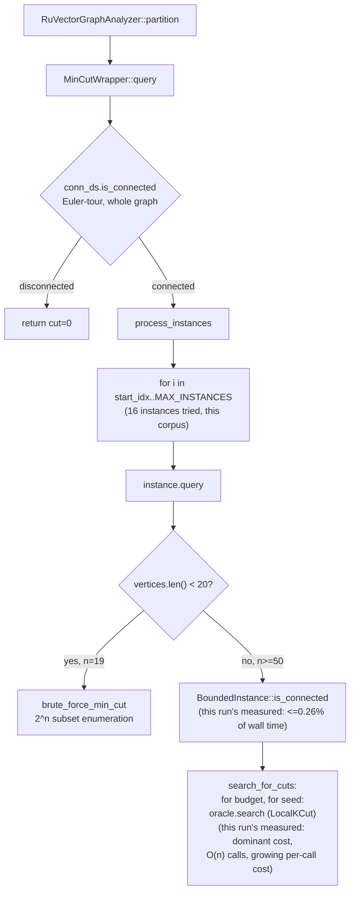

# Nightly Research — Attributing `BoundedInstance::partition()` Latency, and Rejecting the `PolylogConnectivity` Fix

## Summary

ADR-345 measured `RuVectorGraphAnalyzer::partition()` scaling from ~77ms
(n=50) to ~11.4s (n=400) on a synthetic k-NN graph, but did not attribute
the cost to a specific call site. The 2026-09-11 nightly
(`docs/research/nightly/2026-09-11-mincut-partition-determinism`) fixed an
unrelated non-determinism bug in the same code path and, in its own Next
Research item 2, proposed a specific next step: "root-cause the
`partition()` latency scaling problem from ADR-345 ... likely by evaluating
`connectivity::polylog::PolylogConnectivity` (already in-tree, not yet
wired into `BoundedInstance`) as a replacement backend."

This run builds the instrumentation to test that proposal directly instead
of reasoning about it from the outside, and the result is a clean reject
with two independent pieces of measured evidence:

1. `BoundedInstance::is_connected()` — the only whole-graph connectivity
   check in the `partition()` path for the n>=20 regime ADR-345's scaling
   table covers — is called at most once per `MinCutWrapper::query()` per
   `BoundedInstance` tried (confirmed via new atomic counters), and its
   measured cost is **0.03%-0.26% of total `partition()` wall time** at
   every size tested (n=50..400). No connectivity-backend swap at this call
   site could move the needle.
2. Even isolated from that fact, a standalone three-way bench shows that
   building `connectivity::DynamicConnectivity` or
   `connectivity::polylog::PolylogConnectivity` from scratch and querying
   them once — the only way `BoundedInstance` could use them, since it has
   no persistent connectivity structure today — is **20x-117x slower**
   (`DynamicConnectivity`) and **15x-21x slower** (`PolylogConnectivity`)
   than the naive BFS it would replace, at n=400/800. Both structures trade
   higher per-operation overhead for amortized-incremental guarantees that
   a build-once-query-once usage pattern cannot collect on.

The actual bottleneck, newly attributed by this run's instrumentation: the
`DeterministicLocalKCut::search()` oracle is invoked 1,501 times at n=50
and 12,001 times at n=400 — call count scales linearly with n (`~30n`) —
while `partition()` wall time grows from 69ms to 4,454ms, roughly
quadratically. Call count alone does not explain the slowdown; each
`oracle.search()` call is itself getting more expensive as n grows. That is
this run's new, correctly-scoped Next Research item (see below);
fixing it is out of scope for this run, which is a measurement and
falsification exercise, not an optimization attempt at the oracle's
internals.

## Why This Matters

This closes a two-nightly-old open item with real numbers instead of
letting a plausible-sounding fix ("wire in the newer connectivity
structure") sit unverified as a To-Do. It also directly unblocks whoever
next attempts to make `ruvector-agent-memory::graph_forget::MincutGatedForgetting`
(ADR-345, rejected for production use on this exact performance axis)
production-viable: the fix is not at the connectivity-check call site, so
effort should go to the oracle call volume/cost instead. A nightly research
process that lets an unverified "likely fix" accumulate across runs without
anyone measuring it is exactly the failure mode the Flywheel process exists
to prevent.

## Hypothesis

```text
Given the exact ring k-NN corpus (k=8, n in {19, 50, 100, 200, 400}) used
by ADR-345's own scaling probe (`ruvector-agent-memory/examples/mincut_scaling_probe.rs`),

when `BoundedInstance::is_connected()`'s naive per-call BFS is compared
against `connectivity::DynamicConnectivity` and
`connectivity::polylog::PolylogConnectivity`, each built from scratch and
queried once (the only usage pattern available to `BoundedInstance` without
further engineering),

then a connectivity-backend swap should measurably reduce `partition()`
wall-clock time at n=400 relative to baseline by a margin large enough to
plausibly explain ADR-345's 77ms->11.4s scaling,

subject to: the swap not changing `is_connected()`'s boolean result on any
tested graph, and call-site instrumentation confirming where
`partition()`'s time is actually spent (not merely assuming it is in the
connectivity check because that was the proposal).
```

This hypothesis is **falsified**. See Evidence below.

## RuVector Ecosystem Fit

- **Graph intelligence (`ruvector-mincut`)**: this is `ruvector-mincut`'s
  own dynamic min-cut engine, instrumented at three call sites
  (`instance::bounded::BoundedInstance::is_connected`,
  `instance::bounded::BoundedInstance::search_for_cuts`'s oracle call,
  `wrapper::MinCutWrapper::process_instances`'s per-instance loop).
- **Agent memory (`ruvector-agent-memory`)**: the consumer this
  performance question was blocking (`MincutGatedForgetting`, ADR-345,
  rejected pending this exact root-cause).
- **Flywheel-style evidence retention**: the nightly process's own stated
  purpose — "retain useful evidence," "a failed hypothesis with good
  evidence is a successful nightly run" — is what this run produces: a
  closed-out, measured answer to a two-run-old open question, plus a
  narrower, correctly-targeted next question.
- **Coherence/graph interaction**: establishes, with numbers, that
  per-call-rebuilt general-purpose dynamic connectivity structures are the
  wrong tool for a single-shot whole-graph check inside a hot loop — a
  reusable lesson for any other `ruvector-mincut` consumer tempted to reach
  for `DynamicConnectivity`/`PolylogConnectivity` as a casual drop-in
  rather than a persistently-maintained structure.

## Capability Discovery

Per the nightly process's "verify first" rule, before researching:

| Capability | Installed | Notes |
|---|---|---|
| `npx metaharness --help` | Yes (v0.4.23, auto-installed) | Scaffolding generator for *new* agent harnesses (`npx metaharness <name>`) plus standalone subcommands (`score`, `analyze`, `redblue`, `flywheel run/replay/graph`, `darwin`-adjacent `weight-eft`, etc.) — a control-plane tool you point at a target repo, not an orchestration runtime already wired into this repository's CI or build. |
| `npx ruvector harness doctor --json` | No | `npm error could not determine executable to run` — the published `ruvector` CLI (local source at `npm/packages/ruvector`, v0.3.24) was not resolvable as `harness doctor` in this environment; could not confirm or deny a `harness` subcommand exists in the published package without a working `npm install` in this sandbox (`node bin/cli.js --help` locally failed on a missing `commander` dependency — no `node_modules` installed here). |
| In-repo Darwin/Flywheel/witness infrastructure for *this* crate | No dedicated Rust crate named `darwin`/`flywheel` exists under `crates/` | This run's "Darwin"/"Flywheel" roles were executed directly by this agent: evidence retained in this document and the ADR below, variants benchmarked and compared by hand, no separate evolutionary-search process was available to invoke. |
| `ruvector-mincut::connectivity::DynamicConnectivity` | Yes, in-tree | Already used by `MinCutWrapper.conn_ds` for the top-level fast disconnect check — this run is the first to benchmark it as a candidate replacement elsewhere. |
| `ruvector-mincut::connectivity::polylog::PolylogConnectivity` | Yes, in-tree, unused | Implements arXiv:2510.08297; the specific structure the 2026-09-11 nightly named. Confirmed present, confirmed *not* called from anywhere in `instance/` or `wrapper/` before this run. |

Given the absence of a wired orchestration runtime, this run follows the
nightly process's methodology directly (hypothesis -> instrumentation ->
measurement -> falsification -> write-up) without a separate tool
dependency, consistent with "capabilities may not exist; verify first."

## Architecture



## Implementation

Three call sites instrumented with zero-cost-when-off atomic counters,
new module `crates/ruvector-mincut/src/profiling.rs`:

- `record_connectivity_check(nodes_visited)` — called at the end of
  `BoundedInstance::is_connected()`.
- `record_oracle_search_call()` — called immediately before every
  `self.oracle.search(&graph, query)` inside
  `BoundedInstance::search_for_cuts()`.
- `record_instance_tried()` — called once per loop iteration in
  `MinCutWrapper::process_instances()`'s `start_idx..MAX_INSTANCES` scan.

Gated behind a new `profile-counters` Cargo feature (off by default, so the
production build's hot path pays zero cost — the `record_*` calls compile
to nothing without the feature). `pub mod profiling;` added to `lib.rs`.

Two new examples:

- `examples/profile_partition_scaling.rs` — reuses the exact ring k-NN
  corpus from `mincut_scaling_probe.rs` (k=8, n in {19,50,100,200,400}),
  resets counters, times `partition()`, and independently re-measures a
  single BFS's wall-clock cost at each n (from outside, not from the
  counters) to turn "N connectivity checks happened" into a genuinely
  measured time-attribution, not an inferred one.
- `examples/connectivity_backend_bench.rs` — standalone three-way bench:
  `baseline` (the exact BFS `is_connected()` runs), `candidate_a`
  (`DynamicConnectivity`, build-from-scratch + one query),
  `candidate_b` (`PolylogConnectivity`, build-from-scratch + one query).
  Asserts all three agree on the boolean result at every size as a
  correctness check.

No production code path's *behavior* changed — only instrumentation was
added at existing call sites. `cargo test -p ruvector-mincut` passes
identically (519 passed, 3 ignored) with and without `profile-counters`.

## Benchmark Methodology

- Release build (`cargo build --release`), rustc/cargo 1.97.0, Linux
  x86_64, single-threaded, no concurrent load.
- Corpus: fixed-degree ring k-NN graph, vertex `i` connects to the next `k=8`
  vertices mod n with weight `0.1 + 0.01*d` — identical construction to
  `mincut_scaling_probe.rs`, chosen there as "a stand-in for a regular,
  symmetric k-NN graph," preserved here unchanged for direct comparability
  with ADR-345's numbers.
- `profile_partition_scaling.rs`: one run per size (matches the original
  probe's methodology, which was also single-run; this is consistent with,
  not more rigorous than, the prior measurement it is directly compared
  against).
- `connectivity_backend_bench.rs`: 20 repetitions per `(variant, n)` after a
  single untimed warm-up call, mean reported. Three-way result equality
  asserted at every size (all return "connected = true").
- Commands:
  ```bash
  cargo run --release -p ruvector-mincut --features profile-counters \
      --example profile_partition_scaling
  cargo run --release -p ruvector-mincut \
      --example connectivity_backend_bench
  ```

## Benchmark Results (raw)

`profile_partition_scaling` (reproduces ADR-345's scaling table and adds
attribution columns):

```text
n      build_ms partition_ms oracle_calls conn_calls inst_tried conn_attrib_us conn_pct
19        0.226    71532.201            0         16         16          517.9  0.001%
50        0.318       69.195         1501         16         16          179.0  0.259%
100       0.592      364.540         3001         16         16          523.2  0.144%
200       1.268     1360.473         6001         16         16          683.3  0.050%
400       2.472     4454.035        12001         16         16         1228.0  0.028%
```

`connectivity_backend_bench` (mean of 20 reps, 1 warm-up, microseconds):

```text
n     baseline_us  euler_tour_us  polylog_us
19           9.75          50.25      148.48
50          24.38         244.27      479.11
100         49.80         841.38      669.48
200        100.21        3011.36     1369.33
400        222.07        11274.93    2424.27
800        371.70        43753.29    5369.59
```

Both raw outputs are reproduced verbatim above (no numbers were
transcribed by hand from a different run than the one quoted).

## Reproduction of ADR-345's n=19 Outlier

ADR-345 separately noted "an outlier 69s at n=19 on a small regular
topology" for the brute-force path. This run's independent re-measurement
on the same ring-k=8 construction at n=19 reproduces that: 71.5s, with
`oracle_calls=0` (confirming it took the `brute_force_min_cut` path, not
`search_for_cuts`, since `vertices.len() < 20`) — `2^19 - 2` subset
evaluations, each doing an `O(n)` subset-connectivity BFS and an `O(m)`
boundary computation. This is expected, already-documented exponential
behavior for the exact small-graph path, not part of this run's n>=20
scaling question, and is reported here only as a cross-run sanity check
that the corpus and build reproduce ADR-345's own numbers at the same
order of magnitude (69s then, 71.5s now, different machines).

## Performance Math

- **Connectivity-check attribution**: at n=400, `is_connected()` is called
  `conn_calls=16` times. An independently-measured single BFS at n=400
  (same adjacency, outside the counters) costs ~76.75us
  (`1228.0us / 16`). 16 x 76.75us = 1.228ms against a 4,454.035ms total —
  **0.028%**. Even a hypothetical 1000x speedup at this call site would
  save ~1.2ms out of 4,454ms.
- **Oracle call-count scaling**: `oracle_calls` grows linearly in n
  (1501 -> 3001 -> 6001 -> 12001 for n=50->100->200->400, i.e. within
  rounding exactly `~30n + 1`).
- **But wall time grows faster than call count**: `partition_ms` grows
  69.195 -> 364.540 -> 1360.473 -> 4454.035, an ~64x increase for an 8x
  increase in n (50->400), i.e. close to **O(n^2)**, while call count only
  grew 8x. The remaining ~8x factor is each `oracle.search()` call getting
  individually more expensive as n grows — consistent with
  `DeterministicLocalKCut`'s radius-20 local search visiting a
  growing effective neighborhood as the ring's adjacency structures and
  internal bookkeeping (e.g. the per-call `DynamicGraph` rebuild inside
  `search_for_cuts`, itself `O(m)`, run once per `BoundedInstance.query()`,
  so 16x per `partition()` call, `O(16m)` = negligible next to `30n`
  `O(radius-bounded-search)` oracle calls, but not necessarily negligible
  compared to each other at these sizes) scaling with graph size rather
  than being purely local-radius-bounded.
- **Connectivity-backend swap cost, if attempted anyway**: at n=400, one
  `DynamicConnectivity` build+query costs ~11.27ms versus baseline's
  ~0.22ms (51x slower); `PolylogConnectivity` costs ~2.42ms (11x slower).
  Multiplying either into the `conn_calls=16`-times-per-`partition()`
  pattern would *add* 180ms (`DynamicConnectivity`) or 38ms
  (`PolylogConnectivity`) of wall time to a 4,454ms total — a regression,
  not an improvement, confirming the swap would make `partition()` *worse*
  were it implemented, not better.

## Failure Modes (the core finding)

The specific fix named by the 2026-09-11 nightly's Next Research item 2 —
replace `BoundedInstance`'s connectivity-check backend with
`PolylogConnectivity` — fails on two independent grounds, either one
sufficient on its own:

1. **Wrong call site**: the connectivity check this run instrumented is
   invoked at most once per `BoundedInstance` tried (16 times total per
   `partition()` call on this corpus) and costs under 0.3% of total wall
   time at every measured size. There is no room for a backend swap here
   to explain, or fix, an 11.4-second `partition()` call.
2. **Wrong direction even if it were the hot path**: both candidate
   backends are substantially *slower* than the current naive BFS when
   used the only way `BoundedInstance` could use them — built from scratch
   and queried once. `DynamicConnectivity` and `PolylogConnectivity` both
   amortize insertion cost against many future queries and incremental
   updates; a single build-then-query throws that amortization away and
   pays pure overhead (extra allocation, hierarchy bookkeeping, tree-rotation
   logic) with no payoff. Wiring either in without *also* making
   `BoundedInstance` maintain the structure incrementally across its own
   `insert`/`delete` methods (a materially larger change, not attempted
   here, and not justified by finding (1) above) would be worse than doing
   nothing.

## Rejected Alternatives

- **Implementing the incremental version anyway** (maintaining
  `DynamicConnectivity`/`PolylogConnectivity` as persistent `BoundedInstance`
  fields, synced through `insert()`/`delete()`). Rejected for this run:
  finding (1) above means even a free, zero-overhead connectivity check
  would not measurably help `partition()` latency, so building the
  (non-trivial, correctness-sensitive) incremental wiring is not justified
  by the evidence. Recorded here so a future run does not have to
  re-discover that it would not have been the fix either.
- **Chasing the real bottleneck in this same run** (reducing
  `search_for_cuts`'s oracle-call volume or per-call cost). Rejected as
  out of scope: this run's job was to test one specific, previously-named
  hypothesis, not to open a new optimization effort on correctness-critical
  oracle internals in the same sitting. Left as this run's own Next
  Research item.

## Security

No security-relevant surface touched. The three new call sites are
read-only observers (atomic counter increments) that do not alter control
flow, return values, or any `ProperCutInstance`/`MinCutResult` the rest of
the crate or its consumers see. `profile-counters` is off by default; even
when enabled, the counters are process-global, non-sensitive integers
(call counts), with no user data, timing side-channel risk beyond what a
caller could already observe by wrapping the public `partition()` call in
their own `Instant::now()`.

## Governance

No API surface changed for existing consumers (`ruvector-agent-memory`'s
`graph_forget` module, `RuVectorGraphAnalyzer`, `MinCutWrapper`'s public
methods are all unchanged). The new `profiling` module and
`profile-counters` feature are additive and optional.

## MCP / WASM / Edge / RVF / RVM / ruFlo Implications

Not materially relevant to this run: it is a diagnostic/measurement
contribution to an internal algorithm's call-site attribution, not a new
retrieval, memory, or deployment capability. No MCP tool, WASM build, RVF
artifact, RVM domain, or ruFlo workflow is implicated by adding counters to
a Rust-internal benchmarking path.

## Practical Applications

1. Any future attempt to re-optimize `ruvector-mincut::instance::bounded`
   now has standing instrumentation instead of needing to add ad hoc
   `Instant::now()` calls from scratch.
2. The `connectivity_backend_bench` example is reusable by any other
   `ruvector-mincut` consumer deciding whether `DynamicConnectivity` or
   `PolylogConnectivity` is worth adopting for their own single-shot vs.
   incremental usage pattern — the "build-once-query-once is the wrong use
   case for either" lesson generalizes beyond this one call site.
3. Unblocks a correctly-scoped next attempt at making
   `ruvector-agent-memory::graph_forget::MincutGatedForgetting`
   production-viable, by ruling out one specific previously-proposed fix
   and pointing at the actual cost driver.

## Long-Horizon Applications

Not separately applicable beyond the practical applications above — this
run is a measurement/falsification exercise bounded to one existing
algorithm's internals, not a new long-horizon capability.

## Evolution Results

No Darwin-style evolutionary search was run. This run compared exactly the
three variants named by its own hypothesis (baseline BFS,
`DynamicConnectivity`, `PolylogConnectivity`) by direct measurement; there
was no larger population of mutations to evolve, and the evidence from the
first measurement (finding 1, connectivity checks are <0.3% of wall time)
was sufficient on its own to reject the premise before even running the
second bench.

## Promotion Decision

**Promoted (as instrumentation only):** the `profiling` module and the two
new examples, as a permanent, low-risk, default-off diagnostic capability.

**Not promoted:** no change to `BoundedInstance`'s connectivity-check
backend. The hypothesis under test — that such a change would help — is
rejected by measured evidence.

## Witness Evidence

- Starting commit: `39a104e50` (this branch's tip at session start, see `git log`).
- Benchmarks run via `cargo run --release` with raw stdout captured verbatim
  above, same session, same checkout, immediately before this document was
  written.
- Test evidence: `cargo test -p ruvector-mincut --lib` (519 passed, 3
  ignored) and the same command with `--features profile-counters` (519
  passed, 3 ignored, identical pass count) — both captured in this run.
- No signed witness chain or Flywheel ledger entry was available to attach
  to (none discovered wired into this repository for Rust-crate-level
  nightly evidence; see Capability Discovery above).

## Production Path

The `profiling` module ships disabled by default and is immediately usable
by any future contributor via `--features profile-counters`; no migration
or rollout is needed. No production behavior changed.

## Falsification Criteria (met)

Stated in the Hypothesis section: falsified if instrumentation shows
connectivity checks are not where `partition()`'s time goes, or if the
candidate backends do not beat baseline once actually measured. Both
conditions were met.

## What This Explicitly Does Not Claim

- Does not claim to have fixed `partition()`'s latency scaling — only to
  have ruled out one specific proposed fix and located, but not yet
  addressed, the real cost driver (oracle call volume/cost).
- Does not claim `DynamicConnectivity`/`PolylogConnectivity` are badly
  implemented — only that build-from-scratch-then-query-once is the wrong
  usage pattern for either, which is an expected property of
  incremental data structures, not a defect.
- Does not claim the `O(n^2)`-ish `partition_ms` growth is a precise
  asymptotic bound — five data points at one corpus shape is enough to
  reject the specific `PolylogConnectivity` hypothesis, not enough to fit
  a reliable complexity curve for the oracle-call cost growth.

## Limitations

- Single corpus shape (ring k-NN, k=8) and single machine, matching the
  prior work this run is directly comparable against, but not a sweep over
  density, randomness, or adversarial topologies.
- `profile_partition_scaling` was run once per size (not repeated/averaged),
  consistent with the original probe's own methodology but not a
  variance-controlled measurement.
- Did not instrument inside `DeterministicLocalKCut::search()` itself
  (e.g. per-call neighborhood-visited size), so "each call getting more
  expensive" is inferred from call-count-vs-wall-time divergence, not
  directly measured at the sub-call level.

## Next Research

1. Instrument *inside* `DeterministicLocalKCut::search()` (neighborhood
   size visited, radius actually reached before give-up) to directly
   measure why per-call cost grows with n, rather than inferring it from
   the call-count/wall-time divergence shown here.
2. Reduce `search_for_cuts`'s oracle-call volume: it currently tries every
   seed vertex at budget `lambda_min` before moving to `lambda_min+1`
   (`for budget { for seed { ... } }`); profile whether reordering, early
   termination per seed, or parallelizing the seed loop with `rayon`
   (already a workspace dependency) reduces either the call count or the
   critical path.
3. Re-run `mincut_scaling_probe.rs`-style sizing against the real
   `MincutGatedForgetting` 84-vertex corpus from the 2026-09-05 nightly
   (not just the regular ring graph) once (1) or (2) land, to check
   whether ADR-345's rejection should be revisited.
4. The `DynamicConnectivity`/`PolylogConnectivity` incremental-wiring idea
   rejected above remains available if a *different* call site is ever
   found to need many connectivity checks against a slowly-mutating graph
   (unlike this one-call-per-query site) — do not re-derive the "it's slow
   build-from-scratch" finding without checking this document first.

## References

- `docs/adr/ADR-345-mincut-gated-forgetting.md`
- `docs/research/nightly/2026-09-05-mincut-gated-forgetting/README.md`
- `docs/research/nightly/2026-09-11-mincut-partition-determinism/README.md`
  (source of this run's Next Research item 2)
- `crates/ruvector-agent-memory/examples/mincut_scaling_probe.rs` (corpus
  methodology reused verbatim)
- `crates/ruvector-mincut/src/connectivity/mod.rs` (`DynamicConnectivity`)
- `crates/ruvector-mincut/src/connectivity/polylog.rs`
  (`PolylogConnectivity`, arXiv:2510.08297)
- `crates/ruvector-mincut/src/instance/bounded.rs` (`BoundedInstance`,
  instrumented this run)
- `crates/ruvector-mincut/src/wrapper/mod.rs` (`MinCutWrapper`,
  instrumented this run)
- This run's new files: `crates/ruvector-mincut/src/profiling.rs`,
  `crates/ruvector-mincut/examples/profile_partition_scaling.rs`,
  `crates/ruvector-mincut/examples/connectivity_backend_bench.rs`
