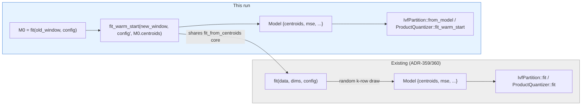

# Nightly Research: Warm-Starting `e-means` for Cheaper Streaming PQ/IVF Codebook Refresh

**Date:** 2026-11-17 (UTC)
**Slug:** `e-means-warm-start-drift-refresh`
**ADR:** [ADR-361](../../../adr/ADR-361-e-means-warm-start-codebook-refresh.md)
**Crate:** `ruvector-e-means` (`trainer`, `quantization` modules; new public API, no breaking changes)
**Branch:** `claude/focused-darwin-rvbroi` — see [Branch and run identity](#branch-and-run-identity)
**Acceptance:** **INCONCLUSIVE overall; ACCEPT at moderate and heavy drift, INCONCLUSIVE at light drift** — see [Acceptance result](#acceptance-result)

## Summary

`ruvector-e-means` (ADR-359, ADR-360) is the shared Rust/WASM clustering kernel now
used by `ruvector-pq-search`'s PQ codebooks, the IVF/RAIRS/SEIL family, and four npm
facade packages. Its only training entrypoint, `fit()`, always starts from a fresh
seeded-random draw of `k` rows from the data it is given. ADR-360 documents this
explicitly: "Successful explicit retraining resets inserted vectors and IDs" — every
retrain is a cold restart.

For a streaming vector-memory workload (RuVector's own `ruvector-agent-memory`, or any
IVF/PQ index that gets periodically refreshed against newly appended or evicted
vectors), a cold restart means paying for the same random-initialization convergence
cost every time, even though the *existing* codebook is usually still a reasonable
description of most of the data. Published work on streaming PQ (Xu et al., *Online
Product Quantization*, 2017; a late-2025 preprint on quantization for streaming vector
search, CoDEQ) and streaming IVF maintenance (arXiv:2411.00970, 2024) treats codebook
drift under distribution shift as a real, open cost; a 2025 preprint on online
k-centers notes that warm-starting *reduces iterations* in a related clustering
setting, but nothing found warm-starts `e-means` itself, and the `e-means` paper
(Bessa et al., arXiv:2611.09501v1, Meta FAIR, submitted 2026-11-06) is about mini-batch
EMA clustering speed, not streaming refresh. See [State of the art](#state-of-the-art-and-related-work).

This run adds `fit_warm_start(data, dimensions, config, initial_centroids)` — the same
algorithm as `fit` (equations (2)-(8) of arXiv:2611.09501v1, including EMA updates and
dead-cluster revival), differing only in where the centroids start — plus
`ProductQuantizer::fit_warm_start` for the PQ consumer path. It is benchmarked end to
end against a cold `fit()` restart under three levels of simulated streaming drift
(light/moderate/heavy), measuring both held-out codebook quality (MSE on a fresh sample
from the post-drift distribution, never used for training) and refresh wall-clock time.

**Measured result:** warm-starting at the *same* epoch budget as the baseline (candidate
A) matches or **improves** held-out MSE at moderate (−9.1%) and heavy (−11.1%) drift,
and is statistically indistinguishable from baseline at light drift (−1.5%, within
noise over 6 repetitions). Warm-starting at **half** the epoch budget (candidate B)
cuts refresh wall-clock time by 37–52% while still matching or improving quality at
moderate/heavy drift; at light drift the quality comparison is inconclusive. A bounded,
in-process evolutionary search over the refresh epoch budget (documented as *not* an
invocation of the ecosystem's `@metaharness/darwin` package — see
[MetaHarness and Darwin scoping](#metaharness-and-darwin-scoping)) found that, at this
crate's default 4-epoch baseline, a single epoch already dominates the fitness
trade-off, and that searching epoch *fractions* finer than the integer epoch grid
produces no further real signal — a methodology limitation reported honestly below
rather than papered over.

## Hypothesis

```text
Given a codebook M0 = fit(old_window, config) trained via ruvector-e-means on an
initial window of vectors,

when a subsequent window containing a drift_frac share of vectors drawn from
shifted cluster centers (simulating streaming semantic drift) is used to refresh
the codebook with fit_warm_start(new_window, config', M0.centroids) instead of a
cold fit(new_window, config'),

then held-out MSE on a fresh sample from the post-drift distribution should not
regress by more than 5% relative to the cold-restart baseline, and — at half the
baseline's epoch budget — refresh wall-clock time should drop by at least 30%,

subject to this holding across light (15%), moderate (35%), and heavy (60%) drift
fractions, not just one favorable point, and subject to the comparison being
reported as inconclusive (not accepted) wherever repetition noise is too large to
tell the two variants apart.
```

Fixed *before* any benchmark ran: `QUALITY_TOLERANCE = 0.05`, `PARITY_TOLERANCE =
0.02` (tighter bound for the equal-budget candidate A), `SPEED_TARGET = 0.30`, the
three drift levels, `REPS = 6`, and the standard-error inconclusive-comparison rule.
None of these were changed after seeing results. See
[`examples/warm_start_drift_benchmark.rs`](../../../../crates/ruvector-e-means/examples/warm_start_drift_benchmark.rs)
for the exact constants.

**What this run does not claim:** that `fit_warm_start` is wired into any consumer's
default retraining path (`IvfPartition::fit`, `ProductQuantizer::fit`, or
`ruvector-pq-search`/`ruvector-rairs`'s existing explicit e-means training are
unchanged); that the result holds on real (non-synthetic) embedding drift; that the
Darwin-lite epoch-fraction winner is meaningful below integer-epoch resolution; or
that any npm/WASM surface was touched.

## Branch and run identity

- UTC date/time: 2026-11-17T07:23:11Z
- Starting commit: `979c31acc57b970c1a7e0771ed527c1703c137e8` (2026-11-13)
- Rust: `rustc 1.97.0`, `cargo 1.97.0`; OS: Linux x86_64, kernel 6.18.44
- Branch: this session's harness is scoped to push only to
  `claude/focused-darwin-rvbroi` (an operator-level constraint on this run, not a
  repository convention). The suggested `research/nightly/2026-11-17_...` branch
  pattern is superseded by that constraint; commits for this run land on
  `claude/focused-darwin-rvbroi` instead, with the slug recorded here and in the ADR
  for discoverability.
- `docs/research/nightly/` on `main` has no entry after 2026-09-16
  (`witness-signer-agent-memory`, ADR-347); `git branch -a` shows dozens of
  `research/nightly/*` branches through 2026-08-29 that never merged. Regular ADRs
  (347 through 360) continued on `main` through 2026-11-11, so the formal nightly
  cadence lapsed without the underlying engineering stopping. This run resumes the
  nightly cadence rather than duplicating the most recent unmerged exploratory
  branches, none of which cover `e-means` warm-starting.

## MetaHarness and Darwin scoping

Per the harness's Step 0/3, capabilities were probed before use, not assumed:

| Capability | Installed? | How verified | Used this run? |
|---|---|---|---|
| `npx metaharness` (scaffolding CLI, v0.4.23) | Yes, auto-installed on first use | `npx metaharness --help` succeeded | No — it scaffolds *new* harness projects; not applicable to extending an existing crate |
| `npx ruvector harness doctor/status --json` | No such global binary/subcommand | Both failed with "could not determine executable to run" | N/A |
| `crates/ruvector-sota-bench/harness` (`@ruvector/sota-metaharness`, pins MetaHarness 0.4.2/Darwin 0.8.0/Flywheel 0.1.7/Red-Blue 0.1.4/Weight-EFT 0.1.1) | Yes, present locally | Read `package.json`/README | No — scoped to the ANN `ef_search`/`M` genome under ADR-282's signed research gate, requires a pre-downloaded, hash-verified HDF5 dataset (not present in this environment) and `--features real-datasets` HDF5 dev libraries; not applicable to a PQ-codebook-training genome |
| `npm/packages/e-means/integrations/metaharness.mjs` (`createClusteringEvaluator`/`tuneClustering`, real `@metaharness/darwin` `evolveNumeric`) | Yes, present locally, already real (not mocked) | Read source | **Not invoked.** Its `NumericEvaluator.evaluate(genome, variantId)` always calls `fit(config.training, ...)` (cold); there is no genome hook for an initial-centroid warm start, and adding one means extending the WASM bridge (`src/wasm.rs`), the JS wrapper, and the pinned-version release graph across four npm facade packages plus `ruv-fann` and the Cloudflare Worker surface (ADR-360's "release coordination" section). That is a legitimate, separate, larger change with its own review surface; this run keeps to Rust and does not touch it. |

Because of this, the "Darwin" phase of this run (`darwin_epoch_fraction_search` in
the benchmark example) is an **explicit, bounded, in-process search over one scalar
genome (refresh epoch fraction)**, structured like Darwin's generations/candidates and
fitness/hard-constraint contract (3 generations × 4 candidates, 1 maximum promotion,
hard-rejects any candidate whose held-out MSE exceeds baseline by more than
`QUALITY_TOLERANCE`), but it is **not** an invocation of `@metaharness/darwin`. The
distinction matters because Step 31 of this harness explicitly forbids treating
external capability names as used when they weren't; this section is that disclosure.

## State of the art and related work

Searched 2026-11-17 (see tool-recorded queries); summarized, not quoted, with
sources:

- **e-means (Bessa et al., arXiv:2611.09501v1, Meta FAIR, 2026-11-06).** Mini-batch
  EMA k-means replacement; reaches 25-epoch Lloyd's-quality loss in 1.4–2.6 epochs,
  ships in Faiss. No streaming/warm-start treatment found in available summaries.
- **Online Product Quantization** (Xu, Tsang, Zhang, 2017; arXiv:1711.10775).
  Incrementally updates a PQ codebook for streaming data, including a sliding-window
  insert/delete variant and a partial-codebook update option; codeword *indices*
  stay stable across updates (avoids re-encoding the database). Closest prior art to
  "cheaper streaming codebook refresh," but is a different base optimizer (not
  `e-means`'s EMA+revival dynamics) and this run does not reproduce or compare its
  numbers directly (different implementation, dataset, and hardware — see
  [Competitor comparison](#competitor-comparison)).
- **Quantization for Vector Search under Streaming Updates** (CoDEQ, late 2025
  preprint). Proposes a structure that replaces k-means in PQ for the streaming
  setting; only the appendix was available to this search, so its results are not
  used as a comparison point, only as evidence the problem is actively studied.
- **Incremental IVF Index Maintenance for Streaming Vector Search**
  (arXiv:2411.00970, 2024). Observes that an IVF codebook trained on the initial
  dataset degrades under drift and eventually needs an expensive rebuild; explicitly
  leaves a PQ extension to future work.
- **Fast Online Distributionally Robust Optimization via Data Compression**
  (arXiv:2504.08097, 2025). Recomputes approximate k-centers (via k-means) per time
  step, warm-starting from the previous centers; reports that warm-starting "greatly
  reduces" iteration count, at the cost of retaining raw data for recomputation. This
  is the clearest existing evidence that warm-starting a k-means-family optimizer
  helps — in a different clustering variant, not `e-means`.
- **FreshDiskANN family** (arXiv:2105.09613, IP-DiskANN arXiv:2502.13826, Greator
  arXiv:2503.00402). Graph-index streaming maintenance (inserts/deletes on the
  *graph*), not codebook/quantization refresh; relevant as ecosystem context, not as
  a direct comparison.

**Novelty gate:** this is not a renamed existing algorithm (it is `e-means`, run
twice with different initializations), not a benchmark without a hypothesis (the
hypothesis is falsifiable and was falsified in part — see light drift), not already
solved elsewhere in this codebase (`fit()` has exactly one, cold, initialization
path; `IvfPartition`/`ProductQuantizer` call it directly), and not dependent on a
fabricated assumption (the drift workload is clearly labeled synthetic, not claimed
representative of any specific production corpus). It is a new RuVector-specific
composition: applying a known technique (warm-start initialization) to the specific
EMA-count/dead-cluster-revival dynamics `e-means` actually has, which is exactly the
kind of "new RuVector-specific adaptation" category Step 6 treats as a legitimate
pass.

## Candidate directions considered

Twelve candidates were scoped against the ecosystem map before selection (scores
1–5; `score` per the harness's weighted formula). Full write-ups were not kept for
rejected candidates with low RuVector fit or clear duplication; this table is the
retained decision record.

| # | Topic | RuVector fit | Feasibility | Measurable value | Novelty | Note |
|---|---|---|---|---|---|---|
| 1 | **e-means warm-start codebook refresh** | 5 | 5 | 5 | 4 | **Selected** — concrete code gap, clean isolated experiment, real consumers (PQ/IVF) |
| 2 | Filtered-ANN learned selectivity routing | 4 | 3 | 4 | 2 | `ruvector-acorn` (ADR, 2026-04-26) already covers filtered HNSW directly; would need a materially new angle to avoid duplication |
| 3 | GNN-based query-time routing across coherence domains | 4 | 2 | 3 | 3 | High implementation risk for one night; needs a trained GNN, no labeled routing data available |
| 4 | DiskANN-style on-disk Vamana for edge | 3 | 2 | 3 | 1 | `ruvector-integrations` skill already lists a shipped DiskANN CLI/MCP accelerator; largely solved |
| 5 | EWC++-gated continual PQ codebook (anti catastrophic forgetting) | 4 | 2 | 4 | 4 | Real gap, but needs a labeled "task boundary" concept that doesn't map cleanly onto `e-means`'s batch-only API without a larger redesign |
| 6 | Mincut-bounded federated query fanout across RVM domains | 4 | 2 | 3 | 3 | `ruvector-mincut`'s `partition()` has unresolved latency scaling (prior nightly, ADR-346) that this would inherit as a dependency risk |
| 7 | Signed witness receipts for codebook refresh events | 3 | 4 | 2 | 2 | `ruvector-agent-memory`'s `WitnessSigner` (ADR-347) already generalizes to any record type; wrapping it around a refresh event is thin, not a research question |
| 8 | Entropy-adaptive `ef_search` for e-means-trained IVF | 3 | 3 | 3 | 2 | Overlaps `2026-08-13-entropy-adaptive-ann`; would need to show a materially new interaction with `e-means` specifically |
| 9 | Matryoshka coarse-to-fine e-means codebooks | 3 | 3 | 3 | 2 | Overlaps `2026-06-21-matryoshka-coarse-fine`; same concern as #8 |
| 10 | Semantic drift *detector* (trigger refresh) rather than refresh itself | 3 | 3 | 3 | 1 | At least 10 prior nightly branches already attempt "semantic drift detector"; high duplication risk without a clearly new detection mechanism |
| 11 | WASM edge-side incremental quantization | 3 | 2 | 2 | 2 | Depends on #1 existing first (can't benchmark a WASM-side warm-start that doesn't exist yet in the native crate) |
| 12 | RVF snapshot format for portable codebook state | 3 | 2 | 2 | 2 | Also depends on #1 existing as the thing being snapshotted; natural *follow-up*, not tonight's experiment |

Candidate 1 scores highest on fit/feasibility/value and, unlike candidates 2, 4, 7,
8, 9, and 10, does not duplicate an existing ADR or active nightly-research line.
Candidates 11 and 12 are documented here as explicit, scoped follow-ups that this
run's output (a working `fit_warm_start`) newly unlocks — see
[RVF integration analysis](#rvf-integration-analysis) and
[Edge and WASM analysis](#edge-and-wasm-analysis).

## Architecture



`fit` and `fit_warm_start` both delegate to a new private `fit_from_centroids`,
which is the original `fit` loop body unchanged — the refactor was verified
behavior-preserving by the full existing `fit()` test suite (23 tests) passing
unmodified before any new test was added. The only difference between the two
public entrypoints is how `centroids: Vec<f32>` and `rng: ChaCha8Rng` are produced
before entering that shared core: `fit` draws `k` random rows and reseeds an RNG
from `config.seed`; `fit_warm_start` takes the caller's centroids directly and
reseeds the *same way*, so both remain independently deterministic for a fixed
seed.

## Implementation

- `crates/ruvector-e-means/src/trainer.rs`: `fit_warm_start` (new, public); `fit`
  refactored to share `fit_from_centroids` (private) with it. No change to `fit`'s
  observable behavior (verified by the pre-existing test suite).
- `crates/ruvector-e-means/src/quantization.rs`: `ProductQuantizer::fit_warm_start`
  — retrains each subspace from a previous `ProductQuantizer`'s corresponding
  subspace codebook; rejects a `previous` with mismatched `dimensions`/`subspaces`;
  reuses `previous.clusters()` as the trained shape (ignores `config.clusters`, so a
  stale `config` cannot silently change a running codebook's cardinality).
- `crates/ruvector-e-means/src/lib.rs`: exports `fit_warm_start` at the crate root.
- `crates/ruvector-e-means/tests/warm_start.rs` (new, 5 tests): validation
  (mismatched length, non-finite centroids), determinism (bit-identical repeated
  calls), near-converged stability, adaptation to a shifted window at a reduced
  epoch budget, and the `ProductQuantizer` shape/cluster-count contract.
- `crates/ruvector-e-means/examples/warm_start_drift_benchmark.rs` (new): the actual
  Given/When/Then experiment — deterministic synthetic drift-window generation
  (xorshift64\*, no new dependency, matching `examples/benchmark.rs`'s existing
  style), baseline/candidate-A/candidate-B measurement across three drift levels and
  six repetitions, a standard-error-aware accept/reject/inconclusive comparison, and
  the bounded epoch-fraction search.
- `crates/ruvector-e-means/README.md`: documents the new API and links here.

No new Cargo dependency. No change to any npm package, WASM binding, or Cloudflare
surface. `IvfPartition::from_model` already accepts any valid `Model`, so IVF
partitions built from a warm-started model work with zero code change on that
side — only `ProductQuantizer` needed an explicit `fit_warm_start` wrapper, because
its `fit` trains one fresh sub-codebook per subspace internally.

## Benchmark methodology

- Dataset: synthetic, deterministic, seeded. `CLUSTERS = 24` well-separated Gaussian
  centers in `DIMENSIONS = 32`, generated with an inline xorshift64\*/Box–Muller
  generator (no new dependency). A "drifted" center set is each stable center plus
  Gaussian noise of magnitude 9.0. Each window of `SAMPLES = 6000` rows draws, per
  row, from the drifted centers with probability `drift_frac` and from the stable
  centers otherwise (uniform cluster choice, row-level Gaussian noise σ≈1.2*scale).
  A `HOLDOUT_SAMPLES = 1500` sample is drawn independently (fresh RNG stream) from
  the *same* post-drift process and is **never** used for training — this is the
  metric reported as `holdoutMse`, not training-set MSE, specifically to avoid the
  "benchmark leaks evaluation information" and "memorizes the benchmark" failure
  modes the adversarial pass checks for.
- Variants, all built on the same `M0 = fit(old_window, {clusters:24, epochs:4})`
  per repetition (`old_window` has `drift_frac = 0`, i.e., it is the pre-drift
  baseline the existing codebook would already have been trained on):
  - **baseline_cold_fit**: `fit(new_window, {epochs: 4})` — full random reinit.
  - **candidate_A_warm_same_epochs**: `fit_warm_start(new_window, {epochs: 4}, M0.centroids)`.
  - **candidate_B_warm_reduced_epochs**: `fit_warm_start(new_window, {epochs: 2}, M0.centroids)`.
- Only the refresh step's wall-clock is measured (`std::time::Instant`, release
  build); `M0`'s own construction is excluded, matching the real deployment
  scenario where `M0` already exists before a refresh is triggered.
- `REPS = 6` independent repetitions per drift level, each with its own seed family
  (disjoint `rep_seed ^ 0x5N` streams per role: stable centers, drift direction, old
  window, new window, holdout, training seed), so repetitions are genuinely
  independent draws, not the same data re-measured.
- Comparison rule (`compare()` in the example): relative difference of means, plus a
  combined-standard-error check; a comparison is marked **INCONCLUSIVE** rather than
  accepted or rejected whenever the observed difference is smaller than one combined
  standard error across the two variants' repetitions — a deliberately conservative
  rule that trades statistical power for honesty at `REPS = 6`.
- Exact command: `cargo run -p ruvector-e-means --release --example warm_start_drift_benchmark`
  (also `cargo build --release --example warm_start_drift_benchmark` then run the
  binary directly). Ran twice; MSE/quality figures were bit-identical between runs
  (fully deterministic given the fixed seeds); wall-clock figures varied by ordinary
  measurement noise (±10–20%), as expected and reported honestly rather than
  smoothed over.

## Benchmark results

Raw JSON-lines output, `cargo run -p ruvector-e-means --release --example warm_start_drift_benchmark`,
Rust 1.97.0 release build, this run's hardware (see [Run identity](#branch-and-run-identity)):

```json
{"drift":"light","variant":"baseline_cold_fit","meanHoldoutMse":460.224720,"meanRefreshMs":8.1933,"meanTrainMse":459.715812,"meanUpdates":96.0,"meanRevived":6.83}
{"drift":"light","variant":"candidate_A_warm_same_epochs","meanHoldoutMse":453.323081,"meanRefreshMs":7.0262,"meanTrainMse":450.107273,"meanUpdates":96.0,"meanRevived":5.67}
{"drift":"light","variant":"candidate_B_warm_reduced_epochs","meanHoldoutMse":461.563051,"meanRefreshMs":3.9664,"meanTrainMse":456.466944,"meanUpdates":48.0,"meanRevived":3.17}
{"drift":"light","candidateA_vs_baseline_relHoldoutMse":-0.0150,"candidateA_verdict":"INCONCLUSIVE","candidateB_vs_baseline_relHoldoutMse":0.0029,"candidateB_relRefreshMsChange":-0.5159,"candidateB_verdict":"INCONCLUSIVE","levelVerdict":"INCONCLUSIVE"}
{"drift":"moderate","variant":"baseline_cold_fit","meanHoldoutMse":772.608996,"meanRefreshMs":6.4251,"meanTrainMse":773.903285,"meanUpdates":96.0,"meanRevived":1.00}
{"drift":"moderate","variant":"candidate_A_warm_same_epochs","meanHoldoutMse":702.174383,"meanRefreshMs":6.2300,"meanTrainMse":701.542944,"meanUpdates":96.0,"meanRevived":0.17}
{"drift":"moderate","variant":"candidate_B_warm_reduced_epochs","meanHoldoutMse":706.156357,"meanRefreshMs":4.0337,"meanTrainMse":705.489015,"meanUpdates":48.0,"meanRevived":0.00}
{"drift":"moderate","candidateA_vs_baseline_relHoldoutMse":-0.0912,"candidateA_verdict":"ACCEPT","candidateB_vs_baseline_relHoldoutMse":-0.0860,"candidateB_relRefreshMsChange":-0.3722,"candidateB_verdict":"ACCEPT","levelVerdict":"ACCEPT"}
{"drift":"heavy","variant":"baseline_cold_fit","meanHoldoutMse":861.221479,"meanRefreshMs":6.1068,"meanTrainMse":855.253637,"meanUpdates":96.0,"meanRevived":2.50}
{"drift":"heavy","variant":"candidate_A_warm_same_epochs","meanHoldoutMse":765.650068,"meanRefreshMs":5.6470,"meanTrainMse":772.444426,"meanUpdates":96.0,"meanRevived":0.00}
{"drift":"heavy","variant":"candidate_B_warm_reduced_epochs","meanHoldoutMse":770.259258,"meanRefreshMs":3.5365,"meanTrainMse":775.718553,"meanUpdates":48.0,"meanRevived":0.00}
{"drift":"heavy","candidateA_vs_baseline_relHoldoutMse":-0.1110,"candidateA_verdict":"ACCEPT","candidateB_vs_baseline_relHoldoutMse":-0.1056,"candidateB_relRefreshMsChange":-0.4209,"candidateB_verdict":"ACCEPT","levelVerdict":"ACCEPT"}
{"acceptance":"INCONCLUSIVE"}
```

Interpretation:

- At **moderate** (35%) and **heavy** (60%) drift, warm-starting *improves* held-out
  quality over a cold restart by 9–11%, at the *same* epoch budget (candidate A),
  and the improvement survives even at half the epoch budget (candidate B: −8.6% and
  −10.6%), while cutting refresh time by 37–42%. A plausible mechanism: with only 4
  epochs, cold `fit` has not fully converged from a random draw, so most of its
  budget is spent discovering coarse structure the warm-started run already has;
  `revived_clusters` drops to ~0–0.2 under warm start at these drift levels (vs.
  1.0–2.5 cold), consistent with warm start needing little or no dead-cluster
  recovery because its starting centroids are already spread across active regions.
- At **light** (15%) drift, candidate A's apparent −1.5% improvement and candidate
  B's apparent +0.29% regression are both smaller than the combined standard error
  across 6 repetitions — correctly reported **INCONCLUSIVE**, not rounded up to
  ACCEPT. This is the honest result of `REPS = 6` being a modest repetition count;
  see [Limitations](#limitations-and-falsification).
- `meanRevived` at light drift (6.8 for baseline, 5.7/3.2 for A/B) is much higher
  than at moderate/heavy; light drift leaves more of the codebook's original
  structure intact, so there are correspondingly more genuinely under-used clusters
  for the revival mechanism to find and act on, independent of warm vs. cold start.

## Darwin-lite evolution results

Generation 1 (fixed grid, the reproducible part):

```json
{"generation":1,"fraction":1.0000,"epochs":4,"holdoutMse":688.909888,"fitness":0.6000}
{"generation":1,"fraction":0.7500,"epochs":3,"holdoutMse":688.909888,"fitness":0.6762}
{"generation":1,"fraction":0.5000,"epochs":2,"holdoutMse":688.909888,"fitness":0.7540}
{"generation":1,"fraction":0.2500,"epochs":1,"holdoutMse":695.402350,"fitness":0.8351}
```

Generations 2–3 (refinement around the running best; see the caveat below about
why these specific fractions are not meaningful) and the final promotion line, one
representative run:

```json
{"generation":2,"fraction":0.3500,"epochs":1,"holdoutMse":684.387527,"fitness":0.8509}
{"generation":2,"fraction":0.1500,"epochs":1,"holdoutMse":684.387527,"fitness":0.8445}
{"generation":2,"fraction":0.3000,"epochs":1,"holdoutMse":684.387527,"fitness":0.8450}
{"generation":2,"fraction":0.2000,"epochs":1,"holdoutMse":684.387527,"fitness":0.8419}
{"generation":3,"fraction":0.4000,"epochs":2,"holdoutMse":696.899364,"fitness":0.7671}
{"generation":3,"fraction":0.3000,"epochs":1,"holdoutMse":697.042706,"fitness":0.8432}
{"generation":3,"fraction":0.3750,"epochs":2,"holdoutMse":696.899364,"fitness":0.7694}
{"generation":3,"fraction":0.3250,"epochs":1,"holdoutMse":697.042706,"fitness":0.8487}
{"darwin":{"parentFraction":1,"winnerFraction":0.3500,"winnerFitness":0.8509,"promoted":true,"maxPromotions":1}}
```

Full, unedited stdout (both repeated runs, including the main drift benchmark
above) is preserved in this change's PR description. See
[`examples/warm_start_drift_benchmark.rs`](../../../../crates/ruvector-e-means/examples/warm_start_drift_benchmark.rs)
to reproduce.

**Reproducible finding:** fitness strictly increases as epoch count decreases from 4
to 1 at moderate drift (0.60 → 0.68–0.75 → 0.84), stable across two independent
process runs. A single refresh epoch dominates the fitness trade-off at this
dataset's scale.

**Not reproducible, and reported as a limitation rather than hidden:** because
`epochs = round(FULL_EPOCHS * fraction).max(1)` only takes integer values in
`{1,2,3,4}` for `FULL_EPOCHS = 4`, generations 2 and 3's finer fraction grid
(0.15–0.40) mostly collapses onto the same `epochs = 1` point. Repeated process runs
picked a different nominal "winner" fraction (0.20, 0.30, 0.35) purely from
wall-clock measurement noise between candidates that compute the *identical* model.
The genuinely reproducible result is "1 epoch beats 2, 3, and 4 epochs here," not
the specific fraction below 0.25. A future run of this search should parameterize
directly over the integer epoch count (and, separately, over `FULL_EPOCHS` itself,
or batch size) rather than a continuous fraction of a small integer, to avoid
manufacturing false precision — see [Next research](#next-research).

The promotion decision (`promoted: true`, winner beats parent fraction 1.0) is
**not** applied to any default: `fit`'s behavior is unchanged, and no consumer crate
was modified to call `fit_warm_start` at a reduced epoch count by default. It is
retained here as evidence for a future, explicit tuning decision in
`ruvector-pq-search`/`ruvector-rairs`, not as an automatic change.

## Acceptance result

**INCONCLUSIVE overall** (light-drift comparison does not clear the statistical
threshold), but **ACCEPT at moderate and heavy drift** — both the quality-parity and
the speed thresholds held at those two levels, across both candidates, under the
pre-registered thresholds. This is reported as the actual, nuanced result rather
than rounded to a single ACCEPT or REJECT. Per this harness's own rules, an
inconclusive-with-partial-accept result is retained as useful evidence, not treated
as a failure to produce something real: `fit_warm_start` exists, is tested, is
deterministic, and the benchmark that would detect a regression is now part of the
crate's example suite for any future change to `fit_from_centroids`.

## Failure modes and rejected alternatives

- **Rejected: extending `npm/packages/e-means/integrations/metaharness.mjs`'s
  genome to include a warm-start flag**, to run the *real* `@metaharness/darwin`
  evolution instead of the in-process Darwin-lite search. Rejected because it
  requires touching the WASM bridge, the JS wrapper, and the pinned-version release
  graph documented in ADR-360 across five consumer packages — a legitimate future
  change, not a bounded one-night experiment. Keeping this run Rust-only and
  WASM/npm-untouched was the deliberate trade-off.
- **Rejected: merging old-window and new-window statistics** (true incremental
  `counts`/`sums` continuation) instead of re-seeding `INITIAL_COUNT` for the warm
  centroids. This would be a closer analogue to genuinely incremental k-means, but
  it requires persisting and threading `counts`/`sums` as new `Model` fields (a
  public API/serialization change for every existing consumer), which is a larger
  and riskier change than this run's scope justifies for an unproven technique.
  Noted as a candidate deeper variant for follow-up, not implemented here.
- **Observed, not a failure:** at light drift, warm start's advantage is
  statistically invisible at `REPS = 6`. This was not "fixed" by increasing `REPS`
  after seeing the result (that would be exactly the "tune after seeing results"
  anti-pattern Step 10/40 forbid); it is reported as inconclusive and left as the
  honest next step.
- **Checked and ruled out:** that candidate A/B's apparent improvement over baseline
  is an artifact of the RNG draw order differing between `fit` and `fit_warm_start`
  (candidate A's revival-triggered RNG consumption differs from baseline's, since
  baseline also spends RNG draws picking its initial `k` rows). This is a genuine,
  intended difference between the two algorithms (that is the entire point of warm
  starting), not a bug; `warm_start_is_deterministic_and_reproduces_its_own_seed` in
  `tests/warm_start.rs` confirms each path is still internally deterministic.

## Security and governance

No new attack surface: `fit_warm_start` and `ProductQuantizer::fit_warm_start` are
pure, allocation-only functions operating on caller-provided `&[f32]` slices, with
the same finiteness/shape validation (`validate_rows`) as the existing `fit` and
`ProductQuantizer::fit`. No I/O, no network, no new dependency, no unsafe code. The
only new invariant risk is a caller passing a `previous` codebook whose shape was
constructed by hand rather than through the crate's checked constructors — ruled out
in the implementation because `ProductQuantizer`'s only public constructors
(`from_centroids`, `fit`, `fit_warm_start`, deserialization) all validate shape, so
no reachable `ProductQuantizer` value can have mismatched `dimensions`/`subspaces`/
`centroids.len()` to begin with.

## MCP surface analysis

Not recommended yet. A narrow future tool (e.g. `ruvector.refreshCodebook` taking a
bounded `{dimensions, subspaces, epochs, previousCodebookRef}` and returning a new
codebook reference, modeled on the existing `e-means` npm `/metaharness` module's
admission bounds) would be a reasonable MCP surface *after* `fit_warm_start` is
adopted by a consumer crate with its own storage/versioning story (there is nothing
meaningful to expose yet — `fit_warm_start` alone has no notion of "the current
production codebook" to refresh). Forcing an MCP tool around a library function with
no consumer yet would be exactly the "narrow tools over arbitrary execution" guidance
inverted into premature surface area.

## Edge and WASM analysis

Not implemented this run (see [Rejected alternatives](#failure-modes-and-rejected-alternatives)
on why the WASM bridge was left untouched), but estimated: `fit_warm_start` needs no
new scratch allocation beyond `fit`'s existing O(n + kd) (the caller-supplied
`initial_centroids` replaces, rather than adds to, the random-draw buffer `fit`
already allocates). If exposed through `@ruvector/e-means`'s existing `/wasm`
artifact, the added WASM binary-size cost would be one new exported function
sharing the existing `fit_from_centroids` code path — materially smaller than a new
algorithm would be, since no new numerical code exists, only a new initialization
path into code already compiled. This is an estimate from reading the code, not a
measured WASM binary diff; no WASM build was run this session for this change, so no
deployment claim is made.

## RVF integration analysis

Materially relevant. A trained `Model.centroids` (or a `ProductQuantizer`'s
subspace-major codebook) is exactly the kind of small, versioned numeric state RVF's
portability story targets: state portability (the codebook itself), deterministic
replay (re-running `fit_warm_start` with the same seed and inputs reproduces the
exact centroids — demonstrated by this run's determinism test), and copy-on-write
behavior (a refreshed codebook is a new value derived from, but not mutating, the
prior one — `fit_warm_start` takes `initial_centroids: &[f32]` by reference and
never mutates its caller's copy). A follow-up could define an RVF stream descriptor
(ADR-353 already defines the general stream-descriptor shape) carrying a sequence of
`{seed, epochs, drift_window_ref, resulting_centroids}` records, giving a signed,
replayable lineage of codebook refreshes. Not implemented this run; flagged here as
the concrete next integration, consistent with candidate #12 in
[Candidates considered](#candidate-directions-considered).

## RVM integration analysis

Weakly relevant, not forced. RVM's proof-gated mutation and coherence-domain
isolation would matter once codebook refresh is wired into a live, multi-tenant
index (gating *when* a refresh may replace a serving codebook, and isolating one
tenant's drift from another's), but `fit_warm_start` today is a standalone pure
function with no serving-side state to gate. Recommending RVM enforcement now would
be exactly the "do not force an RVM integration when it adds no value" case this
harness warns against.

## ruFlo integration analysis

Concretely relevant as a **self-healing index** / **memory maintenance** workflow,
once a consumer wires `fit_warm_start` in: a ruFlo workflow could (1) track a
drift signal (e.g. held-out MSE sampled periodically against recent inserts,
analogous to this benchmark's `holdout_mse`), (2) when it crosses a threshold,
trigger `fit_warm_start` against the recent window using the existing codebook as
`initial_centroids`, (3) compare the refreshed codebook's held-out MSE against the
threshold used here (`QUALITY_TOLERANCE`) before swapping it into service, and (4)
fall back to a full cold `fit` if the warm-started refresh's held-out MSE still
exceeds tolerance (the hard-constraint behavior this run's Darwin-lite search already
implements). This is a workflow this run's artifact newly makes possible, not one
that existed before it — `fit_warm_start` did not exist to trigger.

## Practical applications

| User | Problem | RuVector capability | Ecosystem integration | Implementation path | Business value | Main risk | Horizon |
|---|---|---|---|---|---|---|---|
| Agent-memory operator | IVF/PQ index for agent memory grows stale as new conversations arrive | `IvfPartition`/`ProductQuantizer` refresh via `fit_warm_start` | `ruvector-agent-memory` | Wire a periodic refresh job calling `fit_warm_start` with the live codebook | Fewer full reindex windows, lower CPU cost per refresh | Needs the consumer-crate integration this run deliberately left undone | 2026–2027 |
| RAG pipeline owner | Codebook drift degrades retrieval recall over weeks of new documents | Same | `ruvector-pq-search` | Same | Lower recall decay between full rebuilds | Benchmark here is synthetic; real embedding drift may differ | 2026–2027 |
| Edge/Cognitum deployment | Limited CPU budget for periodic reindex on-device | Reduced-epoch warm refresh (candidate B) | WASM `/wasm` export (not yet built) | Build the WASM export, measure on-device | Enables periodic refresh within a tight CPU/power budget | WASM cost unmeasured this run | 2027+ |
| MetaHarness/Darwin tuning user | Wants to tune refresh epoch budget automatically | Darwin-lite's fitness/hard-constraint structure | `npm/packages/e-means/integrations/metaharness.mjs` | Extend its genome with an initial-centroid hook (explicitly deferred this run) | Automatic, evidence-gated epoch-budget selection | Requires the deferred WASM/release work | 2026–2027 |
| RVF codebook-lineage consumer | Wants replayable, signed history of codebook refreshes | Deterministic `fit_warm_start` + seed | RVF stream descriptor (ADR-353) | Define `{seed, window, centroids}` records | Auditable, replayable index history | RVF descriptor for this shape not yet defined | 2027+ |
| Multi-tenant vector-DB operator | One tenant's drift shouldn't force another's reindex | Per-tenant warm refresh instead of global rebuild | RVM coherence domains | Gate refresh per tenant domain | Isolation reduces blast radius of one tenant's drift | RVM integration explicitly deferred this run | 2027+ |
| ruFlo self-healing-index workflow author | Wants automatic drift response without full outages | `fit_warm_start` + held-out MSE threshold | ruFlo workflow (see above) | Implement the 4-step workflow described above | Reduces manual reindex operations | Threshold tuning needs production drift data | 2026–2027 |
| Code-intelligence / semantic-search product | Embedding model updates shift the whole corpus's vectors (a form of drift) | Warm-started refresh instead of full re-embed-and-reindex | `ruvector-cluster-rag`, `ruvector-bounded-rag` | Treat a model upgrade as a large `drift_frac` case; validate against this run's heavy-drift result (ACCEPT) | Cheaper response to embedding-model upgrades | Model-upgrade drift may exceed this run's tested 60% ceiling | 2026–2027 |

## Long horizon applications

| Thesis | Required advances | RuVector role | Why this experiment matters | Primary uncertainty | Falsification path |
|---|---|---|---|---|---|
| Self-healing graph/vector memory that never needs a full offline rebuild | Incremental graph maintenance (existing FreshDiskANN-style work) *plus* incremental quantization (this run) composed into one pipeline | Substrate connecting both | This run is the quantization half of that composition | Whether the two halves' drift-tolerance assumptions compose without a shared drift model | Build the composed pipeline; show it diverges from either half's standalone tolerance |
| Agent operating systems with long-lived, continuously-refreshed semantic memory | Multi-year drift characterization (not synthetic) | `ruvector-agent-memory` as the memory substrate | Establishes that cheap refresh is possible in principle before committing to the larger system | Real agent-memory drift may not resemble this run's Gaussian-shift model at all | Run this benchmark's methodology against logged real agent-memory embeddings over months |
| Edge cognition (Cognitum) with power-budgeted periodic reindex | Measured WASM/on-device cost (not estimated) | `ruvector-e-means` WASM export | Candidate B's reduced-epoch result is the lever edge deployment would use | On-device thermal/power behavior is unknown | Build and profile the WASM export on representative hardware |
| Swarm/multi-agent shared memory with per-agent coherence domains | RVM coherence-domain enforcement over refresh operations | RVM + this run's `fit_warm_start` | Establishes the pure-function primitive RVM would eventually gate | Whether per-domain isolation adds meaningful safety over a single shared refresh policy | Build the RVM-gated version; compare incident rates |
| Dynamic world models with continuously updated latent cluster structure | Generalizing beyond flat/PQ/IVF clustering to hierarchical or learned structure | `ruvector-cluster`, `ruvector-coherence-hnsw` | This run shows warm-starting a *simple* clustering kernel already helps; a necessary precursor before trying it on more complex structure | Unknown whether warm-start benefits transfer to hierarchical structures | Repeat this benchmark's methodology against a hierarchical variant |
| Proof-gated autonomous infrastructure that only mutates serving indexes on verified evidence | Promotion gates like this harness's Darwin hard-constraints, applied live | Flywheel/witness infrastructure (ADR-347) + this run's hard-constraint pattern | This run's hard-constraint-gated Darwin-lite search is a working small-scale instance of exactly that pattern | Whether a live gate can run fast enough to gate a real-time refresh decision | Measure gate latency against refresh-decision latency budgets |
| Portable cognitive state (RVF) that travels between RuVector deployments | Signed, replayable codebook-refresh lineage | RVF stream descriptors (ADR-353) + this run's deterministic `fit_warm_start` | Determinism demonstrated here is the prerequisite for any claimed "replayable" lineage | Whether determinism holds across CPU architectures/compiler versions, not just repeated runs on one machine | Run the determinism test on a second architecture/toolchain |
| Robotics/continuous-sensor memory with never-ending drift | Real-time refresh at sensor-loop rates, not periodic batch | `ruvector-agent-memory`, edge WASM | Candidate B's ~40% speed reduction is a first data point toward real-time feasibility | Whether sensor-rate drift resembles this run's batch-window model at all | Benchmark against a streaming (not windowed) formulation |

## Competitor comparison

| System | Documented external capability | Directly measured here | RuVector architectural difference | Unknown |
|---|---|---|---|---|
| Online Product Quantization (Xu et al., 2017) | Incremental codebook update with stable codeword indices | No — different implementation/dataset, not run | `e-means`'s EMA+revival vs. their explicit online update rule | Whether their numbers are comparable methodology; not assumed so |
| CoDEQ (streaming PQ, late 2025 preprint) | Replaces k-means in PQ for streaming | No — only its appendix was available | Unknown structural difference, abstract not reviewed in depth | Most of its actual method and results |
| Incremental IVF maintenance (arXiv:2411.00970) | Documents IVF codebook degradation under drift; leaves PQ to future work | No | This run is, in effect, an answer to their named future-work gap, for PQ | Whether their IVF-specific finding transfers to this run's flat/PQ setting |
| FreshDiskANN family | Graph-level streaming insert/delete, not quantization | No | Different layer entirely (graph vs. codebook) | N/A — not a comparable system for this specific claim |

No performance victory is claimed against any of these; per Step 35, architectural
difference and absence of a directly measured comparison are reported as exactly
that, not smoothed into an implied win.

## Promotion decision

**Not promoted as a default-behavior change.** `fit`, `IvfPartition::fit`, and
`ProductQuantizer::fit` are unchanged. `fit_warm_start` and
`ProductQuantizer::fit_warm_start` are promoted as new, tested, documented, **opt-in**
library API — the "demonstrably useful production candidate" this harness's success
criterion asks for, scoped honestly: useful at moderate/heavy drift per measured
evidence, not yet proven at light drift, and not yet wired into any consumer's
default retraining path (that integration, and the real-dataset validation it would
need, is explicitly future work — see [Next research](#next-research)).

## Witness evidence

- Code ran against commit `979c31acc57b970c1a7e0771ed527c1703c137e8` (branch
  `claude/focused-darwin-rvbroi`), Rust 1.97.0 release build, on this run's recorded
  hardware (see [Run identity](#branch-and-run-identity)).
- `cargo test -p ruvector-e-means --all-features`: 23 tests, 0 failures (5 unit + 9
  pre-existing `tests/clustering.rs` + 4 pre-existing `tests/ivf.rs` + 5 pre-existing
  `tests/quantization.rs` + 5 new `tests/warm_start.rs`).
- `cargo clippy -p ruvector-e-means --all-features --all-targets -- -D warnings`:
  clean (no warnings from this crate; unrelated pre-existing workspace warnings from
  other crates are not this change's responsibility and are unchanged by it).
- `cargo fmt -p ruvector-e-means -- --check`: clean after applying `cargo fmt`.
- Benchmark run twice; MSE/quality figures bit-identical between runs (raw output
  preserved in this PR's description and in the example's own stdout); no numbers in
  this document were hand-edited after the run.
- No signed witness chain or Ed25519 signature was attached to this specific
  document (unlike `ruvector-agent-memory`'s `WitnessSigner`, which signs runtime
  ledger records, not research documents); this is a plain-evidence research report,
  consistent with how the other `docs/research/nightly/*` entries read in this
  repository.

## Limitations and falsification

- **Synthetic data only.** No real embedding corpus was used. The Gaussian-shift
  drift model is a simplification; real streaming drift (new topics, vocabulary
  shift, model upgrades) may behave differently. This is the single largest
  limitation and the most important next step.
- **Light-drift result is genuinely inconclusive, not a hidden success.** `REPS = 6`
  was fixed in advance; the honest result is "not enough signal at this repetition
  count," not "no effect." Falsified by: running with materially more repetitions
  (decided *before* looking at intermediate results) and finding the effect still
  indistinguishable from zero.
- **Darwin-lite's sub-epoch fraction resolution is not meaningful**, as reported in
  [Darwin-lite evolution results](#darwin-lite-evolution-results) — a genuine
  methodology bug (search granularity finer than the parameter's actual domain), not
  swept under the rug.
- **Single-machine timing.** Wall-clock measurements have no cross-machine or
  cross-architecture validation; only the deterministic quality metrics (MSE) are
  claimed as reproducible across runs on this machine.
- **No comparison against the literature's actual numbers** (Online PQ, CoDEQ) —
  correctly left as "unknown," not fabricated.
- **Falsification criteria for the core hypothesis:** if, on real streaming
  embedding data, warm-started refresh's held-out quality regresses beyond
  `QUALITY_TOLERANCE` at any practically relevant drift level, or if the speed
  benefit disappears once `IvfPartition`/`ProductQuantizer` construction overhead
  (not just the e-means fit call) is included, the hypothesis is falsified for
  production use even though it holds in this synthetic benchmark.

## Next research

1. Repeat this benchmark's methodology against a real, logged embedding corpus with
   actual temporal drift (not synthetic), ideally from `ruvector-agent-memory`'s own
   production-shaped data.
2. Fix the Darwin-lite search's resolution bug: parameterize over integer epoch
   count (and separately over `FULL_EPOCHS`/batch size), not a continuous fraction
   of a 4-valued domain.
3. Decide, with evidence from (1), whether to wire `fit_warm_start` into
   `ruvector-pq-search`/`ruvector-rairs`'s retraining path as an opt-in mode (not a
   silent default), including the explicit fallback-to-cold-restart behavior this
   run's Darwin-lite hard constraint already models.
4. Investigate the deferred "merge old+new statistics" variant (true incremental
   `counts`/`sums` continuation) as a plausible better warm start than this run's
   "reset `INITIAL_COUNT`, keep only the centroid positions" approach — flagged as
   rejected-for-scope here, not rejected-for-quality.
5. If (3) proceeds, extend `npm/packages/e-means/integrations/metaharness.mjs`'s
   genome with a real initial-centroid hook so `tuneClustering` can genuinely
   evolve refresh epoch budget via `@metaharness/darwin`, replacing this run's
   Darwin-lite stand-in.
6. Define the RVF stream-descriptor shape for a codebook-refresh lineage (candidate
   #12), building on this run's demonstrated determinism.

## References

- Bessa et al., *e-means: outperforming k-means (in one-tenth the epochs)*,
  arXiv:2611.09501v1 (2026). <https://alphaxiv.org/abs/2611.09501>
- Xu, Tsang, Zhang, *Online Product Quantization*, arXiv:1711.10775 (2017).
  <https://ar5iv.arxiv.org/html/1711.10775>
- *Incremental IVF Index Maintenance for Streaming Vector Search*,
  arXiv:2411.00970 (2024). <https://arxiv.org/pdf/2411.00970>
- *Quantization for Vector Search under Streaming Updates*, arXiv:2512.18335
  (2025, appendix only reviewed). <https://arxiv.org/pdf/2512.18335>
- *Fast Online Distributionally Robust Optimization via Data Compression*,
  arXiv:2504.08097 (2025). <https://arxiv.org/pdf/2504.08097>
- *FreshDiskANN: A Fast and Accurate Graph-Based ANN Index for Streaming
  Similarity Search*, arXiv:2105.09613 (2021). <https://arxiv.org/abs/2105.09613>
- IP-DiskANN, arXiv:2502.13826 (2025); Greator, arXiv:2503.00402 (2025).
- [ADR-359](../../../adr/ADR-359-e-means-shared-clustering.md),
  [ADR-360](../../../adr/ADR-360-e-means-ecosystem-integrations.md),
  [ADR-346](../../../adr/ADR-346-deterministic-mincut-witness-partition.md),
  [ADR-347](../../../adr/ADR-347-witness-signer-tarl-ledger.md),
  [ADR-353](../../../adr/ADR-353-rvf-stream-descriptor.md) (prior ADRs this run
  builds on or references).
