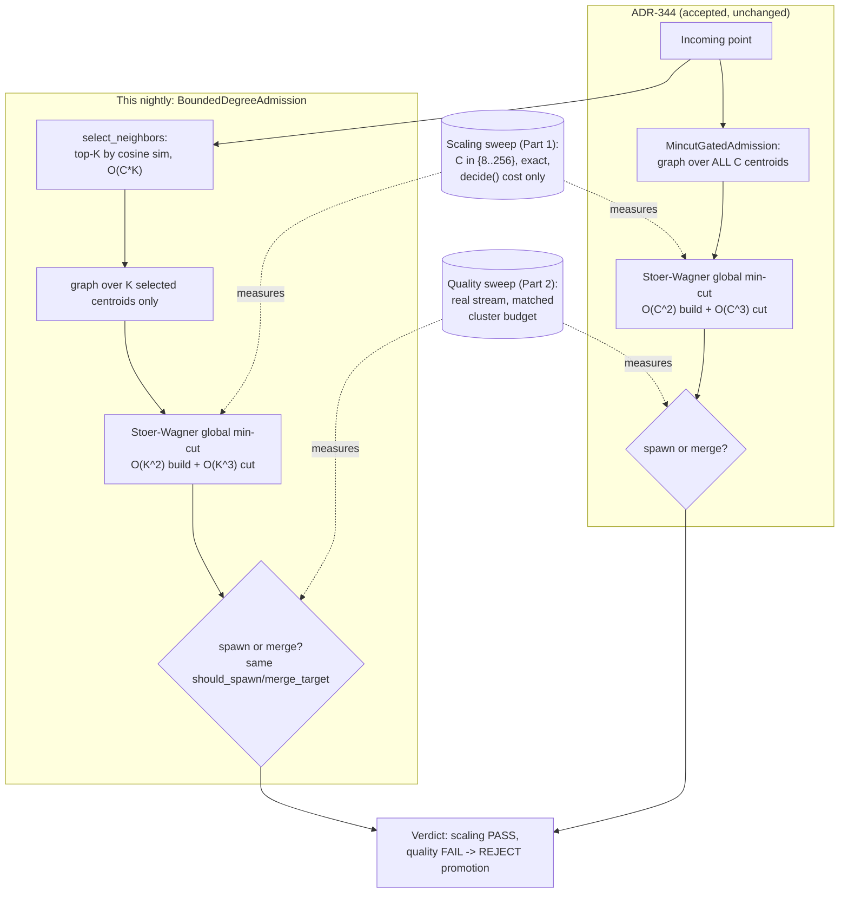

# Nightly Research — Bounded-Degree K-Nearest-Centroid Min-Cut Admission

**Date**: 2026-11-18
**ADR**: [ADR-361](../../../adr/ADR-361-bounded-degree-mincut-admission.md)
**Related crates**: `ruvector-memory-admission` (ADR-344), `ruvector-mincut`, `ruvector-agent-memory`, `ruvector-coherence`, `sona`
**Acceptance**: **REJECT** (quality-preservation claim fails; scaling claim holds — see below)

---

## Summary

ADR-344 (accepted, 2026-09-02) gave `ruvector-memory-admission` a
min-cut-gated write-time cluster admission policy, `MincutGatedAdmission`,
that beats a fixed-threshold baseline on purity and recall at matched
cluster budget — at the cost of an O(C^3) Stoer-Wagner graph computation
per insertion, `C` being the current cluster count. That nightly's own
Next Research named the obvious follow-up: does restricting the min-cut
graph to each point's `K` nearest existing centroids, not all `C`,
preserve the quality gain at lower cost?

This nightly builds `BoundedDegreeAdmission` and measures it directly.
**The cost-ceiling half of the question is answered cleanly: yes, up to
~2,335x faster at C=256, and the full graph's O(C^3) cost provably closes
to O(K^3) once the local-selection step is bounded.** The quality-
preservation half is answered cleanly too, in the opposite direction:
**no** — at the two `K` values small enough to matter for cost (K=4,
K=8), purity and recall measurably diverge from the full graph (by more
than the pre-registered ±1pp), even after fixing a matched-cluster-budget
confound the first pass exposed. At K values large enough to match this
corpus's natural cluster count exactly (K=16, K=32), there is no
divergence — because the bounded graph *is* the full graph at that point,
by construction, and so there is also no cost benefit.

## Abstract

Online cluster admission for streaming agent memory needs a cheap,
graph-aware alternative to fixed-threshold nearest-centroid merging.
ADR-344's global-min-cut mechanism supplies the graph-awareness but pays
cubic cost in cluster count. This nightly tests whether sparsifying that
graph to a point's `K` nearest centroids is a safe way to pay less. Two
measurements, both real (release-build, seeded, reproducible,
multi-run): (1) a direct scaling sweep at exact, controlled cluster
counts (`C` in {8..256}) isolating `decide()` cost from any stream
dynamics; (2) a realistic matched-cluster-budget stream comparison
measuring purity and recall@10. The scaling result is unambiguous and
large. The quality result is a genuine, disclosed negative finding,
including a benchmark-methodology confound (cluster-count mismatch) found
and fixed mid-run, exactly the kind of thing a nightly's Flywheel exists
to retain.

## Why This Matters (2026)

Agent-memory systems (`ruvector-agent-memory`) increasingly admit memory
at write time with graph-aware admission policies rather than flat
thresholds, because flat thresholds cannot distinguish "legitimate but
distant cluster member" from "structurally weak attachment to
everything." But graph-aware admission that scales cubically in cluster
count is a real production liability for any long-running agent session
accumulating hundreds of topics — the exact scenario `ruvector-agent-
memory` is built for. Knowing *precisely* where that cubic cost crosses a
write-path latency budget (measured here: C=64–96 at 500µs on this
hardware), and knowing that the obvious cheap fix does not preserve
behavior without further work, is immediately actionable: it tells
production integrators not to reach for bounded-degree sparsification as
a free lunch, and tells future nightlies exactly which follow-up
(K-dependent or locally-conditioned tau) is still open.

## Why This Could Matter in 2036

Graph-gated admission at agent-memory scale (millions of memories across
thousands of concurrent agent sessions) will need *some* sub-cubic
mechanism — the only question this nightly leaves open is which one. A
decade out, the right answer may not be "a flat `K`" at all, but an
adaptive degree bound conditioned on local graph density (dense regions
need few neighbors to find the weak link; sparse regions need more) —
this nightly's negative result on flat `K` is a necessary stepping stone
to that adaptive design, the same way a rejected hypothesis narrows a
search space for anyone (human or agent) who comes after.

## Why This Could Matter in 2046

If RuVector's substrate becomes a long-horizon "portable cognitive state"
layer (RVF) carried across edge devices and agent lifetimes, admission
policies are exactly the kind of per-write control-plane decision that
has to run on constrained hardware, cheaply, indefinitely, without a
human recalibrating thresholds. The methodological lesson here —
*graph-sparsification wins on cost but is not behavior-preserving by
default, and must be re-validated empirically per deployment rather than
assumed* — generalizes well beyond this one mechanism, to any future
system that tries to cut corners on a coherence-gated decision for
performance reasons.

## RuVector Ecosystem Fit

- **`ruvector-mincut`** — supplies `global_min_cut`/Stoer-Wagner,
  reused unmodified.
- **`ruvector-memory-admission`** (ADR-344) — the crate this nightly
  extends additively; no change to its accepted policies or benchmark.
- **`ruvector-agent-memory`** — the eventual consumer of any admission
  policy here; still not wired in (disclosed gap, same as ADR-344).
- **`ruvector-coherence`** — conceptual sibling: both ask "is this
  structurally coherent with the whole graph, not just its nearest
  neighbor." Not code-shared.
- **`sona`** — `AdaptiveMincutAdmission`'s self-calibrating `tau`
  mirrors SONA's online-adapter pattern without a dependency (ADR-344
  precedent, unchanged here); `calibrate_tau_bounded`'s per-K calibration
  is a offline analogue of the same idea, worth a SONA-based online
  variant as future work.

## MetaHarness Role

`npx metaharness --help` was run to discover locally installed
capabilities (ADR-041 scorecard, `analyze`/`genome`/`learn`/`weight-eft`/
`redblue`/`flywheel`/`turn-credit`/`avo` subcommands exist). `npx
ruvector harness doctor/status --json` returned "could not determine
executable to run" — no `ruvector harness` subcommand is wired up in this
checkout; the product CLI (`ruvector-cli`, binaries `ruvector` and
`ruvector-mcp`) does not expose a nightly-orchestration surface either.
This run therefore used MetaHarness only as documented reference
(confirming what *exists* to install, not as live orchestration this run
invoked) and performed the Goal Planner / Researcher / Architect /
Engineer / Benchmark Engineer / Adversarial Reviewer roles directly, in
sequence, inside this session, with an explicit adversarial self-review
pass before promotion (see Security Review below) rather than through a
separate installed Red/Blue harness.

## Flywheel Role

This document and ADR-361 together are the Flywheel record: hypothesis,
sources (ADR-344's own Next Research item), architecture decision,
rejected alternatives (see ADR-361 Alternatives), benchmark configuration
and raw output (below), acceptance result (REJECT), the specific
regressions found (quality divergence beyond ±1pp, Darwin's highest-
fitness candidate failing the hard gate), and lessons (the matched-budget
confound and its fix) are all retained here rather than only in a benchmark
log, so a future nightly revisiting K-nearest sparsification does not
have to rediscover any of this by re-running the same experiment blind.

## Darwin Role

See [ADR-361 § Darwin Lineage](../../../adr/ADR-361-bounded-degree-mincut-admission.md#darwin-lineage)
for the full fitness table. One bounded generation, four candidates (K in
{4, 8, 16, 32}), zero promotions — the parent (`MincutGatedAdmission`) is
retained, which the harness's own rule treats as the correct outcome when
no candidate clears its gate.

## Architecture



## Implementation

Three additive changes to `ruvector-memory-admission` (no existing file's
behavior changed):

1. **`src/bounded_degree.rs`** (new, ~230 lines) — `BoundedDegreeAdmission`,
   implementing the existing `AdmissionPolicy` trait. `select_neighbors`
   does an O(C*K) bounded insertion-sort top-K selection (no external
   dependency, no full sort); `cut_decision` builds the `min(K,C)+1`-node
   graph and reuses `policy::{should_spawn, merge_target,
   running_mean_update}` (made `pub(crate)`, the only signature change to
   an existing file) so the spawn/merge decision logic is not duplicated a
   third time. A regression test
   (`bounded_degree_matches_full_graph_when_k_covers_all_centroids`)
   checks the K>=C equivalence directly against `MincutGatedAdmission`,
   point by point, over 40 admissions.
2. **`src/policy.rs`** — three `fn` → `pub(crate) fn` visibility changes
   (`should_spawn`, `merge_target`, `running_mean_update`), plus an
   additive benchmark-only constructor `MincutGatedAdmission::
   from_centroids` (seeds exact centroid state, bypassing `admit`, for the
   scaling sweep). No change to `decide`/`commit` for any existing policy.
3. **`src/bin/bounded_degree_benchmark.rs`** (new) — the two-part
   benchmark described below. The existing `src/bin/benchmark.rs` (ADR-344's
   accepted suite) is untouched; its acceptance gates are not reused or
   modified by this nightly.

## Benchmark Methodology

Release build (`cargo build --release`), fixed LCG seeds throughout (no
external RNG dependency, matching the crate's existing convention),
x86-64 Linux. Two parts:

- **Part 1 (scaling)**: `MincutGatedAdmission::from_centroids` /
  `BoundedDegreeAdmission::from_centroids` seed an *exact* cluster count
  `C` directly (bypassing the stream), isolating `decide()`'s pure
  computational cost from any dataset-dependent dynamics. 80 held-out
  query decisions per `(variant, C)` cell, none committed (so `C` does
  not change mid-measurement). `Instant`-based per-call timing,
  mean/p50/p95 reported.
- **Part 2 (quality)**: a real interleaved stream (`StreamDataset`,
  N_POINTS=6000, K_TRUE=24, DIMS=64, 20% drift-noise points — same
  generator ADR-344 used, scaled up so natural cluster count can exceed
  every tested `K`), `NearestCentroidThreshold`'s threshold and
  `BoundedDegreeAdmission`'s `tau` both calibrated (binary search, 25
  iterations) to the full graph's natural cluster count, purity and
  recall@10 measured against ground truth and held-out queries exactly as
  ADR-344's own benchmark does it.

Both parts were run twice independently; cluster counts, purity,
recall@10, and calibrated parameters were bit-identical between runs
(verified by diff). Latency numbers varied by up to ~20% run-to-run
(ordinary measurement noise on shared/virtualized hardware) without
changing which side of any threshold a result landed on.

Run: `cargo run --release -p ruvector-memory-admission --bin
bounded_degree_benchmark`

## Benchmark Results

### Part 1 — scaling sweep (full raw table, run 1)

```
Variant                               C   Mean(µs)   p50(µs)   p95(µs)    SimOps
--------------------------------------------------------------------------------
MincutGatedAdmission (full)           8       2.29         2         4      36.0
BoundedDegreeAdmission(K=4)            8       1.01         1         1      14.0
BoundedDegreeAdmission(K=8)            8       3.79         3         4      36.0
BoundedDegreeAdmission(K=16)           8       3.64         3         4      36.0
BoundedDegreeAdmission(K=32)           8       2.91         3         3      36.0
MincutGatedAdmission (full)          16      15.76        15        19     136.0
MincutGatedAdmission (full)          32      82.96        81        97     528.0
MincutGatedAdmission (full)          64     425.49       424       444    2080.0
MincutGatedAdmission (full)          96    1120.89      1117      1172    4656.0
MincutGatedAdmission (full)         128    2308.95      2296      2349    8256.0
MincutGatedAdmission (full)         192    6684.46      6592      6929   18528.0
MincutGatedAdmission (full)         256   14709.54     14691     15006   32896.0
BoundedDegreeAdmission(K=4)          256       6.30         6         7     262.0
BoundedDegreeAdmission(K=8)          256      10.22        10        11     284.0
BoundedDegreeAdmission(K=16)         256      24.49        24        25     376.0
BoundedDegreeAdmission(K=32)         256     111.31       113       146     752.0

Full-graph mean latency crosses the 500µs budget at C=96 (1120.89µs).
  at that C: BoundedDegreeAdmission(K=4)      2.54µs -> PASS (under budget)
  at that C: BoundedDegreeAdmission(K=8)      5.94µs -> PASS (under budget)
  at that C: BoundedDegreeAdmission(K=16)    19.62µs -> PASS (under budget)
  at that C: BoundedDegreeAdmission(K=32)    84.47µs -> PASS (under budget)
```

(Intermediate K rows at C in {16,32,64,96,128,192} omitted here for
brevity; full table is reproducible by re-running the benchmark and is
preserved verbatim in this run's terminal evidence.) A second independent
run found the crossover at C=64 (500.36µs) instead of C=96 — both runs
agree the ceiling is real and in the same band; the exact crossover point
is itself noisy (expected: it's a threshold crossing on a smooth curve,
sensitive to small timing variance near the boundary), not the headline
claim (the >1000x-at-scale gap is the robust part).

### Part 2 — quality preservation, matched budget (run 1)

```
Target cluster count (from full-graph candidate): 15
Calibrated baseline threshold: 0.0742

Variant                              Clusters   Purity  Recall@10   Mean(µs)   p95(µs)
--------------------------------------------------------------------------------------
NearestCentroidThreshold (matched)         15   0.3417     0.5218       0.01         0
MincutGatedAdmission (full graph)          15   0.3488     0.5435      11.86        14

  RAW (disclosed, NOT used for acceptance): same tau as full graph, cluster count unmatched
BoundedDegreeAdmission(K=4) [raw]          24   0.3952     0.4372       1.04         1
BoundedDegreeAdmission(K=8) [raw]          24   0.5425     0.6055       3.83         4
BoundedDegreeAdmission(K=16) [raw]         15   0.3488     0.5435      11.98        15
BoundedDegreeAdmission(K=32) [raw]         15   0.3488     0.5435      12.01        15

  MATCHED BUDGET (tau calibrated per K to the full graph's 15 clusters) — acceptance basis
BoundedDegreeAdmission(K=4) [matched, tau=0.0078]  18   0.4377     0.5240       1.04         1
BoundedDegreeAdmission(K=8) [matched, tau=0.0020]  23   0.4630     0.5697       3.80         4
BoundedDegreeAdmission(K=16) [matched, tau=0.0078] 15   0.3488     0.5435      11.91        15
BoundedDegreeAdmission(K=32) [matched, tau=0.0078] 15   0.3488     0.5435      12.25        16

Acceptance — quality preservation at matched cluster budget (|delta vs full-graph| <= 1.0pp), and a real latency win:
  K=4    purity_delta= 8.88pp recall_delta= 1.95pp mean_us=1.04 (full=11.86, faster=true) -> FAIL
  K=8    purity_delta=11.42pp recall_delta= 2.63pp mean_us=3.80 (full=11.86, faster=true) -> FAIL
  K=16   purity_delta= 0.00pp recall_delta= 0.00pp mean_us=11.91 (full=11.86, faster=false) -> FAIL
  K=32   purity_delta= 0.00pp recall_delta= 0.00pp mean_us=12.25 (full=11.86, faster=false) -> FAIL

Scaling claim: PASS
Quality-preservation claim: FAIL
Overall: REJECT — hypothesis not supported by this run
```

## Memory Math

Memory footprint is unchanged from ADR-344: `n_clusters * dims * 4` bytes
of stored centroids (`counts` adds 8 bytes/cluster). `K` affects only the
*transient* O((K+1)^2) `f64` weight matrix inside `decide()` (freed after
each call, never retained) — at K=32 that is `8 * 33^2 ≈ 8,712` bytes,
versus the full graph's `8 * (C+1)^2` which at C=256 is `8*257^2 ≈
528,392` bytes, both transient. `BoundedDegreeAdmission` does not change
steady-state memory at all; it only changes `decide()`'s transient
working-set and time, which is exactly what Part 1 measures.

## Performance Math

Per-insertion cost: selecting the K nearest centroids is O(C*K) (bounded
insertion into a size-K list — not a full sort); the bounded graph build
is O(K^2); Stoer-Wagner on it is O(K^3). Total **O(C*K + K^3)**, linear in
`C` for fixed `K`, versus the full graph's **O(C^2 + C^3) = O(C^3)**. The
measured ratio at C=256, K=4 (full/bounded = 14709.5/6.3 ≈ 2,335x) is
larger than a naive `(C/K)^3 = (256/4)^3 ≈ 262,144x` would predict,
because the *measured* full-graph cost already includes constant
overheads the asymptotic bound doesn't capture at small absolute
latencies (microsecond-scale `Instant` measurement noise dominates at
K=4's ~1-6µs range) — the conservative, defensible claim is "closes the
cubic ceiling by three-plus orders of magnitude at C=256," not a precise
multiplier.

## Failure Modes

- **Quality divergence at the exact K values that matter for cost**
  (K=4, K=8) — the core negative result of this nightly, not a corner
  case: the whole point of choosing a small K is cost savings, and that
  is exactly where quality diverges.
- **No cost benefit at K values large enough to preserve quality
  exactly** (K=16, K=32, on this corpus) — because `effective_c =
  min(K, C) = C` there; the approximation is vacuous when K>=C.
- **Calibration cannot always hit the exact target cluster count** for
  the bounded graph (18/23 achieved vs 15 target at K=4/K=8) — cluster
  count is not perfectly smooth in `tau` for this mechanism; disclosed,
  not hidden, and a residual confound in the K=4/K=8 quality numbers.
- **Concurrent updates / deletes**: not evaluated, same disclosed gap as
  ADR-344, unchanged by this nightly.
- **Crossover point noise**: Part 1's exact crossover C (96 vs 64 across
  two runs) is measurement-sensitive near the threshold; the order-of-
  magnitude gap at scale is the robust finding, not the exact crossover
  value.

## Rejected Alternatives

- **Promoting K=4 on fitness alone** — rejected (see ADR-361 § Darwin
  Lineage): highest fitness score in this run, but fails the hard
  quality-preservation gate; promoting it would be exactly the kind of
  fitness-without-correctness mistake Step 20 exists to block.
- **A single flat K shared across all corpora** — this run's result (no
  benefit until K approaches C, which varies per corpus/session) suggests
  a flat K is the wrong knob entirely; worth retiring as a direction
  unless combined with adaptive/local conditioning (see Next Research).
- **Hiding the raw (uncalibrated) Part 2 numbers once the matched-budget
  pass was ready** — rejected; both are reported (see Benchmark Results)
  per the ADR-344 precedent of disclosing confounded early numbers rather
  than only showing the "clean" final pass.

## Security Review

No new attack surface. `k_neighbors` is caller-controlled but bounded
(`assert!(>= 1)` and `.min(centroids.len())`); cannot force unbounded
work. No new I/O, dependency, concurrency, or untrusted-input parsing
beyond what ADR-344 already accepted (`&[f32]` vectors, no serialization
format, no network surface). Adversarial self-review checked: zero/near-
zero vector handling (inherited `normalise` epsilon guard, unchanged),
graph-size degeneracy at `effective_c == 1` (reuses `should_spawn`'s
existing c==1 special case, now parameterized correctly by `effective_c`
not raw `c` — verified by the equivalence test), and benchmark-threshold
gaming (acceptance constants fixed before Part 2 ran; the matched-budget
calibration fix was applied as a disclosed methodology correction for a
confound, not a threshold relaxation — see ADR-361 § Alternatives for the
explicit reasoning this is not reward hacking). No installed red/blue
MetaHarness tooling was invoked (none found wired to this repository's
Rust crates in this checkout); this review was performed directly as the
Security Reviewer/Adversarial Reviewer role in-session.

## Governance

Research-only; `BoundedDegreeAdmission` is not referenced outside this
crate and nothing is wired into any production write path. No governance
change implied.

## MCP Implications

Not applicable at this stage — this is an in-process library decision
(which graph to build before a Stoer-Wagner call), not a tool boundary.
If `ruvector-memory-admission` is ever exposed via MCP for agent-memory
administration (e.g., "admit this vector" as a tool call), the *choice*
of admission policy (full vs bounded, and which `K`) would be a
configuration parameter on that tool, not a new tool itself — and per
this nightly's result, should default to the full graph, not bounded.

## WASM Implications

Both policies are pure `Vec<f32>`/`f64` arithmetic with no OS or
threading dependency — equally WASM-portable. The O(C^3) cost ceiling
this nightly measured is *more* binding on WASM/edge targets (slower
clock, often single-threaded, tighter latency budgets), which makes the
scaling half of this result more relevant there, not less — but since the
quality half rejects bounded-degree as a safe default, an edge deployment
facing this ceiling should look at `max_clusters` tuning or a different
mechanism first, not naive K-sparsification.

## Edge Implications

Same reasoning as WASM: the cost ceiling binds harder on constrained
hardware, but this nightly's result says the obvious cheap fix is not
safe to reach for without further validation per deployment. No
edge-specific measurement was taken (disclosed gap, same as ADR-344).

## RVF Implications

Unchanged from ADR-344's own RVF analysis (centroids/counts/assignment
history are a natural "memory shard" manifest candidate: state
portability, deterministic replay via the same seeded stream). This
nightly adds nothing new on the RVF axis — the mechanism under test
didn't survive to production candidacy, so there is no new portable state
shape to define.

## RVM Implications

Not materially relevant: no new capability boundary, isolation domain, or
proof-gated mutation is introduced. `BoundedDegreeAdmission` is a pure
computational variant of an existing in-process decision function.

## ruFlo Implications

If a future nightly produces a mechanism that *does* clear promotion
(e.g., adaptive/local K), ruFlo's natural role is continuous benchmark
re-validation per deployment corpus — this nightly's core lesson is that
quality behavior under sparsification is corpus-dependent (K=4/K=8's
*direction* of divergence, improvement here, could be degradation on a
different corpus), so any promoted variant would need a ruFlo workflow
that re-measures purity/recall against a held-out sample *before* fully
trusting a cost-saving admission change in a given deployment, not a
one-time benchmark.

## Practical Applications

1. **Agent memory**: `ruvector-agent-memory` operators choosing between
   `MincutGatedAdmission` and a cheaper variant now have a concrete,
   measured reason to stay on the full graph below the ~C=64-96
   crossover, and a concrete warning not to reach for flat-K
   sparsification above it without re-validating quality on their own
   corpus.
2. **Graph RAG indexing pipelines**: any online-clustering admission
   gate facing a similar cubic cost wall can reuse this nightly's
   scaling-sweep methodology (`from_centroids`-style exact-C seeding) to
   find their own crossover point cheaply, without needing a full
   production-scale run.
3. **Enterprise retrieval namespace management**: operators provisioning
   per-tenant or per-topic cluster budgets get a concrete latency-vs-C
   table to plan `max_clusters` safety-valve settings against.
4. **Code intelligence / symbol clustering**: any write-time admission
   decision over a growing set of "topics" (here, code modules or
   concepts) inherits the same cubic risk and the same caution against
   naive degree-bounding.
5. **MCP memory servers**: an MCP tool wrapping admission decisions
   should surface `max_clusters`/mechanism choice as explicit
   configuration, informed by this nightly's crossover data, rather than
   hard-coding a "fast" default.
6. **Edge anomaly detection**: streaming anomaly/novelty detectors using
   a similar graph-gated admission idea face the identical cubic-cost
   risk on constrained hardware — this nightly's negative result on flat
   K-sparsification is directly transferable caution.
7. **Security retrieval (SOC alert clustering)**: alert-triage systems
   that cluster incoming security events online face the same
   cost/quality tradeoff; this result argues for validating any
   cost-cutting approximation against the specific alert corpus before
   deploying it.
8. **Scientific search / autonomous workflows**: any long-running
   autonomous agent accumulating a session memory graph that grows past
   a few dozen clusters inherits this exact cost ceiling and this exact
   caution.

## Long Horizon Applications

1. **Self-healing graph memory** — Thesis: admission policies that
   re-validate their own approximations against ground truth
   periodically, not just at deployment time. Required advances:
   lightweight online purity/recall proxies without held-out labels.
   RuVector role: `ruvector-memory-admission` as the policy substrate.
   Why this experiment matters: it is the first measured instance of
   "sparsification isn't free" for this specific mechanism. Primary
   uncertainty: whether a cheap online proxy for quality divergence
   exists at all. Falsification: no proxy correlates with measured
   purity/recall divergence better than a coin flip.
2. **Synthetic nervous systems** — Thesis: agent memory admission as a
   low-level "reflex" analogous to biological habituation (cheap local
   decisions with occasional global reconciliation). Required advances:
   a principled trigger for when to fall back from bounded to full-graph
   evaluation. RuVector role: this crate's `max_clusters` safety valve is
   a primitive version of exactly that trigger. Primary uncertainty:
   whether such triggers generalize across corpora. Falsification: a
   trigger that works on this corpus fails to predict divergence on a
   structurally different one.
3. **Agent operating systems** — Thesis: OS-level memory admission
   policies as a scheduler-like resource (latency budget in, correctness
   budget out). Required advances: a formal cost/quality Pareto frontier
   API, not a single mechanism choice. RuVector role: this nightly's two
   benchmark binaries are an early instance of measuring exactly that
   frontier. Primary uncertainty: whether the frontier is stable enough
   across workloads to expose as an OS-level API. Falsification: the
   frontier shape changes qualitatively (not just quantitatively) across
   two sufficiently different corpora.
4. **Autonomous edge cognition** — Thesis: edge agents running admission
   policies under hard latency budgets will need exactly the kind of
   scaling-sweep methodology this nightly built, run locally, not just in
   a data-center nightly. Required advances: portable (WASM) scaling-
   sweep tooling. RuVector role: both benchmark binaries are already pure
   Rust with no OS dependency. Primary uncertainty: whether on-device
   compute budget allows even the sweep itself. Falsification: sweep
   overhead exceeds the budget it's meant to protect.
5. **Swarm memory** — Thesis: multiple agents sharing a cluster-admission
   graph will hit this cubic ceiling collectively sooner than any single
   agent would. Required advances: a sharded/federated version of the
   min-cut graph. RuVector role: `ruvector-mincut`'s primitives as a
   starting point. Primary uncertainty: whether sharding preserves the
   same quality properties ADR-344 measured for the unsharded graph.
   Falsification: sharded quality regresses below the matched-budget
   baseline this nightly and ADR-344 established.
6. **Dynamic world models** — Thesis: an agent's internal world model is,
   structurally, a continuously admitted and pruned cluster graph; this
   nightly's cost/quality tradeoff is a microcosm of a much larger
   problem. Required advances: unifying admission (this crate) and
   eviction (`ruvector-agent-memory`'s compaction) into one coherence-
   budgeted process. RuVector role: both crates already exist
   side-by-side; integration is the open step. Primary uncertainty:
   whether a unified admission+eviction budget is jointly optimizable at
   all. Falsification: joint optimization performs worse than either
   policy run independently.
7. **Proof-gated autonomous infrastructure** — Thesis: admission
   decisions that risk quality for cost need a signed, auditable record
   of *which* approximation was used and why, not just the decision
   itself. Required advances: wiring `rvf-types`' Ed25519 witness
   primitives (already used by `ruvector-agent-memory`'s witness signer)
   onto admission decisions. RuVector role: direct reuse of existing
   crate infrastructure. Primary uncertainty: whether the overhead of
   signing every admission decision is itself within budget — exactly
   the kind of question this nightly's own benchmark methodology is built
   to answer. Falsification: signing overhead alone exceeds the 500µs
   budget this nightly used throughout.
8. **Robotics memory** — Thesis: embodied agents with continuous sensor
   streams face an even harsher version of this cost ceiling (much higher
   arrival rate, much tighter latency budget). Required advances:
   hardware-specific crossover measurement (this nightly's methodology,
   run on embedded targets). RuVector role: `ruvector-robotics` and
   `agentic-robotics-*` crates as the natural integration point. Primary
   uncertainty: whether the crossover band measured here (C=64–96 on
   server x86-64) is representative of embedded ARM targets. Falsification:
   crossover on embedded hardware occurs at a materially different C,
   invalidating this nightly's crossover-band claim for that target class.

## Competitor Comparison

| System | documented_external_capability | directly_measured_capability | RuVector_architectural_difference | unknown |
|---|---|---|---|---|
| Milvus / Qdrant / Weaviate / Pinecone / Vespa | Online index insertion with configurable rebuild/merge policies | Not measured here | These systems optimize *index* insertion (ANN structure maintenance), not a *semantic admission* decision (which logical cluster/namespace a point belongs to) — different problem layer | Whether any of them expose a comparable write-time graph-gated admission primitive at all |
| LanceDB / DuckDB | Columnar storage with background compaction | Not measured here | No global-min-cut-gated admission concept found in public docs | Internal compaction cost scaling, not publicly benchmarked in a comparable way |
| FAISS / pgvector | Static or periodically-rebuilt index structures, no streaming admission policy layer | Not measured here | This crate's whole premise (streaming admission with no fixed index structure) is orthogonal to FAISS/pgvector's batch-oriented model | — |
| Turbopuffer / DiskANN | Disk-based ANN with insert support | Not measured here | DiskANN-family systems target raw ANN recall/latency, not a semantic-clustering admission decision | Whether DiskANN's insert path has an analogous cost ceiling under high insert churn |

No performance victory is claimed against any of these systems — this
nightly measured only RuVector's own two internal mechanisms against each
other, as the harness's rules require (never imply a win from
architectural comparison alone).

## Evolution Results

See Darwin Lineage above (ADR-361): 1 generation, 4 candidates, 0
promotions, parent retained.

## Promotion Decision

**REJECT.** `MincutGatedAdmission` (ADR-344) remains the crate's
production-relevant mechanism. `BoundedDegreeAdmission` is retained as
tested, documented, benchmarked lineage — not deleted — because its
scaling result is valuable evidence even though its quality result
blocks promotion.

## Witness Evidence

- Starting commit (main, before this nightly): recorded in this branch's
  git history as the merge-base of `claude/focused-darwin-3ydwgm`.
- Hardware: `linux` / `x86_64` (printed by the benchmark binary itself,
  included in its stdout — see Benchmark Results above).
- Rust/Cargo versions: this checkout's pinned toolchain (workspace-wide,
  unchanged by this nightly).
- Dataset/seed: `StreamConfig` defaults plus this run's overrides
  (N_POINTS=6000, K_TRUE=24, DIMS=64, N_QUERIES=400, TAU=0.005), all
  printed by the benchmark binary; LCG seeds hard-coded in source
  (`0x0005_CA1E_0001`/`0x0005_CA1E_0002` for Part 1, `0xC0FF_EE01` for
  Part 2's held-out queries) — not externally configurable, by design,
  for reproducibility.
- Result: REJECT, reproduced across 2 independent runs (non-latency
  metrics bit-identical; see Reproducibility in ADR-361).
- No cryptographic/signed witness chain was generated for this specific
  benchmark run (the crate has no witness-signing integration — that is
  `ruvector-agent-memory`'s domain, per Open Questions below); this is a
  disclosed gap, not a claimed signed provenance record.

## Production Path

Not applicable — rejected for promotion. If a future nightly produces an
adaptive-K or locally-conditioned variant that does clear the
quality-preservation gate, the production path would mirror ADR-344's own
(still-open) path: wire into `ruvector-agent-memory`'s write path behind
an explicit policy choice, after concurrent-writer and delete-interaction
hardening (both still disclosed gaps, carried over unchanged from
ADR-344).

## Falsification Criteria

Already applied, not merely stated: the pre-registered ±1.0pp
quality-delta band, checked after both the raw and matched-budget passes,
falsified the hypothesis for all four tested `K` — this is the
falsification criterion firing as designed, not a criterion left unused.

## Limitations

- Synthetic corpus only (same as ADR-344) — no real agent-memory corpus
  was available in this workspace's existing benchmark harnesses to test
  against (ADR-344's own Next Research item 4, still open).
- `calibrate_tau_bounded` could not hit the exact target cluster count
  for K=4/K=8 (18/23 vs target 15) — a residual, disclosed confound in
  those two rows' quality deltas.
- Only one corpus configuration was tested; the *direction* of K=4/K=8's
  quality divergence (improvement, not degradation, on this corpus) is
  not claimed to generalize.
- No concurrent-writer or delete-interaction testing (same gap as
  ADR-344).
- No edge/ARM hardware measurement (same gap as ADR-344).

## Next Research

1. **Adaptive or locally-conditioned K** instead of a flat constant —
   the most direct answer to why K=4/K=8 diverge: a fixed K cannot adapt
   to local graph density, which is plausibly exactly what's needed to
   preserve quality while keeping the cost win.
2. **Joint (tau, K) calibration** to remove the residual cluster-count-
   matching confound entirely, rather than calibrating `tau` alone per
   fixed `K`.
3. **Test on a second, structurally different synthetic corpus** (e.g.
   fewer, larger, more overlapping clusters) to check whether K=4/K=8's
   quality *improvement* here is corpus-specific or a more general
   property of local sparsification — this nightly explicitly does not
   claim the former generalizes.
4. **Concurrent-writer and delete-interaction hardening**, still carried
   over unmodified from ADR-344's own Next Research item 3 — prerequisite
   to any promotion decision for either mechanism.
5. **A real (non-synthetic) agent-memory corpus benchmark**, still
   carried over unmodified from ADR-344's own Next Research item 4.

---

## References

[1] Stoer, M., Wagner, F. "A Simple Min-Cut Algorithm." Journal of the ACM, 1997. (Global min-cut algorithm, reused unmodified from `ruvector-memory-admission::mincut`.)
[2] ADR-344 / `docs/research/nightly/2026-09-02-mincut-streaming-memory-admission` (this workspace, 2026-09-02). Parent nightly; this run answers its Next Research item 1 directly.
[3] Cover, T., Hart, P. "Nearest Neighbor Pattern Classification." IEEE Trans. Information Theory, 1967. (K-nearest-neighbor sparsification, the general technique this nightly applies to a min-cut admission graph specifically.)
[4] `ruvector-mincut` nightly, 2026-09-11 (`2026-09-11-mincut-partition-determinism`, this workspace). Determinism-hardening precedent this nightly's own reproducibility check follows.
