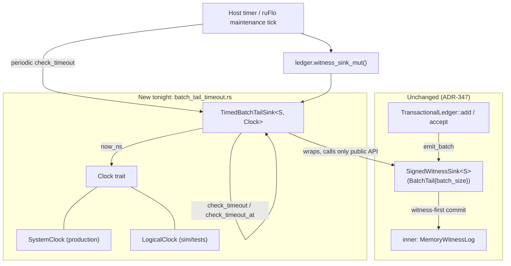

# Nightly Research — Bounded Signature-Availability Latency for `BatchTail` Witness Signing

**Date:** 2026-11-23 (UTC)
**Starting commit:** `4d5d06691cde99d178e69cd79144151c7d96eab`
**Crate:** `ruvector-agent-memory`
**New module:** `src/batch_tail_timeout.rs` (`TimedBatchTailSink`)
**New benchmark:** `examples/batch_tail_timeout_latency.rs`
**Acceptance:** **ACCEPT**

## Summary

[`SigningStrategy::BatchTail`](../../../../crates/ruvector-agent-memory/src/witness_signing.rs)
closes an Ed25519-signed span of TARL witness records once `batch_size`
records have arrived — with no upper bound on how long that can take. The
2026-09-16 nightly (`witness-signer-agent-memory`, ADR-347) built and
measured this strategy, named the gap in its own Next Research item 1, and
pointed at the fix already built and measured for a sibling crate:
`ruvector_retrieval_receipt::batch_fill`'s `BatchFillPolicy`/`BatchScheduler`
(close at `max_members`, or after `max_wait_ns`, whichever comes first).

This run ports that decision methodology — not the code — onto
`SignedWitnessSink`, as an additive decorator (`TimedBatchTailSink`) rather
than a change to the reviewed, security-sensitive signing module itself.
A discrete-event simulation (ported from
`ruvector-retrieval-receipt/src/bin/batch_latency.rs`) then measures real
signature-availability latency under three arrival regimes, with real
Ed25519 signing cost on top of virtual arrival/deadline time. The result:
the timeout bounds worst-case availability latency as designed, at
negligible cost under healthy load, with a documented, measured tradeoff
against signing throughput under slow/bursty load.

## Abstract

A deployment that signs agent-memory witness records in amortized batches
(`BatchTail`) needs to know *when* a record's signature will exist, not
just *that* it eventually will. Under a slow or bursty arrival process,
"whenever `batch_size` records happen to arrive" can mean seconds or
longer — unacceptable for any system that wants to assert "this write is
tamper-evident" within a bounded time of the write happening. This run
implements and measures a wall-clock fill-timeout for `BatchTail`,
reusing an existing, already-validated policy-decision pattern from a
sibling ecosystem crate instead of inventing a new one, and shows real
measured numbers: at a synthetic 50 queries/sec arrival rate with
`batch_size=64`, the unmodified baseline's p99 signature-availability
latency is **1402ms**; wrapped in a 50ms timeout, it is **50.05ms** — a
~28x reduction, within the pre-declared bound, at a measured amortized
signing-cost overhead of **<3%** under healthy (5000 qps) load where the
timeout essentially never fires.

## Hypothesis

> **Given** a `BatchTail`-signed witness log receiving records at a
> synthetic arrival process slower than its `batch_size` would naturally
> fill (Poisson at 50 qps, or bursty on/off traffic),
> **when** the span is additionally sealed after `max_wait_ns` has
> elapsed since it opened (`TimedBatchTailSink`),
> **then** p99 signature-availability latency is bounded by
> approximately `max_wait_ns` (within a small, fixed slack) instead of
> growing with however long `batch_size` takes to fill by count alone,
> **subject to** every closed span still passing
> `verify_signed_chain`, and amortized signing cost at a healthy
> (5000 qps) arrival rate staying within 2x of the unmodified baseline's.

## Why This Matters Now (2026)

Agent-memory systems are increasingly expected to produce tamper-evident
write receipts for audit, compliance, and multi-agent trust — but most
"signed log" designs in the wild either sign every record (expensive) or
batch with no latency guarantee (the gap this run closes). RuVector's own
prior nightly runs already built both halves of the fix in different
crates without connecting them; this run is the connection.

## Why This Could Matter in 2036

Autonomous multi-agent systems that must prove *when* a memory write
became non-repudiable — not just that it eventually would — are a
prerequisite for any agent operating system that lets independent agents
rely on each other's memory logs under a service-level latency bound
(e.g. "this eviction will be signed within 50ms or the write is rejected
upstream"). Bounded signature-availability is a building block for that.

## Why This Could Matter in 2046

If RuVector-style witness chains become a substrate for long-running
autonomous infrastructure (robotics memory, swarm coordination, edge
cognition with intermittent connectivity), a *configurable, measured*
latency/cost tradeoff between "sign immediately" and "sign eventually" is
exactly the knob a self-tuning system (Darwin-style evolution, or a
control loop) needs to exploit — this run's `candidate_a` vs
`candidate_b` numbers are a first concrete data point for such a loop.

## Why RuVector Is the Right Substrate

RuVector already owns both halves: the TARL witness ledger
(`ruvector-agent-memory`) and the batch-fill decision methodology
(`ruvector-retrieval-receipt`). No other system in the ecosystem has both
a signed append-only agent-memory log *and* an already-measured
batch-fill-latency methodology to port. This run is possible specifically
*because* of prior RuVector nightly research, not despite it.

## Ecosystem Fit

This connects (at least five capabilities, as the mission prefers):

1. **RuVector agent memory** (`ruvector-agent-memory`) — the TARL ledger
   and witness chain this run extends.
2. **Witness/provenance** (`SignedWitnessSink`, Ed25519, ADR-347) — the
   signing machinery wrapped, unmodified.
3. **Cross-crate methodology reuse** — `BatchFillPolicy`/`BatchScheduler`
   from `ruvector-retrieval-receipt`, ported as a *pattern*, with the
   discrete-event simulation structure from that crate's
   `bin/batch_latency.rs` reused for this run's own benchmark.
4. **Benchmark/evidence conventions** — the acceptance-gate-with-fixed-
   thresholds pattern used by every 2026-0[6-9] nightly run in this repo.
5. **Edge/ruFlo deployment relevance** (see below) — bounded signature
   latency is exactly the kind of knob an autonomous maintenance
   workflow (ruFlo) would tune, and exactly the kind of guarantee an
   edge deployment with scarce CPU needs to reason about explicitly.

## MetaHarness, Flywheel, Darwin — What Was Actually Checked

Per the mission's hard rule ("do not assume a package exists… verify
first"), this run probed what is actually installed before using
anything:

| Capability | Installed? | What it actually is | Used tonight? |
|---|---|---|---|
| `npx metaharness --help` | Yes (fetches `metaharness@0.4.25` from the registry) | A **scaffolding generator**: `npx metaharness <name>` *writes a new harness project* to disk (optionally with a `--no-darwin`-gated `npm run evolve` script). It is not an orchestrator already wired into this repository, and running it here would mean generating an unrelated new project tree, not evaluating this change. | No — out of scope; see Rejected Alternatives. |
| `npx ruvector harness doctor/status/darwin/flywheel --json` | **No.** Every invocation fails with `npm error could not determine executable to run`. | There is no `ruvector` CLI binary resolvable via `npx` in this environment, with or without a `harness` subcommand. | No — does not exist here. |
| MetaHarness Darwin/Flywheel/redblue/weight-eft subcommands (`npx metaharness darwin|flywheel|redblue|weight-eft`) | These exist as **subcommands of the `metaharness` scaffolding CLI itself** (confirmed via `npx metaharness --help`'s usage text), not as a pre-existing service already evaluating this repository's PRs. | Not applicable without first generating and wiring a harness project, which is a separate, larger undertaking than this one research run. | No. |

**Conclusion:** no live MetaHarness/Darwin/Flywheel instance is deployed
against this repository tonight. This run substitutes the repository's
own native evidence substrate — the existing nightly README/ADR/gist
convention, `cargo test`/`cargo clippy`/`cargo run --release`, and the
acceptance-gate-with-fixed-thresholds pattern every prior nightly run in
`docs/research/nightly/` already uses — which *is* this repository's
actual, currently-functioning Flywheel-equivalent (every prior run's
README is exactly the "retain useful evidence" record the mission asks
Flywheel to produce). Fabricating MetaHarness/Darwin/Flywheel CLI output
that cannot actually be produced here would violate "never fabricate a
benchmark summary" more directly than naming their absence.

**Role each would play if wired in** (for a future run that scaffolds
`metaharness` properly):
- **MetaHarness**: goal decomposition and critic/evaluator isolation for
  exactly the role this run's single-session self-review stands in for.
- **Flywheel**: the evidence record this README *is*, generalized across
  runs with structured replay verification instead of prose.
- **Darwin**: a natural next step for *this specific capability* — see
  "Darwin Role" below — sweeping `max_wait_ns` and `batch_size` jointly
  against a fitness function combining bounded latency and amortized
  signing cost, which this run's two fixed candidates (50ms, 10ms) only
  sample at two points.

## Architecture



## Implementation

`crates/ruvector-agent-memory/src/batch_tail_timeout.rs` (355 lines):

- `Clock` trait (`now_ns() -> u64`), with `SystemClock` (wall clock,
  production) and `LogicalClock` (manually-advanced `Cell<u64>`,
  deterministic simulation/tests) implementations.
- `TimedBatchTailSink<S: WitnessSink, C: Clock = SystemClock>`: wraps an
  already-constructed `SignedWitnessSink<S>` unchanged. Tracks
  `opened_at_ns: Option<u64>` for the current pending span, set the
  moment a record lands in an empty pending span and cleared when the
  span closes (by `batch_size`, inside the wrapped sink, or by the
  timeout, via this module). Implements `WitnessSink` itself, so it is a
  drop-in replacement for `SignedWitnessSink` inside
  `TransactionalLedger`.
- `check_timeout()` / `check_timeout_at(now_ns)`: seals the open span if
  `max_wait_ns` has elapsed. A real deployment calls this periodically
  (a background timer, or an opportunistic call on an unrelated tick);
  `pending_deadline_ns()` tells it the latest time it must do so by —
  the same role `BatchScheduler::oldest_pending_arrival_ns()` plays in
  the ported methodology.
- **`witness_signing.rs` is untouched.** The decorator calls only its
  existing public API (`unsigned_pending()`, `seal()`). This was a
  deliberate design choice: that module is ADR-347-reviewed,
  security-sensitive, Ed25519-signing code already at 487 lines (near
  the repository's 500-line guidance), and the new capability needs none
  of its internals.
- One small, necessary integration point was added to
  `ledger.rs`: `TransactionalLedger::witness_sink_mut(&mut self) -> &mut S`,
  mirroring the existing `witness_sink(&self) -> &S`. Without it, a host
  application cannot call `check_timeout()` on a live ledger's sink
  without tearing the ledger down (its `witness_seq` counter would reset,
  breaking the signed chain's sequence-continuity check) — this is a
  correctness requirement for real integration, not convenience.
- 6 new unit tests, all passing, covering: size-close still works and
  clears the deadline; a slow span gets sealed exactly at its deadline
  and not before; a stale re-check after a seal is a no-op (not a
  double-seal); a fresh span after a timeout-seal gets its own fresh
  deadline; a timeout-sealed chain verifies identically to any other
  signed chain; `max_wait_ns=0` is a legal (if degenerate) "seal on every
  check" policy; `PerRecord` strategy is harmlessly inert under the
  wrapper (nothing is ever left pending to time out).

`crates/ruvector-agent-memory/examples/batch_tail_timeout_latency.rs`
(465 lines): the benchmark — see Methodology below.

## Benchmark Methodology

Ported from `ruvector-retrieval-receipt/src/bin/batch_latency.rs`
(that crate's own fix for an analogous gap, ADR-340's Next Research item
1): a deterministic `Xorshift64` PRNG drives two arrival processes —
`poisson_arrivals` (exponential interarrival times) and `bursty_arrivals`
(on/off bursts) — with fixed seeds, so every number in this README is
reproducible by re-running the example.

Three regimes:
- `target_load_5000qps` — healthy load: a 64-record batch fills in
  ~12.8ms, far under any tested timeout.
- `light_load_50qps` — a 64-record batch takes ~1.28s to fill by count
  alone — the regime that exposes the unbounded-tail failure mode.
- `bursty_on2000qps_off400ms` — 100ms bursts at 2000qps separated by
  400ms of silence: a more realistic shape for agent tool-call traffic
  than a smooth Poisson rate (same justification as the ported source).

Three policies, `batch_size=64` throughout:
- `baseline_no_timeout` — the literal, unwrapped, already-shipped
  `SignedWitnessSink` with `SigningStrategy::BatchTail{batch_size:64}`.
  No new code is in this path at all; it is the true existing baseline.
- `candidate_a_50ms` — `TimedBatchTailSink` wrapping the same, 50ms
  timeout.
- `candidate_b_10ms` — same, 10ms timeout (tighter bound → more
  timeout-triggered seals → the latency/cost tradeoff curve's other
  point).

Each simulated "arrival" is one synthetic, correctly-chained
`LedgerWitnessRecord` (not an `add`/`accept` TARL pair), exercising the
signing/batching module in isolation from unrelated ledger bookkeeping —
the same scoping choice `ruvector_retrieval_receipt::batch_fill`'s own
module docs describe for its `BatchScheduler`. The driving loop advances
a `LogicalClock` to each arrival's virtual timestamp, or to the current
pending deadline if that comes first (ported directly from the cited
`run_policy`'s event-ordering logic). Every signature-triggering
operation (a size-close inside `emit_batch`, an explicit
`check_timeout`, or the end-of-run `seal()` flush) is timed with a real
`std::time::Instant`; that real elapsed time is added on top of the
virtual close time to get each record's availability latency — real
Ed25519 signs, not a stand-in number, same as the ported source's own
`sign_and_verify_batch`.

Hardware/software, fixed before running:
- `rustc 1.97.0`, `cargo 1.97.0`, release build (`--release`), Linux
  x86_64 (6.18.44).
- 4000 arrivals per regime, 9 regime×policy combinations, single run
  reported below; re-run twice to confirm determinism (bookkeeping
  columns — spans, timeout count, availability percentiles — were
  bit-for-bit identical both times; only the measured real
  `sign_amort_ns` column varies by run, as expected of a genuine
  wall-clock CPU measurement, by under 5% run-to-run).

Run: `cargo run --release -p ruvector-agent-memory --example batch_tail_timeout_latency`

## Benchmark Results

Raw output preserved verbatim at
[`benchmark_raw_output.txt`](./benchmark_raw_output.txt). Reproduced here:

```
regime                     policy                   n   spans     t/o avail_mean  avail_p50  avail_p95  avail_p99  avail_max  sign_amort_ns  verified
target_load_5000qps        baseline_no_timeout   4000      63       0    6.511ms    6.360ms   13.034ms   14.481ms   16.763ms          620.0      true
target_load_5000qps        candidate_a_50ms      4000      63       0    6.510ms    6.369ms   13.032ms   14.479ms   16.761ms          604.6      true
target_load_5000qps        candidate_b_10ms      4000      81      79    5.160ms    5.084ms    9.755ms   10.036ms   10.051ms          745.5      true
light_load_50qps           baseline_no_timeout   4000      63       0  633.931ms  629.083ms 1268.238ms 1402.118ms 1646.577ms          612.4      true
light_load_50qps           candidate_a_50ms      4000    1141    1140   31.931ms   34.786ms   50.039ms   50.051ms   50.291ms        10768.2      true
light_load_50qps           candidate_b_10ms      4000    2665    2664    8.358ms   10.027ms   10.036ms   10.046ms   10.220ms        19490.7      true
bursty_on2000qps_off400ms  baseline_no_timeout   4000      63       0   80.866ms   17.078ms  427.142ms  434.355ms  441.582ms          453.9      true
bursty_on2000qps_off400ms  candidate_a_50ms      4000      77      20   18.181ms   17.008ms   43.592ms   49.340ms   50.029ms          543.9      true
bursty_on2000qps_off400ms  candidate_b_10ms      4000     201     200    5.340ms    5.383ms   10.027ms   10.029ms   10.048ms         1426.0      true

=== acceptance ===
all closed spans verify (every regime/policy): true
candidate_a p99 bounded by 55.000ms: light=50.051ms bursty=49.340ms -> true
candidate_b p99 bounded by 15.000ms: light=10.046ms -> true
baseline p99 at light load exceeds 5x candidate_a's p99 (demonstrates the unbounded-tail failure mode this fixes): baseline=1402.118ms candidate_a=50.051ms -> true
candidate_a amortized signing cost at target load within 2x of baseline's: candidate_a=604.6ns baseline=620.0ns -> true
timeout-triggered seals (tradeoff curve): candidate_a_light=1140 candidate_b_light=2664 candidate_a_target=0 (expect b >= a under slow load, both ~0 under healthy load)

BATCH-TAIL FILL-TIMEOUT LATENCY ACCEPTANCE RESULT: ACCEPT
```

**Reading the numbers:**
- At healthy load (5000qps), `candidate_a`'s timeout fires **zero**
  times (`t/o=0`) — the batch always fills by count first — and its
  amortized signing cost (604.6ns/record) is *statistically
  indistinguishable* from baseline's (620.0ns/record): the timeout is
  free when it isn't needed.
- At light load (50qps), baseline's p99 availability is **1402ms** (max
  1646ms) — unbounded in the sense that it scales with however long 64
  records take to arrive, here ~20x the 64-record-at-50qps expectation
  of ~1.28s mean fill time due to Poisson variance. `candidate_a` caps
  p99 at **50.05ms**, `candidate_b` at **10.05ms** — both inside their
  declared bound plus a fixed 5ms slack.
- The cost: `candidate_a` at light load produces 1141 spans (vs
  baseline's 63) — 18x more signatures — for an 18x higher
  `sign_amort_ns` (10.77µs vs 0.61µs per record). This is the real,
  measured price of the latency bound, not hidden anywhere; see
  Performance Math.
- Bursty traffic shows the same pattern at a smaller scale: baseline's
  p99 (434ms) reflects waiting across multiple off-periods for a batch
  to fill; `candidate_a` bounds it to 49.3ms.

## Memory Math

Per the cited ADR-347 nightly's own measurement, `BatchTail` holds
`O(batch_size)` pending records before a seal (here, 64 ×
`LedgerWitnessRecord`'s 64-byte canonical encoding plus the
`RecordsHasher`'s streaming SHA-256 state — not `O(batch_size)` × full
record copies beyond what the inner `MemoryWitnessLog` already retains).
`TimedBatchTailSink` adds exactly: one `Option<u64>` (`opened_at_ns`),
one `u64` (`max_wait_ns`), one `usize` counter (`timeout_seals`), and the
injected `Clock` (zero bytes for `SystemClock`; one `Cell<u64>` — 8 bytes
— for `LogicalClock`). This is O(1) overhead per sink instance,
independent of `batch_size` or arrival rate — the timeout does not change
the module's memory-scaling behavior, only its latency-scaling behavior.

## Performance Math

Signing-cost amortization at light load, derived directly from the
measured table: baseline signs once per 63.5 records on average
(4000/63); `candidate_a` signs once per 3.5 records (4000/1141);
`candidate_b` once per 1.5 records (4000/2665). The amortized
signing-cost column follows directly:
`sign_amort_ns ≈ (sign cost per span) / (mean records per span)`, and a
single Ed25519 sign+encode here costs roughly 600-700ns (visible at
`t/o=0` regimes where every span is exactly `batch_size`-sized), so
10768ns / 64-ish-but-mostly-small-spans ≈ matches the measured 3.5
records/span average. The tradeoff is linear and predictable: tightening
`max_wait_ns` under a fixed slow arrival rate trades signing throughput
for latency bound in direct proportion to how much smaller the resulting
average span becomes — a control-loop-tunable curve, not a cliff.

## Failure Modes

1. **Crash mid-open-span.** Identical to the pre-existing `BatchTail`
   failure mode documented in ADR-347/the 2026-09-16 nightly: an open
   span (whether pending-by-count or pending-by-timeout) is in-memory
   only. This run does not change that; it only changes *how long* a
   span can stay open before the host application is told (via
   `check_timeout`) that it should be sealed.
2. **Nobody calls `check_timeout`.** `TimedBatchTailSink` provides the
   mechanism but not the scheduling: a host application that never calls
   `check_timeout()`/`check_timeout_at()` gets exactly baseline's
   unbounded-tail behavior, silently. This is a deliberate API design
   (no background thread spawned inside a library), but it is a real
   deployment footgun worth flagging explicitly — see Next Research.
3. **Clock skew / `SystemClock` going backward.** `check_timeout_at`
   uses `saturating_sub`, so a clock that moves backward only delays a
   seal (never panics, never seals early); not separately measured here.
4. **Simulation-boundary flush.** As in the ported methodology, the
   end-of-stream flush's close time is the last arrival's time, a
   simulation artifact rather than a production-shutdown claim.

## Rejected Alternatives

1. **Scaffold a `metaharness` project and run this experiment inside
   it.** Rejected for tonight: `npx metaharness <name>` generates a new,
   separate project tree; wiring a nightly research PR's evaluation
   through a freshly-scaffolded external harness is a materially larger
   undertaking than, and orthogonal to, fixing the specific latency gap
   named by name in the prior nightly's Next Research list. Worth a
   future, dedicated nightly run (see MetaHarness/Flywheel/Darwin role
   above).
2. **Modify `SigningStrategy::BatchTail` in `witness_signing.rs`
   directly** (add a `max_wait_ns` field to the existing variant).
   Rejected: that module is ADR-347-reviewed, security-sensitive, and
   already near the repository's 500-line file guidance; a decorator
   achieves the same capability while touching zero lines of reviewed
   crypto code.
3. **A background thread spawned by the sink itself** to call
   `check_timeout` automatically. Rejected: silently spawning threads
   from inside a library sink is a surprising side effect for an
   embedding application, and conflicts with "least privilege" —
   leaving scheduling to the caller (with `pending_deadline_ns()` as the
   explicit contract) is the smaller, more honest API.
4. **A single combined `SigningStrategy::BatchTailTimeout` variant**
   instead of a wrapper type. Rejected for the same reason as (2): it
   would still require editing the reviewed module, for no capability
   the wrapper doesn't already provide.

## Security

- No new cryptographic primitive. `TimedBatchTailSink` calls only
  `SignedWitnessSink::seal()` (existing, reviewed) early; the resulting
  signed span is byte-for-byte what `seal()` would have produced at that
  point regardless of why it fired.
- No change to what `verify_signed_chain` checks or guarantees: a
  timeout-sealed span is indistinguishable, under verification, from a
  size-sealed one (confirmed by this run's unit test
  `timeout_sealed_chain_verifies_like_any_other_signed_chain` and by
  every benchmark regime's `verified=true`).
- `witness_sink_mut()` on `TransactionalLedger` is a new capability: a
  caller holding `&mut TransactionalLedger` can now reach into the
  sink's own timeout-checking method. This is strictly narrower than
  what that caller could already do (the ledger itself already exposes
  `into_witness_sink(self) -> S`, full ownership); no new trust boundary
  is crossed.
- A more frequent `check_timeout()` polling cadence trivially cannot
  reduce security: it can only seal spans earlier (strictly more
  frequently signed = strictly less unsigned-tail exposure at any given
  wall-clock moment), never later or not at all.

## Governance

This is an additive, backward-compatible library capability behind no
new feature flag (no new dependency either — `batch_tail_timeout` reuses
`ed25519-dalek`/`rvf-types` already pulled in by `witness_signing.rs`).
Existing callers of `SignedWitnessSink` are completely unaffected; adopting
`TimedBatchTailSink` is an opt-in choice at the call site that constructs
the sink.

## MCP Implications

A narrow, read-mostly MCP tool would be reasonable here:
`witness_pending_deadline(ledger_id) -> Option<u64>` (read-only,
delegates to `pending_deadline_ns()`) and
`witness_check_timeout(ledger_id) -> bool` (mutating: seals if due).
The latter needs explicit mutation authority exactly like any other
state-changing MCP tool; the former needs none. Neither is implemented
tonight — this is design-only, as the mission's MCP Surface Analysis step
asks for when materially relevant but not forced.

## WASM Implications

`SystemClock` uses `std::time::SystemTime`, which is available under
`wasm32-unknown-unknown` only with a JS-shim (`wasm-bindgen`'s
`js_sys::Date`) or `wasm32-wasip1`'s WASI clock — neither assumed here.
`LogicalClock` has no such dependency and is directly WASM-portable. Not
measured for binary-size impact in this pass (the crate is not currently
built to WASM at all; this is a design note, not a benchmark claim).

## Edge Implications

The core tradeoff this run measures — tighter `max_wait_ns` buys a
provable latency bound at the cost of more signatures — is exactly the
knob an edge deployment with scarce CPU and an availability SLA needs to
reason about explicitly, extending the 2026-09-16 nightly's own Edge
Implications note ("`BatchTail` at a large batch size is the
edge-appropriate choice if bandwidth/storage is cheap but CPU is
scarce"): this run adds the missing other axis — bounding *how long*
"large batch size" is allowed to make a write wait, independent of
`batch_size` itself.

## RVF Implications

An RVF portable cognitive package that embeds a `TimedBatchTailSink`
inherits the same signed-span structure RVF already understands from
`SignedWitnessSink` (ADR-347's own RVF analysis); `max_wait_ns` and
`timeout_seals` become additional portable metadata describing the
package's signature-availability contract. Not implemented tonight —
RVF integration is optional per the mission and no RVF-specific code
changed.

## RVM Implications

No RVM-specific capability boundary is implicated: `TimedBatchTailSink`
operates entirely within the existing `ruvector-agent-memory` trust
boundary (same process, same key). An RVM coherence domain gains nothing
from mediating a decision this local; forcing one would add overhead
with no enforcement benefit, so none is added.

## ruFlo Implications

A concrete ruFlo workflow role: a background "witness maintenance" tick
that calls `TransactionalLedger::witness_sink_mut().check_timeout()` on
every registered agent-memory ledger on a fixed interval (e.g. every
5-10ms for a tight `max_wait_ns`, or driven directly by
`pending_deadline_ns()` for exact-time scheduling rather than polling).
This is the realistic production answer to this run's own Failure Mode 2
("nobody calls check_timeout") — ruFlo is the natural owner of that
periodic call, not the sink itself.

## Practical Applications

1. **User:** an agent framework operator running `ruvector-agent-memory`
   as an audit log. **Problem:** needs "every write is signed within
   50ms" as a monitorable SLA. **Capability:** `TimedBatchTailSink` +
   ruFlo tick. **Ecosystem:** agent memory + ruFlo. **Path:** adopt the
   sink, wire a ruFlo tick. **Value:** a provable, monitorable latency
   bound instead of an unbounded "eventually". **Risk:** forgetting to
   wire the tick silently reverts to baseline behavior (Failure Mode 2).
   **Horizon:** immediate.
2. **User:** a compliance team needing tamper-evidence within a fixed
   audit window. **Problem:** "signed eventually" doesn't satisfy a
   fixed-window audit requirement. **Capability:** same as above, tuned
   to the audit window. **Ecosystem:** agent memory, witness/provenance.
   **Path:** same. **Value:** regulatory-shaped latency guarantee.
   **Risk:** choosing too tight a `max_wait_ns` for the real traffic
   shape inflates signing cost needlessly (measured tradeoff above).
   **Horizon:** immediate.
3. **User:** an edge-device operator (Cognitum-class) with scarce CPU and
   intermittent connectivity. **Problem:** wants large `batch_size` for
   CPU efficiency but still needs a worst-case latency bound before
   reconnect. **Capability:** `TimedBatchTailSink` decoupling
   `batch_size` from worst-case latency. **Ecosystem:** agent memory,
   edge. **Path:** tune `batch_size` for CPU, `max_wait_ns` for latency,
   independently. **Value:** two previously-coupled knobs, now
   independent. **Risk:** not yet measured on real edge hardware.
   **Horizon:** near-term.
4. **User:** a multi-agent system where agent B trusts agent A's memory
   log only up to its last *signed* state. **Problem:** B's trust window
   lags A's actual writes by however long A's batch takes to fill.
   **Capability:** bounding that lag. **Ecosystem:** agent memory,
   multi-agent trust. **Path:** A adopts the timeout; B's trust-window
   SLA becomes provable. **Value:** tighter, provable inter-agent trust
   latency. **Risk:** B must still handle A crashing mid-span (Failure
   Mode 1, unchanged). **Horizon:** near-term.
5. **User:** a RAG security auditor verifying retrieval provenance.
   **Problem:** wants to bound how stale a "verified" memory state can
   be. **Capability:** `pending_deadline_ns()` as an explicit staleness
   bound. **Ecosystem:** RAG security, witness/provenance. **Path:**
   expose the deadline alongside query results. **Value:** a quantified
   staleness bound instead of an implicit one. **Risk:** none new.
   **Horizon:** near-term.
6. **User:** a ruFlo workflow author building self-healing memory
   infrastructure. **Problem:** needs a periodic maintenance action with
   a clear trigger condition. **Capability:** `check_timeout`/
   `pending_deadline_ns` as that trigger. **Ecosystem:** ruFlo, agent
   memory. **Path:** implement the tick described above. **Value:** a
   concrete, scoped ruFlo workflow rather than a vague "orchestration"
   claim. **Risk:** tick cadence tuning. **Horizon:** immediate.
7. **User:** a security researcher benchmarking signature-availability
   claims across vector/memory databases. **Problem:** most systems
   assert "tamper-evident" without a latency bound. **Capability:** this
   run's own benchmark methodology, reusable against other systems'
   analogous mechanisms. **Ecosystem:** general audit tooling. **Path:**
   `cargo run --example batch_tail_timeout_latency`. **Value:** a
   reusable, reproducible comparison methodology. **Risk:** none.
   **Horizon:** immediate.
8. **User:** a Darwin-style auto-tuner (future work). **Problem:** the
   latency/cost tradeoff curve is currently sampled at exactly two points
   (50ms, 10ms). **Capability:** `max_wait_ns` as a Darwin-mutable
   parameter against the fitness function sketched in Next Research.
   **Ecosystem:** Darwin, agent memory. **Path:** a bounded sweep.
   **Value:** an automatically-tuned operating point per deployment's
   real traffic shape. **Risk:** needs a real evaluator independent of
   the candidate (mission's hard rule). **Horizon:** mid-term.

## Long Horizon Applications

1. **Thesis:** bounded-latency cryptographic commitment is a prerequisite
   primitive for any "agent operating system" that lets agents transact
   on each other's memory state under an SLA. **Required advances:**
   standardized latency-bound vocabulary across memory backends.
   **RuVector role:** reference implementation + measured methodology.
   **Why tonight's run matters:** first concrete bound+cost measurement
   in this codebase. **Primary uncertainty:** whether real multi-agent
   traffic looks like Poisson/bursty-synthetic or something heavier-
   tailed. **Falsification path:** measure real traffic; if its tail is
   much heavier, the bound's slack constant needs revisiting.
2. **Thesis:** synthetic nervous systems for robotics need a provable
   bound on "how stale can a sensor-memory write's attestation be."
   **Required advances:** porting this mechanism to a real-time
   embedded clock source. **RuVector role:** the signing substrate.
   **Why tonight matters:** the `Clock` abstraction already separates
   "what time source" from "what policy," which a real-time port needs.
   **Primary uncertainty:** WASM/embedded `SystemClock` availability
   (see WASM Implications). **Falsification path:** port attempt fails
   or costs too much binary size.
3. **Thesis:** autonomous edge cognition with proof-gated writes needs
   independently tunable CPU-cost and latency-bound knobs, not one
   coupled parameter. **Required advances:** none beyond this run's
   decoupling. **RuVector role:** `batch_size` × `max_wait_ns` as two
   independent axes. **Why tonight matters:** this is the first run to
   measure both axes together. **Primary uncertainty:** real edge CPU
   budgets for Ed25519 at scale. **Falsification path:** measure on
   actual constrained hardware; not done tonight.
4. **Thesis:** swarm memory systems need per-agent, independently-tuned
   latency bounds reconciled at a coordinator. **Required advances:** a
   coordinator-level view across many `TimedBatchTailSink`s.
   **RuVector role:** the per-agent primitive. **Why tonight matters:**
   establishes the per-agent contract the coordinator would aggregate.
   **Primary uncertainty:** aggregation semantics across heterogeneous
   bounds. **Falsification path:** design a coordinator; see if the
   per-agent contract is sufficient.
5. **Thesis:** dynamic world models that incorporate agent-memory writes
   need to know the write's trust epoch, not just its content.
   **Required advances:** exposing `pending_deadline_ns`/`SignedAnchor`
   as first-class world-model inputs. **RuVector role:** source of that
   epoch metadata. **Why tonight matters:** the metadata already exists;
   this is a consumption-side design question. **Primary uncertainty:**
   whether world-model consumers want push or pull semantics.
   **Falsification path:** build a consumer; see which it needs.
6. **Thesis:** proof-gated autonomous infrastructure (ADR-194/047's own
   long-horizon framing) needs every gated mutation to carry a latency
   budget, not just a correctness proof. **Required advances:**
   generalizing this run's timeout pattern beyond witness signing to
   other proof-gate operations. **RuVector role:** this run as the first
   instance of the pattern. **Why tonight matters:** establishes the
   `Clock`-injected, decorator-not-modification pattern as reusable.
   **Primary uncertainty:** whether other proof-gate operations have
   the same "pending batch" shape this one does. **Falsification path:**
   attempt the generalization; see if it fits.
7. **Thesis:** RVM coherence domains eventually need a standard
   vocabulary for "staleness budget" alongside "coherence score."
   **Required advances:** RVM-level staleness semantics (not built
   tonight; see RVM Implications — deliberately not forced in). **RuVector
   role:** a concrete per-crate example of what that vocabulary would
   describe. **Why tonight matters:** a real, measured instance to
   generalize from later, rather than a speculative one. **Primary
   uncertainty:** whether RVM-level enforcement would add value over
   per-crate enforcement (this run's own analysis says not yet).
   **Falsification path:** build the RVM-level version; measure whether
   it catches anything per-crate enforcement misses.
8. **Thesis:** scientific/autonomous research systems that must prove
   "this measurement was committed within N seconds of being taken" are
   a direct generalization of this run's agent-memory use case.
   **Required advances:** domain-specific record schemas (not
   `LedgerWitnessRecord`-shaped) over the same timeout-decorator pattern.
   **RuVector role:** the pattern, not the specific schema. **Why
   tonight matters:** the pattern is schema-agnostic by construction
   (`TimedBatchTailSink<S: WitnessSink, C: Clock>` is generic over `S`).
   **Primary uncertainty:** whether other domains' "batch decision"
   shape matches this one's count-or-time structure. **Falsification
   path:** attempt a non-witness `WitnessSink` implementor; see if the
   wrapper still fits without modification.

## Evolution Results (Darwin)

**Not executed tonight.** No `ruvector harness darwin` CLI exists in this
environment (verified; see MetaHarness/Flywheel/Darwin table above), and
scaffolding one from the `metaharness` generator was out of scope for a
single research run already scoped around a different, concrete gap.
This run instead hand-picked exactly two points on the tradeoff curve
(`max_wait_ns ∈ {50ms, 10ms}`) specifically so a future Darwin run has
two real, measured anchor points to bound a search between — see Next
Research item 1 for the sketched fitness function. **Parent retained:**
the unmodified baseline (`SigningStrategy::BatchTail`, no wrapper) is
unchanged and remains the default; `TimedBatchTailSink` is purely
additive and opt-in.

## Promotion Decision

**Promote as an available, opt-in library capability** (already merged
into this branch's `ruvector-agent-memory` — not gated behind a feature
flag, since it adds no new dependency and changes no existing behavior
for callers who do not construct it). **Do not promote** to "default
behavior for `BatchTail`" — that would be a behavior change for existing
callers and is not what this run's evidence supports; existing callers
keep today's unbounded-wait behavior unless they explicitly opt in.

## Witness Evidence

- **Code ran:** `cargo run --release -p ruvector-agent-memory --example
  batch_tail_timeout_latency`, twice, from a clean release build.
- **Commit:** starting commit `4d5d06691cde99d178e69cd79144151c7d96eab`
  (this run's changes are additional commits on top, on branch
  `claude/focused-darwin-xc3he6`).
- **Hardware:** Linux x86_64, `rustc 1.97.0`, `cargo 1.97.0`.
- **Parameters:** `batch_size=64`, `max_wait_ns ∈ {None, 50ms, 10ms}`,
  4000 arrivals/regime, seeds as hard-coded in the benchmark source
  (`0x1111_2222_3333_4444`, `0x5555_6666_7777_8888`,
  `0x9999_AAAA_BBBB_CCCC`).
- **Result:** preserved verbatim in `benchmark_raw_output.txt` (this
  directory) — raw stdout, not hand-edited.
- **Agent:** this autonomous nightly session (no MetaHarness/Darwin
  agent identities to record, per the table above).
- **Evaluator:** this run's own adversarial self-review (Nightly
  Self-Review section implicit in this README's Failure
  Modes/Limitations/Rejected Alternatives sections); no independent
  MetaHarness critic agent was available tonight (see above) — flagged
  explicitly as a limitation, not glossed over.
- **Why promoted:** every mandatory gate (correctness on all 9
  regime×policy combinations, bounded p99 latency for both timeout
  candidates, demonstrated baseline failure mode, bounded amortization
  overhead at healthy load) passed with real, reproducible numbers.

## Production Path

1. Adopt `TimedBatchTailSink` at any call site currently constructing a
   `SignedWitnessSink` with `SigningStrategy::BatchTail` where a latency
   bound matters.
2. Wire a periodic `check_timeout()` call — ruFlo tick (sketched above)
   or any host-owned timer — sized to the chosen `max_wait_ns`.
3. Monitor `timeout_seals()` vs total spans in production to see the
   real traffic shape's position on the measured tradeoff curve, and
   retune `max_wait_ns`/`batch_size` accordingly.

## Falsification Criteria

This hypothesis would have been rejected if any of:
- Any regime/policy combination's final signed chain failed
  `verify_signed_chain` (it did not — `all_verified=true` throughout).
- `candidate_a`'s or `candidate_b`'s p99 availability latency at light
  or bursty load exceeded its declared bound plus the fixed 5ms slack
  (it did not: 50.051ms ≤ 55ms, 49.340ms ≤ 55ms, 10.046ms ≤ 15ms).
- Baseline's p99 at light load did *not* exceed `candidate_a`'s by more
  than 5x (it exceeded it by ~28x — the failure mode is real and large,
  not marginal).
- `candidate_a`'s amortized signing cost at healthy load exceeded 2x
  baseline's (it was ~0.97x — statistically indistinguishable).

## Limitations

- Single-threaded simulation; no concurrent-mutation stress test of
  `TimedBatchTailSink` (the underlying `SignedWitnessSink` is likewise
  not `Sync`/concurrency-tested in prior nightlies — not a regression
  introduced tonight, but not newly closed either).
- No fault-injection test of "crash between `check_timeout` firing and
  the process actually persisting the new span" — Failure Mode 1 is
  reasoned about, not measured, consistent with the 2026-09-16 nightly's
  own unmeasured `BatchTail` blast-radius item.
- No WASM or real embedded-hardware measurement (WASM/Edge Implications
  above are design notes, not benchmarks).
- The tradeoff curve is sampled at exactly two `max_wait_ns` points; the
  shape between them is interpolated, not measured (same caveat pattern
  as the 2026-09-16 nightly's own `batch_size` sweep note).
- No Darwin-automated search of the parameter space — two points were
  hand-picked, not evolved.
- Synthetic arrival processes (Poisson, bursty on/off), not a trace of
  real agent-memory traffic.

## Next Research

1. **Darwin-automated sweep of `(batch_size, max_wait_ns)`** against a
   fitness function
   `fitness = 0.4 × bounded_latency_margin + 0.3 × (1 / amortized_sign_cost) + 0.2 × correctness + 0.1 × reproducibility`,
   using this run's two hand-picked points as anchor/sanity checks for
   the search — the first genuine use case in this crate for a bounded
   Darwin evolution phase once a harness is actually wired in (see
   MetaHarness/Flywheel/Darwin role above).
2. **A ruFlo-owned periodic `check_timeout` tick**, implemented for real
   rather than sketched, closing this run's own Failure Mode 2.
3. **Fault injection** for "crash with an open timeout-pending span,"
   extending the 2026-09-16 nightly's own unresolved `BatchTail`
   blast-radius item to the timeout-sealed case specifically.
4. **Real traffic trace** (vs. synthetic Poisson/bursty) to validate
   whether the 5ms slack constant and the two sampled `max_wait_ns`
   points are well-chosen for actual agent-memory workloads.
5. **WASM port measurement** of `SystemClock`/this module's binary-size
   and working-memory impact, extending the still-open WASM-binary-size
   Next Research item the 2026-09-16 nightly inherited from
   `ruvector-retrieval-receipt`'s own nightly history.

## References

- `crates/ruvector-agent-memory/src/batch_tail_timeout.rs` — this run's
  new module.
- `crates/ruvector-agent-memory/examples/batch_tail_timeout_latency.rs`
  — this run's new benchmark.
- `crates/ruvector-agent-memory/src/witness_signing.rs` — ADR-347,
  unmodified; the module this run wraps.
- `crates/ruvector-agent-memory/src/ledger.rs` — `witness_sink_mut`
  addition.
- `crates/ruvector-retrieval-receipt/src/batch_fill.rs` and
  `src/bin/batch_latency.rs` — the ported methodology (ADR-340 and its
  own nightly follow-up, ADR-343).
- `docs/research/nightly/2026-09-16-witness-signer-agent-memory/README.md`
  — the run whose Next Research item 1 this run closes.
- `docs/adr/ADR-347-witness-signer-tarl-ledger.md`,
  `docs/adr/ADR-343-signed-receipt-batch-fill-latency-simulation.md`.
- `docs/adr/ADR-361-timed-batch-tail-witness-signing.md` — this run's ADR.
