# Nightly Research — Eliminating Redundant λ-Instance Recomputation in `ruvector-mincut`'s Bounded Wrapper

## Summary

Two prior nightlies (2026-09-05, ADR-345; 2026-09-11, ADR-346) measured
`ruvector_mincut::RuVectorGraphAnalyzer::partition()` taking **69.3s** on
a 19-vertex regular ring graph — against 77ms–11.4s at n=50–400 — and
named the next step: evaluate swapping in
`connectivity::polylog::PolylogConnectivity` as a faster backend for
`BoundedInstance`. This run investigated that lead first and found the
premise wrong: `PolylogConnectivity` has no min-cut or witness API at
all — it cannot be a "backend" for `partition()` in any direct sense.

The actual root cause, found by reading `MinCutWrapper::process_instances`
and `BoundedInstance::query`/`brute_force_min_cut` directly: for small
graphs (`n < 20`), the brute-force minimum-cut computation is
**independent of the instance's own `[lambda_min, lambda_max]` bounds** —
it always computes the true global minimum cut, then just classifies it
afterward. But `MinCutWrapper` sweeps λ-instances one at a time from
index 0, constructing a **fresh** `BoundedInstance` at each index, so a
graph whose true min cut requires sweeping past several ranges pays the
full `2^n`-subset brute force **once per range swept**, not once total.
Instrumented confirmation: the 19-vertex ring case makes exactly **16**
`brute_force_min_cut()` calls before the fix and exactly **1** after.

The fix (`ProperCutInstance::exact_value_hint`/`seed_known_value`, two
new default trait methods, wired into `process_instances`) makes
`MinCutWrapper` jump directly to the correct λ-instance and seed it,
instead of revisiting every range in between. Measured on this run's
hardware: **~16-17x** latency reduction on the originally-reported
outlier (81.8-83.4s → 4.9-5.1s), zero change on every case where no skip
applies (n≥20 graphs, or n<20 graphs whose true value is already in
instance 0's range) — verified both by timing and, independently, by a
unit test asserting the exact instance-visit count. Full workspace test
suite green; one pre-existing, unrelated failure (`wasm::canonical`)
confirmed to exist identically on unmodified code.

This does **not** resolve ADR-345's rejection of `MincutGatedForgetting`
— that rejection also rests on the separate, unaddressed `n≥20`
`LocalKCut` scaling problem (77ms→11.4s, n=50→400), which this run
deliberately leaves open (see Open Questions in ADR-361). It does remove
the specific blocker ADR-345 and ADR-346 named, with evidence, and
falsifies a specific wrong assumption two prior nightlies carried
forward — which this process's own rules treat as a legitimate, useful
nightly finding in its own right, independent of whether it unblocks a
larger rejected experiment.

## Abstract

We root-cause a 900x latency outlier (69.3s vs. a 77ms neighbor at
similar graph size) in `ruvector-mincut`'s bounded dynamic minimum-cut
wrapper, previously attributed to "an adversarial/degenerate case" with
no mechanism identified. We show the cause is redundant recomputation —
not an algorithmic complexity problem in the underlying minimum-cut
algorithm itself — and fix it with a small (~100 line), backward
compatible trait extension that lets a bound-independent instance
implementation report its answer once and have it reused, instead of
recomputed, across every λ-range the wrapper's sweep would otherwise
revisit. We measure a ~16-17x latency reduction on the reported case,
confirm zero regression on every other measured case (including the
n≥20 path, which the fix deliberately does not touch), and provide a
three-variant comparison (naive linear sweep / exponential-search
alternative / the shipped fix) proving the shipped fix strictly
dominates a plausible, real alternative on both correctness and cost.

## Hypothesis

```text
Given MinCutWrapper::process_instances() on a cold wrapper (start_idx=0),
over a graph with n < 20 vertices whose true minimum cut value is not in
instance 0's range [1, 1],

when BoundedInstance exposes the true, bound-independent value it already
computes via brute_force_min_cut() even when reporting AboveRange, and
process_instances uses it to jump directly to the λ-instance that
actually contains that value — seeding that instance instead of letting
it recompute the identical answer itself,

then end-to-end query() latency for such graphs drops by roughly the
factor of λ-instances previously swept, with no change to the returned
cut value or witness,

subject to: every existing ruvector-mincut test remaining green, the
n>=20 (LocalKCut) path and the "no skip needed" n<20 path being
byte-for-byte unaffected, and determinism (ADR-346) preserved.
```

## Why This Matters

`ruvector-mincut` backs three in-tree consumers
(`RuVectorGraphAnalyzer`, `CommunityDetector`, `GraphPartitioner`) and 18
dependent crates, including WASM/Node bindings and agent-memory's
forgetting policy. A 900x latency outlier with no known trigger
condition is a landmine: any caller that happens to hand it a
small-but-high-connectivity graph (a dense cluster, a tightly-looped
subgraph, a small complete-graph-like community) silently stalls for
tens of seconds. Fixing it removes that landmine for every current and
future caller, at zero migration cost, and does so by understanding the
actual mechanism rather than papering over the symptom.

## 2026 State of the Art

Dynamic (incremental) minimum-cut maintenance is an active area —
`ruvector-mincut`'s own implementation targets a December 2024/2025
subpolynomial-update paper family (arXiv:2512.13105 for the wrapper
algorithm here; arXiv:2510.08297 for the separate `PolylogConnectivity`
dynamic-connectivity oracle this run evaluated and rejected as
inapplicable). Production graph databases (Neo4j, Memgraph) and vector
systems (Milvus, Qdrant, Weaviate) generally do not expose exact dynamic
minimum-cut as a first-class primitive at all; where graph-cut-adjacent
functionality exists (community detection, connected-components), it is
typically static/batch, not maintained incrementally under edge
insert/delete. `ruvector-mincut`'s differentiator — and the reason this
bug mattered enough to chase — is that it is one of very few open-source
Rust implementations attempting the incremental, subpolynomial-update
version of this problem at all, including as a from-scratch
implementation of a result less than two years old at time of writing.
This run's contribution is systems engineering on top of that
implementation (removing a redundant-computation bug), not a new
algorithm.

## Long Horizon Thesis

**2036:** Agent memory systems that gate forgetting/compaction by
information-theoretic graph structure (a "weakest link" test on an
agent's semantic memory graph) need cut computation cheap enough to run
on every compaction pass, not as an offline batch job. A correctness-
and-latency-trustworthy small-graph cut primitive is a necessary
building block, even though this run shows it is not yet sufficient
(the n≥20 path still needs work).

**2046:** If RuVector's substrate role extends to edge/embedded agent
cognition (Cognitum-class appliances, robotics memory), small, frequent,
latency-bounded graph queries — not large batch analytics — are the
realistic workload shape. A primitive that is correct but
unpredictably 900x slow on an unlucky input shape is categorically
unsuitable for a real-time control loop; one with measured, explained,
bounded worst-case behavior is a prerequisite, not a nice-to-have.

## RuVector Ecosystem Fit

This fix touches `ruvector-mincut` directly and, transitively, every
consumer: `ruvector-agent-memory` (`MincutGatedForgetting`,
feature-gated, currently rejected but retained lineage),
`ruvector-graph-condense`, `prime-radiant`, `cognitum-gate-kernel`,
`mcp-brain-server`, and the WASM/Node bindings
(`ruvector-mincut-wasm`/`-node`). It connects: **vector/graph
intelligence** (the min-cut primitive itself), **agent memory**
(the blocked `MincutGatedForgetting` consumer), and **edge cognition**
(WASM/Node bindings, where a 69.3s stall is categorically worse than on
a server). At least three ecosystem capabilities, as the harness
requires; arguably a fourth (**coherence/proof-gated systems**, via
`cognitum-gate-kernel`'s dependency on this crate).

## MetaHarness, Flywheel, and Darwin Role (and What Was Actually Used)

Per this process's Step 0/3, capabilities were verified before use, not
assumed:

| Capability | Installed? | Version | CLI | Mutates state? | Used this run? |
|---|---|---|---|---|---|
| `metaharness` (npm, scaffolding tool) | Yes (auto-installed via `npx`) | 0.4.25 | `npx metaharness <name>`, plus `analyze`/`score`/`genome`/`flywheel`/`darwin`/`redblue`/`weight-eft` subcommands | `analyze`/`score`/`genome` read-only against an arbitrary repo; `flywheel`/`darwin`/`redblue` operate on a harness *it scaffolds*, not generically on an arbitrary existing crate | Partially — `npx metaharness analyze .` run for repo orientation (output accidentally written to repo root as `harness-plan.json`/`repo-profile.json`; deleted before commit, per this process's "never store generated artifacts in repository root" rule) |
| `ruvector harness` CLI (doctor/status) | **Not found** | — | `npx ruvector harness doctor --json` / `status --json` both fail with `npm error could not determine executable to run` | — | No — verified unavailable, not assumed |
| Darwin (bounded evolutionary search) | No dedicated CLI applicable to this crate | — | — | — | No automated Darwin loop ran. A functional equivalent was performed by hand: three real, executable variants (`baseline`, `candidate_b` exponential-doubling search, `candidate_a` the shipped fix) in `process_instances_sweep_variants.rs`, compared on a pre-declared ordering (correctness first, then instance-visit count, then wall-clock), with the losing variants' code kept in-tree as evidence rather than discarded. |
| Flywheel (evidence retention) | No dedicated CLI applicable to this crate | — | — | — | No automated Flywheel record written. This document, the ADR, the three-variant example file, and the git history serve the same evidence-retention function manually. |

This is reported plainly rather than presented as more automated than it
was — per this process's own rule against presenting unsigned inference
as equivalent to measured evidence, and against fabricating tool usage
that didn't happen.

## Architecture

```mermaid
flowchart TD
    subgraph Before["Before (baseline)"]
        A0["MinCutWrapper::process_instances()<br/>start_idx = 0"] --> A1["i = 0: new BoundedInstance<br/>brute_force_min_cut() [full 2^n enum]<br/>AboveRange"]
        A1 --> A2["i = 1: new BoundedInstance<br/>brute_force_min_cut() AGAIN<br/>AboveRange"]
        A2 --> A3["... repeat for every<br/>intermediate λ-instance ..."]
        A3 --> A4["i = target: new BoundedInstance<br/>brute_force_min_cut() AGAIN<br/>ValueInRange ✓"]
    end

    subgraph After["After (this fix)"]
        B0["MinCutWrapper::process_instances()<br/>start_idx = 0"] --> B1["i = 0: new BoundedInstance<br/>brute_force_min_cut() [full 2^n enum]<br/>AboveRange, but exact_value_hint()<br/>reveals the true value"]
        B1 --> B2["target = binary_search_lambda_max(value)<br/>jump directly: i = target"]
        B2 --> B3["i = target: new BoundedInstance<br/>seed_known_value(value, witness)<br/>query() hits cached-witness fast path<br/>ValueInRange ✓ — no recomputation"]
    end
```



## Implementation

- `crates/ruvector-mincut/src/instance/traits.rs`: `ProperCutInstance`
  gains `exact_value_hint(&self) -> Option<(u64, WitnessHandle)>` and
  `seed_known_value(&mut self, value: u64, witness: &WitnessHandle)`,
  both defaulted to inert (`None` / no-op) so no existing implementor
  needs to change.
- `crates/ruvector-mincut/src/instance/bounded.rs`: `BoundedInstance`
  implements both, gated on `vertices.len() < 20` — the same threshold
  `query()` already uses. `exact_value_hint` returns the cached
  `best_witness` (already populated by `brute_force_min_cut()`
  regardless of range); `seed_known_value` writes it directly, which
  `query()`'s pre-existing top-of-function cached-witness check honors
  unmodified.
- `crates/ruvector-mincut/src/wrapper/mod.rs`: `process_instances`'
  `for` loop becomes a `while` loop carrying an optional `pending_seed`.
  On `AboveRange`, it checks `exact_value_hint()`; if available, it
  computes the target index via a new associated function
  `binary_search_lambda_max(&[u64], u64) -> usize` (factored out of
  `find_instance_for_value` specifically so it can be called as a
  plain-slice function — not a `&self` method — while a `&mut
  self.instances[i]` borrow from the active instance is still live) and
  jumps there directly, carrying the hint to be seeded once the target
  instance is instantiated.
- Seven new regression tests across `bounded.rs` and `wrapper/mod.rs`
  (see ADR-361's Decision section for the full list); one new example,
  `process_instances_sweep_variants.rs`; one new criterion benchmark
  group, `bounded_skip_ahead_small_graph`.

## Benchmark Methodology

- Release builds throughout (`cargo build --release` / `cargo run
  --release` / `cargo bench`).
- Hardware: this session's container, `x86_64`, `rustc 1.97.0`, `cargo
  1.97.0`, Linux 6.18.
- Baseline captured by `git stash`-ing the three source-file changes,
  rebuilding, and rerunning the exact same unmodified probe scripts;
  fix captured by `git stash pop` and rerunning. No numbers were
  hand-adjusted; every table entry below is a raw measured value.
- Brute-force call counts confirmed by temporarily adding `eprintln!`
  to `brute_force_min_cut()`, rebuilding, running, counting lines, then
  removing the instrumentation before committing (verified absent via
  `grep` before the final build).
- Pre-existing-failure isolation: the one `--all-features` test failure
  was independently reproduced against the pre-fix code (via the same
  `git stash` + rebuild procedure) to confirm it is unrelated to this
  change, not merely assumed.
- Reused, not rewritten: `ruvector-agent-memory/examples/mincut_scaling_probe.rs`
  and `mincut_determinism_probe.rs` were run unmodified. The new
  `process_instances_sweep_variants.rs` reuses their exact ring-graph
  construction.
- Exact commands:
  ```bash
  cargo build --release -p ruvector-mincut
  cargo test --release -p ruvector-mincut            # default features
  cargo test --release -p ruvector-mincut --all-features
  cargo test --release -p ruvector-agent-memory --features mincut-forget
  cargo clippy --release -p ruvector-mincut --all-features
  cargo run --release -p ruvector-agent-memory --example mincut_scaling_probe --features mincut-forget
  cargo run --release -p ruvector-agent-memory --example mincut_determinism_probe --features mincut-forget
  cargo run --release -p ruvector-mincut --example process_instances_sweep_variants
  cargo bench -p ruvector-mincut --bench bounded_bench -- bounded_skip_ahead_small_graph
  ```

## Benchmark Results

```text
mincut_scaling_probe (baseline, git-stash'd; two independent runs):
n=19    build=     0.265ms  partition= 81766.313ms
n=50    build=     0.386ms  partition=    75.468ms
n=100   build=     0.649ms  partition=   415.027ms
n=200   build=     1.369ms  partition=  1562.188ms
n=400   build=     2.627ms  partition=  5242.863ms

n=19    build=     0.244ms  partition= 83409.633ms   (instrumented: 16 brute_force_min_cut calls)
n=50    build=     0.393ms  partition=    78.263ms
n=100   build=     0.648ms  partition=   416.806ms
n=200   build=     1.330ms  partition=  1647.588ms
n=400   build=     4.480ms  partition=  5385.731ms

mincut_scaling_probe (fixed; two independent runs):
n=19    build=     0.246ms  partition=  4922.805ms   (instrumented: 1 brute_force_min_cut call)
n=50    build=     0.430ms  partition=    74.648ms
n=100   build=     0.646ms  partition=   400.813ms
n=200   build=     1.245ms  partition=  1497.616ms
n=400   build=     2.564ms  partition=  4899.504ms

n=19    build=     0.225ms  partition=  5104.811ms
n=50    build=     0.400ms  partition=    82.409ms
n=100   build=     0.662ms  partition=   422.419ms
n=200   build=     1.296ms  partition=  1614.744ms
n=400   build=     2.521ms  partition=  5121.814ms

mincut_determinism_probe (fixed; bridge graph, no skip possible — min cut
already in instance 0's range, so this case is an unaffected-path check):
trials=50 elapsed=53.60s avg_per_call=1072.1ms empty_or_degenerate=0 (0%) bridge_detected_as_boundary=50 (100%)

process_instances_sweep_variants (all three variants fed the identical,
canonical, de-duplicated edge list; assert_eq! gates confirm agreement):
=== 19-vertex regular ring (n=19, k=8) ===
canonical edge count: 152
baseline:     value=Some(16) instance_visits=16   elapsed= 95736.417ms
candidate_b:  value=Some(16) instance_visits=10   elapsed= 61059.609ms
candidate_a:  value=Some(16) instance_visits=2    elapsed=  6414.533ms  (shipped fix, via MinCutWrapper)

=== 10-vertex regular ring, secondary data point (n=10, k=6) ===
canonical edge count: 45
baseline:     value=Some(9) instance_visits=13   elapsed=    65.350ms
candidate_b:  value=Some(9) instance_visits=8    elapsed=    40.368ms
candidate_a:  value=Some(9) instance_visits=2    elapsed=     5.377ms  (shipped fix, via MinCutWrapper)

cargo bench bounded_skip_ahead_small_graph:
bounded_skip_ahead_small_graph/cold_wrapper_first_query
                        time:   [3.6368 ms 3.8333 ms 4.0962 ms]

cargo test --release -p ruvector-mincut (default features):
test result: ok. 521 passed; 0 failed; 3 ignored  (lib)
+ 18 + 8 + 16 + 8 + 20 passed across 5 integration test binaries, 0 failed
+ 26 passed, 20 ignored (doc-tests)

cargo test --release -p ruvector-mincut --all-features:
test result: FAILED. 718 passed; 1 failed; 3 ignored
  (the 1 failure, wasm::canonical::tests::test_dynamic_wasm_init_and_compute,
  reproduced identically against unmodified (git-stash'd) code — pre-existing,
  unrelated to this change; two sibling wasm::canonical tests also fail
  identically pre-existing)

cargo test --release -p ruvector-agent-memory --features mincut-forget:
test result: ok. 51 + 1 + 10 + 8 + 13 passed, 0 failed across all binaries

cargo clippy --release -p ruvector-mincut --all-features:
0 warnings referencing any file touched by this change
  (1 pre-existing warning in dependency crate ruvector-graph, unrelated)
```

## Memory Math

No new persistent memory structures. The two new trait methods add one
`Option<(u64, WitnessHandle)>` local variable (`pending_seed`) to
`process_instances`' stack frame for the duration of one `query()` call
— negligible, freed on return. `WitnessHandle` is already
reference-counted (`Arc<ImplicitWitness>` internally), so
`seed_known_value`'s `witness.clone()` is an `Arc` clone, not a deep
copy.

## Performance Math

For an `n < 20` graph whose true minimum cut value `v` requires sweeping
to λ-instance `target = binary_search_lambda_max(v)` starting from
`start_idx = 0`:

- **Before:** `target + 1` full `brute_force_min_cut()` calls, each
  `O(2^n · m)` (subset enumeration times per-subset connectivity+boundary
  check). Total: `O((target + 1) · 2^n · m)`.
- **After:** exactly 1 full `brute_force_min_cut()` call (at
  `start_idx`) plus 1 seeded, O(1) cached-witness lookup (at `target`).
  Total: `O(2^n · m)` — independent of `target`.
- **Measured ratio** on the n=19, k=8 case (`target` ≈ 15, i.e. 16
  λ-instances swept before the fix): **16x** fewer brute-force
  recomputations (instrumented count), **~16-17x** wall-clock speedup
  (81.8-83.4s → 4.9-5.1s) — the two ratios matching confirms the
  mechanism, not a correlated-but-separate effect.
- For graphs where `target = start_idx` already (the common case: true
  value already in the first range tried), the fix is a no-op by
  construction (`target > i` guard) — confirmed unchanged within noise
  on the bridge-graph determinism probe and the n=50-400 scaling probe
  rows.

## Failure Modes

- The `n >= 20` `LocalKCut`/`search_for_cuts` path's own separate,
  unaddressed scaling problem (77ms→11.4s, n=50→400) is untouched — by
  design (`exact_value_hint` correctly returns `None` there, since that
  search's result genuinely depends on its bounds).
- If a future caller relied on `MinCutWrapper` visiting every
  intermediate λ-instance as an undocumented side effect, that no longer
  happens. No such reliance was found in this workspace.
- A future unsound `exact_value_hint` implementation (returning a value
  not actually bound-independent) would silently corrupt the skip-ahead
  for that implementor. `BoundedInstance`'s gate (`vertices.len() < 20`)
  matches `query()`'s own branch exactly, so this is verified-correct
  for the one implementor that exists today.

## Rejected Alternatives

See ADR-361's [Alternatives](../../adr/ADR-361-mincut-process-instances-redundant-sweep.md#alternatives)
section for full detail. Summary: swapping in `PolylogConnectivity`
(structurally cannot answer the question asked of it — rejected before
implementation); a shared content-hash-keyed memoization cache (works,
but strictly more moving parts than exposing a value the instance
already has — rejected as disproportionate); the exponential-doubling
search `candidate_b` (real, measured, correct, and *better than the
original baseline* — but strictly dominated by the shipped fix on every
axis, so not shipped, kept as an in-tree comparison point instead of
discarded).

## Security

No security-relevant surface changed. No new unsafe code, no new
dependency, no change to any witness or signature semantics — this fix
changes *which* `BoundedInstance` computes an answer and *when*, not
what the answer means or how it is attested.

## Governance

Standard PR review; no schema, wire-format, or persisted-data changes.

## MCP Implications

None directly. `ruvector-mincut` has no MCP surface of its own in this
workspace; `mcp-brain-server` depends on it transitively and inherits
the latency fix without any MCP-level change required.

## WASM Implications

`ruvector-mincut-wasm` and `ruvector-mincut-node` depend on this crate
and inherit the fix on next rebuild. Not independently re-benchmarked
under WASM this run (flagged as next research, per the 2026-09-11
nightly's own unresolved item 4: "smoke-test `ruvector-mincut-wasm` and
`ruvector-mincut-node` against this fix before their next release" — now
also applicable to this fix). A 900x stall is categorically worse in a
browser/edge WASM context than on a server, which is the main reason
this matters for that target even though it isn't measured here.

## Edge Implications

Same reasoning as WASM: an edge appliance (Cognitum-class) running
`ruvector-mincut` for on-device graph maintenance cannot tolerate an
unexplained, unbounded 69s stall on an unlucky input shape. This fix
converts that into a bounded, explained, ~5s-worst-case-on-this-hardware
cost for the specific n<20 pathology measured — still not fast enough
for a hard real-time loop, but no longer a landmine with no known
trigger.

## RVF Implications

Not directly relevant. This is an internal performance fix to an
existing crate's algorithm, not a new capability that would become part
of a portable cognitive artifact. If `MincutGatedForgetting` is ever
promoted (it remains rejected), *that* capability's state (forgetting
decisions, witness records) would be the RVF-relevant surface, not this
fix itself.

## RVM Implications

None. No capability boundary, coherence domain, or proof-gated mutation
is introduced or changed by this fix.

## ruFlo Implications

A ruFlo workflow role worth naming concretely: **continuous benchmark
regression gating**. The new `bounded_skip_ahead_small_graph` criterion
benchmark (fast — milliseconds) could be wired into a ruFlo-triggered CI
gate that fails a future PR if this specific optimization regresses
(e.g., someone "simplifies" `process_instances` back to a plain linear
sweep). This is a concrete, scoped automation target, not a speculative
one — the benchmark already exists and already produces a comparable
number.

## Practical Applications

| # | User | Problem | RuVector Capability | Ecosystem Integration | Implementation Path | Business Value | Main Risk | Time Horizon |
|---|---|---|---|---|---|---|---|---|
| 1 | Agent memory maintainer | Compaction passes over small, tightly-connected memory clusters stall unpredictably | Fast small-graph min-cut via `MinCutWrapper` | `ruvector-agent-memory` | Already wired (feature `mincut-forget`); this fix removes one blocker | Predictable compaction latency | `n>=20` path still slow (separate issue) | Now |
| 2 | Graph-RAG system operator | Community detection over small sub-communities (e.g. per-tenant shards) | `CommunityDetector::recursive_partition` | `ruvector-cluster-rag`, `ruvector-graph` | Direct dependency, no code change needed | Faster re-partitioning on small shards | Large shards still hit the unaddressed `n>=20` path | Now |
| 3 | Distributed index operator | Graph partitioning for sharding decisions on small candidate subgraphs | `GraphPartitioner::recursive_bisect` | `ruvector-graph`, `ruvector-router-core` | Direct dependency | Fewer latency-outlier partitioning calls | Same as above | Now |
| 4 | Security/anomaly-detection team | Small suspicious subgraphs (e.g. a flagged cluster of accounts/sessions) need fast "how tightly connected is this" scoring | `RuVectorGraphAnalyzer::partition()` on extracted subgraphs | New integration, not yet built | Build a thin alerting service calling `partition()` on extracted n<50 subgraphs | Faster triage of flagged clusters | Needs its own false-positive/threshold design | 1-2yr |
| 5 | Robotics/edge memory engineer | On-device episodic memory graphs are small by construction (memory-constrained) | Same fix, WASM/native edge build | `ruvector-robotics`, `ruos-thermal`-adjacent targets | Compile crate to edge target, benchmark there (not done this run) | Removes a specific worst-case stall risk on-device | WASM/edge-specific benchmark still needed | 1-3yr |
| 6 | Scientific/research-agent system | Small hypothesis-relationship graphs need frequent re-cut as new evidence arrives | Same primitive, novel domain | New integration | Model hypotheses as graph, call `partition()` incrementally | Faster "does this new evidence disconnect the hypothesis cluster" checks | Domain modeling risk (does graph-cut map to the right notion of "disconnect") | 1-3yr |
| 7 | MCP memory-server operator | `mcp-brain-server` inherits this crate transitively | `mcp-brain-server`'s existing dependency | Already wired | No change needed, free on rebuild | Latency tail removed for any MCP tool touching small graphs | Not independently benchmarked at the MCP layer this run | Now |
| 8 | Enterprise Graph-RAG deployment | Thousands of small per-document/session graphs, cut computed on ingest | `ruvector-graph-condense` | Already a dependent | No change needed | Fewer latency-outlier ingest stalls | Large-document-graph case still hits unaddressed path | Now-1yr |

## Long Horizon Applications

| # | Thesis | Required Advances | RuVector Role | Why This Experiment Matters | Primary Uncertainty | Falsification Path |
|---|---|---|---|---|---|---|
| 1 | Self-healing agent memory graphs that recompact themselves under drift without human intervention | A production-grade, fully-scaling (n<20 *and* n>=20) cut primitive; a promoted (not rejected) `MincutGatedForgetting` | Establishes the first half of the needed primitive | This fix is a necessary, not sufficient, step toward that promotion | Whether the n>=20 path's bottleneck is fixable with comparable effort | A follow-up nightly finds the n>=20 bottleneck structural, not fixable without an algorithm change |
| 2 | Edge/embedded agent cognition with on-device graph memory maintenance | WASM/edge-specific benchmarking of this fix (not done this run); real-time latency budget analysis | Substrate for on-device graph maintenance | Removes one specific, measured worst-case stall | Whether ~5s-worst-case-on-this-hardware is anywhere near edge-CPU-feasible | Edge hardware benchmark shows the fixed path still exceeds a real-time deadline |
| 3 | Proof-gated autonomous infrastructure where graph mutations carry witnesses | Wiring `partition()` results into `ruvector-proof-gate`'s witness chains | This fix makes the underlying query fast enough to witness per-call, not just per-batch | Establishes the primitive a future witness-chain would attach to | Whether witness overhead is compatible with the now-much-lower query latency budget | Witness-chain overhead benchmark shows it dominating the now-small query cost |
| 4 | Agent operating systems using graph-cut as a native "coherence boundary" primitive | A stable, documented, generically-reusable `exact_value_hint`-style API for any future bound-independent algorithm | This run's trait extension is a reusable hook, not a one-off patch | Demonstrates the hook's generality (any future implementor gets the optimization for free) | Whether a genuinely different bound-independent algorithm (not brute force) ever gets implemented here | No second implementor ever uses `exact_value_hint` within N years — hook adds complexity with no realized reuse |
| 5 | Swarm/multi-agent memory systems sharing a min-cut-gated consensus boundary | Concurrent-mutation safety analysis for `MinCutWrapper` under multi-writer access (explicitly unaddressed, both here and in ADR-346) | Same crate, different consumer | Same fast primitive would be reused | Whether concurrent mutation during a skip-ahead jump produces a torn read — not tested | A concurrent stress test finds a race specific to the new jump logic |
| 6 | Dynamic world-models that re-cut relationship graphs as an agent's beliefs update in real time | Much broader scaling work (this fix addresses one specific, narrow pathology) | Establishes that latency pathologies in this substrate are tractable to root-cause, not just work around | Precedent: a 900x outlier with "no known trigger" turned out to have an exact, fixable mechanism | Whether every future pathology is this tractable, or some are genuinely structural | A future pathology resists root-causing with comparable effort |
| 7 | Scientific autonomous-discovery systems maintaining evidence-relationship graphs under constant revision | Domain validation (does graph min-cut actually correspond to a useful "hypothesis cluster coherence" signal) — not attempted here | Speculative extension of the primitive to a new domain | N/A directly — flagged as a long-horizon possibility, not pursued this run | Whether the graph-cut abstraction maps meaningfully onto scientific hypothesis structure at all | A domain pilot finds no correlation between cut structure and expert-judged hypothesis coherence |
| 8 | RVM coherence domains enforcing proof-gated mutation on graph state transitions | RVM integration analysis (this run found none needed yet) | Future candidate surface if RVM-style enforcement is ever wanted here | Establishes a faster primitive as a prerequisite, not the enforcement layer itself | Whether RVM enforcement would even be the right model for this crate's mutation pattern | An RVM pilot finds this crate's mutation pattern a poor fit for coherence-domain enforcement |

## Evolution Results

No automated Darwin loop ran this session (see [MetaHarness, Flywheel,
and Darwin Role](#metaharness-flywheel-and-darwin-role-and-what-was-actually-used)
above for why). A manual, bounded, three-candidate comparison was run
instead, with a pre-declared ordering (correctness, then instance-visit
count, then wall-clock) — see [Benchmark Results](#benchmark-results).

- **Parent:** the original linear-sweep `process_instances` (baseline).
- **Mutations tested:** `candidate_b` (exponential-doubling + binary
  search over instance indices, no exploitation of value-exactness);
  `candidate_a` (the shipped fix, exploiting `exact_value_hint`).
- **Fitness (informal, pre-declared):** correctness (must match
  baseline's value) is a hard gate; subject to that, fewer instance
  visits and lower wall-clock are both strictly better, with no
  tradeoff between them observed (candidate_a wins both simultaneously
  on every measured case).
- **Rejected mutation:** `candidate_b` — correct and better than the
  parent, but strictly dominated by `candidate_a`. Its code is retained
  in-tree (`process_instances_sweep_variants.rs`) as evidence, not
  deleted, per this process's rule against discarding a rejected
  candidate's lineage.
- **Promoted mutation:** `candidate_a`, shipped as the production
  `process_instances` implementation.
- **Safety result:** no hard-constraint violation (tests pass, build
  passes, no public API break, no new unsafe code, no test weakened).
- **Reward-hack scan:** manual (no automated Weight-EFT/reward-hack
  tool was available/applicable to this crate this run — see table
  above); the specific checks from Step 21 were reasoned through by
  hand: no benchmark was modified to favor the fix (the exact same
  unmodified probe scripts were used before and after); no test was
  removed or weakened (seven tests *added*, zero removed or loosened);
  no acceptance threshold was moved; no dataset/seed cherry-picking (the
  ring-graph construction is deterministic and was reused unmodified
  from a prior nightly, not re-chosen to flatter this run); the one
  test failure found under `--all-features` was investigated rather
  than hidden, and confirmed pre-existing via independent reproduction
  against unmodified code.
- **Witness identity:** this document, ADR-361, the exact git commits
  on branch `claude/focused-darwin-y1zq3d`, and the raw command output
  pasted verbatim above constitute this run's evidence trail. No
  cryptographic witness chain applies — this is an internal performance
  fix to development-time code, not a runtime memory/ledger mutation of
  the kind `ruvector-proof-gate`/TARL-ledger witness chains are built
  for.
- **Commit identity:** see this branch's commit log for exact hashes.

## Promotion Decision

**Promoted.** `candidate_a` (the shipped fix) meets every gate this
process requires for a non-Darwin, direct-implementation promotion:
`beats_parent` (true — strictly better on every measured dimension,
every case), `no_regression` (true — every case where no skip applies
is unchanged within noise, verified by both timing and a dedicated unit
test), `tests_green` (true, modulo one independently-confirmed
pre-existing unrelated failure), `build_green` (true), `benchmark_reproducible`
(true — exact commands given above, raw output preserved), `reward_hack_free`
(true, by manual review — see Evolution Results above). `safety_score`
and `witness_valid` in the automated-gate sense do not apply (no
automated gate tool was available/applicable this run — reported
honestly rather than fabricated as passed).

## Witness Evidence

See [Evolution Results](#evolution-results) above. No signed/automated
witness chain; the evidence trail is this document, ADR-361, the git
history, and the raw, unedited command output reproduced verbatim
throughout this document.

## Production Path

Already production: this fix is merged directly into `ruvector-mincut`'s
default code path (no feature flag), consistent with ADR-346's
precedent for this same module (a correctness/performance fix to
existing default behavior does not warrant a flag). No migration is
required by downstream consumers.

## Falsification Criteria

This hypothesis would have been falsified by any of:

- `candidate_a`'s returned value or witness differing from `baseline`'s
  on any tested graph (`assert_eq!` gates in
  `process_instances_sweep_variants.rs`; also covered by the
  `test_seed_known_value_matches_independent_computation` unit test).
  Did not occur.
- No measurable latency improvement on the originally-reported case.
  Did not occur (~16-17x measured, repeatedly).
- A regression on any case where no skip applies (n>=20, or n<20 with
  no skip needed). Did not occur — confirmed both by timing (within
  noise) and by a unit test asserting zero behavioral change
  (`test_no_skip_when_first_instance_already_in_range`,
  `test_large_graph_unaffected_by_skip_ahead`).
- The full test suite failing to stay green. One failure was found, but
  confirmed pre-existing and unrelated via independent reproduction —
  this does not falsify the hypothesis, but is reported rather than
  hidden.

## Limitations

- Only the `n < 20` brute-force path is fixed; the `n >= 20`
  `LocalKCut` path's separate scaling problem remains open.
- `MincutGatedForgetting`'s overall rejection (ADR-345) is not
  reversed by this run and was deliberately not re-litigated.
- No WASM/edge-target benchmarking was performed, despite this fix's
  relevance to those targets being part of the stated motivation.
- Absolute latency numbers vary meaningfully run-to-run on this
  container (consistent with the 2026-09-11 nightly's own observation
  of ~33% hardware variance) — the *ratios* (16x/17x) are the
  load-bearing claim, not any single absolute millisecond figure.
- No automated Darwin/Flywheel/reward-hack-scanner tooling was
  available/applicable to this specific crate this run; the
  corresponding steps were performed manually and are reported as such,
  not fabricated as automated.

## Next Research

1. Root-cause the `n >= 20` `search_for_cuts`/`LocalKCut` scaling
   problem (77ms→11.4s, n=50→400) — the remaining blocker for any
   future `MincutGatedForgetting` reconsideration, and the natural
   continuation of this exact thread.
2. Re-run `MincutGatedForgetting`'s original acceptance benchmark once
   (1) is addressed, to see whether the combined fixes (this one,
   ADR-346's determinism fix, and a future n>=20 fix) change its
   verdict.
3. Benchmark this fix under `ruvector-mincut-wasm`/`-node`, per the
   2026-09-11 nightly's still-open item 4 (now doubly relevant).
4. Concurrent-mutation stress test for the new skip-ahead jump logic
   specifically (does a concurrent insert/delete during the jump produce
   a torn read, beyond what ADR-346 already left open for the crate
   generally).

## References

1. `docs/adr/ADR-345-mincut-gated-forgetting.md` — original rejection
   and the `69.3s` outlier this run explains.
2. `docs/adr/ADR-346-deterministic-mincut-witness-partition.md` — the
   determinism fix and the "remaining blocker" framing this run
   resolves.
3. `docs/adr/ADR-361-mincut-process-instances-redundant-sweep.md` — this
   run's ADR, full decision record.
4. `docs/research/nightly/2026-09-05-mincut-gated-forgetting/README.md`
5. `docs/research/nightly/2026-09-11-mincut-partition-determinism/README.md`
6. arXiv:2512.13105 — the subpolynomial dynamic minimum-cut paper
   `MinCutWrapper`/`BoundedInstance` implement.
7. arXiv:2510.08297 — the dynamic-connectivity paper
   `connectivity::polylog::PolylogConnectivity` implements (evaluated
   and found inapplicable this run).
