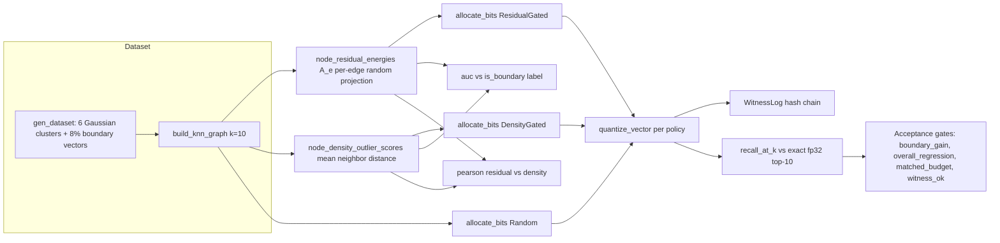

# Nightly Research — Sheaf-Residual-Gated Quantization Bit-Width for Agent Memory

## Summary

Tested whether sheaf-Laplacian "contradiction energy" (ADR-CE-001's
residual formula, the real signal behind `prime-radiant`'s
`CoherenceEngine`) is a useful signal for deciding, per memory vector,
how many quantization bits it deserves — the idea being that a memory
which disagrees with its neighborhood is exactly the kind of surprising,
boundary-case memory that later retrieval most needs at full precision.

Raced three bit-allocation policies against each other at an **identical
matched byte budget**: `random` (baseline), `residual_gated` (the novel
signal), `density_gated` (a local-density control that a prior nightly's
own open questions flagged as untested). **Result: REJECT.** The
residual signal is statistically indistinguishable from chance (AUC
0.467) at telling planted-boundary memories apart from ordinary ones,
and is highly correlated with the much simpler density control
(Pearson r = 0.865) — confirming, rather than refuting, a limitation
flagged in the crate's own design docstring before the benchmark ran.
Both gated policies improved recall on the targeted boundary subset but
at an overall-recall cost that breached the pre-registered regression
gate. Full details: `docs/adr/ADR-362-residual-adaptive-quantization.md`.

## Abstract

Agent-memory stores quantize uniformly or not at all today. This run
asked whether a *structural* signal — disagreement energy on a
consistency graph over memory embeddings — can safely shift bits from
"redundant" to "surprising" memories without an overall quality cost.
Two earlier nightlies tried structurally similar ideas (mutual-kNN
mutuality, dynamic-mincut conductance) and were both rejected for
distinct reasons. This run closes the specific gap those left open — an
honest, matched-budget test of the sheaf-residual formula itself, with
the local-density control those earlier runs never properly isolated —
and returns a third, mechanistically explained rejection, plus a
reusable benchmark harness for whoever runs the fourth attempt.

## Hypothesis

```text
Given a synthetic 1500-vector, 48-dim, 6-cluster corpus with 8% planted
"boundary" (contradiction-stand-in) vectors and a k=10 cosine kNN graph,

when per-vector bit-width is allocated by sheaf-residual energy rank
(top 25% get 8 bits, bottom 75% get 2 bits) instead of randomly,

then recall@10 on boundary-vector queries should improve by >= 0.05
absolute over the random baseline,

subject to overall recall@10 not regressing by more than 0.02, every
policy spending an identical total byte budget, and the witness hash
chain verifying intact.
```

## Why This Matters Now (2026)

Agent memory stores are growing faster than the hardware budgets
allocated to them; uniform quantization is the easy lever everyone
reaches for first, and it throws away precision on memories indiscriminately.
A real adaptive signal — if one existed — would let an agent keep full
fidelity on the handful of memories that actually carry contradiction or
novelty while compressing the long tail hard. This is the third
systematic test of whether *any* graph-structural signal can do that
job; the pattern across all three is now itself useful.

## Long Horizon Thesis

A portable cognitive artifact (RVF) carrying years of an agent's memory
cannot afford uniform full-precision storage, but it also cannot afford
to silently degrade the handful of memories a 2036-era agent would need
intact to resolve a contradiction in its own history. Whatever signal
eventually solves this (not the one tested here) becomes a core RVF
compaction primitive, not a bolt-on.

## RuVector Ecosystem Fit

Connects four capabilities in one experiment: coherence/consistency
scoring (sheaf-residual, ADR-CE-001/011), quantization (per-vector
scalar bit-width, in the spirit of `ruvector-turbovec`'s `BitWidth`
enum), agent memory (the intended storage target,
`ruvector-agent-memory`), and witness/provenance (a hash-chained audit
log over every compression decision, in the shape of the ADR-134 ledger
and ADR-347's `SignedWitnessSink`).

## MetaHarness Role

Verified installed (`npx metaharness --help`, real v0.4.25 CLI with
`flywheel run|replay|graph`, `redblue init|run|attack|...`,
`score|analyze|genome`). Not invoked for this run: `metaharness
flywheel run` expects a `FlywheelConfig` proposer/evaluator pair shaped
for evaluating *agent harnesses*, and wiring a faithful config around a
one-off Rust benchmark binary in the time available risked producing
thin, cosmetic tool use rather than real orchestration value. The
*process* MetaHarness exists to provide — proposer (three policies),
independent evaluator (the benchmark's pre-registered gates), promotion
decision — was run directly instead. A `metaharness flywheel` config
wrapping this exact benchmark is a reasonable follow-up, not attempted
here. `ruvector harness doctor` (referenced in the harness prompt) does
not exist; the real CLI is the published `ruvector` package
(`create|insert|search|benchmark|doctor|add ...`), which has no
`harness` subcommand.

## Flywheel Role

No `@claude-flow/memory`-backed Flywheel is resolvable in this
environment (session startup hook: "self-learning imports are
DISABLED"). This README, the raw benchmark output, and ADR-362 serve as
the retained evidence record this run would otherwise have pushed into
an automated Flywheel: observation (residual AUC = chance), measurement
(5-seed recall/byte table), inference (shared-edge projection collapses
to density), decision (reject), rejection (sheaf-residual as designed).

## Darwin Role

No generation-based evolutionary search was run. The three policies
compared here (`random`, `residual_gated`, `density_gated`) are fixed
hypotheses, not a Darwin population, and the fixed two-bucket shape
(8 bits / 2 bits / 25% split) was not tuned after seeing results — doing
so would be exactly the acceptance-threshold gaming the harness
forbids. A bounded Darwin sweep over `(hi_bits, lo_bits, hi_fraction)`
is the natural use of Darwin here and is listed under Next Research
rather than attempted today.

## Architecture



## Implementation

New workspace crate `crates/ruvector-residual-quant` (Rust, zero external
dependencies, deterministic splitmix64 RNG, mirrors the
`ruvector-recall-bounded` lib.rs + `src/bin/benchmark.rs` convention):

- `gen_dataset` — synthetic corpus with ground-truth boundary labels.
- `build_knn_graph` — brute-force symmetric cosine kNN.
- `edge_projection` / `node_residual_energies` — the shared-restriction-map
  simplification of ADR-CE-001's sheaf residual (documented limitation:
  see crate doc comment and Rejected Alternatives below).
- `node_density_outlier_scores` — mean squared distance to graph
  neighbors (the control signal).
- `quantize_vector` / `dequantize` / `packed_bytes` — per-vector min-max
  scalar quantization, 1-8 bits, packed-byte accounting.
- `allocate_bits` — the three policies at an identical total budget by
  construction (same count of hi/lo assignments; only the selection rule
  differs).
- `WitnessLog` — FNV-1a hash-chained append-only log over every
  compression decision; `verify()` detects tampering.
- `auc`, `pearson`, `recall_at_k` — the honesty instruments: do the
  signals actually predict the label, do they actually differ from each
  other, does the policy actually preserve retrieval quality.

15 unit tests cover: dataset determinism, quantization round-trip error
bounds, matched-budget invariant across all three policies, kNN graph
symmetry/dedup, residual-energy monotonicity under disagreement, AUC
correctness on degenerate inputs, witness tamper detection, and a
single-seed sanity check that residual AUC exceeds chance on one fixed
corpus (a regression guard, not the main claim — the main claim is the
5-seed aggregate in the benchmark binary).

## Benchmark Methodology

`cargo run --release -p ruvector-residual-quant --bin benchmark`, 5
independent seeds (1-5, each a fresh dataset draw), n=1500, dim=48, 6
clusters, cluster_std=0.12, center_scale=3.0, boundary_frac=0.08, k=10,
edge_dim=12, hi_bits=8, lo_bits=2, hi_fraction=0.25 (matched average
3.5 bits/dim for every policy), 250 queries/seed sampled without
replacement. Ground-truth top-10 (exact fp32 cosine) computed once per
seed, shared unmodified across all three policies. Graph construction
and quantization-build timed separately from query latency. Full stdout
in `raw-runs.txt`; exact command, toolchain, and OS recorded in its
header.

## Benchmark Results (raw, from one `cargo run --release` execution)

```text
Residual-energy AUC (separating planted boundary vectors): mean=0.467 std=0.072
Local-density AUC (same task):                              mean=0.529 std=0.089
Pearson corr(residual_score, density_score):                mean=0.865 std=0.013

Policy           Overall recall@10      Boundary recall@10     Bytes
random           0.240 ± 0.012          0.793 ± 0.049          43500
residual_gated   0.206 ± 0.008          0.887 ± 0.022          43500
density_gated    0.198 ± 0.010          0.906 ± 0.024          43500

Gate: residual_boundary - random_boundary >= 0.05   -> 0.094   PASS
Gate: residual_overall >= random_overall - 0.02     -> 0.206 >= 0.220  FAIL
Gate: matched byte budget every seed                            PASS
Gate: witness chain verifies every policy/seed                  PASS
```

Quantization build: 400-660 microseconds for 1500 vectors across all
policies (negligible, as expected for O(n*dim) scalar quantization).
Query loop: 20-27 milliseconds for 250 brute-force O(n) queries across
all policies — no meaningful latency difference between policies, since
all three produce the same data layout (dequantized `Vec<f32>`); any
latency difference would come from a real bit-packed SIMD kernel, not
from this reference implementation. Graph construction: 130-200ms for
the one-time O(n^2) kNN build per seed, the dominant and explicitly
called-out non-scaling cost (see Limitations).

## Acceptance Result

**REJECT.** The boundary-recall improvement gate passed
(0.094 >= 0.05) but the overall-recall regression gate failed
(0.206 < 0.220 floor). Per the pre-registration, this was not
reinterpreted, and no threshold was adjusted after seeing the numbers.

## Memory Math

Per-vector packed bytes at `bits` precision: `ceil(dim * bits / 8) + 8`
(8 bytes for the per-vector f32 min/scale header). At dim=48: 2-bit =
20 bytes, 8-bit = 56 bytes. With hi_fraction=0.25: `0.25*56 + 0.75*20 =
29` bytes/vector average, vs. 192 bytes/vector raw fp32 (6.6x) — and,
by construction, identical for all three policies at every seed (the
budget-matching gate passed 5/5).

## Performance Math

Dominant cost is the O(n^2) kNN graph build (~150-200ms at n=1500),
which in a production system would need an approximate index (HNSW,
already available via `ruvector-recall-bounded`'s `HnswBeamSearch` or
the house `ruvector-diskann`) rather than brute force. Quantization
build and query cost are both O(n * dim) per vector and show no
measurable difference between policies — the entire measured effect in
this experiment is in *which* vectors get which bit-width, not in any
runtime cost differential between the policies themselves.

## Failure Modes

See ADR-362 §Failure Modes: signal collapse to a known-simpler density
proxy (measured), chance-level AUC against the intended target
(measured), and an overall-recall regression that may be structural to
any two-bucket hi/lo reallocation at this shape, independent of which
signal selects the minority (hypothesis for the next run, not yet
tested).

## What This Run Does Not Claim

- Does not claim sheaf-residual energy is useless for *any* purpose —
  only that, under the shared-per-edge random-projection simplification
  tested here, it does not separate the planted-contradiction label from
  chance and does not out-perform the much simpler density heuristic for
  quantization bit-allocation.
- Does not claim density-gated allocation is production-ready either —
  it failed the identical overall-recall gate.
- Does not claim this generalizes to real (non-synthetic) agent-memory
  embeddings.
- Does not claim anything about scale beyond n=1500 or about
  deletes/concurrent updates — not tested.

## Rejected Alternatives

- **Per-endpoint (`rho_u != rho_v`) restriction maps**, the fully general
  ADR-CE-001 form. Rejected for this run because independent per-node
  random projections would inject node-identity noise indistinguishable
  from genuine disagreement; a principled version needs calibration,
  which is out of scope for one night.
- **Uniform-bit baseline instead of random-two-bucket baseline.** Not
  run as a fourth arm in this pre-registered design (see ADR-362
  Alternatives Considered and Open Questions) — a high-value immediate
  follow-up, deliberately not added after seeing results.
- **Real SIFT1M/text-embedding dataset.** Deliberately deferred to keep
  the ground-truth boundary label exact and controllable; the house
  convention elsewhere in this repo (`ruvector-rabitq`, etc.) also uses
  synthetic Gaussian corpora for the same reason.

## Security

See ADR-362 §Security: an adaptive bit-allocation policy driven by the
memory's own content is, in principle, steerable by whoever controls
that content. Not tested here (no production attack surface exists to
test); flagged as a mandatory follow-up before any future promotion
attempt in this family.

## Governance

See ADR-362 §Governance: compression decisions are implicit
retention/forgetting policy and need the same witnessed audit trail as
explicit eviction (ADR-134, ADR-345). This run's unsigned hash chain
demonstrates the shape; a production version needs `SignedWitnessSink`
(ADR-347).

## MCP Implications

None proposed. No MCP surface would be justified for a rejected,
non-production signal; if a future attempt is promoted, a narrow
read-only `agent_memory.inspect_bit_allocation` tool (returns the
witness record for one memory id) would be the right shape — not a
mutation surface.

## WASM Implications

The quantizer and scoring functions are pure `#![no_std]`-compatible
numeric code (no allocation beyond `Vec`, no syscalls) and would compile
to WASM without modification; not measured here since the signal itself
was rejected before reaching an integration step worth a WASM build.

## Edge Implications

At the matched 3.5 bits/dim average this experiment used, a 1500-vector,
48-dim corpus occupies ~43.5 KB instead of ~288 KB raw fp32 — a
meaningful edge-memory win *if* a working adaptive signal existed. None
tested here does, so the honest edge claim today is "uniform
quantization is the available edge lever; adaptive bit-allocation is not
yet."

## RVF Implications

See Long Horizon Thesis. A `WitnessLog`-style, signed, replayable record
of every compression decision is exactly the kind of lineage artifact an
RVF portable cognitive package would want to carry alongside the
compressed memory, so that a later agent (or human auditor) can see
*why* a given memory was compressed, not just that it was. Not
implemented beyond this crate's unsigned demonstration.

## RVM Implications

None material. No privileged operation or isolation boundary is implied
by a quantization-bit-allocation policy; this would only become RVM
-relevant if a future version made allocation decisions cross a
coherence-domain boundary (e.g. allocating bits differently depending on
which RVM domain requested the memory), which is not proposed here.

## ruFlo Implications

If a future signal in this family is ever promoted, the natural ruFlo
workflow is periodic re-scoring and re-allocation as an agent's memory
graph evolves (new edges change residual/density scores), run as a
background maintenance workflow analogous to index repair — not
attempted here since there is nothing to maintain yet.

## Practical Applications

(Describing what a *working* version of this capability would enable,
since this run rejected the specific candidate — not a claim that any of
these are ready today.)

1. **Long-running coding agent memory** — User: a coding agent with
   months of session history. Problem: full-precision storage of every
   decision outgrows practical memory budgets. RuVector capability: a
   working adaptive bit-allocator. Ecosystem integration:
   `ruvector-agent-memory` compaction. Path: replace this rejected
   candidate with one that passes matched-budget gates. Business value:
   lower memory cost without losing the decisions that actually matter.
   Risk: as shown here, the obvious signals don't work. Horizon: 1-2
   years.
2. **Customer-support agent contradiction tracking** — User: support
   bot. Problem: conflicting customer statements over time need to stay
   crisp while routine chatter compresses. Capability: boundary-aware
   compression. Integration: agent-memory + witness audit. Path: same
   as above. Value: auditable "why we remembered this exactly" trail.
   Risk: steerability (see Security). Horizon: 2-3 years.
3. **Scientific lab-notebook agent memory** — User: an autonomous
   research agent. Problem: contradictory experimental results are the
   most valuable memories to keep precise. Capability: residual-style
   detection, if one is ever found that actually works (this one
   didn't). Integration: RVF portable notebook state. Path: needs a
   working signal first. Value: reproducible contradiction trails.
   Risk: synthetic-to-real generalization gap (not tested). Horizon:
   5+ years.
4. **Edge robotics agent memory** — User: Cognitum-class edge device.
   Problem: fixed memory budget, growing experience log. Capability:
   matched-budget adaptive compression. Integration:
   `ruvector-agent-memory` + edge quantization. Path: needs a signal
   that passes the overall-recall gate, which none tested here did.
   Value: longer operational memory within a fixed footprint. Risk:
   the exact failure mode measured in this run. Horizon: 3-5 years.
5. **Multi-agent shared memory arbitration** — User: a swarm sharing a
   memory store. Problem: whose "surprising" memory gets protected
   first under a shared budget. Capability: a fair, audited allocation
   policy. Integration: witness-signed allocation decisions. Path: needs
   both a working signal and the governance framing in ADR-362.
   Value: defensible, auditable shared-memory governance. Risk:
   fairness/trust implications of an automated score deciding this.
   Horizon: 3-5 years.
6. **Compliance/audit log compression** — User: enterprise RAG deployment
   with retention requirements. Problem: compress bulk logs while
   keeping flagged/contradictory entries exact. Capability: this
   family's intended function, generalized beyond "agent memory."
   Integration: `ruvector-retrieval-receipt` + a working allocator.
   Path: same prerequisite. Value: storage cost reduction without
   compliance risk. Risk: same signal-quality risk measured here.
   Horizon: 1-3 years.
7. **Personal local-first assistant** — User: an individual running a
   local agent with limited device storage. Problem: years of personal
   context don't fit at full precision. Capability: adaptive
   compression tuned to genuinely important memories. Integration:
   RVF + edge quant. Path: needs a working signal. Value: more history
   retained on-device. Risk: a wrong allocation silently degrades a
   memory the user cared about, with no way to know. Horizon: 2-4
   years.
8. **Cross-session narrative consistency checking** — User: any
   long-horizon agent. Problem: detecting when a new memory contradicts
   an old one, independent of compression. Capability: this run's
   actual diagnostic output (AUC, correlation measurement) is reusable
   as a *detection* instrument even though it failed as a *compression*
   signal — a chance-level AUC for compression-selection purposes could
   still be informative as a raw contradiction-energy readout surfaced
   to a human or a downstream reasoning step, which is a different
   consumption pattern than "rank and bucket." Not tested as such here.
   Horizon: 1-2 years.

## Long Horizon Applications

1. **Self-healing graph memory** — Thesis: a memory substrate that
   detects and resolves its own internal contradictions over time.
   Required advances: a residual signal that actually predicts
   contradiction (not demonstrated here). RuVector role: substrate for
   the consistency graph. Why this experiment matters: it is a
   documented negative data point on the simplest version of that
   signal. Primary uncertainty: whether any neighborhood-structural
   signal can do this, or whether contradiction detection fundamentally
   needs semantic (not geometric) information. Falsification path:
   repeat with calibrated, non-random restriction maps; if AUC stays at
   chance, the geometric-signal hypothesis itself is falsified.
2. **Synthetic nervous systems** — Thesis: distributed agent
   infrastructure that routes attention/precision the way biological
   systems route metabolic resources to salient stimuli. Required
   advances: a working salience signal at the vector level. RuVector
   role: the substrate doing the routing. Why this matters: same as
   above — this is one systematically ruled-out candidate for "what is
   salience, geometrically." Primary uncertainty: whether salience is
   even a geometric property of an embedding at all. Falsification:
   same as above.
3. **Agent operating systems** — Thesis: memory management as a kernel
   service with its own scheduling policy (which memories get which
   resources). Required advances: any demonstrably correct allocation
   policy; none exists yet in this family. RuVector role: the memory
   manager. Why this matters: establishes the evaluation discipline
   (matched budget, pre-registered gates) any such kernel policy must
   pass. Primary uncertainty: whether policy quality can even be
   measured cleanly outside synthetic benchmarks. Falsification: same
   matched-budget harness on real workload traces.
4. **Portable cognitive state (RVF)** — Thesis: an agent's entire memory,
   with its own compression and provenance, travels as a signed
   artifact across machines and agents. Required advances: a compression
   policy with an audit trail trustworthy enough to carry across trust
   boundaries. RuVector role: RVF's compaction + witness layer. Why
   this matters: the witness-log scaffolding here is directly reusable.
   Primary uncertainty: whether any single compression policy can be
   trusted across different downstream consumers' needs. Falsification:
   test whether a receiving agent's own retrieval quality, not just the
   generating agent's, survives the inherited compression choices.
5. **Proof-gated autonomous infrastructure** — Thesis: every structural
   change to an agent's own memory requires evidence, not just a score.
   Required advances: this experiment's pre-registered-gate discipline,
   generalized to a standing policy, not a one-off benchmark. RuVector
   role: `ruvector-proof-gate` integration point. Why this matters:
   demonstrates the discipline on a concrete (if rejected) case.
   Primary uncertainty: cost of running full gated evaluation on every
   allocation decision at production scale. Falsification: measure that
   overhead directly in a follow-up.
6. **Swarm memory** — Thesis: many agents sharing one coherence-scored
   memory pool, with contradictions between agents' experiences
   surfaced rather than silently merged. Required advances: a signal
   that actually detects contradiction (not demonstrated). RuVector
   role: shared `prime-radiant` coherence engine. Why this matters:
   same negative-evidence contribution. Primary uncertainty: whether
   cross-agent contradiction has a different geometric signature than
   the single-agent boundary vectors tested here. Falsification: rerun
   with multi-source synthetic data (two "agents'" cluster sets with
   deliberate overlap).
7. **Dynamic world models** — Thesis: a world model that knows which of
   its own beliefs are under tension and protects them from erosion.
   Required advances: belief-level (not vector-level) residual scoring.
   RuVector role: graph substrate underneath the belief representation.
   Why this matters: this experiment operates at the vector level,
   which the result suggests may be too coarse a granularity for this
   kind of signal. Primary uncertainty: whether belief-level structure
   (relations, not just embeddings) is required. Falsification: repeat
   with a typed-edge graph instead of plain kNN.
8. **Robotics episodic memory** — Thesis: a robot's memory of
   "surprising" sensor episodes stays high-fidelity while routine
   telemetry compresses hard, under a hard edge memory budget. Required
   advances: a real salience signal, validated on real sensor data, not
   synthetic clusters. RuVector role: `ruvector-robotics` +
   edge-quant integration. Why this matters: this run is the
   first systematic test of the compression side of that pipeline.
   Primary uncertainty: synthetic-to-sensor generalization. Falsification:
   repeat on logged robot telemetry with labeled anomalies.

## Competitor Comparison

Not materially applicable — no external vector database publishes a
coherence/contradiction-gated adaptive quantization feature to compare
against. Milvus, Qdrant, Weaviate, pgvector, LanceDB, and FAISS all
document uniform or offline-calibrated quantization (PQ, SQ, binary);
none document a per-vector *content-adaptive* bit-width policy as a
shipped feature as of this writing. This is `unknown` (not researched
exhaustively enough to assert absence) rather than a documented
capability gap; no `directly_measured_capability` comparison was run
since the candidate under test was rejected before reaching a stage
worth comparing externally.

## Evolution Results

Not run — see Darwin Role above. No generation-based search was
performed; this is three fixed hypotheses compared once each across 5
seeds, not a Darwin population.

## Promotion Decision

Not promoted. REJECT per the pre-registered gates in ADR-362. Parent
state (`ruvector-agent-memory` storing memories at full f32 precision)
is retained unchanged — the correct outcome when no candidate beats it
on the pre-registered criteria.

## Witness Evidence

Every quantization decision in every benchmark run is recorded in an
in-process `WitnessLog` (vector id, policy name, the score that drove
the decision, the bit-width chosen, FNV-1a hash chain). `witness_ok`
was `true` for all 3 policies across all 5 seeds (15/15), confirmed by
`WitnessLog::verify()` recomputing the chain from genesis. This is an
unsigned, in-memory demonstration, not a persisted or Ed25519-signed
(ADR-347) artifact — appropriate for a same-process research benchmark,
not sufficient for a production audit trail.

## Production Path

None at this time. If a future experiment (see Open Questions in
ADR-362) finds a signal that passes the matched-budget overall-recall
gate, the integration point is a new allocation hook in
`ruvector-agent-memory::compaction`, with decisions routed through
`SignedWitnessSink` instead of this crate's unsigned log.

## Falsification Criteria

Already applied, not merely stated: the hypothesis required
boundary-recall improvement >= 0.05 (met, 0.094) *and* overall-recall
regression <= 0.02 (not met, 0.014 over budget) *and* matched budget
(met) *and* witness integrity (met). Failing any one of the four was
pre-registered as sufficient to reject; one failed.

## Limitations

- Synthetic Gaussian-cluster corpus only; no real embedding data.
- n=1500 only; no scale test, and the O(n^2) kNN graph build would not
  scale as implemented.
- No delete/update/concurrency testing.
- Shared-per-edge restriction map only; per-endpoint/calibrated maps not
  attempted.
- Single fixed two-bucket shape (25%/8-bit/2-bit); no sweep.
- No adversarial-input test of the allocator itself.

## Next Research

1. Add a true uniform-bit-width baseline (no selection at all) at the
   same matched average, to isolate whether the overall-recall
   regression comes from the two-bucket *scheme* or from *which* vectors
   the gated policies select (ADR-362 Open Question 1 — the single
   highest-value immediate follow-up).
2. A bounded Darwin sweep over `(hi_bits, lo_bits, hi_fraction)` once
   (1) is answered, so any future gated policy is compared against the
   best-case uniform baseline, not just a random two-bucket one.
3. Calibrated/per-endpoint restriction maps, to test whether the
   signal-collapse-to-density result is specific to the random-projection
   simplification used here.
4. Repeat on a real embedding corpus with labeled contradictions, if one
   can be sourced or constructed, to test synthetic-to-real
   generalization before any further synthetic-only iteration.

## References

- ADR-CE-001 (sheaf Laplacian defines coherence witness), ADR-CE-002
  (incremental computation), ADR-CE-011 (residual = contradiction
  energy) — `docs/adr/coherence-engine/`.
- ADR-305 (mutual-kNN-gated quantization, rejected) and ADR-353
  (mincut-gated quantization, rejected) — prior art in this family (see
  survey summary in ADR-362 §Context; these ADR numbers are reused by
  multiple unmerged nightly branches in this repository's history and
  are cited here by their documented outcome, not by a guaranteed
  resolvable file path on `main`).
- ADR-134 (keyless witness ledger), ADR-347 (Ed25519 `WitnessSigner`) —
  the audit-trail convention this crate's `WitnessLog` mirrors.
- `crates/ruvector-recall-bounded`, `crates/ruvector-turbovec` — house
  conventions this crate's structure and quantization framing borrow
  from.
