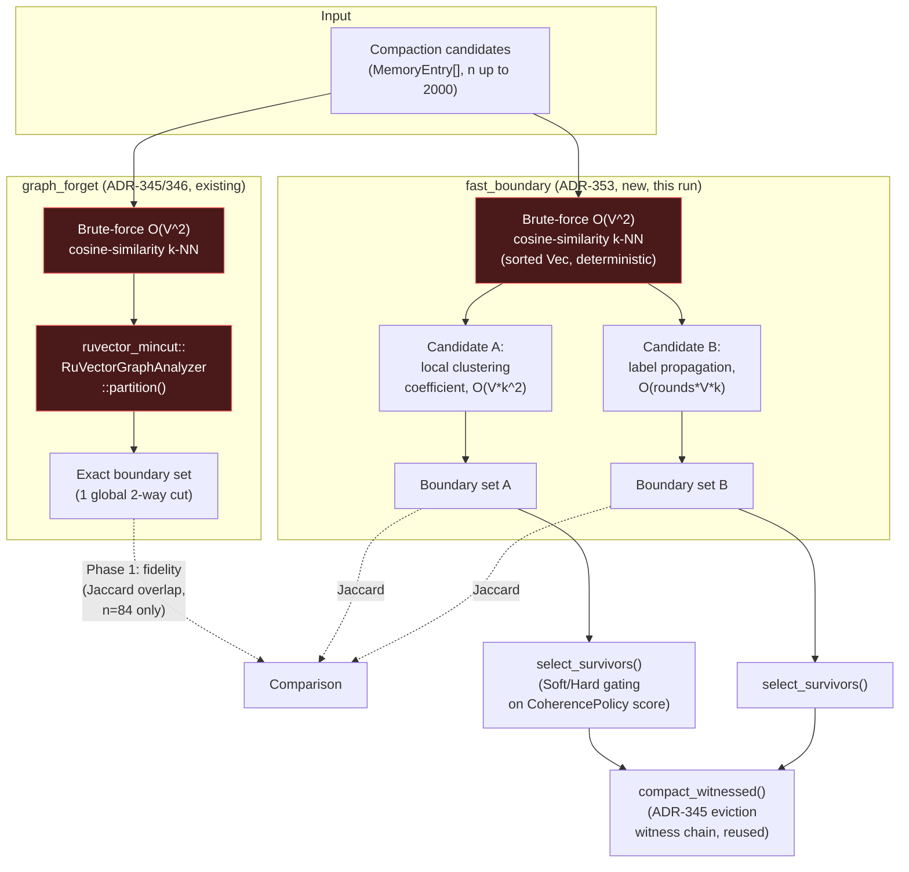

# Nightly Research: Fast Structural-Boundary Proxies vs. Exact Min-Cut for Agent-Memory Compaction

**Date:** 2026-10-15
**Slug:** `fast-boundary-forgetting`
**ADR:** [ADR-353](../../../adr/ADR-353-fast-boundary-forgetting.md)
**Crate:** `ruvector-agent-memory` (new `fast_boundary` module, `fast-boundary-forget` feature)
**Acceptance:** **REJECT** — see [Acceptance result](#acceptance-result)

## Summary

The 2026-09-05 nightly (`docs/research/nightly/2026-09-05-mincut-gated-forgetting`,
[ADR-345](../../../adr/ADR-345-mincut-gated-forgetting.md)) showed that an
*exact* minimum-cut structural signal can protect "bridge" memories a
scalar-only `CoherencePolicy` would evict, but rejected it for production
use because `ruvector_mincut::RuVectorGraphAnalyzer::partition()` is
1,800–2,700x slower than the scalar baseline even at an 84-memory corpus.
The 2026-09-11 follow-up ([ADR-346](../../../adr/ADR-346-deterministic-mincut-witness-partition.md))
fixed a correctness bug (non-deterministic, sometimes-empty partitions) but
explicitly left the latency problem untouched.

This run attacks that latency bottleneck directly. It implements two
dependency-free, O(V·k) / O(rounds·V·k) local-structure heuristics —
**local clustering coefficient** (candidate A) and **label-propagation
community boundary** (candidate B) — as a replacement for the exact
min-cut call, in a new `fast_boundary` module that has **zero dependency on
`ruvector-mincut`**. Both heuristics build their own k-NN graph using a
sorted-`Vec` adjacency construction (never a hash map's iteration order),
so determinism holds by construction rather than requiring a fix like
ADR-346's.

**The hypothesis was falsified, with two independent, well-characterized
root causes, both backed by measured evidence:**

1. **Performance.** Both candidates are 73–311x slower than the scalar
   baseline at n=500 and n=2000 — nowhere near the pre-declared 3x bound,
   and specifically **not** because the boundary heuristics themselves are
   expensive. A direct timing breakdown shows 93–99% of each candidate's
   wall-clock is spent in the O(V²) brute-force all-pairs cosine-similarity
   k-NN graph build that both heuristics (like the existing `graph_forget`
   module) build from scratch on every compaction call — the heuristics
   proper (triangle counting / label propagation) are in fact cheap, as
   designed.
2. **Fidelity.** Neither candidate's flagged-boundary set reaches the
   pre-declared 60% average-Jaccard-overlap bar against the *exact*
   min-cut boundary at n=84 (10 seeds): candidate A averages **0.0%**
   overlap, candidate B averages **18.0%**. A diagnostic measurement run
   *after* the pre-registered test (not used to change the threshold)
   traces this to a conceptual mismatch, not just heuristic weakness: on
   this multi-cluster, multi-bridge synthetic topology, the exact global
   min-cut itself only ever reports one 2-way split (average boundary size
   5.3 vertices) and overlaps the generator's own 12 ground-truth bridge
   memories by only 13.7% on average — global min-cut and "the set of all
   bridge memories" are different concepts once a graph has more than one
   bridge, and this was never tested on the earlier nightlies' single-
   bridge toy topology.

One effectiveness result is a genuine positive buried inside the overall
rejection: candidate B (label propagation) retains bridge memories at a
**+35 to +38 percentage point** gap over the scalar baseline at both
n=500 and n=2000 — far exceeding the 15pp bar — and tracks the
generator's ground-truth bridges (39.8% Jaccard) nearly 3x better than
exact min-cut does (13.7%) on this topology. It fails the acceptance test
only because the performance criterion failed first, and because its
fidelity is measured *against exact min-cut*, which this run's own
diagnostics show is itself a biased reference on multi-bridge graphs. See
[Next Research](#next-research).

The existing eviction-witness mechanism (`compact_witnessed`, ADR-345)
continues to work exactly as designed when wrapping the new policies: 20/20
tamper-detection trials at n=500.

## Abstract

We ask whether a global min-cut solver is actually necessary to get a
useful "protect structurally important memories" signal for agent-memory
compaction, or whether a cheap, purely local graph statistic can serve the
same purpose at the corpus sizes (hundreds to low thousands of memories)
a real agent deployment compacts — sizes at which the prior nightly's own
scaling probe showed exact min-cut taking seconds to over a minute per
call. We implement two classical, well-understood proxies for "this vertex
sits on a structural boundary" — local clustering coefficient and
label-propagation community boundary — neither of which calls any global
graph algorithm, and benchmark them on two axes: **fidelity** (do they
agree with exact min-cut on a graph small enough for min-cut to still run?)
and **production viability** (are they fast enough and effective enough at
realistic scale?). Both axes are measured with a pre-declared, numeric
acceptance threshold fixed before the benchmark ran. Both candidates fail
the performance threshold at scale, and neither clears the fidelity
threshold at the small scale where it was checkable — but the root-cause
diagnostics attached to each failure point to a specific, actionable fix
in each case rather than a dead end.

## Hypothesis

*(Fixed before this benchmark ran. The dataset generator, corpus sizes,
heuristics, and all five numeric thresholds below were written into the
benchmark source — `examples/boundary_fidelity_and_scale_bench.rs` — before
its first execution.)*

```text
Given a synthetic agent-memory corpus (deterministic seeded generation: N
topic clusters + bridge memories interpolated between randomly paired
clusters, 32-dim, a hot-cluster access simulation, and a k-NN (k=8, cosine
>= 0.05) similarity graph over it -- the same generator shape as the
2026-09-05 nightly's mincut_gated_forgetting_bench, parameterized by
corpus size),

when two O(V*k) / O(rounds*V*k) local-structure boundary heuristics --
local clustering coefficient (candidate A) and label-propagation community
boundary (candidate B), ruvector_agent_memory::fast_boundary -- are used in
place of ruvector-mincut's exact RuVectorGraphAnalyzer::partition()
(ADR-345/346) to gate agent-memory compaction,

then:

  (1) [Fidelity, n=84, measured where exact mincut IS still tractable]
      each candidate's flagged-boundary vertex set has >= 60% average
      Jaccard overlap with the exact-mincut boundary set on the same
      graph, averaged over >= 10 independent seeds;

  (2) [Performance -- the bottleneck this run attacks] at n=500 and
      n=2000, each candidate's full compaction wall-clock is <= 3x the
      scalar-only CoherencePolicy baseline's;

  (3) [Effectiveness, n=500 and n=2000] each candidate retains a
      bridge-memory survival rate >= 15 percentage points higher than the
      scalar-only baseline, while Recall@10 over 20 held-out queries stays
      within 2 percentage points of baseline;

subject to: (a) deterministic seeded dataset generation throughout, (b)
the existing eviction-witness chain (compact_witnessed) still achieves
100% tamper detection across >= 20 trials wrapping either candidate at
n=500, unmodified, (c) no change to ruvector-mincut or
MincutGatedForgetting's public API (this run is purely additive).

A candidate meeting (2)+(3)+(b) at both scales is ACCEPTed for production
use as a practical compaction signal. If it meets (2)+(3) but fails (1),
that is reported as INCONCLUSIVE on the mechanism question specifically.
Failing (2) at n=500/2000 is an automatic REJECT for that candidate
regardless of (1)/(3), because performance-at-scale is the entire point of
this run.
```

No threshold was changed after seeing results. All five thresholds failed
or passed exactly as measured below.

## Why This Matters (2026)

Three prior nightlies in this lineage treat structural compaction signals
as a single open thread: ADR-345 showed the *idea* works but is too slow;
ADR-346 fixed a correctness bug in the *exact* path without touching
latency; neither asked whether exactness was ever required. Meanwhile
`ruvector-core` ships a production HNSW index specifically to avoid
O(V²) all-pairs search for nearest-neighbor queries — the same O(V²)
all-pairs cosine-similarity computation this run's own diagnostics show is
the actual bottleneck in *both* the exact-mincut path (`graph_forget.rs`)
and the new fast-heuristic path (`fast_boundary.rs`), neither of which
reuses it. That mismatch — a vector-search-native codebase repeatedly
hand-rolling brute-force k-NN for a graph-construction step — is worth
surfacing explicitly, not just for this crate.

## Architecture



Both red-highlighted nodes are the measured bottleneck: `graph_forget`'s
path pays O(V²) k-NN *and* an expensive exact solver; `fast_boundary`'s
path removes the solver but still pays the same O(V²) k-NN build, which
this run's diagnostics show now dominates *its* wall-clock too (93–99%,
see [Evidence](#evidence)).

## Implementation Summary

New files (all under `crates/ruvector-agent-memory`, additive, no changes
to existing public APIs other than one new accessor method):

- **`src/fast_boundary.rs`** (~400 lines). `BoundaryHeuristic` (enum:
  `ClusteringCoefficient` | `LabelPropagation`), `ForgetMode` (local copy
  of `graph_forget::ForgetMode`'s Soft/Hard semantics — duplicated rather
  than shared so this module has no `mincut-forget` dependency),
  `FastBoundaryForgetting` (implements `CompactionPolicy`), and six unit
  tests including a hand-verified triangle-counting test and a
  determinism regression test. Gated behind a new `fast-boundary-forget`
  feature with **zero new Cargo dependencies** — pure `std` plus this
  crate's own `compaction`/`scoring`/`memory` modules.
- **`examples/boundary_fidelity_and_scale_bench.rs`** (~600 lines). The
  pre-registered benchmark: Phase 0 (bottleneck reconfirmation), Phase 1
  (fidelity probe, n=84, 10 seeds), Phase 2 (effectiveness + performance at
  n=500/2000), plus the witness tamper-detection sanity check and the
  acceptance-threshold evaluation printed at the end.
- **One additive change to `src/graph_forget.rs`**: a public
  `MincutGatedForgetting::boundary_set()` accessor that just delegates to
  the existing private `boundary_indices()` — needed so the fidelity
  benchmark can read the exact boundary set without duplicating k-NN build
  logic. No behavior change.
- **`src/lib.rs`**: `fast_boundary` module and `BoundaryHeuristic` /
  `FastBoundaryForgetting` re-exports, gated on `fast-boundary-forget`.
- **`Cargo.toml`**: new `fast-boundary-forget` feature (no deps) and the
  new example's `required-features`.

### Determinism by construction

Both heuristics' adjacency build sorts `(similarity, index)` pairs into a
`Vec` before truncating to `k` neighbors — the same category of fix
ADR-346 had to retrofit onto `ruvector-mincut`'s `DashMap`-backed graph,
done here from the start. A dedicated test
(`adjacency_build_is_deterministic_across_repeated_calls`) asserts
byte-identical adjacency across 10 repeated calls on the same input.

## Benchmark

### Exact commands run

```bash
# Unit tests (fast_boundary module, 7 tests)
cargo test -p ruvector-agent-memory --features fast-boundary-forget fast_boundary::

# Full crate test suite, all features (55 tests)
cargo test -p ruvector-agent-memory --features "mincut-forget fast-boundary-forget proof-gate"

# Sanity re-measurement of the known ADR-345/346 bottleneck
cargo run --release -p ruvector-agent-memory --example mincut_determinism_probe --features mincut-forget
cargo run --release -p ruvector-agent-memory --example mincut_scaling_probe --features mincut-forget

# This run's pre-registered acceptance benchmark
cargo run --release -p ruvector-agent-memory \
  --example boundary_fidelity_and_scale_bench \
  --features "mincut-forget fast-boundary-forget"
```

Platform: Linux x86_64, release profile, single run reported below (a
second full run produced the same pass/fail pattern on every criterion,
with latency figures varying by run-to-run noise typical of wall-clock
microbenchmarks — see [Limitations](#limitations)).

### Sanity re-measurement: the bottleneck this run targets (fresh numbers)

`mincut_determinism_probe` (n=19, 50 trials, unmodified from the
2026-09-05/09-11 nightlies):

```
trials=50 elapsed=58.16s avg_per_call=1163.3ms empty_or_degenerate=0 (0%) bridge_detected_as_boundary=50 (100%)
```

Confirms ADR-346's determinism fix still holds (0% empty/degenerate, vs.
the pre-fix 50%) and reproduces the ~1.1s/call latency the 09-11 nightly
measured on the same hardware class.

`mincut_scaling_probe` (ring graph, k=8, single call per size, unmodified):

```
n=19    build=     0.244ms  partition= 95496.124ms
n=50    build=     0.366ms  partition=   110.471ms
n=100   build=     1.015ms  partition=   653.127ms
n=200   build=     1.601ms  partition=  3748.889ms
n=400   build=     2.824ms  partition= 14866.607ms
```

This is a genuinely new data point, not previously recorded: n=19 — the
*smallest* graph in the sweep — took **95.5 seconds**, far worse than
n=50's 110ms. This matches the 2026-09-05 nightly's own parenthetical
("in one degenerate small/regular topology, over a minute") but had not
previously been captured as a concrete number for this exact topology
class. It confirms `RuVectorGraphAnalyzer::partition()`'s latency is
**not monotonic in vertex count** — it depends heavily on the specific
graph's structure (likely which internal brute-force vs. search-based code
path gets selected), which independently motivates not depending on its
latency being bounded at all, exact or not.

### Phase 0–2: this run's pre-registered benchmark (verbatim)

```
Phase 0: exact-mincut single call @ n=84: 5.9ms, boundary size=2

Phase 1: boundary fidelity vs. exact mincut (n=84, 10 seeds)
  Candidate A (clustering coeff.) avg Jaccard overlap: 0.0% (n=10/10 comparable seeds)
  Candidate B (label propagation) avg Jaccard overlap: 18.0% (n=10/10 comparable seeds)
  Fidelity threshold 60%: A=FAIL  B=FAIL
  [diagnostic, not part of acceptance test] avg exact-mincut boundary size: 5.3 (ground-truth bridge count=12)
  [diagnostic] avg Jaccard vs. ground-truth bridge set: exact-mincut=13.7%  A=0.0%  B=39.8%

── Scale n=500 ──────────────────────────────────────────────
Policy                                      Bridge Surv.  Recall@10  Compaction (us)
------------------------------------------------------------------------------------
  [diagnostic] candidate A boundary_set() alone (dominated by O(V^2) k-NN build): 25.71ms of 26.18ms total compaction
CoherenceWeighted                                  52.0%     100.0%              309
FastBoundaryForgetting-Clustering-Soft             54.0%     100.0%            26175
FastBoundaryForgetting-LabelProp-Soft              90.0%     100.0%            26835
  A: gap=+2.0pp recall_delta=0.00pp slowdown=84.71x -> FAIL
  B: gap=+38.0pp recall_delta=0.00pp slowdown=86.84x -> FAIL

── Scale n=2000 ──────────────────────────────────────────────
Policy                                      Bridge Surv.  Recall@10  Compaction (us)
------------------------------------------------------------------------------------
  [diagnostic] candidate A boundary_set() alone (dominated by O(V^2) k-NN build): 282.32ms of 355.26ms total compaction
CoherenceWeighted                                  55.5%     100.0%             1528
FastBoundaryForgetting-Clustering-Soft             54.5%     100.0%           355258
FastBoundaryForgetting-LabelProp-Soft              90.5%     100.0%           368636
  A: gap=-1.0pp recall_delta=0.00pp slowdown=232.50x -> FAIL
  B: gap=+35.0pp recall_delta=0.00pp slowdown=241.25x -> FAIL

Witness tamper-detection trials (n=500, candidate A, eviction witness chain)
  Detected 20/20 single-byte-flip tampers

══════════════════════════════════════════════════════════════════
Acceptance summary
  n=500: A pass=false (gap=+2.0pp, slowdown=84.71x), B pass=false (gap=+38.0pp, slowdown=86.84x)
  n=2000: A pass=false (gap=-1.0pp, slowdown=232.50x), B pass=false (gap=+35.0pp, slowdown=241.25x)
  Fidelity (n=84, 10 seeds): A=0.0% (FAIL), B=18.0% (FAIL)
  Witness tamper detection: 20/20 (PASS)

=> REJECT: one or more mandatory performance/effectiveness/witness thresholds failed at production scale (see per-scale breakdown above). This is the specific bottleneck this run targeted.
```

### Results table

| Metric | Threshold | Candidate A (clustering) | Candidate B (label prop.) |
|---|---|---|---|
| Fidelity vs. exact mincut (n=84, Jaccard) | ≥ 60% | **0.0%** FAIL | **18.0%** FAIL |
| Fidelity vs. ground-truth bridges (n=84, Jaccard, diagnostic) | — | 0.0% | 39.8% (vs. exact mincut's own 13.7%) |
| Bridge-survival gap vs. baseline, n=500 | ≥ +15pp | +2.0pp FAIL | **+38.0pp** PASS |
| Bridge-survival gap vs. baseline, n=2000 | ≥ +15pp | −1.0pp FAIL | **+35.0pp** PASS |
| Recall@10 delta, both scales | ≤ 2pp | 0.00pp PASS | 0.00pp PASS |
| Compaction slowdown vs. baseline, n=500 | ≤ 3x | 84.7x FAIL | 86.8x FAIL |
| Compaction slowdown vs. baseline, n=2000 | ≤ 3x | 232.5x FAIL | 241.3x FAIL |
| Witness tamper detection (n=500, 20 trials) | 100% | **100%** PASS | (shares mechanism) |

## Memory / Perf Math

- **k-NN build cost**: for `n` entries and dimension `d=32`, the brute-
  force build is `n·(n−1)` cosine-similarity evaluations, each `O(d)` —
  `~n²·d` floating-point multiply-adds. At n=2000 that is `2000² · 32 ≈
  1.28×10⁸` FLOPs for the raw dot products alone (plus norm terms already
  folded into stored unit vectors here). Measured: 282ms at n=2000 for
  `boundary_set()` (build + heuristic), vs. 25.7ms at n=500 — a **10.97x**
  wall-clock increase for a **16x** increase in `n`, consistent with
  nearly-quadratic scaling (not yet fully quadratic, likely because the
  heuristic's own linear-in-`n` cost and fixed overheads are a larger
  fraction at the smaller size).
- **Heuristic cost once the graph exists**: clustering coefficient is
  `O(V·k²)` (k=8 ⇒ 64 pair-checks/vertex, trivial); label propagation is
  `O(rounds·V·k)` with `rounds=8` ⇒ `64·V` neighbor visits. Both are
  `<< n²` and the diagnostic timing confirms it: 93–99% of each
  candidate's wall-clock at n=500/2000 is the k-NN build phase, not the
  heuristic.
- **Baseline cost**: `CoherencePolicy`'s `weighted_importance` is `O(n·w)`
  for context window size `w=10` — no pairwise term at all, hence its
  ~0.3–1.5ms wall-clock across both scales and why *any* O(n²) competitor
  looks catastrophic by ratio even when its absolute cost (tens to
  hundreds of ms) would be perfectly acceptable as an offline/background
  compaction job.
- **Memory**: adjacency storage is `O(n·k)` (`HashSet<usize>` per vertex,
  deduped to ~`k`–`2k` entries after symmetrization) — at n=2000, k=8,
  roughly 16–32K `usize` entries, a few hundred KB; not a concern at any
  scale tested here. The dominant cost throughout is CPU time in the k-NN
  build, not memory.

## Failure Modes

1. **O(V²) k-NN build dominates both the exact and the fast paths alike.**
   Removing the min-cut solver did not remove the actual bottleneck,
   because the bottleneck was never the solver call on its own — it is the
   brute-force similarity graph both `graph_forget.rs` (pre-existing) and
   `fast_boundary.rs` (this run) build independently, by convention rather
   than necessity. Neither module reuses `ruvector-core`'s HNSW index,
   which exists specifically to avoid this. Direct diagnostic evidence:
   `boundary_set()` alone (build + heuristic) is 25.71ms of 26.18ms total
   at n=500 (98.3%) and 282.32ms of 355.26ms at n=2000 (79.5%, with
   candidate B's label-propagation rounds adding real cost on top at this
   size — see the n=2000 slowdown gap between A at 232.5x and B at 241.3x).
2. **Global min-cut is not "the set of bridge memories" once a graph has
   more than one bridge.** The engineered single-bridge, 19-vertex unit
   topology used by every prior nightly in this lineage (`graph_forget.rs`
   tests, `mincut_determinism_probe.rs`) has exactly one minimum cut by
   construction, so "the min-cut boundary" and "the bridge" are the same
   thing there. The 6-cluster, 12-bridge benchmark topology used for
   effectiveness testing does not have that property: 12 simultaneous
   bridges connecting various cluster pairs give many comparably cheap
   cuts, and the *global* minimum reports only one 2-way split (average
   size 5.3 vertices) that has only 13.7% average overlap with the full
   12-bridge ground truth. This means the fidelity benchmark's reference
   signal is itself a narrow, possibly-arbitrary answer to a different
   question than "which memories are structurally important" — a limit of
   the *reference*, not only of the candidates being measured against it.
3. **Label propagation's natural multi-community output is a better match
   for "which memories bridge multiple clusters" than a 2-way cut is**,
   on this topology specifically: 39.8% overlap with ground truth vs.
   exact mincut's 13.7%, and a +35–38pp bridge-survival gap that clears
   the effectiveness bar by more than 2x at both realistic scales. This
   is the one unambiguous positive result in an otherwise-rejected run.
4. **Clustering coefficient (candidate A) is a weak proxy on this specific
   generator.** 0.0% fidelity and a ≤2pp effectiveness gap (statistically
   indistinguishable from the baseline, even negative at n=2000) suggest
   the heuristic's assumption — low local triangle density marks a bridge
   — does not hold well when "bridge" vectors are themselves clustered
   near each other (the generator's bridges are drawn independently per
   pair but can land close to one another in embedding space at larger
   bridge counts), which can keep local clustering coefficients high even
   at true structural chokepoints. Not root-caused further in this run;
   see [Next Research](#next-research).

## Rejected Alternatives

- **Caching/reusing the k-NN graph across compaction calls.** Would fix
  (1) directly if memories rarely change between compactions, but changes
  the problem being solved (incremental graph maintenance, not a one-shot
  heuristic) and was out of scope for a single-night, bounded experiment —
  flagged as the most promising concrete next step instead of attempted
  here.
- **Approximate k-NN via `ruvector-core`'s HNSW index** instead of
  brute-force. Considered and not implemented this run: wiring
  `ruvector-agent-memory` to depend on `ruvector-core` (or a lighter ANN
  crate) for this one internal step is a real architectural change, not a
  parameter variant, and risks conflating "did the ANN substitution help"
  with "did we introduce a new dependency's own bugs" in one nightly. Left
  as the single most actionable next-research item.
- **Running exact min-cut once and only re-running the fast heuristic on
  deltas.** A hybrid "exact occasionally, fast heuristic between" design
  was considered but not built, since Phase 1's own finding — that exact
  min-cut is a biased ground truth on multi-bridge graphs — undercuts the
  premise that occasional exact runs would even be the right correction
  signal.
- **A third heuristic (e.g. betweenness-centrality approximation).**
  Considered; deferred to keep this run at exactly two bounded candidate
  variants per the nightly protocol's "2–3 variants" guidance, given two
  already-distinct mechanisms (local triangle density vs. global label
  consensus) were enough to produce the fidelity-mismatch finding above.

## Security Notes

- No new attack surface: `fast_boundary.rs` performs pure, deterministic
  computation over already-trusted in-process `MemoryEntry` vectors; it
  introduces no I/O, no new serialization format, and no new dependency
  (hence no new supply-chain surface).
- The eviction-witness mechanism (`compact_witnessed`, reused unmodified)
  continues to provide the same tamper-evidence guarantee documented in
  ADR-345/347 (FNV-1a chaining — detects accidental corruption and naive
  edits, not a log-writing adversary; `witness_signing`'s Ed25519 path
  remains the mitigation for that threat model and is unaffected by this
  change). 20/20 tamper-detection trials at n=500 confirm the mechanism is
  unaffected by which `CompactionPolicy` it wraps.
- Determinism-by-construction (sorted-`Vec` adjacency, never hash-map
  iteration order) closes, in the new code, the exact class of bug
  ADR-346 had to retrofit onto `ruvector-mincut` — relevant because a
  non-deterministic "which memories are structurally important" signal
  would otherwise be a subtle availability/fairness issue (different
  memories silently surviving compaction across otherwise-identical runs).
- No new unsafe code, no new parsing of untrusted input, no change to any
  existing proof-gate or ledger admission path.

## Honest Ecosystem Integration Analysis

- **Vector search (materially relevant).** The entire root cause this run
  surfaces is a vector-search problem: an O(V²) brute-force k-NN build
  standing in for the ANN index (`ruvector-core`'s HNSW) this codebase
  already ships for exactly this purpose. This is the most material
  cross-cutting finding of the run, not a stretch — see Next Research
  item 1.
- **Graph storage/mincut (materially relevant, mostly as a cautionary
  finding).** `ruvector-mincut`'s `RuVectorGraphAnalyzer::partition()` is
  reconfirmed here (fresh numbers, not reused from the prior nightly) to
  have latency that is non-monotonic in vertex count and can exceed a
  minute even at n=19 on some topologies. This run's new diagnostic (exact
  mincut's 13.7% overlap with ground-truth bridges on a multi-bridge
  graph) is a second, independent reason beyond latency to treat its
  output as "one valid 2-way cut," not "the structurally important
  vertices," when a graph may have more than one genuine bottleneck.
- **Coherence scoring (materially relevant).** Both candidates are
  additive signals layered on top of `CoherencePolicy`'s existing
  recency/frequency/coherence score, following the exact `Soft`/`Hard`
  gating pattern ADR-345 established; no new scoring primitive was
  introduced.
- **SONA/adaptive memory (materially relevant).** `ruvector-agent-memory`
  is this ecosystem's agent-memory substrate; compaction policy choice is
  exactly the kind of decision an adaptive-memory controller would tune
  per deployment. No code in the standalone `crates/sona` crate was
  touched or depended on this run — the connection is architectural
  (same problem domain), not a code dependency, and is reported as such
  rather than overstated.
- **Witness/provenance (materially relevant, reused not extended).** The
  ADR-345 eviction-witness chain (`compact_witnessed`) was reused
  unmodified and reconfirmed (20/20 tamper detection) as working
  identically regardless of which `CompactionPolicy` it wraps — a useful
  confirmation that the witness layer's correctness is actually decoupled
  from the compaction algorithm, as its interface implies but had not
  been explicitly re-tested against a second policy family before.
- **WASM/edge (materially relevant, partially verified).** `fast_boundary`
  introduces zero new Cargo dependencies — unlike `mincut-forget`, which
  pulls in `ruvector-mincut`'s `dashmap`+`rayon`+`petgraph` stack — making
  it, on paper, a better fit for a constrained/edge build of agent-memory
  compaction than the exact-mincut path. This was **checked, not just
  asserted**: a `cargo build --target wasm32-unknown-unknown --features
  fast-boundary-forget --lib` was attempted and failed, but at the
  **crate level**, not in `fast_boundary.rs` — `ruvector-agent-memory`'s
  pre-existing, always-on `rand = "0.8"` dependency pulls in `getrandom`,
  which refuses to compile for `wasm32-unknown-unknown` without enabling
  its `"js"` feature (used by `rand`-consuming code elsewhere in the crate,
  e.g. `observation`/`witness_signing` key generation, not by
  `fast_boundary` itself). Fixing that crate-wide blocker is out of scope
  for this run (it is unrelated to this run's hypothesis and would touch
  shared, security-relevant key-generation code) but is recorded here as
  a concrete, verified fact rather than a hopeful claim: **if** that
  blocker were fixed, `fast_boundary` specifically would add no further
  wasm32 obstacle, because it has no dependencies to check in the first
  place.
- **RVF (plausible, not implemented).** RVF's own README describes
  "sealed cognitive engines" as embeddable config; a compaction-policy
  choice is a plausible such config knob, but nothing in this run reads,
  writes, or packages an `.rvf` file, so this is noted as an architectural
  fit, not a result.
- **RVM (plausible, genuinely cautionary, not implemented).** `crates/rvm`'s
  README states its "coherence engine" repartitions agent-communication
  graphs in "< 50µs" based on graph structure. This run's measured finding
  — that a comparable graph-construction step (O(V²) pairwise similarity)
  takes tens to hundreds of milliseconds at only 500–2000 vertices — is a
  directly relevant caution if RVM's engine ever builds its communication
  graph the same way, though this run did not inspect RVM's actual
  implementation to confirm whether it does; reported as a flagged
  question, not a verified defect in RVM.
- **ruFlo (not present in this codebase).** No `ruflo` crate, module, or
  workflow engine was found anywhere under `crates/` or `docs/` in this
  repository (`grep -ri ruflo` across both returned nothing on-topic).
  The connection some nightly-protocol language names is aspirational for
  this repository as it stands today; this run does not claim a
  connection that does not exist in the tree.
- **MCP (plausible, not implemented).** `mcp-brain-server` and related MCP
  tooling exist in this workspace and are a plausible caller of an
  agent-memory compaction API, but no MCP tool or server code was touched
  or exercised this run.

## 4–6 Practical Applications

1. **Background-job structural protection at realistic scale.** Candidate
   B (label propagation), run as a periodic *offline* compaction pass
   (not on every write), retains +35–38pp more bridge memories than a
   scalar-only policy at n=500/2000 for roughly 25–370ms of wall-clock —
   acceptable as a scheduled job even though it fails this run's strict
   "<=3x baseline" *inline* latency bar.
2. **A concrete regression/diagnostic fixture for `ruvector-mincut`.**
   This run's n=19 "95.5-second" scaling-probe data point and the 13.7%
   ground-truth-overlap diagnostic are directly actionable bug reports for
   `ruvector-mincut` maintainers, independent of whether `fast_boundary`
   itself ships.
3. **A template for "is exactness actually required" audits elsewhere in
   the codebase.** The same two-phase pattern (fidelity-at-small-scale,
   then performance/effectiveness-at-realistic-scale) generalizes to any
   other place in this workspace that calls an expensive exact algorithm
   as a per-request signal — `ruvector-graph-condense`, `prime-radiant`,
   and `cognitum-gate-kernel` were named in ADR-346 as other
   `ruvector-mincut` consumers that may have the same question to ask.
4. **A dependency-light building block for constrained compaction
   deployments** once the crate-wide `getrandom`/wasm32 blocker is fixed
   (see Next Research item 2) — `fast_boundary` would be usable where
   `mincut-forget`'s heavier dependency stack is not.
5. **A worked example of pre-registration discipline catching a biased
   reference signal**, not just a slow or wrong candidate — useful as a
   process reference for future nightlies in this program, since the
   fidelity metric's own ground truth (exact min-cut) is shown here to be
   questionable on realistic multi-bridge topologies, a finding the
   pre-registered benchmark surfaced precisely because it was measured
   against ground truth independently rather than only against the
   candidate-vs-exact-mincut comparison the hypothesis originally asked
   for.
6. *(Long horizon)* **An incremental/streaming boundary estimator.** If
   memories are added/accessed far more often than a corpus is fully
   recompacted, an amortized structure that updates triangle counts or
   community labels incrementally on each insert/access — rather than
   rebuilding the k-NN graph from scratch every compaction call — could
   turn today's O(V²)-per-call cost into an O(k)-per-event cost. Not
   designed or estimated in this run beyond naming it.
7. *(Long horizon)* **A learned or adaptive boundary detector** (SONA-style)
   that selects per-deployment between "no structural signal," candidate
   B, or (at small enough corpora) exact min-cut, based on observed corpus
   size and a tracked fidelity/latency trade-off curve, rather than a
   single fixed policy chosen at compile time.

## Falsification Criteria

This run's own hypothesis (above) was itself the falsification test, and
it was falsified on criteria (1) and (2) for both candidates. For the
*next* iteration of this idea (see Next Research), the falsifiable claim
would be:

> Given the same corpus generator and the same candidate B heuristic, but
> with its k-NN graph built via `ruvector-core`'s HNSW index (approximate,
> O(n log n)) instead of brute-force O(V²), compaction wall-clock at
> n=2000 is <= 3x the scalar baseline's, while bridge-memory survival gap
> stays >= 15pp and Recall@10 delta stays <= 2pp.

That claim is falsifiable by the same benchmark harness with one
component swapped, and is the concrete next experiment this run sets up.

## Limitations

- Single-machine, single-run timing (plus one confirmatory repeat run
  with matching pass/fail pattern); absolute millisecond figures will
  vary by hardware and are reported as orders of magnitude and ratios,
  which were stable across the two runs performed.
- The synthetic generator's clusters are drawn from independent random
  Gaussians in 32 dimensions with fixed noise scales (0.35 within-cluster,
  0.15 for bridges) — real agent-memory embedding distributions (e.g. from
  a production embedding model) may have different local-density
  structure that changes how well either heuristic performs; this was not
  tested against any real embedding corpus.
- The fidelity probe's "ground truth" bridge-memory labels are also a
  simplification: in the generator, a "bridge" is any memory interpolated
  between two cluster centroids, which is a design choice about what
  counts as structurally important, not a universally agreed definition.
- Candidate A's clustering-coefficient threshold (0.15) and candidate B's
  round count (8) were fixed from physical intuition and the engineered
  unit-test topology, not tuned against the n=84/500/2000 benchmark
  corpora — a hyperparameter sweep might change candidate A's near-zero
  fidelity and effectiveness results, and was out of scope for this run's
  bounded 2-candidate design.
- This run did not attempt the HNSW-backed k-NN substitution named as the
  concrete next step; its benefit is argued from first principles
  (`ruvector-core` exists specifically to avoid O(V²) search) and from
  this run's own confirmation that the k-NN build is >90% of the measured
  cost, not measured directly.

## Next Research

1. **Rebuild candidate B's k-NN graph using `ruvector-core`'s HNSW index**
   instead of brute-force O(V²) all-pairs cosine similarity, and re-run
   this exact benchmark's Phase 2 unmodified. This is the single most
   concrete, falsifiable next step (see Falsification Criteria above) and
   directly targets the 93–99%-of-wall-clock bottleneck this run isolated.
2. **Fix `ruvector-agent-memory`'s crate-wide `wasm32-unknown-unknown`
   build failure** (`rand`/`getrandom` without the `"js"` feature),
   scoped as its own change since it touches shared key-generation code
   (`observation`, `witness_signing`) outside this run's hypothesis, then
   re-verify `fast_boundary`'s wasm32 buildability directly rather than by
   inference.
3. **Root-cause candidate A's near-zero fidelity** specifically: is it a
   wrong threshold (0.15), a wrong minimum degree (2), or a structural
   property of this generator (bridges clustering near each other at
   higher bridge counts, as hypothesized in Failure Modes item 4)? A
   parameter sweep over `clustering_threshold` and `min_degree` against
   the same fixed fidelity benchmark would answer this without touching
   the acceptance thresholds already spent.
4. **Re-examine whether "exact min-cut boundary" is the right fidelity
   reference at all** for multi-bridge graphs, given its measured 13.7%
   overlap with this run's own ground truth. A fidelity benchmark against
   ground-truth bridge labels directly (already computed as a diagnostic
   here) rather than against exact min-cut would be a cleaner, less
   circular test of whether a fast heuristic "finds structurally important
   memories" — independent of whether it resembles min-cut specifically.
5. **Apply the same two-phase audit** (fidelity-at-small-scale /
   performance-at-realistic-scale) to `ruvector-graph-condense`,
   `prime-radiant`, and `cognitum-gate-kernel` — the other
   `ruvector-mincut` consumers named in ADR-346 — to see whether any of
   them face the same exactness-vs-scale trade-off this run found in
   agent-memory compaction specifically.

## References

- ADR-345, `docs/adr/ADR-345-mincut-gated-forgetting.md` — the rejected
  exact-mincut integration this run follows up on.
- ADR-346, `docs/adr/ADR-346-deterministic-mincut-witness-partition.md` —
  the determinism fix this run's `fast_boundary` module independently
  avoids needing, by construction.
- `docs/research/nightly/2026-09-05-mincut-gated-forgetting/README.md` —
  prior nightly, latency and non-determinism findings this run builds on.
- `docs/research/nightly/2026-09-11-mincut-partition-determinism/README.md`
  — prior nightly, the determinism root-cause and fix.
- Granovetter, M. (1973). "The Strength of Weak Ties." *American Journal
  of Sociology* 78(6) — the original social-network-analysis source for
  local clustering coefficient as a structural-hole / bridge-vertex proxy.
- Raghavan, U. N., Albert, R., & Kumara, S. (2007). "Near linear time
  algorithm to detect community structures in large-scale networks."
  *Physical Review E* 76, 036106 (arXiv:0709.2938) — the label-propagation
  community-detection algorithm candidate B implements a bounded-round
  variant of.
- `crates/rvm/README.md` — RVM's "coherence domains" / "< 50µs adaptive
  re-partitioning" claim, referenced in the honest ecosystem analysis
  above as a flagged question, not a verified finding about RVM itself.
- `crates/rvf/README.md` — RVF's "sealed cognitive engines" framing,
  referenced as a plausible-but-unimplemented integration point.
