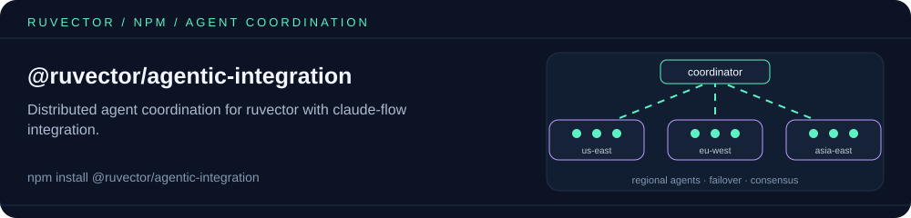

<p align="center"></p>

# @ruvector/agentic-integration

Distributed agent coordination for [ruvector](https://www.npmjs.com/package/ruvector), with optional
[claude-flow](https://github.com/ruvnet/claude-flow) hooks. It provides building blocks for running
vector-search agents across regions: an agent coordinator with load balancing and circuit breakers, a
regional agent, a swarm manager with auto-scaling, and a message/consensus protocol.

## Install

```bash
npm install @ruvector/agentic-integration
```

## Exports

| Export | Purpose |
|---|---|
| `AgentCoordinator` | Registers agents, queues and distributes tasks (`round-robin`, `least-connections`, `weighted`, `adaptive`), runs health checks, retries with backoff, and trips per-agent circuit breakers |
| `RegionalAgent` | A per-region agent that serves vector queries and syncs entries with peers |
| `SwarmManager` | Spawns and despawns agents per region (`mesh`, `hierarchical` or `hybrid` topology), with threshold-based auto-scaling |
| `CoordinationProtocol` | Message passing, pub/sub topics and consensus proposals between agents |

Each class is an `EventEmitter`, and every config and payload type (`CoordinatorConfig`, `SwarmConfig`,
`QueryRequest`, `ConsensusProposal`, …) is exported with full TypeScript definitions.

```typescript
import { AgentCoordinator } from '@ruvector/agentic-integration';

const coordinator = new AgentCoordinator({
  maxAgentsPerRegion: 10,
  healthCheckInterval: 5_000,
  taskTimeout: 30_000,
  retryBackoffBase: 200,
  retryBackoffMax: 10_000,
  loadBalancingStrategy: 'adaptive',
  failoverThreshold: 3,
  enableClaudeFlowHooks: false,
});
```

Source and tests: [`npm/packages/agentic-integration`](https://github.com/ruvnet/ruvector/tree/main/npm/packages/agentic-integration).

## License

MIT

<!-- weaver:seo:links:start -->
## Works with / Used by

Part of the [ruv.io](https://ruv.io) open-source stack for distributed systems, agent orchestration, agentic AI.

- **Works with** (its runtime dependencies): no other ruvnet package (standalone)
- **Used by** (published packages that depend on it): none yet
<!-- weaver:seo:links:end -->

<!-- weaver:seo:footer:start -->
---

Built by [rUv](https://ruv.io) · [ruv.io](https://ruv.io) · [Source](https://github.com/ruvnet/ruvector)
<!-- weaver:seo:footer:end -->
