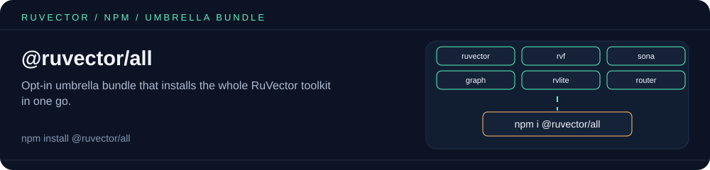

<p align="center"></p>

# @ruvector/all

**Opt-in umbrella bundle for the whole RuVector toolkit.** One install pulls in
every user-facing RuVector package listed below.

> Most users should **not** install this. Install only the packages you need,
> e.g. `npm install ruvector`, then add extras with `npx ruvector add <extra>` (ruvector ≥0.3.8)
> (run `npx ruvector add --list` to see them). `@ruvector/all` is for people
> who explicitly want everything in one dependency — exploration, demos,
> notebooks, kitchen-sink prototypes.

```bash
npm install @ruvector/all
```

Requires Node.js >= 20 (the strictest requirement among the members, from `ruvector`).

## What's included

| Package | Purpose | Access via |
|---|---|---|
| [`ruvector`](https://www.npmjs.com/package/ruvector) | Self-learning vector database for Node.js: native HNSW, ONNX embeddings, GNN, SONA routing, MCP server | `all.ruvector` |
| [`@ruvector/rvf`](https://www.npmjs.com/package/@ruvector/rvf) | RuVector Format — unified TypeScript SDK for RVF vector containers | `all.rvf` |
| [`@ruvector/sona`](https://www.npmjs.com/package/@ruvector/sona) | Self-Optimizing Neural Architecture: runtime LoRA, EWC++, ReasoningBank | `all.sona` |
| [`@ruvector/diskann`](https://www.npmjs.com/package/@ruvector/diskann) | DiskANN/Vamana SSD-friendly billion-scale ANN with product quantization | `all.diskann` |
| [`@ruvector/tiny-dancer`](https://www.npmjs.com/package/@ruvector/tiny-dancer) | FastGRNN neural router for agent orchestration | `all.tinyDancer` |
| [`rvlite`](https://www.npmjs.com/package/rvlite) | Lightweight vector database with SQL, SPARQL and Cypher | `all.rvlite` |
| [`@ruvector/rvf-solver`](https://www.npmjs.com/package/@ruvector/rvf-solver) | RVF self-learning temporal solver (Thompson Sampling, PolicyKernel) | `all.rvfSolver` |
| [`@ruvector/rabitq-wasm`](https://www.npmjs.com/package/@ruvector/rabitq-wasm) | RaBitQ 1-bit quantized vector index in WebAssembly | `await all.loadRabitqWasm()` |
| [`@ruvector/graph-wasm`](https://www.npmjs.com/package/@ruvector/graph-wasm) | Neo4j-compatible hypergraph database in WebAssembly (Cypher) | `await all.loadGraphWasm()` |
| [`@ruvector/ruvllm-wasm`](https://www.npmjs.com/package/@ruvector/ruvllm-wasm) | Browser-compatible RuvLLM inference runtime (WebGPU) | `await all.loadRuvllmWasm()` |
| [`@ruvector/emergent-time`](https://www.npmjs.com/package/@ruvector/emergent-time) | Agentic Time: an agent's internal time and 7-state health, in WASM | `await all.loadEmergentTime()` |
| [`@ruvector/rvf-wasm`](https://www.npmjs.com/package/@ruvector/rvf-wasm) | RVF WASM microkernel for browser and edge vector operations | `await all.loadRvfWasm()` |

Platform-specific native binaries (`*-linux-x64-gnu`, `*-darwin-arm64`, …) are
not listed here; each member pulls the right one through its own
`optionalDependencies`.

## Usage

Requiring `@ruvector/all` loads **nothing**. Each member is loaded the first
time you touch it, so you only pay for what you use.

```js
const all = require('@ruvector/all');

// CommonJS members: lazy getters (require() on first access, then cached).
const { SonaEngine } = all.sona;

// ESM-only members (wasm-bindgen packages): async loaders using import().
const graph = await all.loadGraphWasm();

// Uniform async loader for any member, CJS or ESM.
const rvf = await all.load('rvf');

all.isLoaded('diskann'); // false until first access
all.members;             // [{ key, pkg, kind, loader? }, ...]
```

ESM-only members are exposed as async loaders rather than getters because
`require()` of an ES module is not available on every Node release this package
supports. Some wasm-bindgen packages also need their own init call in Node —
see each package's README.

From ESM, use the **default import only**:

```js
import all from '@ruvector/all';
const sona = all.sona;
```

Named ESM imports (`import { sona } from '@ruvector/all'`) do not work: the lazy
getters are defined at runtime, so Node cannot detect them as named exports.

## License

MIT

<!-- weaver:seo:links:start -->
## Works with / Used by

Part of the [ruv.io](https://ruv.io) open-source stack for WASM, graph, Rust.

- **Works with** (its runtime dependencies): [`@ruvector/diskann`](https://www.npmjs.com/package/@ruvector/diskann), [`@ruvector/emergent-time`](https://www.npmjs.com/package/@ruvector/emergent-time), [`@ruvector/graph-wasm`](https://www.npmjs.com/package/@ruvector/graph-wasm), [`@ruvector/rabitq-wasm`](https://www.npmjs.com/package/@ruvector/rabitq-wasm), [`@ruvector/ruvllm-wasm`](https://www.npmjs.com/package/@ruvector/ruvllm-wasm), [`@ruvector/rvf`](https://www.npmjs.com/package/@ruvector/rvf), [`@ruvector/rvf-solver`](https://www.npmjs.com/package/@ruvector/rvf-solver), [`@ruvector/rvf-wasm`](https://www.npmjs.com/package/@ruvector/rvf-wasm), [`@ruvector/sona`](https://www.npmjs.com/package/@ruvector/sona), [`@ruvector/tiny-dancer`](https://www.npmjs.com/package/@ruvector/tiny-dancer), [`ruvector`](https://www.npmjs.com/package/ruvector), [`rvlite`](https://www.npmjs.com/package/rvlite)
- **Used by** (published packages that depend on it): none yet
<!-- weaver:seo:links:end -->

<!-- weaver:seo:footer:start -->
---

Built by [rUv](https://ruv.io) · [ruv.io](https://ruv.io) · [Source](https://github.com/ruvnet/ruvector)
<!-- weaver:seo:footer:end -->
