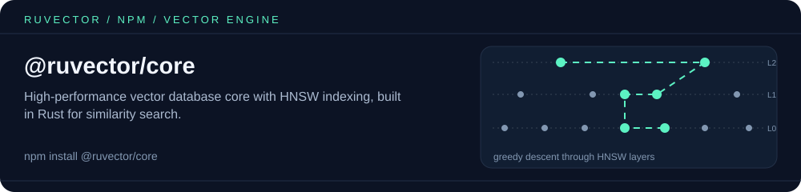

<p align="center"></p>

# @ruvector/core

[](https://www.npmjs.com/package/@ruvector/core)
[](https://opensource.org/licenses/MIT)
[](https://nodejs.org)
[](https://www.npmjs.com/package/@ruvector/core)

**High-performance vector database with HNSW indexing, built in Rust with Node.js bindings**

Ruvector is a fast vector database for AI/ML applications, semantic search, and similarity matching. Built in Rust with SIMD-optimized distance functions and exposed to Node.js through N-API.

🌐 **[Visit ruv.io](https://ruv.io)** for more AI infrastructure tools

## Features

- 🚀 **Fast** - native Rust core, async API that runs work off the JS thread
- 🎯 **HNSW Indexing** - approximate nearest neighbor search (enable it with `hnswConfig`, see below)
- ⚡ **SIMD Optimized** - hardware-accelerated distance computations
- 💾 **Persistent** - vectors are stored on disk at `storagePath`
- 🔒 **Type-Safe** - TypeScript definitions included
- 🌍 **Cross-Platform** - Linux, macOS (Intel & Apple Silicon), Windows
- 🦀 **Rust Core** - memory safety with zero-cost abstractions

## Quick Start

### Installation

```bash
npm install @ruvector/core
```

The correct platform-specific native module is automatically installed.

### Basic Usage

```javascript
const { VectorDb } = require('@ruvector/core');

async function example() {
  // Create a 128-dimensional database with an HNSW index
  const db = new VectorDb({
    dimensions: 128,
    distanceMetric: 'Cosine',
    storagePath: './vectors.db',
    hnswConfig: { m: 16, efConstruction: 200, efSearch: 100 }
  });

  // Insert a vector (vectors must be Float32Array; metadata is a JSON string)
  const vector = new Float32Array(128).map(() => Math.random());
  const id = await db.insert({
    id: 'doc_1',
    vector,
    metadata: JSON.stringify({ title: 'Example Document' })
  });

  // Search for similar vectors
  const results = await db.search({ vector, k: 10 });

  console.log('Top 10 similar vectors:', results);
  // [{ id: 'doc_1', score: 0, vector: Float32Array(128), metadata: '{"title":"Example Document"}' }, ...]
  // With the Cosine metric, score is a distance: lower is closer, 0 is an exact match.
}

example();
```

### TypeScript

```typescript
import { VectorDb, VectorEntry, SearchResult } from '@ruvector/core';

const db = new VectorDb({ dimensions: 128, storagePath: './vectors.db' });

const entry: VectorEntry = {
  id: 'doc_1',
  vector: new Float32Array(128)
};
await db.insert(entry);

const results: SearchResult[] = await db.search({
  vector: new Float32Array(128),
  k: 10
});
```

## API Reference

### Constructor

```typescript
new VectorDb(options: {
  dimensions: number;      // Vector dimensionality (required)
  distanceMetric?: 'Cosine' | 'Euclidean' | 'DotProduct' | 'Manhattan'; // default 'Cosine'
  storagePath?: string;    // default './ruvector.db'
  hnswConfig?: {           // omit for an exact (brute-force) flat index
    m?: number;              // default 32
    efConstruction?: number; // default 200
    efSearch?: number;       // default 100
    maxElements?: number;    // default 10,000,000
  };
})

VectorDb.withDimensions(dimensions: number) // factory with default options
```

Notes:

- `distanceMetric` values are case-sensitive PascalCase; `'cosine'` or `'dot'` are rejected.
- Without `hnswConfig` the database uses an exact flat index, which is correct but scans every vector on each search. Pass `hnswConfig` (even `{}`) for HNSW.
- Omitting `storagePath` does **not** give an in-memory database: data is written to `./ruvector.db` in the current working directory.

### Methods

All methods are async.

- `insert(entry: { id?: string; vector: Float32Array; metadata?: string }): Promise<string>` - insert a vector; returns its id (generated if not provided)
- `insertBatch(entries): Promise<string[]>` - insert many vectors
- `search(query: { vector: Float32Array; k: number; efSearch?: number }): Promise<SearchResult[]>` - nearest neighbors; each result has `id`, `score`, and when stored, `vector` and `metadata`
- `get(id: string): Promise<VectorEntry | null>` - retrieve a vector by id
- `delete(id: string): Promise<boolean>` - remove a vector
- `len(): Promise<number>` - count stored vectors
- `isEmpty(): Promise<boolean>`

`vector` must be a `Float32Array`; a plain `number[]` throws `Get TypedArray info failed`. `metadata` is stored and returned as a string — use `JSON.stringify` / `JSON.parse`.

## Performance Benchmarks

Tested on AMD Ryzen 9 5950X, 128-dimensional vectors (figures from the original authors, not re-measured for this README):

| Operation | Throughput | Latency (p50) | Latency (p99) |
|-----------|------------|---------------|---------------|
| Insert    | 52,341 ops/sec | 0.019 ms | 0.045 ms |
| Search (k=10) | 11,234 ops/sec | 0.089 ms | 0.156 ms |
| Search (k=100) | 8,932 ops/sec | 0.112 ms | 0.203 ms |
| Delete    | 45,678 ops/sec | 0.022 ms | 0.051 ms |

*Benchmarks measured with 100K vectors, 128 dimensions, k=10. Results depend on hardware and HNSW parameters.*

## Platform Support

Automatically installs the correct native module for:

- **Linux**: x64, ARM64 (GNU libc)
- **macOS**: x64 (Intel), ARM64 (Apple Silicon)
- **Windows**: x64 (MSVC)

Node.js 18+ required.

## Advanced Configuration

### HNSW Parameters

```javascript
const db = new VectorDb({
  dimensions: 384,
  storagePath: './large-db.db',
  hnswConfig: {
    m: 16,               // Higher = better recall, more memory
    efConstruction: 200, // Higher = better recall, slower build
    efSearch: 100,       // Higher = better recall, slower search
    maxElements: 1000000
  }
});

// efSearch can also be set per query
const results = await db.search({ vector: queryVector, k: 10, efSearch: 200 });
```

### Distance Metrics

```javascript
const db = new VectorDb({
  dimensions: 128,
  distanceMetric: 'Euclidean' // 'Cosine' (default), 'Euclidean', 'DotProduct', or 'Manhattan'
});
```

### Persistence

```javascript
// Stored at ./persistent.db
const db = new VectorDb({
  dimensions: 128,
  storagePath: './persistent.db'
});
```

For throwaway data, point `storagePath` at a temporary directory and delete it when done.

## Building from Source

```bash
# Install Rust toolchain
curl --proto '=https' --tlsv1.2 -sSf https://sh.rustup.rs | sh

# Build native module
npm run build:napi
```

Requires:
- Rust 1.77+
- Node.js 18+
- Cargo

## Use Cases

- **Semantic Search** - Find similar documents, images, or embeddings
- **RAG Systems** - Retrieval-Augmented Generation for LLMs
- **Recommendation Engines** - Content and product recommendations
- **Duplicate Detection** - Find similar items in large datasets
- **Anomaly Detection** - Identify outliers in vector space

## Examples

### Semantic Text Search

Any embedding model works; this one uses the OpenAI SDK (requires an API key).

```javascript
const { VectorDb } = require('@ruvector/core');
const OpenAI = require('openai');

const openai = new OpenAI();
const db = new VectorDb({ dimensions: 1536, storagePath: './docs.db', hnswConfig: {} });

async function embed(text) {
  const res = await openai.embeddings.create({ model: 'text-embedding-3-small', input: text });
  return new Float32Array(res.data[0].embedding);
}

async function indexDocuments(texts) {
  for (const [i, text] of texts.entries()) {
    await db.insert({ id: `doc-${i}`, vector: await embed(text), metadata: JSON.stringify({ text }) });
  }
}

async function search(query) {
  const results = await db.search({ vector: await embed(query), k: 5 });
  return results.map((r) => ({ id: r.id, distance: r.score, ...JSON.parse(r.metadata ?? '{}') }));
}
```

### Vector search + graph expansion (offline)

[`examples/npm-vector-graph`](https://github.com/ruvnet/ruvector/tree/main/examples/npm-vector-graph) is a runnable script that pairs `@ruvector/core` (top-k search) with [`@ruvector/graph-wasm`](https://www.npmjs.com/package/@ruvector/graph-wasm) (follow relationships from each hit). No API keys required.

## Related packages

- [`@ruvector/graph-wasm`](https://www.npmjs.com/package/@ruvector/graph-wasm) — property graph + Cypher in WebAssembly; pair it with core for graph-expanded retrieval (see the example above).
- [`@ruvector/router`](https://www.npmjs.com/package/@ruvector/router) — semantic intent routing on its own native HNSW index, for matching queries to handlers.
- [`@ruvector/rabitq-wasm`](https://www.npmjs.com/package/@ruvector/rabitq-wasm) — 1-bit quantized ANN index in WebAssembly for browsers and edge runtimes.
- [`ruvector`](https://www.npmjs.com/package/ruvector) — umbrella package and CLI (`npx ruvector`).

## Resources

- 🏠 [Homepage](https://ruv.io)
- 📦 [GitHub Repository](https://github.com/ruvnet/ruvector)
- 📚 [Documentation](https://github.com/ruvnet/ruvector/tree/main/docs)
- 🐛 [Issue Tracker](https://github.com/ruvnet/ruvector/issues)
- 💬 [Discussions](https://github.com/ruvnet/ruvector/discussions)

## Contributing

Contributions are welcome! Please see [CONTRIBUTING.md](https://github.com/ruvnet/ruvector/blob/main/CONTRIBUTING.md) for guidelines.

## License

MIT License - see [LICENSE](https://github.com/ruvnet/ruvector/blob/main/LICENSE) for details.

---

Built with ❤️ by the [ruv.io](https://ruv.io) team

<!-- weaver:seo:links:start -->
## Works with / Used by

Part of the [ruv.io](https://ruv.io) open-source stack for vector database, vector search, HNSW.

- **Works with** (its runtime dependencies): no other ruvnet package (standalone)
- **Used by** (published packages that depend on it): [`@claude-flow/embeddings`](https://www.npmjs.com/package/@claude-flow/embeddings), [`@ruvector/node`](https://www.npmjs.com/package/@ruvector/node), [`claude-flow`](https://www.npmjs.com/package/claude-flow), [`ruvector`](https://www.npmjs.com/package/ruvector)
<!-- weaver:seo:links:end -->
