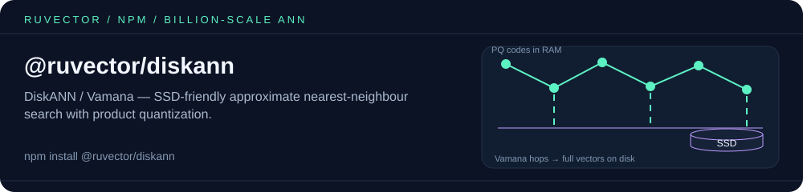

<p align="center"></p>

# @ruvector/diskann

[](https://www.npmjs.com/package/@ruvector/diskann)
[](https://github.com/ruvnet/ruvector/blob/main/LICENSE)
[](https://nodejs.org)

**DiskANN / Vamana** approximate-nearest-neighbor (ANN) search for Node.js — a Rust core compiled to native `.node` addons via [NAPI-RS](https://napi.rs/) for Linux x64/arm64, macOS x64/arm64, and Windows x64.

DiskANN is the SSD-friendly graph index from Microsoft Research that powers billion-scale vector search on a single machine. This package implements the **Vamana** graph construction with **α-robust pruning** ([NeurIPS 2019](https://proceedings.neurips.cc/paper/2019/hash/09853c7fb1d3f8ee67a61b6bf4a7f8e6-Abstract.html)) plus optional **Product Quantization** (PQ) and **mmap** persistence so working set ≪ dataset size.

## Why DiskANN

| | HNSW (in-memory) | **DiskANN (this package)** |
|---|---|---|
| Scale | <1M vectors, fully resident in RAM | **1M – 1B+ vectors**, SSD-backed |
| Memory | full vectors in RAM | only graph + optional PQ codes in RAM |
| Insert | incremental | batch (build once after inserts) |
| Search | sub-ms | **~55µs** (5K · 128d · k=10, M-series) |
| Best for | real-time routing, small corpora | large-corpus RAG, retrieval, embeddings store |

## Capabilities

- **Vamana graph** with two-pass construction (α=1.0 then α=1.2) and α-robust pruning — the published DiskANN algorithm, not a clone of HNSW.
- **Optional Product Quantization** (M subspaces × 256 centroids, trained with k-means++ / Lloyd's) for compressed in-memory codes + fast distance tables.
- **Memory-mapped persistence** — `save()` writes a flat slab + graph + (optional) PQ codes; `load()` mmaps so the OS pages in only touched vectors.
- **Async builds and searches** that off-load to a blocking thread pool so the Node event loop stays responsive.
- **Batch insert** API for high-throughput ingestion of millions of vectors.
- **Delete** support (tombstoned, with graph edges repaired in place — no rebuild needed).
- **Cache-friendly internals** — contiguous `FlatVectors`, generation-counter `VisitedSet` (O(1) per-query reset), flat PQ distance tables, 4-accumulator ILP for L2.
- **Optional SimSIMD acceleration** (NEON / AVX2 / AVX-512) in the Rust crate; Node bindings ship with the portable build.
- **TypeScript types** included.
- **Cross-platform prebuilds** for `linux-x64-gnu`, `linux-arm64-gnu`, `darwin-x64`, `darwin-arm64`, `win32-x64-msvc` — no toolchain or `node-gyp` required at install time.

## Install

```bash
npm install @ruvector/diskann
# or
pnpm add @ruvector/diskann
# or
yarn add @ruvector/diskann
```

Requires Node ≥ 18. The matching platform binary (`@ruvector/diskann-<platform>`) is pulled in automatically as an optional dependency — there is no install-time compilation.

## Quick Start

```javascript
const { DiskAnn } = require('@ruvector/diskann');

// 1. Create the index
const index = new DiskAnn({ dim: 128 });

// 2. Insert vectors (string id + Float32Array)
for (let i = 0; i < 10_000; i++) {
  const vec = new Float32Array(128);
  for (let d = 0; d < 128; d++) vec[d] = Math.random();
  index.insert(`vec-${i}`, vec);
}

// 3. Build the Vamana graph (one-time, required before search)
await index.buildAsync();

// 4. Search
const query = new Float32Array(128).fill(0.5);
const results = await index.searchAsync(query, 10);
//   [ { id: 'vec-42', distance: 0.123 }, ... ]

// 5. Persist + reload
index.save('./my-index');
const loaded = DiskAnn.load('./my-index');
```

### With Product Quantization

Trade a small recall hit for far smaller in-memory footprint and faster candidate scoring on millions of vectors:

```javascript
const index = new DiskAnn({
  dim: 768,
  pqSubspaces: 96,     // 96 bytes per vector instead of 768 × 4 = 3072 B
  pqIterations: 12,
  maxDegree: 64,
  buildBeam: 128,
  searchBeam: 96,
  alpha: 1.2,
});
```

### TypeScript

```typescript
import { DiskAnn, DiskAnnOptions, DiskAnnSearchResult } from '@ruvector/diskann';

const opts: DiskAnnOptions = { dim: 384, searchBeam: 96 };
const index = new DiskAnn(opts);

const hits: DiskAnnSearchResult[] = index.search(query, 10);
```

## API

### `new DiskAnn(options)`

| Option | Type | Default | Meaning |
|---|---|---|---|
| `dim` | `number` | — *(required)* | Vector dimensionality |
| `maxDegree` | `number` | `64` | Vamana graph out-degree R |
| `buildBeam` | `number` | `128` | Beam width during construction (L_build) |
| `searchBeam` | `number` | `64` | Beam width at query time (L_search) |
| `alpha` | `number` | `1.2` | α-robust pruning factor (≥ 1.0) |
| `pqSubspaces` | `number` | `0` | PQ subspaces M (0 disables PQ) |
| `pqIterations` | `number` | `10` | k-means iterations for PQ training |
| `storagePath` | `string` | — | Optional directory; if set, `build()` also saves the index there |

### Methods

| Method | Description |
|---|---|
| `insert(id: string, vector: Float32Array): void` | Insert a single vector |
| `insertBatch(ids: string[], vectors: Float32Array, dim: number): void` | Insert N vectors packed as a flat `Float32Array` of length `N · dim` |
| `build(): void` | Build the Vamana graph (and train PQ if enabled) |
| `buildAsync(): Promise<void>` | Same, off-loaded to a blocking thread pool |
| `search(query: Float32Array, k: number): DiskAnnSearchResult[]` | k-NN search |
| `searchAsync(query, k): Promise<DiskAnnSearchResult[]>` | Async k-NN search |
| `delete(id: string): boolean` | Tombstone a vector; it disappears from results immediately (returns `false` if unknown) |
| `count(): number` | Number of vectors currently in the index |
| `save(dir: string): void` | Persist index files into `dir` |
| `static load(dir: string): DiskAnn` | Load and mmap an index from `dir` |

Search results are `{ id: string, distance: number }`, where `distance` is squared-L2.

`search()` before `build()` throws `Index not built — call build() first`. Any `insert` / `insertBatch` after a build invalidates the graph, so call `build()` again before the next search. Vectors must be `Float32Array` (a plain `number[]` throws).

## Benchmarks

Reference measurements on an Apple-silicon M-series laptop, release build, single-thread search. PQ is **off** unless noted.

| Dataset | Dim | Vectors | Build | Search (k=10) | Recall@10 |
|---|---|---|---|---|---|
| Synthetic | 64 | 2,000 | ~1.4 s | ~22 µs | **1.000** |
| Synthetic | 128 | 5,000 | ~6.2 s | **~55 µs** | **0.998** |
| Synthetic, 50 queries | 64 | 2,000 | — | — | **0.998** avg |

Validated by the in-tree Rust test suite (17 tests across distance, PQ, Vamana, and end-to-end index) plus the Node integration test that ships with the package (`npm test`).

## When NOT to use this

- You have **fewer than ~10K vectors** and don't need persistence → a brute-force scan is faster and simpler.
- You need **real-time incremental inserts with immediate searchability** → use HNSW (see `@ruvector/router`). DiskANN requires a build pass.
- You're operating in a browser → this is a native Node addon; use the WASM-based packages in the ruvector family instead.

## Algorithm notes (one paragraph)

Insertion appends vectors to a contiguous `FlatVectors` buffer. `build()` computes the medoid (point nearest the centroid, parallel via rayon), initializes a bounded-degree random graph, then runs two passes of *greedy-search-from-medoid → α-robust-prune → bidirectional-edge-update*: pass 1 with α=1.0 (accuracy), pass 2 with α=1.2 (navigability). If `pqSubspaces > 0`, a Product Quantizer is trained with k-means++ initialization and Lloyd's iterations; per-query, a distance table is precomputed so PQ distance is a sum of M table lookups. Search is greedy beam-search from the medoid with a top-L candidate pool; with PQ enabled, top results are re-ranked with exact L2.

For the full design — including persistence layout, optimization rationale, and trade-off analysis — see [ADR-146: DiskANN/Vamana Implementation](https://github.com/ruvnet/ruvector/blob/main/docs/adr/ADR-146-diskann-vamana-implementation.md).

## Related packages

- [`@ruvector/core`](https://www.npmjs.com/package/@ruvector/core) — native in-memory HNSW vector database, for corpora that fit in RAM and need incremental inserts.
- [`@ruvector/router`](https://www.npmjs.com/package/@ruvector/router) — HNSW-backed semantic intent router (sub-millisecond, small/medium corpora).
- [`@ruvector/rabitq-wasm`](https://www.npmjs.com/package/@ruvector/rabitq-wasm) — 1-bit RaBitQ quantized index in WebAssembly, for the browser / edge case this addon can't serve.
- [`ruvector`](https://www.npmjs.com/package/ruvector) — umbrella package and CLI (`npx ruvector`).

## Links

- Rust crate: [`ruvector-diskann`](https://crates.io/crates/ruvector-diskann)
- Repository: <https://github.com/ruvnet/ruvector>
- Issues: <https://github.com/ruvnet/ruvector/issues>
- DiskANN paper (NeurIPS 2019): <https://proceedings.neurips.cc/paper/2019/hash/09853c7fb1d3f8ee67a61b6bf4a7f8e6-Abstract.html>

## License

[MIT](https://github.com/ruvnet/ruvector/blob/main/LICENSE)

<!-- weaver:seo:links:start -->
## Works with / Used by

Part of the [ruv.io](https://ruv.io) open-source stack for vector search, quantization, Rust.

- **Works with** (its runtime dependencies): no other ruvnet package (standalone)
- **Used by** (published packages that depend on it): [`@claude-flow/embeddings`](https://www.npmjs.com/package/@claude-flow/embeddings) (peer), [`@ruvector/all`](https://www.npmjs.com/package/@ruvector/all), [`ruvector`](https://www.npmjs.com/package/ruvector) (peer)
<!-- weaver:seo:links:end -->

<!-- weaver:seo:footer:start -->
---

Built by [rUv](https://ruv.io) · [ruv.io](https://ruv.io) · [Source](https://github.com/ruvnet/ruvector)
<!-- weaver:seo:footer:end -->
