# @ruvector/e-means



Portable WebAssembly bindings for the shared `ruvector-e-means` Rust crate, based on [e-means (arXiv:2611.09501v1)](https://arxiv.org/abs/2611.09501v1). Uses EMA counts and sums, cosine annealing, dead-cluster splitting and last-epoch mean finalization.

```js
import { init, fit, predict } from '@ruvector/e-means';

await init();
const data = new Float32Array([0, 0, 0, 2, 10, 10, 10, 12]);
const model = fit(data, 2, { clusters: 2, epochs: 3, seed: 42 });
const labels = predict(data, 2, model.centroids);
```

Pass flat row-major `Float32Array` data and finite values. `fit` and `predict` are synchronous after `init`; input arrays are unchanged. Cluster labels break distance ties at the lowest centroid index. `mse` is mean squared Euclidean distance per vector. Output assignments are recomputed against the final codebook.

The runtime transfers result vectors directly as typed arrays. Returned arrays belong to the caller and remain valid across later fits and WebAssembly memory growth. The temporary Rust result handle is released before `fit` returns; the small options object alone uses JSON transport.

`batchSize` and `peakStep` can override the paper's automatic settings. `finalization: 'ema'` returns the training EMA instead of the default `'lastEpochMean'`. The empirical scaling laws target large embedding datasets; evaluate overrides on tiny or low-dimensional data. CPU/WASM throughput is not the paper's measured GPU throughput. GPU kernels, approximate assignment and the optional slow-EMA finalizer are outside this initial implementation.

Node reads the bundled WASM from disk. In browsers, serve the `.wasm` artifact beside its generated JavaScript module, or call `init(bytes)` / `init(compiledModule)` to supply it explicitly. No native compilation, network request, or model download occurs during installation or Node initialization. Browser initialization fetches the bundled `.wasm` URL by default.

From a source checkout: install the `wasm32-unknown-unknown` Rust target and `wasm-bindgen-cli` version `0.2.125`, then run `npm run build`, `npm test` and `npm run test:consumer` in this package. `npm pack` verifies the built runtime before creating an archive. The archive contains the runtime and needs neither Rust nor the source repository.

`npm run typecheck` validates the declarations. `npm run test:browser` uses external Playwright 1.62.1 tooling to run the numerical oracle in real headless Chromium against the default browser loader. Bootstrap the development-only driver outside this package:

```sh
npm install --prefix /tmp/e-means-browser-tools --ignore-scripts --no-save playwright@1.62.1
/tmp/e-means-browser-tools/node_modules/.bin/playwright install chromium
E_MEANS_PLAYWRIGHT_ROOT=/tmp/e-means-browser-tools npm run test:browser
```

`E_MEANS_CHROMIUM` can select an existing Chromium executable. Qualification requires successful module/runtime/WASM responses and the typed numerical result; browser errors or missing routes fail.

`npm run benchmark -- --baseline /path/to/previous/package --repeats 7` measures median fit and prediction time on one million scalar rows and an embedding codebook workload. It also compares JSON and typed output on the same current Rust kernel. The baseline argument is optional; retain the previous package's module and WASM together. Run benchmarks without other compute workloads; results describe the current machine and these fixtures.

RuVector exposes the same API through `ruvector/clustering.mjs` once a `ruvector` release that depends on this package is published. A ruv-FANN facade is proposed separately and is not released.

The package also ships explicit integration subpaths:

| Import | Use |
|---|---|
| `@ruvector/e-means/quantization` | Train PQ subspace codebooks, encode byte codes, decode vectors, and validate JSON codebooks |
| `@ruvector/e-means/ivf` | Train coarse clusters and construct stable posting lists |
| `@ruvector/e-means/metaharness` | Measure held-out clustering quality and run bounded numeric evolution with Darwin 0.13.0 or 0.13.1 |
| `@ruvector/e-means/cloudflare` | Create an authenticated Worker and explicitly persist/export centroid codebooks through R2/Vectorize bindings |
| `@ruvector/e-means/runtime` | Initialize from explicit bytes or a precompiled WASM module without importing Node loaders |
| `@ruvector/e-means/cloudflare/build` | Build the shipped Worker example locally; requires development tooling, and never deploys |
| `@ruvector/e-means/wasm` | Static WASM module import for Wrangler |

```js
import { init } from '@ruvector/e-means';
import { trainProductQuantizer, encodeProductQuantizer, decodeProductQuantizer }
  from '@ruvector/e-means/quantization';
import { partition, postingList } from '@ruvector/e-means/ivf';

await init();
const data = new Float32Array([0, 0, 0, 2, 10, 10, 10, 12]);
const options = { clusters: 2, epochs: 3, seed: 42 };
const book = trainProductQuantizer(data, 2, 2, options);
const codes = encodeProductQuantizer(book, data);
const reconstructed = decodeProductQuantizer(book, codes);
const inverted = partition(data, 2, options);
const firstPosting = postingList(inverted, 0);
```

MetaHarness tuning requires the optional peer `@metaharness/darwin` at 0.13.0 or 0.13.1.
`createClusteringEvaluator` uses snapshotted, nonoverlapping training/holdout
arrays and explicit evaluation/work/deadline budgets. `tuneClustering` calls the
real numeric SDK, verifies observed records, and returns a recommendation with
`sourceApplied: false`. Selection uses the holdout; another test split is needed
for generalization claims. See the shipped `examples/metaharness.mjs`.

For a Worker, statically import the module and supply the deployment's secret:

```js
import wasmModule from '@ruvector/e-means/wasm';
import { createClusteringWorker } from '@ruvector/e-means/cloudflare';

export default {
  fetch(request, env) {
    return createClusteringWorker({
      wasmModule, bearerToken: env.E_MEANS_BEARER_TOKEN,
    }).fetch(request);
  },
};
```

`/fit` and `/predict` require authentication by default and enforce body, shape,
stream-read and work bounds. R2 helpers persist only centroid codebooks.
Vectorize exports use explicit caller-owned bindings; acknowledgements are
asynchronous and failures can leave earlier batches applied. Use versioned
prefixes/namespaces because upserts do not delete stale IDs. PQ records have a
different layout and are rejected by these single-codebook helpers.

The shipped `examples/cloudflare` contains a static-WASM builder and Wrangler
configuration. `npm run build:cloudflare` only writes local artifacts. `buildWorker` needs `esbuild`
installed by the caller and reports a clear error without it. Qualify
with `npm ci --ignore-scripts --workspaces=false`, `npm test`,
`npm run typecheck`, `npm run test:consumer`, and `npm run test:ecosystem`.
Local workerd/R2 tests use development dependencies; Vectorize is covered by
binding fixtures. No hosted deployment is implied.

The `@ruvector/core`, `@ruvector/all`, `@ruvector/wasm` and `ruvector` sources
add clustering subpaths over these integrations; they reach users only with
those packages' next releases. See
[ADR-360](https://github.com/ruvnet/ruvector/blob/main/docs/adr/ADR-360-e-means-ecosystem-integrations.md)
for the exact paths, release order, and validation scope.
