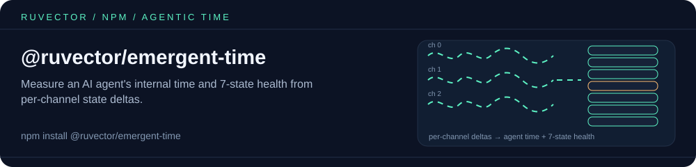

<p align="center"></p>

# @ruvector/emergent-time

**Agentic Time** for the browser, the edge, and Node — a tiny WASM build of the
agentic-time layer of the [`emergent-time`](https://crates.io/crates/emergent-time)
Rust crate.

Agentic time measures how much an AI agent has *changed internally*, not how many
seconds, steps, or tokens have elapsed. You feed it the six channel deltas of a
transition — belief, memory, retrieval, goal-graph, contradiction, plan — and it
returns:

- an explainable **tick** (a post-floor internal-time increment, its class, a
  human-readable reason, and the per-channel contributions),
- a cumulative **agentic time** reading,
- the **Agentic Time Index** (ATI = progress per unit of structural change), and
- a **7-state health** classification: `Healthy`, `Drifting`, `Stuck`,
  `NeedsReplan`, `Contradicting`, `Collapsing`, `NeedsHumanReview`.

It also ships the two fair change-point detectors the agentic clock is honestly
compared against (a windowed z-score and a Page–Hinkley test), so you can run the
comparison yourself.

> An agent can run for 30 minutes and barely age; or hit one contradiction and
> age massively in a second. Wall-clock time tells you *when* something happened;
> agentic time tells you *how much the agent changed*.

## Honest scope (read this)

The agentic clock is a **diagnostic signal**, not a proven early-warning predictor.
On real recorded agent traces it does **not** establish an early-warning lead over
a fair cheap baseline (a windowed z-score on a single observable, or a
Page–Hinkley detector) — this is the same conclusion the Rust crate and ADR-251
reach. What it gives you is an explainable, per-channel decomposition of internal
change plus a health classifier. Treat it as observability, not as a guarantee.

## Install

```bash
npm install @ruvector/emergent-time
```

- **Bundle:** ~55 KB WASM (size-optimized with `wasm-opt -Oz`; ~62 KB before opt) +
  ~31 KB JS glue + ~16 KB `.d.ts`. Packed tarball ~40 KB.
- **Dependencies:** none. The WASM core is pure Rust with a `dlmalloc` allocator;
  no runtime npm dependencies.
- **Target:** built with `wasm-bindgen --target web`. It loads in the browser
  (via `fetch`), in Node (via `initSync` with the wasm bytes — see below), and in
  any bundler that understands ESM + `.wasm`.

## Quickstart (browser / bundler)

In a browser or a bundler, the default export initializes from the bundled
`.wasm` URL:

```js
import init, { AgenticClock, StateDelta, TickClassJs, AgentHealthJs }
  from '@ruvector/emergent-time';

await init(); // fetches and instantiates the .wasm

const clock = new AgenticClock();

// StateDelta(belief, memory, retrieval, goal, contradiction, plan,
//            contradictionLevel, progress)
const tick = clock.tick(new StateDelta(0.3, 0.1, 0.4, 0.2, 0.3, 0.8, 0.6, 0.0));

console.log(tick.deltaTime);           // post-floor internal-time increment
console.log(TickClassJs[tick.class]);  // e.g. "Progress"
console.log(tick.reason);              // "Progress: dominated by plan movement (...)"
console.log(clock.ati);                // progress per unit structural change
console.log(AgentHealthJs[clock.health]); // "Collapsing" here (contradictionLevel 0.6)
```

## Quickstart (Node ESM)

The `web` build does not auto-fetch in Node, so read the bytes and pass them to
`initSync`:

```js
import { readFile } from 'node:fs/promises';
import { createRequire } from 'node:module';
import init, { initSync, AgenticClock, StateDelta, AgentHealthJs }
  from '@ruvector/emergent-time';

const require = createRequire(import.meta.url);
const wasmPath = require.resolve('@ruvector/emergent-time/wasm');
initSync({ module: await readFile(wasmPath) });

const clock = new AgenticClock();
clock.tick(new StateDelta(0.3, 0.1, 0.4, 0.2, 0.3, 0.8, 0.6, 0.0));
console.log(AgentHealthJs[clock.health]);
void init; // `init` is the browser entry point; unused in Node
```

## TypeScript usage (compiles against the shipped `.d.ts`)

```ts
import {
  AgenticClock,
  StateDelta,
  WindowedDeltaClock,
  PageHinkleyDetector,
  LearnedWeights,
  TickClassJs,
  AgentHealthJs,
  fullFeatureDim,
} from '@ruvector/emergent-time';

// (after init / initSync — omitted here)
const clock = new AgenticClock();
clock.setWindow(8);
clock.setNoiseFloor(1e-3);

const delta = new StateDelta(0.3, 0.1, 0.4, 0.2, 0.3, 0.8, 0.6, 0.0);
const tick = clock.tick(delta);

const dt: number = tick.deltaTime;
const cls: TickClassJs = tick.class;
const reason: string = tick.reason;
const ati: number = clock.ati;
const health: AgentHealthJs = clock.health;

if (cls === TickClassJs.Collapse && health === AgentHealthJs.NeedsHumanReview) {
  // escalate to a human
}

// Detectors return a per-step statistic and latch an alarm.
const wd = new WindowedDeltaClock(8, 4.0, 1.0); // window, kSigma, stdFloor
const z: number = wd.push(2.5);
const fired: boolean = wd.alarmed;
const at: bigint = wd.alarmIndex; // -1n until it fires

const ph = new PageHinkleyDetector(0.1, 1.0); // delta (tolerance), lambda (threshold)
const stat: number = ph.push(2.5);

// Inference of an offline-trained logistic scorer over channel-movement features.
const dim: number = fullFeatureDim(); // 6 (full) or honestFeatureDim() => 5
const model = LearnedWeights.fromParams(
  dim,
  new Float64Array(dim).fill(0.1), // coef
  0.0,                              // bias
  new Float64Array(dim).fill(0.0), // feature means
  new Float64Array(dim).fill(1.0), // feature stds
);
const p: number = model.predict(new Float64Array(dim).fill(0.5)); // [0, 1]
```

> The shipped `.d.ts` references `Symbol.dispose` and DOM/`WebAssembly` types. If
> you type-check it directly, use `"lib": ["ES2022", "DOM", "ESNext.Disposable"]`
> (or `"esnext"`) in your `tsconfig.json` — the standard libs for a `web`-target
> wasm-bindgen module.

## API

### `class AgenticClock`

A stateful agentic-time clock. Construct it, feed transitions, read back time,
the ATI, and health.

```ts
new AgenticClock();
static withWeights(
  belief: number, memory: number, retrieval: number,
  goalGraph: number, contradiction: number, plan: number,
): AgenticClock;            // custom channel weights

setNoiseFloor(floor: number): void;   // jitter suppression (default 1e-3)
setWindow(window: number): void;       // rolling window for ATI/health (default 8)
setThresholds(                         // health-classifier thresholds
  idle: number, healthyAti: number, driftingAti: number,
  collapse: number, humanReview: number,
): void;

tick(delta: StateDelta): Tick;         // feed one transition, advance the clock
reset(): void;                         // zero running state, keep config

readonly cumulativeTime: number;       // Σ agentic time so far
readonly cumulativeProgress: number;   // Σ progress so far
readonly ati: number;                  // progress / Δτ over the window (∞ if Δτ≈0, progressing)
readonly health: AgentHealthJs;        // current 7-state verdict
```

Default channel weights: contradiction `1.5`, belief / goal-graph / plan `1.0`,
memory / retrieval `0.5` (contradictions age an agent the most).

### `class StateDelta`

The six per-transition channel deltas (already-computed scalar movements — pick
your own embeddings and distance metric on the JS side).

```ts
new StateDelta(
  belief: number,             // L2 movement of the belief embedding (≥ 0)
  memory: number,             // L2 movement of working memory (≥ 0)
  retrieval: number,          // L2 movement of retrieved context (≥ 0)
  goal: number,               // |Δ goal-graph mass|
  contradiction: number,      // |Δ contradiction score|
  plan: number,               // L2 movement of the plan embedding (≥ 0)
  contradictionLevel: number, // current absolute contradiction in [0, 1]
  progress: number,           // Δ task progress over this transition
);
```

`contradictionLevel` is the *current* contradiction (not a delta); it drives the
`Collapsing` / `NeedsHumanReview` health states.

### `class Tick`

An explainable tick. The per-channel fields are the **raw (pre-floor)** weighted
contributions; `deltaTime` is the **post-floor** increment
`max(0, Σ channels − noiseFloor)`. The identity `deltaTime === Σ channels` holds
only when `noiseFloor === 0`.

```ts
readonly deltaTime: number;     // post-floor internal-time increment
readonly class: TickClassJs;    // Idle | Progress | Learning | Contradiction | Collapse
readonly reason: string;        // human-readable audit string
readonly belief: number;        // raw weighted belief contribution
readonly memory: number;
readonly retrieval: number;
readonly goalGraph: number;
readonly contradiction: number;
readonly plan: number;
```

### `enum TickClassJs`

`Idle = 0`, `Progress = 1`, `Learning = 2`, `Contradiction = 3`, `Collapse = 4`.

### `enum AgentHealthJs`

`Healthy = 0`, `Drifting = 1`, `Stuck = 2`, `NeedsReplan = 3`,
`Contradicting = 4`, `Collapsing = 5`, `NeedsHumanReview = 6`.

### `class WindowedDeltaClock` — fair baseline (rolling z-score)

A windowed `mean + kσ` change-point detector on a single scalar observable.

```ts
new WindowedDeltaClock(window: number, kSigma: number, stdFloor: number);
push(value: number): number;     // returns the rolling z-score
readonly alarmed: boolean;       // latched true on first alarm
readonly alarmIndex: bigint;     // 0-based index of first alarm, or -1n
reset(): void;
```

`stdFloor` is a variance floor: set it near your stationary noise scale so a
near-constant stream does not trip a spurious infinite z-score.

### `class PageHinkleyDetector` — fair baseline (adaptive CUSUM)

A Page–Hinkley test whose reference is a *running* mean, so a noisy early phase
does not permanently raise the bar.

```ts
new PageHinkleyDetector(delta: number, lambda: number); // upward (increase) form
static downward(delta: number, lambda: number): PageHinkleyDetector;
push(value: number): number;     // returns the current PH statistic
readonly alarmed: boolean;
readonly alarmIndex: bigint;
reset(): void;
```

`delta` is the tolerance (deviations below it are treated as normal jitter);
`lambda` is the alarm threshold (larger ⇒ fewer false alarms, later detection).

### `class LearnedWeights` — offline-trained scorer (inference only)

A fitted logistic-regression scorer over the channel-movement features. Train it
with the Rust crate; load the parameters here to score in the browser.

```ts
static fromParams(
  dim: number,
  coef: Float64Array, bias: number,
  mean: Float64Array, std: Float64Array,
): LearnedWeights;
predict(features: Float64Array): number; // failure-approach probability in [0, 1]
clockWeights(): Float64Array;            // non-negative weights for withWeights(...)
readonly dim: number;
```

### Free functions

```ts
function fullFeatureDim(): number;   // 6
function honestFeatureDim(): number; // 5 (contradiction-free "honest" set)
function setPanicHook(): void;       // route panics to console (no-op cost otherwise)
function version(): string;          // package version
```

## The physics core lives in the Rust crate

The parent [`emergent-time`](https://crates.io/crates/emergent-time) crate also
implements four physics formalisms of emergent/relational time — Wheeler–DeWitt
timeless constraint, Page–Wootters relational clocks, entropic time, Connes–Rovelli
thermal time — plus Structural Proper Time. Those deal in dense complex matrices
that do not serialize cheaply across the JS boundary, so they are intentionally
**not** wrapped here (it would bloat the WASM without a clean API). Use the Rust
crate directly if you need them.

## Building from source

Requires a Rust toolchain with `wasm32-unknown-unknown` std, `wasm-bindgen`, and
`wasm-opt` (binaryen) on `PATH`:

```bash
npm run build   # cargo build → wasm-bindgen --target web → wasm-opt -Oz
```

The build script enables the bulk-memory and nontrapping-float-to-int opcodes the
toolchain emits (a plain `wasm-opt -O` rejects them).

## Related packages

- [`emergent-time`](https://crates.io/crates/emergent-time) (Rust crate) — the full library this package wraps, including the physics formalisms and weight training.
- [`ruvector`](https://www.npmjs.com/package/ruvector) — umbrella package and CLI (`npx ruvector`).

## License

MIT

<!-- weaver:seo:links:start -->
## Works with / Used by

Part of the [ruv.io](https://ruv.io) open-source stack for WASM, AI agents, WebAssembly.

- **Works with** (its runtime dependencies): no other ruvnet package (standalone)
- **Used by** (published packages that depend on it): [`@metaharness/kernel`](https://www.npmjs.com/package/@metaharness/kernel), [`@ruvector/all`](https://www.npmjs.com/package/@ruvector/all)
<!-- weaver:seo:links:end -->

<!-- weaver:seo:footer:start -->
---

Built by [rUv](https://ruv.io) · [ruv.io](https://ruv.io) · [Source](https://github.com/ruvnet/ruvector)
<!-- weaver:seo:footer:end -->
