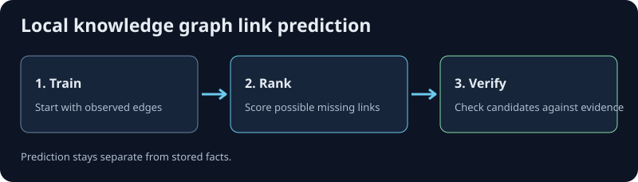

# @ruvector/kge

Predict missing links in a knowledge graph from example relationships. This
opt-in [RuVector](https://github.com/ruvnet/ruvector) package ranks plausible
triples, compares relations, and supports two-hop composition with RotatE.
Inference runs locally in Node.js through a native addon or the WASM fallback.



## Predict a missing link in Node.js

Use Node.js 18 or later. The package offers native builds for Linux (glibc x64
and ARM64), macOS (x64 and ARM64), and Windows x64, plus a Node.js WASM
fallback. This example works without a database, API key, or network access
after installation.

```sh
npm install --save-exact @ruvector/kge@0.2.0
```

Save as `predict.cjs`, then run `node predict.cjs`:

```js
const assert = require('node:assert/strict');
const { createKge } = require('@ruvector/kge');

async function main() {
  const kge = createKge({ scorer: 'hole', dims: 32, seed: 42 });
  const rows = [
    ['iris', 'flowers', 'garden'],
    ['tulip', 'flowers', 'garden'],
    ['daisy', 'flowers', 'garden'],
    ['lily', 'flowers', null],
    ['trout', 'fish', 'water'],
    ['salmon', 'fish', 'water'],
    ['carp', 'fish', 'water'],
    ['perch', 'fish', 'water'],
  ];
  kge.addTriples(rows.flatMap(([s, family, habitat]) => [
    { s, r: 'isA', o: family, split: 'train' },
    ...(habitat ? [{ s, r: 'foundIn', o: habitat, split: 'train' }] : []),
  ]));
  await kge.train({ epochs: 10, lr: 0.1 });
  const { candidates } = kge.predict({ s: 'lily', r: 'foundIn', k: 3 });
  assert.equal(candidates[0]?.entity, 'garden');
  console.log('Predicted: lily foundIn garden');
}

main().catch((error) => {
  console.error(error);
  process.exitCode = 1;
});
```

Expected output: `Predicted: lily foundIn garden`. The fixture deliberately
omits the `lily foundIn garden` training edge. This result is a prediction on
a toy graph; it is neither a stored fact nor a model accuracy benchmark.
To test the fallback, set `KGE_BACKEND=wasm` before running the same command.
For retrieving explicit edges and their provenance, see the
[RuVector graph examples](https://github.com/ruvnet/ruvector/tree/main/examples/graph).

## What it is

A trained pair of embedding tables (entities `E`, relations `R`) plus a scorer.
The default scorer is **HolE** (Holographic Embeddings, Nickel, Rosasco &
Poggio, AAAI 2016): it scores `r · (e_s ⋆ e_o)`, a relation vector dotted with
the *circular correlation* of the head and tail entity vectors.

**HolE ≡ ComplEx.** Hayashi & Shimbo (ACL 2017, arXiv:1702.05563) proved HolE is
algebraically the same model class as ComplEx (Trouillon 2016). That is the
load-bearing fact of this package: it lets us ship the real-valued
circular-correlation form — half the parameters of ComplEx's doubled
real/imaginary table — while inheriting ComplEx's accuracy *and* its
inner-product structure, which is what makes ANN candidate retrieval possible
(ADR-001, ADR-002).

The opt-in second scorer is **RotatE** (Sun et al., ICLR 2019,
arXiv:1902.10197), the one family member that represents relation
**composition** `r1 ∘ r2` — the pattern HolE/ComplEx cannot.

## Status (v1)

- **Platforms.** 0.2.0 bundles native addons for the five platforms listed
  above plus the WASM fallback. Older 0.1.0 builds bundled only
  `linux-x64-gnu` and WASM. `KGE_BACKEND=wasm` forces the fallback on
  either version.
- **`predict`, `similarRelations`, `compose`, `train`, `eval`, `buildIndex` and
  `optimize` all work today.** `predict` is exhaustive until you `buildIndex`,
  then ANN-accelerated. Before `train`, the tables are the deterministic seed
  init, so scores are structurally valid but not yet meaningful.
- **`optimize` runs the ADR-004 self-optimization campaign.** It fits each HPO
  and model arm on the frozen `train` split, gates it against the incumbent with
  the paired anytime-valid test (a candidate wins a validation query when it
  ranks the true entity above the incumbent), enforces the transfer-holdout
  non-regression check, then installs the best promoted arm's exact trained
  tables. It reports baseline-vs-champion validation, transfer and test MRR (the
  test split scored exactly twice), the per-proposal decisions, and the
  hash-chained receipt log. No numbers are invented — every MRR is measured on
  the model's own splits.
- **Composition is RotatE-only**; asking a HolE model to `compose` returns
  `{"error":{"kind":"unsupported"}}`.
- **The ANN index and trained weights: growth-safe, index transient.** Adding
  triples grows the tables in place (trained rows are preserved) and drops the
  index. The index is not saved, so after `loadKge` you `buildIndex` again.

## Install

```sh
npm install @ruvector/kge
```

Building from source in this repo:

```sh
bash scripts/build-native.sh   # -> native/kge.<triple>.node
bash scripts/build-wasm.sh     # -> wasm/ (nodejs + bundler), with the ADR-005 import check
npm run build                  # tsc -> dist/
```

`KGE_BACKEND=wasm` forces the fallback; otherwise the native addon loads when
present, else WASM.

## Quick start (TypeScript)

```ts
import { createKge, defineSchema } from '@ruvector/kge';

// Optional: a schema narrows the relation argument to a string-literal union.
const schema = defineSchema({ relations: ['bornIn', 'locatedIn'] as const });

const kge = createKge({ scorer: 'hole', dims: 256, schema });
kge.addTriples([
  { s: 'Ada', r: 'bornIn', o: 'London' },
  { s: 'London', r: 'locatedIn', o: 'England' },
]);

// Link prediction — leave exactly one slot open:
const tails = kge.predict({ s: 'Ada', r: 'bornIn', k: 10 });
tails.candidates[0].entity;   // best-ranked object

// Relation similarity (cosine over relation vectors):
kge.similarRelations({ r: 'bornIn', k: 5 });

// Save / restore (the envelope carries a sha256; load fails closed on a mismatch):
const saved = kge.save();
import { loadKge } from '@ruvector/kge';
const restored = loadKge(saved);

// Signed save / restore: the envelope also carries an HMAC-SHA256 under your key
// (at least 16 bytes), and load rejects edits made without it:
const signed = kge.save({ key: process.env.KGE_MODEL_KEY });
const trusted = loadKge(signed, { key: process.env.KGE_MODEL_KEY });
```

Errors are thrown as `KgeError` with a `.kind` in
`limit | invalid | unavailable | unsupported | scorer`; success payloads never
throw. A malformed or tampered `save()` envelope makes `loadKge` throw
`KgeError{kind:'invalid'}`.

## Quick start (CLI)

```sh
kge import  --triples facts.jsonl --out model.json --scorer hole --dims 256
kge predict --model model.json --s Ada --r bornIn -k 10
kge similar --model model.json --r bornIn -k 5
kge compose --model model.json --r1 bornIn --r2 locatedIn --s Ada -k 10  # RotatE model
kge serve   --model model.json --port 8788
```

`facts.jsonl` is one `{"s","r","o"}` per line. `kge serve` exposes
`POST /v1/predict`, `POST /v1/compose` and `GET /healthz` on 127.0.0.1; it logs
method, path, status and milliseconds only — never the request body.

## The three operators

| Verb | Query | Returns |
|---|---|---|
| `predict` | `{s, r, k}` or `{r, o, k}` | `{candidates:[{entity,score}], exact, ann}` |
| `similarRelations` | `{r, k}` | `{relations:[{relation,score}]}` |
| `compose` | `{r1, r2, s, k}` (RotatE) | `{candidates:[{entity,score}], exact, ann}` |

`exact:true, ann:false` marks the exhaustive path. After `buildIndex()`,
`predict` uses the `DistanceMetric::DotProduct` HNSW path (ADR-001 §3) and
returns `exact:false, ann:true`; pass `useIndex:false` to force exhaustive
scoring.

## Training, evaluation, optimization

```ts
await kge.train({ epochs: 50, lr: 0.1 });   // CPU mini-batch training in place
kge.buildIndex();                            // HNSW over entities; predict goes ANN
const r = kge.evaluate({ split: 'test' });   // filtered MRR / Hits@k
r.report.combined.mrr;
```

- `train(config)` / `kge train` — mini-batch training over the tables (ADR-003).
  Training de-duplicates the store; if you add the same fact several times to
  record how often it occurs, pass `duplicates: 'count'` (train it once per
  occurrence, capped at 1,000) or `'log'` (`1 + floor(ln n)` times). The
  default, `'ignore'`, keeps the previous behaviour.
- `evaluate(config)` / `kge eval` — filtered ranking metrics. **Split tags are
  honoured verbatim**: tag triples on ingest (`addTriples([{s,r,o,split:'test'}])`)
  and `train` uses only the `train` split while `eval({split:'test'})` scores
  exactly that subset — this is how the bench harness pins ADR-006's frozen
  split. With no tags, a `split` is a **derived** 80/10/10 partition, a smoke
  check only. `predict({..., useIndex:false})` forces exhaustive scoring even
  when an index exists (exact per-candidate scores).
- `optimize(spec)` / `kge optimize --budget N [--receipts r.jsonl] [--out m.json]`
  — the self-optimization loop (ADR-004). `spec` is all-optional
  (`{budget, alpha, seed, splitRatios, transferTolerance, lambdaCost, grid}`);
  the budget is capped at 64. It uses the model's **frozen per-triple split tags**
  when present. With **untagged** triples it falls back to `split4`, whose
  transfer holdout is a whole set of relations — with only a handful of relations
  that transfer MRR is measured on never-trained relations and is noisy, so tag
  your splits for a meaningful campaign. `optimize` installs the champion's
  trained tables into the model (so `save()` afterwards persists the tuned
  model) and returns an `OptimizeReport` whose ids (`championId`,
  `proposals[].id`) are strings that match the receipts' `knobs_hash` exactly.
  It runs **synchronously** on the calling thread (unlike `train`, which has a
  native async form); at large `dims` a campaign can block for minutes.

## Security promises (ADR-005)

- **No network, no subprocess, no file reads in the scoring path.** The CLI
  reads/writes model files; the library never does. CI greps the built
  artifacts to enforce it (`scripts/check-security.mjs`).
- **The WASM module imports no WASI / fs / net / socket / fetch symbol**
  (`scripts/check-wasm-imports.mjs`, run in the wasm build).
- **Triple and label text is never logged**; errors carry numeric ids only.
- **Saved models are content-hashed** (sha256 envelope); load fails closed on a
  mismatch. The sha256 catches corruption, but anyone can recompute it after an
  edit. For tamper evidence, save with `{ key }` and load with the same key:
  the envelope then carries an HMAC-SHA256, and `loadKge` throws
  `KgeError{kind:'invalid'}` for an unsigned, edited or wrongly keyed model.
  Signed envelopes still load without a key. Signing needs a binding built from
  this version (native, or a rebuilt WASM package).
- **Input limits**, rejected with a typed error, never truncated: ≤ 1M
  entities, ≤ 100k relations, label ≤ 1 KiB, `k` ≤ 1000.

## Measured

FFT-vs-direct circular correlation, x86_64, from
[`bench/fft-spike-2026-09-21.json`](bench/fft-spike-2026-09-21.json) (rustfft
6.4.1; median ns/op):

| dimension `d` | FFT correlation speedup vs direct |
|---|---|
| 128 | 71× |
| 256 | 138× |
| 512 | 297× |

Batch scoring against a 2,000-entity table beats per-triple scoring by ~10.5×.
The ADR-002 §3 pass criterion — FFT beats direct at `d=512` and rustfft runs on
wasm32 — holds.

Link-prediction quality (filtered MRR / Hits@k on FB15k-237, WN18RR, CoDEx-M),
ANN recall, and latency are **to be measured by `kge bench`** (ADR-006); no
numbers are quoted here until that harness writes them.

## Release-gate status (0.1.0)

From the committed receipts in `bench/results/` (21 Sep 2026). ADR-006 gates
that have not yet been run at full scale are listed as such rather than implied.

| Gate (ADR-006) | Status |
|---|---|
| Link prediction, FB15k-237 / WN18RR (MRR ≥ LibKGE ComplEx − 3 pts) | Not yet run on the full datasets; the committed FB15k-237 receipt is a 493-entity subgraph (test MRR 0.50) |
| ANN recall@10 ≥ 0.90 | Pass on the synthetic suite (0.985) and the FB15k-237 subgraph (0.988). Below the gate on a sparser graph: 0.865 on a 3,000-entity WN18RR subgraph (2,752 entities seen, 275 test + validation queries, default `buildIndex()`), measured independently on 27 Sep 2026. Use `useIndex: false` where recall matters more than latency |
| Adversarial confidence drop > 0 | Open: on the synthetic suite, confidence rose slightly under the symmetry-decoy attack (drop −0.059) |
| Predict p95 latency (native) | Pass |
| Tie-break, HolE≡ComplEx, loop safety | Not exercised by the committed receipts (HolE≡ComplEx is covered by the crate unit test) |

## Notes

- **Duplicate facts.** `addTriples` stores every triple it is given (and counts
  them in `added`), but training builds a de-duplicated `TripleStore`, so by
  default repeating a fact does not weight it. Opt in with `duplicates: 'count'`
  or `'log'` (see Training above).
- **Regularisation.** The trainer's default N3 weight is `1e-3`. For
  ComplEx-style models a larger weight (e.g. `n3_lambda: 0.05` in `train`)
  often scores better; tune it on your validation split.

## Design records

- [ADR-001 — architecture](docs/adr/ADR-001-architecture.md)
- [ADR-002 — scorers and math (HolE via FFT)](docs/adr/ADR-002-scorers-and-math.md)
- [ADR-003 — training and evaluation](docs/adr/ADR-003-training-and-evaluation.md)
- [ADR-004 — self-optimization loop](docs/adr/ADR-004-self-optimization-loop.md)
- [ADR-005 — security model](docs/adr/ADR-005-security-model.md)
- [ADR-006 — benchmarks and release gates](docs/adr/ADR-006-benchmarks-and-release-gates.md)

## License

MIT
