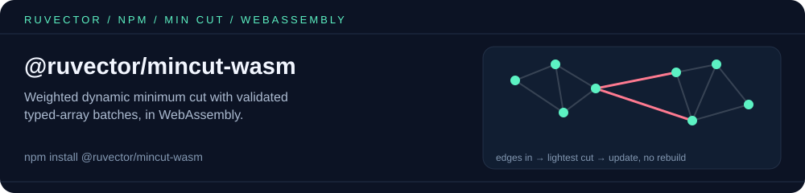

<p align="center"></p>

# @ruvector/mincut-wasm

Weighted dynamic minimum cut for Node.js and browsers: build a graph from typed-array batches, read the lightest cut, and update edge weights without rebuilding.

**Environments.** Node.js 22+ (CommonJS and ESM) and browsers via the `web` entry. Pure WebAssembly: no native build step and no runtime dependencies.

<!-- weaver:seo:install:start -->
## Install

```bash
npm install @ruvector/mincut-wasm
```
<!-- weaver:seo:install:end -->

## Quickstart

```javascript
const { WasmMinCut } = require('@ruvector/mincut-wasm');

// A triangle: edges 0-1 (weight 2), 1-2 (weight 3), 0-2 (weight 4)
const graph = WasmMinCut.fromEdges([[0, 1, 2], [1, 2, 3], [0, 2, 4]]);
try {
  console.log('min cut value:', graph.minCutValue());
  console.log('cut edges:', JSON.stringify(graph.cutEdges()));

  graph.updateEdge(0n, 1n, 10); // dynamic update, no rebuild
  console.log('after update:', graph.minCutValue());
} finally {
  graph.free(); // WASM memory is released explicitly
}
```

Expected output:

```text
min cut value: 5
cut edges: [{"u":0,"v":1,"weight":2},{"u":1,"v":2,"weight":3}]
after update: 7
```

For bulk loads use `batchInsertTyped(new Uint32Array([u0, v0, u1, v1, ...]), new Float64Array([w0, w1, ...]))`; invalid IDs or weights throw and leave the graph unchanged. Browsers import `@ruvector/mincut-wasm/web` and pass the `.wasm` bytes (exported as `@ruvector/mincut-wasm/wasm`) to `init()`.

Next step: pair it with [`@ruvector/graph-wasm`](https://www.npmjs.com/package/@ruvector/graph-wasm) to store the graph you are cutting.

<!-- weaver:seo:links:start -->
## Works with / Used by

Part of the [ruv.io](https://ruv.io) open-source stack for WASM, vector database, vector search.

- **Works with** (its runtime dependencies): no other ruvnet package (standalone)
- **Used by** (published packages that depend on it): [`agentdb`](https://www.npmjs.com/package/agentdb) (optional), [`agentic-flow`](https://www.npmjs.com/package/agentic-flow) (optional), [`ruvector`](https://www.npmjs.com/package/ruvector) (optional)
<!-- weaver:seo:links:end -->

<!-- weaver:seo:footer:start -->
---

Built by [rUv](https://ruv.io) · [ruv.io](https://ruv.io) · [Source](https://github.com/ruvnet/ruvector)
<!-- weaver:seo:footer:end -->
