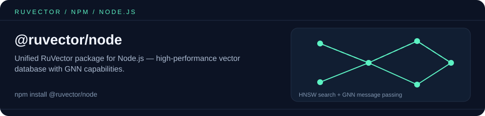

<p align="center"></p>

# @ruvector/node

[](https://www.npmjs.com/package/@ruvector/node)
[](https://github.com/ruvnet/ruvector/blob/main/LICENSE)

One install for the native RuVector vector database and its graph-neural-network (GNN) layer in Node.js. This package re-exports [`@ruvector/core`](https://www.npmjs.com/package/@ruvector/core) (`VectorDB`) and [`@ruvector/gnn`](https://www.npmjs.com/package/@ruvector/gnn) (`RuvectorLayer`, `TensorCompress`, …); both are native N-API modules installed as dependencies.

## Install

```bash
npm install @ruvector/node
```

Requires Node.js 18+ on a platform with prebuilt binaries for both dependencies (Linux x64/ARM64 glibc, macOS x64/ARM64, Windows x64).

## Usage

```javascript
const { VectorDB, RuvectorLayer, TensorCompress, differentiableSearch } = require('@ruvector/node');

// Vector database (from @ruvector/core)
const db = new VectorDB({ dimensions: 4, storagePath: './vectors.db', hnswConfig: {} });
await db.insert({ id: 'a', vector: new Float32Array([1, 0, 0, 0]) });
await db.insert({ id: 'b', vector: new Float32Array([0, 1, 0, 0]) });
const [best] = await db.search({ vector: new Float32Array([1, 0.1, 0, 0]), k: 1 }); // best.id === 'a'

// GNN layer (from @ruvector/gnn): inputDim, hiddenDim, heads, dropout
const layer = new RuvectorLayer(4, 8, 2, 0.1);
const h = layer.forward(
  new Float32Array([1, 0, 0, 0]),                                  // node embedding
  [new Float32Array([0, 1, 0, 0]), new Float32Array([0, 0, 1, 0])], // neighbor embeddings
  new Float32Array([0.5, 0.5])                                      // edge weights
); // Float32Array of length hiddenDim (8)

// Soft top-k over candidate embeddings
const { indices, weights } = differentiableSearch(
  new Float32Array([1, 0, 0, 0]),
  [new Float32Array([1, 0, 0, 0]), new Float32Array([0, 1, 0, 0])],
  1,   // k
  1.0  // temperature
);

// Access-frequency-aware embedding compression
const tc = new TensorCompress();
const packed = tc.compress(new Float32Array([0.1, 0.2, 0.3, 0.4]), 0.5); // JSON string
const restored = tc.decompress(packed);                                 // Float32Array
```

ES modules work too: `import { VectorDB, RuvectorLayer } from '@ruvector/node'`. A default export bundles the same functions.

Vectors must be `Float32Array`. See the [`@ruvector/core` README](https://www.npmjs.com/package/@ruvector/core) for `VectorDB` options (distance metrics, `hnswConfig`, `storagePath` defaults) and the [`@ruvector/gnn` README](https://www.npmjs.com/package/@ruvector/gnn) for the GNN API.

## Exports

| Entry point | Exports |
|-------------|---------|
| `@ruvector/node` | `VectorDB`, `RuvectorLayer`, `TensorCompress`, `differentiableSearch`, `hierarchicalForward`, `getCompressionLevel`, `initGnn`; types `VectorEntry`, `SearchQuery`, `CoreSearchResult`, `GnnSearchResult`, `CompressionLevelConfig` |
| `@ruvector/node/gnn` | `RuvectorLayer`, `TensorCompress`, `differentiableSearch`, `hierarchicalForward`, `getCompressionLevel`, `init`; types `SearchResult`, `CompressionLevelConfig` |

## Related packages

- [`@ruvector/core`](https://www.npmjs.com/package/@ruvector/core) — the vector database re-exported here; install it alone if you don't need GNN.
- [`@ruvector/gnn`](https://www.npmjs.com/package/@ruvector/gnn) — the GNN layers re-exported here.
- [`@ruvector/graph-wasm`](https://www.npmjs.com/package/@ruvector/graph-wasm) — property graph + Cypher in WebAssembly, for the relationships your GNN consumes.
- [`ruvector`](https://www.npmjs.com/package/ruvector) — umbrella package and CLI (`npx ruvector`).

## License

MIT

<!-- weaver:seo:links:start -->
## Works with / Used by

Part of the [ruv.io](https://ruv.io) open-source stack for graph neural network, Node.js, vector search.

- **Works with** (its runtime dependencies): [`@ruvector/core`](https://www.npmjs.com/package/@ruvector/core), [`@ruvector/gnn`](https://www.npmjs.com/package/@ruvector/gnn)
- **Used by** (published packages that depend on it): none yet
<!-- weaver:seo:links:end -->

<!-- weaver:seo:footer:start -->
---

Built by [rUv](https://ruv.io) · [ruv.io](https://ruv.io) · [Source](https://github.com/ruvnet/ruvector)
<!-- weaver:seo:footer:end -->
