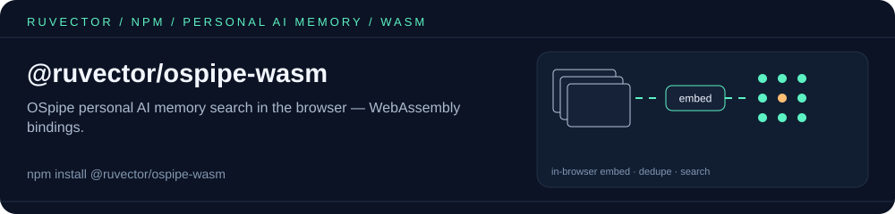

<p align="center"></p>

# @ruvector/ospipe-wasm

WebAssembly bindings for [OSpipe](https://github.com/ruvnet/ruvector/tree/main/examples/OSpipe), the
RuVector-enhanced personal AI memory for [Screenpipe](https://github.com/mediar-ai/screenpipe). It keeps
frame embeddings in memory inside the browser and searches them locally, with no backend.

For the Node.js / Screenpipe-pipe SDK, see [`@ruvector/ospipe`](https://www.npmjs.com/package/@ruvector/ospipe).

## Install

```bash
npm install @ruvector/ospipe-wasm
```

## Usage

The package is built with `wasm-pack --target web`, so initialise the module before use:

```javascript
import init, { OsPipeWasm } from '@ruvector/ospipe-wasm';

await init();
const pipe = new OsPipeWasm(384); // embedding dimension

const emb = pipe.embed_text('quarterly planning notes'); // demo embedding, see below
pipe.insert('frame-1', emb, JSON.stringify({ app: 'Notes' }), Date.now());

const hits = pipe.search(pipe.embed_text('planning'), 5); // [{ id, score, metadata, timestamp }]
```

## API

| Method | Description |
|---|---|
| `new OsPipeWasm(dimension)` | Create an in-memory store for embeddings of `dimension` floats |
| `insert(id, embedding, metadata, timestamp)` | Store a frame embedding with a JSON metadata string and a Unix-ms timestamp |
| `search(query, k)` | Top-k similarity search, returns `{ id, score, metadata, timestamp }[]` |
| `search_filtered(query, k, startTime, endTime)` | Top-k search limited to a timestamp range (inclusive) |
| `is_duplicate(embedding, threshold)` | `true` if any stored embedding has cosine similarity ≥ `threshold` |
| `len()` / `is_empty()` / `stats()` | Store size and a JSON stats string |
| `embed_text(text)` / `batch_embed(texts)` | Deterministic hash-based embeddings, for demos and tests only. They are **not** neural embeddings |
| `safety_check(content)` | Returns `"deny"`, `"redact"` or `"allow"` for content such as card numbers or SSNs |
| `route_query(query)` | Keyword heuristic that returns `"Graph"`, `"Temporal"`, `"Keyword"` or `"Semantic"` |

For real semantic search, pass embeddings from a proper model (for example ONNX all-MiniLM-L6-v2 via
[`ruvector`](https://www.npmjs.com/package/ruvector)) instead of `embed_text`.

## Build from source

```bash
wasm-pack build examples/OSpipe --target web --release
```

## License

MIT

<!-- weaver:seo:links:start -->
## Works with / Used by

Part of the [ruv.io](https://ruv.io) open-source stack for WASM, agent memory, vector search.

- **Works with** (its runtime dependencies): no other ruvnet package (standalone)
- **Used by** (published packages that depend on it): none yet
<!-- weaver:seo:links:end -->

<!-- weaver:seo:footer:start -->
---

Built by [rUv](https://ruv.io) · [ruv.io](https://ruv.io) · [Source](https://github.com/ruvnet/ruvector)
<!-- weaver:seo:footer:end -->
