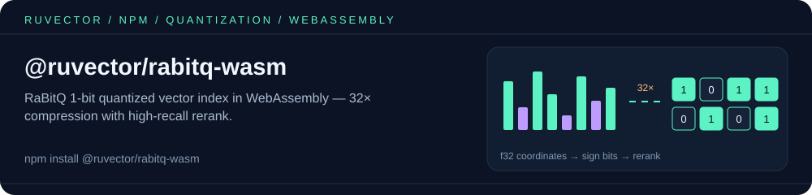

<p align="center"></p>

# @ruvector/rabitq-wasm

**RaBitQ 1-bit quantized vector index in WebAssembly.** Compress embeddings 32× and run approximate nearest-neighbor search in the browser, Cloudflare Workers, Deno, or Bun.

[](https://www.npmjs.com/package/@ruvector/rabitq-wasm)
[](https://github.com/ruvnet/RuVector#license)

## What is RaBitQ?

RaBitQ is a rotation-based 1-bit vector quantization scheme that compresses each f32 embedding into a single bit per dimension while preserving rank order under L2 distance. A small "rerank pool" of exact-distance computations on the top candidates restores recall.

For a 768-dimensional embedding (~3 KB raw), RaBitQ stores **96 bytes** of quantized code plus the rotation matrix — a 32× memory reduction. Search runs in two phases:

1. **Hamming-distance scan** over the 1-bit codes — fast, branch-free, ~10× more vectors per cache line than f32.
2. **Exact L2² rerank** of the top `rerank_factor × k` candidates — restores recall.

The rotation is **deterministic** from `(seed, dim, vectors)`, so the same input always produces bit-identical codes whether you build on x86_64, aarch64, or wasm32.

## Install

```bash
npm install @ruvector/rabitq-wasm
```

## Usage (browser)

```js
import init, { RabitqIndex } from "@ruvector/rabitq-wasm";

await init(); // the default export loads the .wasm (the named `init` export is only the panic-hook installer)

const dim = 768;
const n = 10_000;
const vectors = new Float32Array(n * dim);
// ... populate `vectors` with your embeddings (n × dim, row-major) ...

// seed = 42 for reproducibility; rerank_factor = 20 is the typical default
const idx = RabitqIndex.build(vectors, dim, 42n, 20);

const query = new Float32Array(dim);
// ... fill query ...

const results = idx.search(query, 10);
for (const r of results) console.log(r.id, r.distance); // e.g. 7421 0.0023
```

The hits are wasm-bindgen `SearchResult` objects whose `id` / `distance` are
getters, so `JSON.stringify` or `{ ...r }` won't show them — map to plain objects
first: `results.map(r => ({ id: r.id, distance: r.distance }))`.

## Usage (Node.js / Bun)

```js
import { RabitqIndex } from "@ruvector/rabitq-wasm/node/ruvector_rabitq_wasm.js";
// no `init()` needed for the node target

const idx = RabitqIndex.build(vectors, 768, 42n, 20);
const results = idx.search(query, 10);
```

## Usage (bundlers — Vite, Webpack, Rollup)

```js
import { RabitqIndex } from "@ruvector/rabitq-wasm/bundler/ruvector_rabitq_wasm.js";
// the bundler handles the .wasm import transparently
```

## API

### `class RabitqIndex`

#### `RabitqIndex.build(vectors, dim, seed, rerankFactor)`

Build an index from a flat `Float32Array` of length `n * dim`.

| Parameter | Type | Description |
|---|---|---|
| `vectors` | `Float32Array` | Row-major matrix of `n` vectors, each of length `dim`. |
| `dim` | `number` | Vector dimensionality. |
| `seed` | `bigint` | Random rotation seed. Same `(seed, dim, vectors)` triple → bit-identical codes. |
| `rerankFactor` | `number` | Multiplier on `k` for the exact-L2² rerank pool. Typical: 20. |

Throws if `dim == 0`, `vectors` is empty, or `vectors.length` is not a multiple of `dim`.

#### `idx.search(query, k)`

Find the `k` nearest neighbors of `query` (a `Float32Array` of length `dim`). Returns an array of `SearchResult` ordered ascending by distance. Throws if `k == 0` or the query length differs from the index's `dim`.

#### `idx.len` (getter, number)

Number of vectors indexed.

#### `idx.isEmpty` (getter, boolean)

`true` iff no vectors have been indexed.

### `class SearchResult`

```ts
{
  readonly id: number;       // caller-supplied vector id (its row index in `build`)
  readonly distance: number; // approximate L2² distance after rerank
}
```

`RabitqIndex` and `SearchResult` hold WASM memory; call `.free()` when you are done
with them in long-running code (they are also released by a `FinalizationRegistry`).

### `version()`

Returns the crate version baked at build time.

## Why use this in the browser

- **32× smaller indices.** A 100 K × 768 embedding store is ~9.6 MB instead of ~300 MB — fits comfortably in any browser tab.
- **Cache-line-friendly hamming scan.** The 1-bit codes pack 64 dimensions into one `u64`, so the hot path runs at memory bandwidth.
- **Deterministic across architectures.** Builds on your x86_64 build server, runs identically on the user's ARM phone or in a Cloudflare Worker.
- **No server.** Run RAG, semantic search, or recommendation lookup entirely client-side.

## Related packages

- [`@ruvector/acorn-wasm`](https://www.npmjs.com/package/@ruvector/acorn-wasm) — predicate-agnostic filtered HNSW in WASM, for when you also need to filter results by metadata.
- [`@ruvector/wasm`](https://www.npmjs.com/package/@ruvector/wasm) — the full ruvector vector database compiled to WASM for browsers.
- [`@ruvector/core`](https://www.npmjs.com/package/@ruvector/core) — native Node.js (NAPI) vector database with HNSW indexing.
- [`ruvector`](https://www.npmjs.com/package/ruvector) — umbrella package and CLI (`npx ruvector`).

## Source

- **Rust crate**: [`crates/ruvector-rabitq-wasm/`](https://github.com/ruvnet/RuVector/tree/main/crates/ruvector-rabitq-wasm)
- **Algorithm crate**: [`crates/ruvector-rabitq/`](https://github.com/ruvnet/RuVector/tree/main/crates/ruvector-rabitq)
- **ADR**: [ADR-154 RaBitQ rotation-based 1-bit quantization](https://github.com/ruvnet/RuVector/blob/main/docs/adr/ADR-154-rabitq-rotation-based-1bit-quantization.md)
- **Packaging ADR**: [ADR-161 — `ruvector-rabitq-wasm` npm package](https://github.com/ruvnet/RuVector/blob/main/docs/adr/ADR-161-rabitq-wasm-npm-package.md)
- **Repository**: [github.com/ruvnet/RuVector](https://github.com/ruvnet/RuVector)

## License

MIT OR Apache-2.0
