<p align="center"></p>

# @ruvector/router

Semantic router for AI agents - vector-based intent matching with HNSW indexing and SIMD acceleration.

## Features

- **Semantic Intent Matching**: Route queries to intents based on meaning, not keywords
- **HNSW Indexing**: Fast approximate nearest neighbor search
- **SIMD Optimized**: Native Rust performance with vectorized operations
- **Bring Your Own Embedder**: Plug in any `(text) => Promise<Float32Array>` function
- **Multi-Platform**: Works on Linux, macOS, and Windows

## Installation

```bash
npm install @ruvector/router
```

The package automatically installs the correct native binary for your platform.

The package is CommonJS. The `import { ... }` samples below work from TypeScript
compiled to CommonJS and from bundlers; in native Node ESM (`.mjs` or
`"type": "module"`) named imports of `SemanticRouter` / `DistanceMetric` fail, so
use the default import:

```js
import router from '@ruvector/router';
const { SemanticRouter, VectorDb, DistanceMetric } = router;
// or, in CommonJS: const { SemanticRouter } = require('@ruvector/router');
```

## Quick Start

The router does not ship an embedding model. Give it an embedder (any async
function that turns text into a `Float32Array` of length `dimension`), or pass
pre-computed embeddings yourself.

```typescript
import { SemanticRouter } from '@ruvector/router';

// Create router
const router = new SemanticRouter({ dimension: 384 });

// Plug in your embedding model (must return a Float32Array of length 384)
router.setEmbedder(async (text) => myEmbeddingModel.embed(text));

// Add intents with example utterances; addIntentAsync embeds each
// utterance and indexes their centroid
await router.addIntentAsync({
  name: 'weather',
  utterances: [
    'What is the weather today?',
    'Will it rain tomorrow?',
    'How hot will it be?'
  ],
  metadata: { handler: 'weather_agent' }
});

await router.addIntentAsync({
  name: 'greeting',
  utterances: [
    'Hello',
    'Hi there',
    'Good morning',
    'Hey'
  ],
  metadata: { handler: 'greeting_agent' }
});

await router.addIntentAsync({
  name: 'help',
  utterances: [
    'I need help',
    'Can you assist me?',
    'What can you do?'
  ],
  metadata: { handler: 'help_agent' }
});

// Route a query
const results = await router.route('What will the weather be like this weekend?');

console.log(results[0].intent);   // 'weather'
console.log(results[0].score);    // similarity, e.g. 0.92
console.log(results[0].metadata); // { handler: 'weather_agent' }
```

Matches scoring below `threshold` (default `0.7`) are dropped, so `route()` can
return fewer than `k` results — or an empty array.

## API Reference

### `SemanticRouter`

Main class for semantic routing.

#### Constructor

```typescript
new SemanticRouter(config: RouterConfig)
```

**RouterConfig:**
| Property | Type | Default | Description |
|----------|------|---------|-------------|
| `dimension` | number | required | Embedding dimension size |
| `metric` | string | 'cosine' | Distance metric: 'cosine', 'euclidean', 'dot', 'manhattan' |
| `m` | number | 16 | HNSW M parameter |
| `efConstruction` | number | 200 | HNSW ef_construction |
| `efSearch` | number | 100 | HNSW ef_search |
| `threshold` | number | 0.7 | Minimum similarity; lower-scoring matches are dropped |
| `quantization` | boolean | false | Accepted but not yet implemented (no effect) |

#### Methods

##### `setEmbedder(embedder: (text: string) => Promise<Float32Array>): void`

Set the function used to embed utterances (`addIntentAsync`) and string queries (`route`).

##### `addIntentAsync(intent: Intent): Promise<void>`

Add an intent, embedding its utterances with the embedder and indexing their
centroid. If `intent.embedding` is given, that is used instead. Throws if there
is neither an embedder nor an `embedding`.

```typescript
await router.addIntentAsync({
  name: 'booking',
  utterances: ['Book a flight', 'Reserve a hotel'],
  metadata: { department: 'travel' }
});
```

##### `addIntent(intent: Intent): void`

Synchronous variant. The intent is only searchable if you pass a pre-computed
`embedding` — without one it is registered by name but never matched.

```typescript
router.addIntent({
  name: 'booking',
  utterances: ['Book a flight', 'Reserve a hotel'],
  embedding: bookingCentroid, // Float32Array | number[] of length `dimension`
  metadata: { department: 'travel' }
});
```

##### `route(query: string | Float32Array, k?: number): Promise<RouteResult[]>`

Route a query to matching intents (`k` defaults to 1). A string query requires
`setEmbedder()`; otherwise it throws `No embedder set`.

```typescript
const results = await router.route('I want to book a vacation');
// [{ intent: 'booking', score: 0.89, metadata: {...} }]
```

##### `routeWithEmbedding(embedding: Float32Array | number[], k?: number): RouteResult[]`

Route with a pre-computed embedding (synchronous).

```typescript
const embedding = await getEmbedding('query text');
const results = router.routeWithEmbedding(embedding, 3);
```

##### `removeIntent(name: string): boolean`

Remove an intent from the router.

##### `getIntents(): string[]`

Get all registered intent names.

##### `getIntent(name: string): { name, utterances, metadata } | null`

Get one intent's details.

##### `count(): number`

Number of registered intents.

##### `clear(): void`

Remove all intents.

##### `save(path: string): Promise<void>`

Write intents (names, utterances, metadata, embeddings) and the threshold to a JSON file.

##### `load(path: string): Promise<void>`

Replace the router's intents with those from a file written by `save()`. The
router's `dimension` must match the saved one.

### Types

#### `Intent`

```typescript
interface Intent {
  name: string;                        // Unique intent identifier
  utterances: string[];                // Example utterances
  embedding?: Float32Array | number[]; // Pre-computed embedding
  metadata?: Record<string, unknown>;  // Custom metadata
}
```

#### `RouteResult`

```typescript
interface RouteResult {
  intent: string;                      // Matched intent name
  score: number;                       // Similarity score (0-1)
  metadata?: Record<string, unknown>;  // Intent metadata
}
```

### `VectorDb` (low-level)

The native HNSW index behind `SemanticRouter` is also exported.

```typescript
import { VectorDb, DistanceMetric } from '@ruvector/router';

const db = new VectorDb({
  dimensions: 384,
  distanceMetric: DistanceMetric.Cosine, // enum: Euclidean | Cosine | DotProduct | Manhattan
});

db.insert('doc-1', new Float32Array(384).fill(0.5));
const hits = db.search(new Float32Array(384).fill(0.5), 5);
// [{ id: 'doc-1', score: ~0 }]  — score is a distance (lower = closer)
```

- Vectors must be `Float32Array`; a plain `number[]` throws `Get TypedArray info failed`.
- `distanceMetric` takes the `DistanceMetric` enum, not a string (`'cosine'` / `'Cosine'` throw).
- Other options: `hnswM`, `hnswEfConstruction`, `hnswEfSearch`, `storagePath`, and
  `maxElements` (a capacity hint; with `enforceMaxElements: true` an insert past it
  throws `ERR_CAPACITY_EXCEEDED: ...`).
- Methods: `insert`, `insertAsync`, `search`, `searchAsync`, `delete`, `count`, `getAllIds`.

## Use Cases

### Chatbot Intent Detection

```typescript
const router = new SemanticRouter({ dimension: 384 });
router.setEmbedder(embed); // your (text) => Promise<Float32Array>

// Define intents
const intents = [
  { name: 'faq', utterances: ['What are your hours?', 'How do I contact support?'] },
  { name: 'order', utterances: ['Track my order', 'Where is my package?'] },
  { name: 'return', utterances: ['I want to return this', 'How do I get a refund?'] }
];

for (const i of intents) await router.addIntentAsync(i);

// Handle user message
async function handleMessage(text: string) {
  const [result] = await router.route(text);
  if (!result) return handleUnknown(text); // nothing above the threshold

  switch(result.intent) {
    case 'faq': return handleFAQ(text);
    case 'order': return handleOrder(text);
    case 'return': return handleReturn(text);
    default: return handleUnknown(text);
  }
}
```

### Multi-Agent Orchestration

```typescript
const agents = {
  'code': new CodeAgent(),
  'research': new ResearchAgent(),
  'creative': new CreativeAgent()
};

const router = new SemanticRouter({ dimension: 768 });
router.setEmbedder(embed); // your (text) => Promise<Float32Array>

await router.addIntentAsync({
  name: 'code',
  utterances: ['Write code', 'Debug this', 'Implement a function'],
  metadata: { agent: 'code' }
});

await router.addIntentAsync({
  name: 'research',
  utterances: ['Find information', 'Search for', 'Look up'],
  metadata: { agent: 'research' }
});

// Route task to best agent
async function routeTask(task: string) {
  const [result] = await router.route(task);
  if (!result) throw new Error(`No agent matched: ${task}`);
  const agent = agents[result.metadata.agent];
  return agent.execute(task);
}
```

## Platform Support

| Platform | Architecture | Package |
|----------|--------------|---------|
| Linux | x64 | `@ruvector/router-linux-x64-gnu` |
| Linux | ARM64 | `@ruvector/router-linux-arm64-gnu` |
| macOS | x64 | `@ruvector/router-darwin-x64` |
| macOS | ARM64 | `@ruvector/router-darwin-arm64` |
| Windows | x64 | `@ruvector/router-win32-x64-msvc` |

## Performance

- **Routing**: < 1ms per query with HNSW
- **Throughput**: 100,000+ routes/second
- **Memory**: ~1KB per intent + embeddings

## Related packages

- [`@ruvector/router-wasm`](https://www.npmjs.com/package/@ruvector/router-wasm) — WebAssembly build of the same router core, for browsers.
- [`@ruvector/tiny-dancer`](https://www.npmjs.com/package/@ruvector/tiny-dancer) — learned (FastGRNN) neural router for agent orchestration, an alternative to similarity routing.
- [`@ruvector/core`](https://www.npmjs.com/package/@ruvector/core) — full native vector database with HNSW indexing.
- [`ruvector`](https://www.npmjs.com/package/ruvector) — umbrella package and CLI (`npx ruvector`).

## License

MIT
