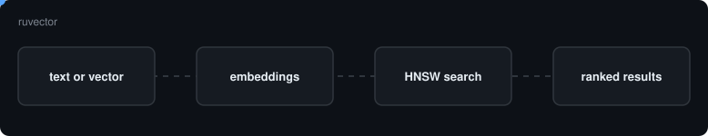
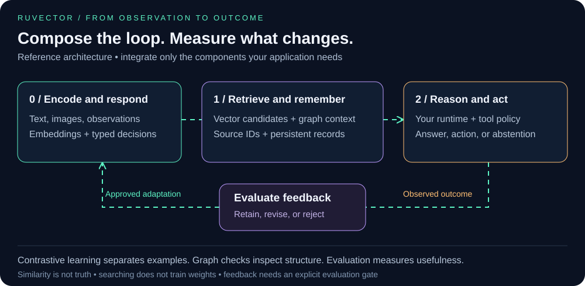

<p align="center"></p>

# ruvector: vector search and persistent agent memory

<!-- weaver:seo:flow:start -->

<!-- weaver:seo:flow:end -->



[](https://www.npmjs.com/package/ruvector)
[](https://github.com/ruvnet/RuVector/blob/main/LICENSE)

The `ruvector` npm package provides Node.js vector storage, semantic memory commands, and MCP integration. It is part of [Reuven Cohen's RuVector stack](https://github.com/ruvnet/RuVector). Specialized graph, learning, browser, and runtime libraries have their own packages and setup.

[Quick start](#quick-start) · [Claude Code](#claude-code) · [Node.js tutorial](https://github.com/ruvnet/RuVector/blob/main/examples/nodejs/README.md) · [Full library catalog](https://github.com/ruvnet/RuVector#library-and-capability-map)

## Quick start

Run in your project directory:

```bash
npm install ruvector
npx ruvector info
npx ruvector hooks remember --semantic --type decision "Keep customer inference in Canada."
npx ruvector hooks recall --semantic --top-k 3 "Where should inference run?"
```

Memories and vector stores support full create, read, update and delete:

```bash
npx ruvector hooks memory-list --type decision          # ids, newest first
npx ruvector hooks memory-update <id> --content "Keep customer inference in Canada and the EU."
npx ruvector hooks forget <id>

npx ruvector create vectors.db -d 384                   # vector store
npx ruvector insert vectors.db data.json                # [{id, vector, metadata?}], existing ids are replaced
npx ruvector get vectors.db doc-1
npx ruvector update vectors.db doc-1 --metadata '{"tag":"reviewed"}' --merge
npx ruvector delete vectors.db doc-1 doc-2
```

The same operations are available as MCP tools (`hooks_memory_*`, `hooks_forget`, `vectordb_*`) and in the library (`VectorDB#insert/get/update/delete/deleteMany`).

The first semantic command downloads a local embedding model. Memory belongs to the current project. Run recall again from the same directory in a new terminal to check persistence. Commit your lockfile to preserve dependency resolution.

**Backend check:** native vector operations require a working native backend. If it cannot load, the limited fallback does not provide persistent vector storage. Browser applications should use the [WASM package and tutorial](https://github.com/ruvnet/RuVector/blob/main/examples/wasm-vanilla/README.md). See [supported deployment surfaces](https://github.com/ruvnet/RuVector#deployment-surfaces).

## Claude Code

```bash
claude mcp add --scope project --env RUVECTOR_MCP_PROFILE=readonly --transport stdio ruvector -- npx -y ruvector mcp start
claude mcp get ruvector
```

Open Claude Code in the project, approve the project server when prompted, and check `/mcp`. Ask it to retrieve relevant project memory and identify the supporting records.

[Complete Claude Code instructions and CLAUDE.md sample](https://github.com/ruvnet/RuVector#claude-code-setup)

### Other MCP clients

Use command `npx`, arguments `["-y", "ruvector", "mcp", "start"]`, and environment `RUVECTOR_MCP_PROFILE=readonly`. Launch from the project directory.

```bash
npx ruvector mcp tools
RUVECTOR_MCP_PROFILE=readonly npx ruvector mcp start
```

Available tools vary with package version and policy. `RUVECTOR_MCP_DENY` overrides allow rules; `RUVECTOR_MCP_ALLOW` and profiles restrict access. Without a policy, the broader compatibility surface remains available. [Policy and agent integration](https://github.com/ruvnet/RuVector#agent-integration).

## Build with the SDK

Follow the [Node.js write and reopen tutorial](https://github.com/ruvnet/RuVector/blob/main/examples/nodejs/README.md). It uses `VectorDB`, `OnnxEmbedder`, and search parameter `k`, with a separate read process to verify storage.

[Node.js API](https://github.com/ruvnet/RuVector/blob/main/docs/api/NODEJS_API.md) · [Current exports](https://github.com/ruvnet/RuVector/blob/main/npm/packages/ruvector/src/index.ts)

## Choose a capability

| System | Start with | Tutorial |
| :--- | :--- | :--- |
| System 0: Sense and respond | Local embeddings, npm `@ruvector/typesafe` | [Typed decisions](https://github.com/ruvnet/RuVector/blob/main/npm/packages/typesafe/README.md) |
| System 1: Learn and remember | `ruvector`, `@ruvector/kge`, `@ruvector/sona` | [Memory](https://github.com/ruvnet/RuVector/blob/main/examples/nodejs/README.md), [KGE](https://github.com/ruvnet/RuVector/blob/main/npm/packages/kge/README.md), [SONA](https://github.com/ruvnet/RuVector/blob/main/npm/packages/sona/README.md) |
| System 2: Reason and orchestrate | MCP, MetaHarness integrations, RVF artifacts | [Examples hub](https://github.com/ruvnet/RuVector/blob/main/examples/README.md), [RVF](https://github.com/ruvnet/RuVector/blob/main/examples/rvf/README.md) |

Reading memory does not train weights. Learning requires explicit outcomes and an evaluation policy. Contrastive learning and graph coherence provide different signals; neither establishes factual truth.

### Optional extras

Some features use packages that are not installed by default. `ruvector add` installs one into your project with the package manager it finds (npm, pnpm, yarn or bun), after printing what it will install and why.

```bash
npx ruvector add --list            # extras, what each enables, installed or not
npx ruvector add rabitq --dry-run  # show the exact install command only
npx ruvector add rabitq diskann
```

| Extra | Package | Enables |
| :--- | :--- | :--- |
| `rabitq` | `@ruvector/rabitq-wasm` | `RabitqIndex`: 1-bit quantized search, ~32x smaller codes |
| `diskann` | `@ruvector/diskann` | `DiskAnnIndex`: on-disk Vamana index for data larger than RAM |
| `router` | `@ruvector/router` | `ruvector route`, `SemanticRouter` |
| `graph` | `@ruvector/graph-node` | `CodeGraph` with Cypher queries |
| `rvlite` | `rvlite` | `rvlite_sql`, `rvlite_cypher`, `rvlite_sparql` MCP tools |
| `quantum` | `@ruvector/ruqu-wasm` | `ruvector quantum`, `quantum_simulate` / `quantum_info` MCP tools, `ruvector.quantum` |

`rvf`, `tiny-dancer` and `quantum` are optional dependencies and are usually present already; `add` installs them if your install skipped optional packages.

## Quantum (ruqu)

`ruvector quantum` (alias `ruvector ruqu`) runs state-vector quantum circuits on the [ruqu](https://github.com/ruvnet/ruqu) engine, Rust compiled to WebAssembly. The engine is the optional package `@ruvector/ruqu-wasm`. If it is missing, the command prints `npm i @ruvector/ruqu-wasm` and exits non-zero.

```bash
npm i @ruvector/ruqu-wasm                          # if optional deps were skipped
npx ruvector quantum simulate bell                 # |00> and |11> at 0.5 each, plus 1024 sampled shots
npx ruvector quantum simulate ghz:5 --shots 4096 --seed 1
npx ruvector quantum simulate "h 0; rx 1 1.5708; cx 0 2" --json
npx ruvector quantum simulate circuit.json         # {"qubits":2,"gates":[{"gate":"h","qubits":[0]},{"gate":"cnot","qubits":[0,1]}]}
npx ruvector quantum grover --qubits 4 --target 11
npx ruvector quantum bench                         # GHZ at 10, 16 and 20 qubits
npx ruvector quantum info
```

The gates are `h x y z s t rx ry rz cnot/cx cz swap rzz barrier`. Measurement is not a circuit op, because the engine would collapse it with unseeded randomness. Use `--shots` instead: it samples the final state with a seeded PRNG, so the counts are reproducible. Qubit 0 is the rightmost bit, so `x 0` on 2 qubits gives `|01>`.

From code, `const { quantum } = require('ruvector'); await quantum.simulate(quantum.ghzCircuit(3), { shots: 1000 })`. The accessor is lazy, so neither the wrapper nor the WASM engine loads until you use it. MCP clients get `quantum_simulate` and `quantum_info`. Both are in the `readonly` profile. The MCP caps are 20 qubits (a 16 MiB state vector, since the state takes 2^n × 16 bytes), 10,000 gates, 100,000 shots and the top 256 states. NaN or infinite angles are rejected. The CLI allows up to the engine's 25 qubits.

Measured with `ruvector quantum bench` (GHZ circuit, median of 7, Node 22, Ryzen 9 9950X):

| Qubits | State vector | Simulate |
| ---: | ---: | ---: |
| 10 | 16 KiB | 0.11 ms |
| 16 | 1 MiB | 5.60 ms |
| 20 | 16 MiB | 104.70 ms |

The engine adds 458 KB unpacked to an install. `npx ruvector --help` cold start was unchanged: 30 ms, against 31 ms before.

**Works with:** [ruqu](https://github.com/ruvnet/ruqu), the quantum simulator and agent harness (`npx @ruvector/ruqu`), which this command uses as its engine.

## Recipe: knowledge-graph link prediction (`@ruvector/kge`)

Predict missing facts in a knowledge graph. [`@ruvector/kge`](https://www.npmjs.com/package/@ruvector/kge) trains HolE / RotatE embeddings on `(head, relation, tail)` triples locally and ranks candidate tails for a query like `(Tim, citizenOf, ?)`. It is opt-in: `ruvector` does not depend on it or install it, and it has no runtime dependencies of its own.

```bash
npx @ruvector/kge demo
```

The demo trains on a bundled toy graph of 39 triples with three `citizenOf` facts held out, then predicts them. Output from a clean install of 0.2.1 (Node 22, under a second):

```text
Trained HolE (dims 64, 500 epochs) on 39 triples: 24 entities, 4 relations.
3 citizenOf facts were held out of training. Predicting them:

(Tim, citizenOf, ?)  held-out answer: UK, rank 1 of 24
  1. UK           3.34  <- held out
  2. Ada          2.68
  3. Alan         2.54

(Simone, citizenOf, ?)  held-out answer: France, rank 1 of 24
  1. France       3.35  <- held out
  2. German       2.70
  3. Manchester   1.49

(Max, citizenOf, ?)  held-out answer: Germany, rank 1 of 24
  1. Germany      3.58  <- held out
  2. English      1.63
  3. Lyon         1.05
```

Each held-out answer ranks first. To use it from code, `npm install @ruvector/kge` and see its [README](https://www.npmjs.com/package/@ruvector/kge).

## Coding hooks and harnesses

[Hooks reference](https://github.com/ruvnet/RuVector/blob/main/npm/packages/ruvector/HOOKS.md) covers setup, generated configuration, and workflow integration.

```bash
npx ruvector hooks --help
npx ruvector hooks verify
npx ruvector harness doctor --json
```

Review generated hooks before using them. Harness execution and hosted Brain commands have different effects and data boundaries from local retrieval. Start with the [governance and deployment guide](https://github.com/ruvnet/RuVector#security-and-governance).

## Troubleshooting

| Symptom | Check |
| :--- | :--- |
| Native backend unavailable | Run `npx ruvector info`; check platform and native dependency installation |
| Empty recall after changing directory | Return to the directory that owns the memory store |
| Embedding dimension mismatch | Use the original model and dimension; review `npx ruvector hooks reembed --help` before migrating |
| Claude cannot find the server | Run `claude mcp get ruvector`, then inspect `/mcp` in that project |
| A write tool is unavailable | Check the configured MCP profile and explicit tool policy |

[Benchmarks with scope and evidence](https://github.com/ruvnet/RuVector#reproduce-the-evidence) · [Known boundaries](https://github.com/ruvnet/RuVector#known-boundaries) · [Issues](https://github.com/ruvnet/RuVector/issues) · [MIT license](https://github.com/ruvnet/RuVector/blob/main/LICENSE)

<!-- weaver:seo:links:start -->
## Works with / Used by

Part of the [ruv.io](https://ruv.io) open-source stack for vector database, vector search, embeddings.

- **Works with** (its runtime dependencies): [`@ruvector/attention`](https://www.npmjs.com/package/@ruvector/attention), [`@ruvector/core`](https://www.npmjs.com/package/@ruvector/core), [`@ruvector/gnn`](https://www.npmjs.com/package/@ruvector/gnn), [`@ruvector/sona`](https://www.npmjs.com/package/@ruvector/sona), [`@metaharness/darwin`](https://www.npmjs.com/package/@metaharness/darwin), [`@metaharness/flywheel`](https://www.npmjs.com/package/@metaharness/flywheel), [`@metaharness/harness`](https://www.npmjs.com/package/@metaharness/harness), [`@metaharness/redblue`](https://www.npmjs.com/package/@metaharness/redblue), [`@metaharness/router`](https://www.npmjs.com/package/@metaharness/router), [`@metaharness/weight-eft`](https://www.npmjs.com/package/@metaharness/weight-eft), [`@metaharness/workspace-lens`](https://www.npmjs.com/package/@metaharness/workspace-lens), [`@metaharness/workspace-probe`](https://www.npmjs.com/package/@metaharness/workspace-probe), [`@ruvector/mincut-wasm`](https://www.npmjs.com/package/@ruvector/mincut-wasm), [`@ruvector/rabitq-wasm`](https://www.npmjs.com/package/@ruvector/rabitq-wasm), [`@ruvector/ruqu-wasm`](https://www.npmjs.com/package/@ruvector/ruqu-wasm), [`@ruvector/rvf`](https://www.npmjs.com/package/@ruvector/rvf), [`@ruvector/tiny-dancer`](https://www.npmjs.com/package/@ruvector/tiny-dancer), [`metaharness`](https://www.npmjs.com/package/metaharness), [`@ruvector/diskann`](https://www.npmjs.com/package/@ruvector/diskann), [`@ruvector/pi-brain`](https://www.npmjs.com/package/@ruvector/pi-brain), [`@ruvector/router`](https://www.npmjs.com/package/@ruvector/router), [`@ruvector/ruvllm`](https://www.npmjs.com/package/@ruvector/ruvllm), [`rvlite`](https://www.npmjs.com/package/rvlite)
- **Used by** (published packages that depend on it): [`@claude-flow/cli`](https://www.npmjs.com/package/@claude-flow/cli), [`@foxruv/iris-agentic-synth`](https://www.npmjs.com/package/@foxruv/iris-agentic-synth), [`@ruvector/agentic-synth`](https://www.npmjs.com/package/@ruvector/agentic-synth), [`@ruvector/all`](https://www.npmjs.com/package/@ruvector/all), [`agentdb`](https://www.npmjs.com/package/agentdb), [`agentic-flow`](https://www.npmjs.com/package/agentic-flow), [`claude-flow`](https://www.npmjs.com/package/claude-flow), [`psycho-symbolic-integration`](https://www.npmjs.com/package/psycho-symbolic-integration), [`ruvector-extensions`](https://www.npmjs.com/package/ruvector-extensions), [`ruvector-mragent`](https://www.npmjs.com/package/ruvector-mragent)
<!-- weaver:seo:links:end -->

<!-- weaver:seo:footer:start -->
---

Built by [rUv](https://ruv.io) · [ruv.io](https://ruv.io) · [Source](https://github.com/ruvnet/ruvector)
<!-- weaver:seo:footer:end -->
