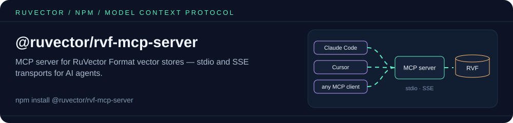

<p align="center"></p>

# @ruvector/rvf-mcp-server

Local vector search for AI agents over MCP: this server lets Claude Code, Cursor or any Model Context Protocol client open a portable `.rvf` vector index on your disk and run k-nearest-neighbor search against its HNSW index, with no hosted database and no API key.

It is the MCP front end for [`@ruvector/rvf`](https://www.npmjs.com/package/@ruvector/rvf), the library that writes and reads `.rvf` files. Build an index with `@ruvector/rvf` (or with this server's `rvf_create_store` / `rvf_ingest` tools), then search it from any MCP client.

## Supported environments

- **Node.js** >= 18 (`engines`). The quickstart below was run on Node 20.x, 22.23 and 24.22 on Linux x64.
- **OS / CPU**: the server always opens stores through the native `@ruvector/rvf-node` binding, which ships prebuilt binaries for Linux x64 and arm64 (glibc), macOS x64 and arm64, and Windows x64. There is no prebuilt binary for Alpine/musl or 32-bit platforms.
- **No WASM fallback in the server.** `@ruvector/rvf` itself installs an optional `@ruvector/rvf-wasm` backend for browsers and in-memory use, but this server needs real files on disk and does not fall back to it. On a platform without a native binary, opening a store fails.

## Quickstart: search a portable RVF index through MCP

```bash
mkdir rvf-mcp-demo && cd rvf-mcp-demo
npm init -y
npm install @ruvector/rvf-mcp-server @ruvector/rvf @modelcontextprotocol/sdk
```

`@ruvector/rvf` and `@modelcontextprotocol/sdk` are already dependencies of the server; listing them lets the two scripts import them directly and adds nothing to the install.

**1. Build an index.** Save as `build-index.mjs`:

```js
// build-index.mjs: write a small portable RVF index to stores/docs.rvf
import { RvfDatabase } from '@ruvector/rvf';
import { mkdirSync } from 'node:fs';

const docs = [
  { id: 'intro-to-rvf', vector: [0.9, 0.1, 0.0, 0.0] },
  { id: 'hnsw-explained', vector: [0.7, 0.6, 0.1, 0.0] },
  { id: 'mcp-tools', vector: [0.0, 0.2, 0.9, 0.1] },
  { id: 'claude-code-setup', vector: [0.1, 0.0, 0.8, 0.5] },
  { id: 'cooking-pasta', vector: [0.0, 0.0, 0.1, 0.99] },
];

mkdirSync('stores', { recursive: true });
const db = await RvfDatabase.create('stores/docs.rvf', { dimensions: 4, metric: 'cosine' });
const { accepted } = await db.ingestBatch(
  docs.map((d) => ({ id: d.id, vector: new Float32Array(d.vector) })),
);
await db.close();
console.log(`wrote stores/docs.rvf with ${accepted} vectors`);
```

In a real index the vectors come from your embedding model; four dimensions keep the example readable.

**2. Search it through the MCP server.** Save as `search.mjs`. It starts the server over stdio, exactly as an MCP client would, and calls the `rvf_open_store` and `rvf_query` tools:

```js
// search.mjs: start rvf-mcp-server over stdio and search stores/docs.rvf through MCP
import { Client } from '@modelcontextprotocol/sdk/client/index.js';
import { StdioClientTransport } from '@modelcontextprotocol/sdk/client/stdio.js';
import { fileURLToPath } from 'node:url';
import { resolve } from 'node:path';

const cli = fileURLToPath(new URL('./cli.js', import.meta.resolve('@ruvector/rvf-mcp-server')));
const transport = new StdioClientTransport({
  command: process.execPath,
  args: [cli, '--data-dir', resolve('stores')],
});
const client = new Client({ name: 'rvf-quickstart', version: '1.0.0' });
await client.connect(transport);

async function call(name, args) {
  const res = await client.callTool({ name, arguments: args });
  const text = res.content[0].text;
  if (text.startsWith('Error:')) throw new Error(`${name}: ${text}`);
  return JSON.parse(text);
}

const store = await call('rvf_open_store', { path: 'docs.rvf', readOnly: true });
console.log(`opened ${store.path}: ${store.dimensions} dims, ${store.metric}`);
const { results } = await call('rvf_query', {
  storeId: store.storeId,
  vector: [0.05, 0.1, 0.85, 0.3], // "how do I set up MCP in Claude Code?"
  k: 3,
});
for (const [i, r] of results.entries()) {
  console.log(`${i + 1}. ${r.id.padEnd(18)} distance=${r.distance.toFixed(4)}`);
}
await client.close();
```

**3. Run both:**

```bash
node build-index.mjs
node search.mjs
```

Expected output (the `RVF MCP Server starting` line is the server's banner on stderr):

```text
wrote stores/docs.rvf with 5 vectors
RVF MCP Server starting (stdio transport)...
opened docs.rvf: 4 dims, cosine
1. claude-code-setup  distance=0.0310
2. mcp-tools          distance=0.0324
3. cooking-pasta      distance=0.5773
```

Results are ranked by distance, closest first. For `cosine` the distance is `1 - cosine similarity`.

**Moving an index.** `RvfDatabase` keeps string ids in a sidecar, so copy `docs.rvf` *and* `docs.rvf.idmap.json` together; without the sidecar, results come back with numeric ids. Metadata filters (`filter` on `rvf_query`) use the server's own `<store>.mcp-meta.jsonl`, so they apply to vectors ingested through the server's `rvf_ingest` tool, not to an index built elsewhere.

### Use the same index from Claude Code

`--data-dir` must be an absolute path: the MCP client starts the server from its own working directory.

```bash
claude mcp add rvf -- npx -y @ruvector/rvf-mcp-server --data-dir "$PWD/stores"
claude mcp get rvf
```

`claude mcp get rvf` should report `Status: ✔ Connected`. Then ask Claude to open `docs.rvf` and search it. To share the server with a project, add `--scope project`, which writes this `.mcp.json`:

```json
{
  "mcpServers": {
    "rvf": {
      "type": "stdio",
      "command": "npx",
      "args": ["-y", "@ruvector/rvf-mcp-server", "--data-dir", "/absolute/path/to/stores"],
      "env": {}
    }
  }
}
```

### How it works

<p align="center"></p>

## Install

```bash
npx @ruvector/rvf-mcp-server --transport stdio
```

## Claude Code Integration

Add to your MCP config:

```json
{
  "mcpServers": {
    "rvf": {
      "command": "npx",
      "args": ["@ruvector/rvf-mcp-server", "--transport", "stdio"]
    }
  }
}
```

## Transports

```bash
# stdio (for Claude Code, Cursor, etc.)
npx @ruvector/rvf-mcp-server --transport stdio

# SSE (for web clients)
npx @ruvector/rvf-mcp-server --transport sse --port 3100
```

The SSE transport binds `127.0.0.1` by default and serves one session at a time. It has no authentication; use `--host <address>` to bind elsewhere only behind your own auth proxy. Point clients at `http://127.0.0.1:3100/sse` (on dual-stack hosts `localhost` may resolve to `::1`; use `--host ::1` if your client needs it).

## Storage

Stores are real `.rvf` files written through [`@ruvector/rvf`](https://www.npmjs.com/package/@ruvector/rvf), so they survive server restarts and queries go through the native HNSW index instead of a linear scan. Every tool `path` is resolved inside the data directory: `--data-dir <dir>`, else `$RVF_MCP_DATA_DIR`, else `~/.rvf-mcp-server`. Absolute paths, `..` segments and symlinks that lead outside it are rejected. Per-vector metadata, which the native store does not hold, lives next to each store in `<store>.mcp-meta.jsonl`. Metadata filters are applied to an over-fetched index result.

## MCP Tools

| Tool | Description |
|------|-------------|
| `rvf_create_store` | Create a new RVF vector store |
| `rvf_open_store` | Open an existing store |
| `rvf_close_store` | Close and release writer lock |
| `rvf_ingest` | Insert vectors with optional metadata |
| `rvf_query` | k-NN similarity search with filters |
| `rvf_delete` | Delete vectors by ID |
| `rvf_delete_filter` | Delete vectors matching a filter |
| `rvf_compact` | Compact store to reclaim space |
| `rvf_status` | Get store status |
| `rvf_list_stores` | List all open stores |

## MCP Resources

| URI | Description |
|-----|-------------|
| `rvf://stores` | JSON listing of all open stores |

## MCP Prompts

| Prompt | Description |
|--------|-------------|
| `rvf-search` | Natural language similarity search |
| `rvf-ingest` | Data ingestion with auto-embedding |

## Requirements

- Node.js >= 18.0.0

## Works with / Used by

- **Depends on** [`@ruvector/rvf`](https://www.npmjs.com/package/@ruvector/rvf) for the `.rvf` file format and HNSW search (native binding [`@ruvector/rvf-node`](https://www.npmjs.com/package/@ruvector/rvf-node)), plus [`@modelcontextprotocol/sdk`](https://www.npmjs.com/package/@modelcontextprotocol/sdk), `express` (SSE transport) and `zod` (tool input schemas).
- **Works with** any MCP client that can launch a stdio server or connect to an SSE endpoint, including Claude Code and Cursor.
- **Used by**: no published npm package depends on `@ruvector/rvf-mcp-server` today.
- **Related**: the [`ruvector`](https://www.npmjs.com/package/ruvector) CLI's own MCP server (`ruvector mcp start`) also exposes path-based `rvf_*` tools alongside its other tools. Use this package when you want only the RVF tools, a data directory that tool paths cannot escape, and four runtime dependencies.

## License

MIT

---

Part of [RuVector](https://github.com/ruvnet/RuVector) · [ruv.io](https://ruv.io)
