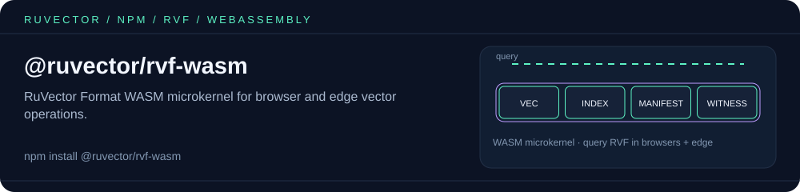

<p align="center"></p>

# @ruvector/rvf-wasm

RuVector Format (RVF) WASM build for browsers and edge functions. Query vectors directly in the browser with zero backend.

## Install

```bash
npm install @ruvector/rvf-wasm
```

## Usage

`@ruvector/rvf-wasm` itself is a low-level C-ABI module (raw `rvf_*` exported
functions operating on integer handles and WASM linear-memory pointers) — it
does **not** export a `WasmRvfStore` class or any other high-level wrapper.
For ergonomic browser usage, install `@ruvector/rvf` and use its `wasm`
backend, which wraps this module for you:

```bash
npm install @ruvector/rvf
```

```javascript
import { RvfDatabase } from '@ruvector/rvf';

const db = await RvfDatabase.create('unused-in-wasm', { dimensions: 384 }, 'wasm');
// The WASM backend stores u64 IDs: pass decimal-integer strings ('1', '42', ...).
// Non-numeric IDs such as 'a' are rejected (only the Node backend maps
// arbitrary string IDs).
await db.ingestBatch([{ id: '1', vector: new Float32Array(384).fill(0.1) }]);
const results = await db.query(new Float32Array(384).fill(0.1), 10);
console.log(results); // [{ id: '1', distance: 0 }]

// The WASM backend is in-memory only (no filesystem access). To persist a
// store across page loads, serialize it to bytes and save them yourself
// (e.g. to IndexedDB/OPFS), then reload with RvfDatabase.openBytes():
const bytes = await db.exportBytes();
// ...write `bytes` to IndexedDB/OPFS...
const reopened = await RvfDatabase.openBytes(bytes, 'wasm');
```

See [#705](https://github.com/ruvnet/RuVector/issues/705) for background: an
earlier version of this README described an unshipped `WasmRvfStore` API.

## Features

- Single ~40 KB WASM module (`pkg/rvf_wasm_bg.wasm`, `wasm32-unknown-unknown`)
- In-memory store with exact (brute-force) k-NN search: create, ingest, query, delete, export/open bytes
- Tile query path: distances, top-k merge, SQ/PQ dequantization, HNSW neighbor navigation
- Segment header parsing, CRC32C/checksum and witness-chain verification
- No backend required

The raw exports are declared in `pkg/rvf_wasm.d.ts` (`RvfWasmExports`); the
default export `init(input?)` instantiates the module and resolves to them.

## Related packages

- [`@ruvector/rvf`](https://www.npmjs.com/package/@ruvector/rvf) — TypeScript SDK; its `'wasm'` backend wraps this module.
- [`@ruvector/rvf-node`](https://www.npmjs.com/package/@ruvector/rvf-node) — native N-API backend for Node.js with file persistence and HNSW indexing.
- [`ruvector`](https://www.npmjs.com/package/ruvector) — umbrella package and CLI (`npx ruvector`).

## License

MIT
