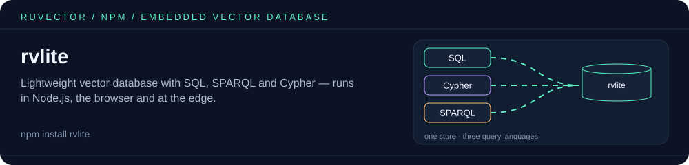

<p align="center"></p>

# RvLite

Lightweight vector database with SQL, SPARQL, and Cypher - runs everywhere (Node.js, Browser, Edge).

Built on WebAssembly for maximum performance and portability. Only ~850KB!

## Features

- **Vector Search** - Semantic similarity with cosine, euclidean, or dot product distance
- **SQL** - Query vectors with standard SQL plus distance operations
- **Cypher** - Property graph queries (Neo4j-compatible syntax)
- **SPARQL** - RDF triple store with W3C SPARQL queries
- **Persistence** - Save/load to file (Node.js) or IndexedDB (browser)
- **Tiny** - ~850KB WASM bundle, no external dependencies

## Installation

```bash
npm install rvlite
```

## CLI Usage

The CLI stores its database as JSON (default `.rvlite/db.json`, override with `--path`).
It covers vector and RDF-triple operations; SQL, Cypher and SPARQL queries are
available through the SDK (below), not as CLI commands.

```bash
# Initialize a new database (default: 384 dimensions, cosine)
npx rvlite init --dimensions 384 --metric cosine

# Insert a vector
npx rvlite insert "[0.1, 0.2, 0.3, ...]" --metadata '{"text": "Hello"}'

# Search for similar vectors
npx rvlite search "[0.1, 0.2, 0.3, ...]" --top 5

# Get / delete by ID
npx rvlite get vec_1
npx rvlite delete vec_1

# RDF triples
npx rvlite triple "http://example.org/alice" "http://xmlns.com/foaf/0.1/name" "Alice"
npx rvlite triples

# Interactive REPL
npx rvlite repl

# Database stats
npx rvlite stats

# Export/Import
npx rvlite export backup.json
npx rvlite import backup.json
```

Run `npx rvlite --help` for the full command list (it also includes `embed`,
`embed-search`, `batch-insert`, `benchmark` and the `sona-*`, `agent-*`,
`federated-*` and `attention*` learning commands).

### REPL Commands

```
.insert <vector> [metadata]  - Insert a vector
.search <vector> [k]         - Search for similar vectors
.get <id>                    - Get vector by ID
.delete <id>                 - Delete vector
.triple <s> <p> <o>          - Add RDF triple
.triples                     - List all triples
.stats                       - Show statistics
.bench [n]                   - Quick benchmark (n vectors)
.save                        - Save database
.clear                       - Clear screen
.exit                        - Exit REPL
```

## SDK Usage

### Basic Vector Operations

```typescript
import { RvLite, createRvLite } from 'rvlite';

// Create instance
const db = await createRvLite({ dimensions: 384 });

// Insert vectors
const id = await db.insert([0.1, 0.2, 0.3, ...], { text: "Hello world" });

// Insert with custom ID
await db.insertWithId("my-doc-1", [0.1, 0.2, ...], { source: "article" });

// Search similar
const results = await db.search([0.1, 0.2, ...], 5);
// [{ id: "...", score: 0.0012, vector: [...], metadata: Map {...} }, ...]
// `score` is a distance (lower = closer); `metadata` comes back as a JS Map

// Get by ID
const item = await db.get("my-doc-1");

// Delete
await db.delete("my-doc-1");
```

### SQL Queries

```typescript
// Create table (VECTOR needs its dimension) and insert (column list required,
// vector literals are unquoted)
await db.sql("CREATE TABLE documents (id TEXT, title TEXT, embedding VECTOR(3))");
await db.sql("INSERT INTO documents (id, title, embedding) VALUES ('doc1', 'Hello', [0.1, 0.2, 0.3])");

// Nearest-neighbour query. The parser accepts <-> (L2), <=> (cosine) and
// <#> (dot product); in the current release all three return the same
// (cosine) distance, regardless of the operator or distanceMetric.
const results = await db.sql(`
  SELECT id, title FROM documents
  ORDER BY embedding <-> [0.1, 0.2, 0.3]
  LIMIT 5
`);
// { rows: [{ id: { Text: 'doc1' }, title: { Text: 'Hello' }, _distance: { Real: ... }, ... }], rows_affected: 0 }
```

### Cypher Graph Queries

```typescript
// Create nodes and a relationship in one pattern
await db.cypher(`
  CREATE (alice:Person {name: 'Alice', age: 30})-[:KNOWS {since: 2020}]->(bob:Person {name: 'Bob', age: 25})
`);

// Query
const friends = await db.cypher(`
  MATCH (p:Person)-[:KNOWS]->(friend:Person)
  WHERE p.name = 'Alice'
  RETURN friend.name
`);
// { columns: ['friend.name'], rows: [Map { 'friend.name' => ... }] }
```

> Note: in the current release `MATCH ... CREATE (a)-[:REL]->(b)` does not bind
> to the matched nodes (it creates new ones), so create relationships in the
> same `CREATE` pattern as their nodes.

### SPARQL RDF Queries

```typescript
// Add triples — wrap IRIs in <...>; a bare string is stored as a literal
await db.addTriple(
  "<http://example.org/alice>",
  "<http://xmlns.com/foaf/0.1/name>",
  "Alice"
);

await db.addTriple(
  "<http://example.org/alice>",
  "<http://xmlns.com/foaf/0.1/knows>",
  "<http://example.org/bob>"
);

// Query
const results = await db.sparql(`
  PREFIX foaf: <http://xmlns.com/foaf/0.1/>
  SELECT ?name WHERE {
    <http://example.org/alice> foaf:name ?name
  }
`);
```

### Persistence

```typescript
// Node.js - Export to file
const state = await db.exportJson();
fs.writeFileSync('db.json', JSON.stringify(state));

// Node.js - Import from file
const data = JSON.parse(fs.readFileSync('db.json'));
await db.importJson(data);

// Browser only - save()/load()/clearStorage() throw in Node.js
// Browser - Save to IndexedDB
await db.save();

// Browser - Load from IndexedDB
const db = await RvLite.load({ dimensions: 384 });

// Browser - Clear storage
await RvLite.clearStorage();
```

### Semantic Memory for AI

```typescript
import { RvLite, SemanticMemory, createRvLite } from 'rvlite';

// Create with embedding provider
const db = await createRvLite({ dimensions: 1536 });
const memory = new SemanticMemory(db);

// Store memories with embeddings
await memory.store("conv-1", "User asked about weather", embedding1);
await memory.store("conv-2", "Discussed travel plans", embedding2);

// Add relationships
await memory.addRelation("conv-1", "LEADS_TO", "conv-2");

// Query by similarity
const similar = await memory.query("What was the weather question?", queryEmbedding);

// Find related through graph
const related = await memory.findRelated("conv-1", 2);
```

> Note: `addRelation()` uses `MATCH ... CREATE`, which (see the Cypher note above)
> does not yet link the existing memory nodes, so `findRelated()` currently
> returns no rows. `store()` and `query()` work as shown.

## RVF Storage Backend

RvLite can persist to an `.rvf` file in Node.js via `RvLite.createWithRvf()`, `saveToRvf()` and `loadFromRvf()` (see [RVF (RuVector Format)](https://github.com/ruvnet/ruvector/tree/main/crates/rvf)). Saving is explicit — inserts are not written to disk until you call `saveToRvf()`.

### Install

```bash
npm install rvlite
```

### Usage

```typescript
import { RvLite } from 'rvlite';

// Opens the file if it exists (and loads it), otherwise starts empty
const db = await RvLite.createWithRvf({ dimensions: 384, rvfPath: './data/db.rvf' });

await db.insert([0.1, 0.2, ...], { text: "Hello world" });
const results = await db.search([0.1, 0.2, ...], 5);

// Write the current state to disk
await db.saveToRvf('./data/db.rvf');
```

The file rvlite writes is a JSON envelope (`"magic": "RVF1"`) around the
`exportJson()` payload. rvlite would use a native RVF reader/writer from
`@ruvector/rvf-wasm` (an optional dependency) if that package exported one; the
current `@ruvector/rvf-wasm` does not, so the JSON envelope is what you get.

### Platform Support

| Platform | Persistence | Notes |
|----------|-------------|-------|
| Node.js (Linux, macOS, Windows) | `.rvf` file via `saveToRvf()` / `loadFromRvf()`, or `exportJson()` | Needs `fs` |
| Browser (Chrome, Firefox, Safari) | IndexedDB via `save()` / `RvLite.load()`, or `exportJson()` | `saveToRvf()` / `loadFromRvf()` throw outside Node.js |

### Rust Feature Flag

If building from source, enable the `rvf-backend` feature in `crates/rvlite`:

```toml
[dependencies]
rvlite = { version = "0.3", features = ["rvf-backend"] }
```

This enables epoch-based reconciliation between RVF and metadata stores:
- Monotonic epoch counter shared between RVF and metadata
- On startup, compares epochs and rebuilds the lagging side
- RVF file is source of truth; metadata (IndexedDB) is rebuildable cache

### Download Example .rvf Files

These are binary RVF containers for the [`@ruvector/rvf`](https://www.npmjs.com/package/@ruvector/rvf)
tooling; rvlite's `loadFromRvf()` only reads its own JSON-envelope files, so it cannot open them.

```bash
# Download pre-built examples to test with
curl -LO https://raw.githubusercontent.com/ruvnet/ruvector/main/examples/rvf/output/basic_store.rvf
curl -LO https://raw.githubusercontent.com/ruvnet/ruvector/main/examples/rvf/output/semantic_search.rvf
curl -LO https://raw.githubusercontent.com/ruvnet/ruvector/main/examples/rvf/output/agent_memory.rvf

# 46 examples available at:
# https://github.com/ruvnet/ruvector/tree/main/examples/rvf/output
```

---

## Integration with claude-flow

RvLite can enhance claude-flow's memory system with semantic search:

```typescript
import { createRvLite } from 'rvlite';

// In your claude-flow hooks
const db = await createRvLite({ dimensions: 1536 });

// Pre-task hook: Find relevant context
async function preTask(task) {
  const embedding = await getEmbedding(task.description);
  const context = await db.search(embedding, 5);
  return { ...task, context };
}

// Post-task hook: Store results
async function postTask(task, result) {
  const embedding = await getEmbedding(result.summary);
  await db.insert(embedding, {
    task: task.id,
    result: result.summary,
    timestamp: Date.now()
  });
}
```

## API Reference

### RvLite Class

| Method | Description |
|--------|-------------|
| `insert(vector, metadata?)` | Insert vector, returns ID |
| `insertWithId(id, vector, metadata?)` | Insert with custom ID |
| `search(query, k)` | Find k nearest vectors (`score` is a distance; lower = closer) |
| `get(id)` | Get vector by ID |
| `delete(id)` | Delete vector by ID |
| `len()` | Count of vectors |
| `sql(query)` | Execute SQL query |
| `cypher(query)` | Execute Cypher query |
| `cypherStats()` | Get graph statistics |
| `sparql(query)` | Execute SPARQL query |
| `addTriple(s, p, o, graph?)` | Add RDF triple |
| `tripleCount()` | Count of triples |
| `exportJson()` | Export state to JSON |
| `importJson(data)` | Import state from JSON |
| `save()` | Save to IndexedDB (browser) |
| `RvLite.load(config)` | Load from IndexedDB |
| `RvLite.clearStorage()` | Clear IndexedDB |
| `RvLite.createWithRvf({ rvfPath, ...config })` | Create an instance, loading `rvfPath` if it exists (Node.js) |
| `saveToRvf(path)` | Write state to an `.rvf` file (Node.js) |
| `loadFromRvf(path)` | Load state from an `.rvf` file written by `saveToRvf` (Node.js) |

### CLI Commands

| Command | Description |
|---------|-------------|
| `rvlite init` | Initialize database |
| `rvlite insert <vector>` | Insert vector |
| `rvlite search <vector>` | Search similar |
| `rvlite get <id>` / `rvlite delete <id>` | Get / delete a vector |
| `rvlite batch-insert <file>` | Insert vectors from a JSON file |
| `rvlite triple <s> <p> <o>` | Add triple |
| `rvlite triples` | List triples |
| `rvlite stats` | Show statistics |
| `rvlite export <file>` | Export to JSON |
| `rvlite import <file>` | Import from JSON |
| `rvlite repl` | Start interactive mode |

## Related packages

- [`@ruvector/rvf`](https://www.npmjs.com/package/@ruvector/rvf) — SDK for the binary RVF container format (the `.rvf` example files above).
- [`@ruvector/rvf-wasm`](https://www.npmjs.com/package/@ruvector/rvf-wasm) — RVF WASM microkernel; rvlite's optional dependency.
- [`ruvector`](https://www.npmjs.com/package/ruvector) — umbrella package and CLI (`npx ruvector`).

## License

MIT OR Apache-2.0
