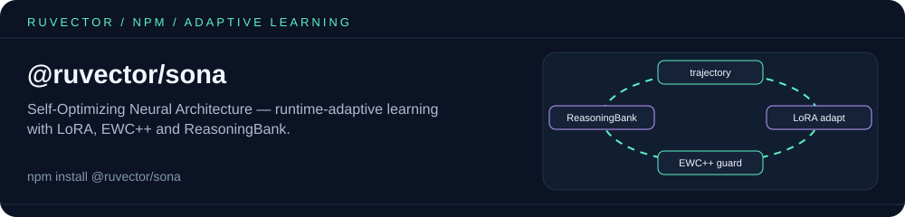

<p align="center"></p>

# @ruvector/sona

**Self-Optimizing Neural Architecture (SONA)** - Node.js bindings for adaptive learning with ReasoningBank.

SONA is a cutting-edge adaptive learning system that combines:
- **Micro-LoRA** (rank 1-2): Ultra-fast inference-time adaptation
- **Base LoRA** (rank 8+): Deeper background learning
- **EWC++**: Catastrophic forgetting prevention
- **ReasoningBank**: Pattern extraction and storage
- **Dual Learning Loops**: Instant (<1ms) and background (periodic) learning

## Features

- 🚀 **Instant Adaptation**: Sub-millisecond learning updates during inference
- 🧠 **Pattern Recognition**: Automatic extraction and clustering of learned patterns
- 🔄 **Dual Learning Loops**: Balance speed and depth with instant and background learning
- 💾 **Memory Preservation**: EWC++ prevents catastrophic forgetting
- ⚡ **High Performance**: Native Rust implementation with SIMD optimizations
- 🎯 **Production Ready**: Used in large-scale LLM deployments

## Installation

```bash
npm install @ruvector/sona
```

## Quick Start

```typescript
import { SonaEngine } from '@ruvector/sona';

// Create engine with hidden dimension
// const engine = new SonaEngine(512);

// Or with custom configuration
const engine = SonaEngine.withConfig({
  hiddenDim: 512,
  microLoraRank: 2,
  baseLoraRank: 16,
  microLoraLr: 0.002,
  qualityThreshold: 0.7,
});

// All vectors are plain number[] arrays (embeddings: embeddingDim, which
// defaults to hiddenDim; activations: hiddenDim). Typed arrays such as
// Float64Array are rejected by the binding.
// Start a trajectory: returns a numeric trajectory ID
const trajectoryId = engine.beginTrajectory(queryEmbedding);

// Record inference steps
engine.addTrajectoryStep(trajectoryId, activations, attentionWeights, 0.8);
engine.addTrajectoryStep(trajectoryId, activations2, attentionWeights2, 0.9);
engine.setTrajectoryRoute(trajectoryId, 'model-a');   // optional
engine.addTrajectoryContext(trajectoryId, 'ctx-1');   // optional

// Complete trajectory
engine.endTrajectory(trajectoryId, 0.85); // quality score

// Apply learned transformations (returns number[])
const output = engine.applyMicroLora(input);

// Force learning cycle
const result = engine.forceLearn();
console.log(result);

// Find similar patterns
const patterns = engine.findPatterns(queryEmbedding, 5);
patterns.forEach(p => {
  console.log(`Pattern ${p.id}: quality=${p.avgQuality}, size=${p.clusterSize}`);
});
```

## API Reference

### SonaEngine

Main class for adaptive learning.

#### Constructor

```typescript
new SonaEngine(hiddenDim: number)
```

Create a new SONA engine with default configuration.

**Parameters:**
- `hiddenDim`: Hidden dimension size (e.g., 256, 512, 1024)

#### Static Methods

##### `SonaEngine.withConfig(config: JsSonaConfig): SonaEngine`

Create engine with custom configuration.

**Configuration Options:**
```typescript
interface JsSonaConfig {
  hiddenDim: number;              // Required: Hidden dimension
  embeddingDim?: number;          // Default: hiddenDim
  microLoraRank?: number;         // Default: 1 (range: 1-2)
  baseLoraRank?: number;          // Default: 8
  microLoraLr?: number;           // Default: 0.001
  baseLoraLr?: number;            // Default: 0.0001
  ewcLambda?: number;             // Default: 1000.0
  patternClusters?: number;       // Default: 50
  trajectoryCapacity?: number;    // Default: 10000
  backgroundIntervalMs?: number;  // Default: 3600000 (1 hour)
  qualityThreshold?: number;      // Default: 0.5
  enableSimd?: boolean;           // Default: true
}
```

#### Instance Methods

##### `beginTrajectory(queryEmbedding: number[]): number`

Start recording a new inference trajectory. Returns a trajectory ID used by the
`*Trajectory*` methods below.

##### `addTrajectoryStep(trajectoryId: number, activations: number[], attentionWeights: number[], reward: number): void`

Add a step to the trajectory.

**Parameters:**
- `trajectoryId`: ID returned by `beginTrajectory`
- `activations`: Layer activations
- `attentionWeights`: Attention weights
- `reward`: Reward signal for this step

##### `setTrajectoryRoute(trajectoryId: number, route: string): void`

Set model route identifier.

##### `addTrajectoryContext(trajectoryId: number, contextId: string): void`

Add context ID to trajectory.

##### `endTrajectory(trajectoryId: number, quality: number): void`

Complete and submit trajectory for learning.

**Parameters:**
- `trajectoryId`: ID returned by `beginTrajectory`
- `quality`: Final quality score [0.0, 1.0]

##### `applyMicroLora(input: number[]): number[]`

Apply micro-LoRA transformation (instant learning).

##### `applyBaseLora(layerIdx: number, input: number[]): number[]`

Apply base-LoRA transformation to specific layer.

##### `tick(): string | null`

Run background learning cycle if due. Returns status message if executed.

##### `forceLearn(): string`

Force immediate background learning cycle.

##### `flush(): void`

Flush instant loop updates.

##### `findPatterns(queryEmbedding: number[], k: number): LearnedPattern[]`

Find k most similar learned patterns.

##### `getStats(): string`

Get engine statistics as JSON string.

##### `setEnabled(enabled: boolean): void`

Enable or disable learning.

##### `isEnabled(): boolean`

Check if engine is enabled.

### LearnedPattern

Represents a learned pattern from trajectory clustering (exported type name:
`JsLearnedPattern`).

```typescript
interface JsLearnedPattern {
  id: string;
  centroid: number[];
  clusterSize: number;
  totalWeight: number;
  avgQuality: number;
  createdAt: string;    // Unix seconds, as a string
  lastAccessed: string; // Unix seconds, as a string
  accessCount: number;
  patternType: string;  // see below
}
```

### Pattern types

`patternType` is a plain string (no enum is exported) with one of these values:

```typescript
type PatternType =
  | 'General'
  | 'Reasoning'
  | 'Factual'
  | 'Creative'
  | 'CodeGen'
  | 'Conversational';
```

## Advanced Usage

### LLM Integration Example

```typescript
import { SonaEngine } from '@ruvector/sona';

class AdaptiveLLM {
  private sona: SonaEngine;

  constructor() {
    this.sona = SonaEngine.withConfig({
      hiddenDim: 4096,
      microLoraRank: 2,
      baseLoraRank: 16,
      microLoraLr: 0.002,
      qualityThreshold: 0.7,
      backgroundIntervalMs: 1800000, // 30 minutes
    });
  }

  async generate(prompt: string): Promise<string> {
    const embedding = await this.embed(prompt); // number[]
    const trajectoryId = this.sona.beginTrajectory(embedding);

    // Generate with SONA-enhanced layers
    const output = await this.runInference(trajectoryId);

    // Calculate quality score
    const quality = this.assessQuality(output);

    // Submit trajectory for learning
    this.sona.endTrajectory(trajectoryId, quality);

    // Periodic background learning
    const status = this.sona.tick();
    if (status) {
      console.log('Background learning:', status);
    }

    return output;
  }

  private async runInference(trajectoryId: number): Promise<string> {
    let output = '';

    for (const layer of this.layers) {
      // Get layer activations
      const activations = layer.forward(/* ... */);
      const attention = layer.getAttention();

      // Apply micro-LoRA enhancement
      const enhanced = this.sona.applyMicroLora(activations);

      // Record step
      const reward = this.calculateReward(enhanced);
      this.sona.addTrajectoryStep(trajectoryId, activations, attention, reward);

      // Continue generation with enhanced activations
      output += this.decode(enhanced);
    }

    return output;
  }
}
```

### Pattern-Based Routing

```typescript
// Find similar patterns for routing decisions
const patterns = engine.findPatterns(queryEmbedding, 3);

if (patterns.length > 0) {
  const topPattern = patterns[0];

  if (topPattern.patternType === 'CodeGen' && topPattern.avgQuality > 0.8) {
    // Route to specialized code generation model
    await routeToCodeModel(query);
  } else if (topPattern.patternType === 'Reasoning') {
    // Use chain-of-thought prompting
    await useCoTPrompting(query);
  }
}
```

### Performance Monitoring

```typescript
// Get statistics
const stats = JSON.parse(engine.getStats());
// Keys: trajectories_recorded, trajectories_buffered, trajectories_dropped,
// buffer_success_rate, patterns_stored, patterns_learned, ewc_tasks,
// instant_ewc_tasks, instant_enabled, background_enabled
console.log(`
  Trajectories buffered: ${stats.trajectories_buffered}
  Trajectories dropped: ${stats.trajectories_dropped}
  Patterns stored: ${stats.patterns_stored}
  Patterns learned: ${stats.patterns_learned}
`);

// Force learning when needed
if (stats.trajectories_buffered > 100) {
  const result = engine.forceLearn();
  console.log('Forced learning:', result);
}
```

## Performance Characteristics

- **Micro-LoRA Application**: <1ms per forward pass
- **Trajectory Recording**: ~10μs per step
- **Background Learning**: Depends on buffer size (typically 100-500ms for 1000 trajectories)
- **Pattern Search**: O(k * n) where k = number of results, n = total patterns
- **Memory Usage**: ~50MB base + ~1KB per trajectory + ~10KB per pattern

## Architecture

SONA implements a dual-loop learning architecture:

1. **Instant Loop** (<1ms):
   - Accumulates micro-LoRA gradients during inference
   - Updates on every trajectory
   - Rank-1 or rank-2 LoRA for minimal overhead

2. **Background Loop** (periodic):
   - Extracts patterns via k-means clustering
   - Updates base LoRA weights
   - Applies EWC++ for stability
   - Prunes low-quality patterns

## Requirements

- Node.js >= 16
- Native bindings for your platform (automatically installed)

## Supported Platforms

- Linux x64 (glibc and musl), Linux ARM64 (glibc)
- macOS x64 and ARM64 (Apple Silicon)
- Windows x64 and ARM64

## Related packages

- [`ruvector-sona`](https://www.npmjs.com/package/ruvector-sona) — WebAssembly (wasm-pack) build of the same `sona` crate, for browsers.
- [`@ruvector/ruvllm`](https://www.npmjs.com/package/@ruvector/ruvllm) — self-learning LLM runtime; its Rust core uses the `sona` crate for adaptive learning.
- [`ruvector`](https://www.npmjs.com/package/ruvector) — umbrella package and CLI (`npx ruvector`); depends on `@ruvector/sona`.

## License

MIT OR Apache-2.0

## Links

- [GitHub Repository](https://github.com/ruvnet/ruvector)
- [Documentation](https://github.com/ruvnet/ruvector/tree/main/crates/sona)
- [rUvector Project](https://github.com/ruvnet/ruvector)

## Contributing

Contributions are welcome! Please see the main rUvector repository for contribution guidelines.

## Acknowledgments

SONA is part of the rUvector project, building on research in:
- Low-Rank Adaptation (LoRA)
- Elastic Weight Consolidation (EWC)
- Continual Learning
- Neural Architecture Search

---

Built with ❤️ by the rUv Team

<!-- weaver:seo:links:start -->
## Works with / Used by

Part of the [ruv.io](https://ruv.io) open-source stack for self-learning, LoRA, LLM routing.

- **Works with** (its runtime dependencies): no other ruvnet package (standalone)
- **Used by** (published packages that depend on it): [`@claude-flow/neural`](https://www.npmjs.com/package/@claude-flow/neural), [`@claude-flow/performance`](https://www.npmjs.com/package/@claude-flow/performance), [`@claude-flow/plugin-hyperbolic-reasoning`](https://www.npmjs.com/package/@claude-flow/plugin-hyperbolic-reasoning), [`@ruvector/all`](https://www.npmjs.com/package/@ruvector/all), [`agentdb`](https://www.npmjs.com/package/agentdb), [`agentic-flow`](https://www.npmjs.com/package/agentic-flow), [`claude-flow`](https://www.npmjs.com/package/claude-flow), [`ruvector`](https://www.npmjs.com/package/ruvector)
<!-- weaver:seo:links:end -->

<!-- weaver:seo:footer:start -->
---

Built by [rUv](https://ruv.io) · [ruv.io](https://ruv.io) · [Source](https://github.com/ruvnet/ruvector)
<!-- weaver:seo:footer:end -->
