<p align="center"></p>

# @ruvector/tiny-dancer

Neural router for AI agent orchestration - FastGRNN-based intelligent routing with circuit breaker, uncertainty estimation, and hot-reload.

## Features

- **FastGRNN Neural Routing**: Efficient gated recurrent network for fast inference
- **Uncertainty Estimation**: Know when the router is confident vs. uncertain
- **Circuit Breaker**: Automatic fallback when routing fails repeatedly
- **Hot-Reload**: Update models without restarting the application
- **SIMD Optimized**: Native Rust performance with SIMD acceleration
- **Multi-Platform**: Works on Linux, macOS, and Windows

## Installation

```bash
npm install @ruvector/tiny-dancer
```

The package automatically installs the correct native binary for your platform.

> **Embeddings must be `Float32Array`.** `queryEmbedding` and each candidate's `embedding` are passed straight to the native binding, which rejects plain `number[]` arrays (`Get TypedArray info failed`). Wrap arrays with `new Float32Array(arr)`.

## Quick Start

`Router` needs a FastGRNN model file at `modelPath`. If you don't have one yet, create one with [`trainRouter`](#training-a-model) first.

```typescript
import { Router } from '@ruvector/tiny-dancer';

// Create router with configuration
const router = new Router({
  modelPath: './models/fastgrnn.safetensors',
  confidenceThreshold: 0.85,
  maxUncertainty: 0.15,
  enableCircuitBreaker: true,
  circuitBreakerThreshold: 5
});

// Route a query to the best candidate
const response = await router.route({
  queryEmbedding: new Float32Array([0.1, 0.2, 0.3, ...]),
  candidates: [
    { id: 'gpt-4', embedding: new Float32Array([...]), successRate: 0.95 },
    { id: 'claude-3', embedding: new Float32Array([...]), successRate: 0.92 },
    { id: 'gemini', embedding: new Float32Array([...]), successRate: 0.88 }
  ]
});

// Get the best routing decision
const best = response.decisions[0];
console.log(`Route to: ${best.candidateId}`);
console.log(`Confidence: ${best.confidence}`);
console.log(`Use lightweight: ${best.useLightweight}`);
console.log(`Inference time: ${response.inferenceTimeUs}μs`);
```

## API Reference

### `Router`

Main class for neural routing.

#### Constructor

```typescript
new Router(config: RouterConfig)
```

**RouterConfig:**
| Property | Type | Default | Description |
|----------|------|---------|-------------|
| `modelPath` | string | required | Path to FastGRNN model file |
| `confidenceThreshold` | number | 0.85 | Minimum confidence for routing |
| `maxUncertainty` | number | 0.15 | Maximum uncertainty allowed |
| `enableCircuitBreaker` | boolean | true | Enable fault tolerance |
| `circuitBreakerThreshold` | number | 5 | Failures before circuit opens |
| `enableQuantization` | boolean | true | Enable memory-efficient quantization |
| `databasePath` | string | undefined | Optional persistence path |

#### Methods

##### `route(request: RoutingRequest): Promise<RoutingResponse>`

Route a query to the best candidate.

```typescript
const response = await router.route({
  queryEmbedding: new Float32Array([...]),
  candidates: [{ id: 'model-1', embedding: new Float32Array([...]) }],
  metadata: '{"context": "user-query"}'
});
```

##### `reloadModel(): Promise<void>`

Hot-reload the model from disk.

```typescript
await router.reloadModel();
```

##### `circuitBreakerStatus(): boolean | null`

Check if the circuit breaker is closed (healthy) or open (unhealthy).

```typescript
const isHealthy = router.circuitBreakerStatus();
```

### Types

#### `Candidate`

```typescript
interface Candidate {
  id: string;                    // Unique identifier
  embedding: Float32Array;       // Vector embedding
  metadata?: string;             // JSON metadata
  createdAt?: number;            // Timestamp
  accessCount?: number;          // Usage count
  successRate?: number;          // Historical success (0-1)
}
```

#### `RoutingDecision`

```typescript
interface RoutingDecision {
  candidateId: string;           // Which candidate to use
  confidence: number;            // Confidence score (0-1)
  useLightweight: boolean;       // Use fast/lightweight model
  uncertainty: number;           // Uncertainty estimate (0-1)
}
```

#### `RoutingResponse`

```typescript
interface RoutingResponse {
  decisions: RoutingDecision[];  // Ranked decisions
  inferenceTimeUs: number;       // Inference time (μs)
  candidatesProcessed: number;   // Number processed
  featureTimeUs: number;         // Feature engineering time (μs)
}
```

## Use Cases

### LLM Model Routing

Route queries to the most appropriate language model:

```typescript
const router = new Router({ modelPath: './models/llm-router.safetensors' });

const response = await router.route({
  queryEmbedding: await embedQuery("Explain quantum computing"),
  candidates: [
    { id: 'gpt-4', embedding: gpt4Embedding, successRate: 0.95 },
    { id: 'gpt-3.5-turbo', embedding: gpt35Embedding, successRate: 0.85 },
    { id: 'claude-instant', embedding: claudeInstantEmbedding, successRate: 0.88 }
  ]
});

// Use lightweight model for simple queries
if (response.decisions[0].useLightweight) {
  return callModel('gpt-3.5-turbo', query);
} else {
  return callModel(response.decisions[0].candidateId, query);
}
```

### Agent Orchestration

Route tasks to specialized AI agents:

```typescript
const agents = [
  { id: 'code-agent', embedding: codeEmbedding, successRate: 0.92 },
  { id: 'research-agent', embedding: researchEmbedding, successRate: 0.89 },
  { id: 'creative-agent', embedding: creativeEmbedding, successRate: 0.91 }
];

const best = (await router.route({ queryEmbedding, candidates: agents })).decisions[0];
const agent = agents.find((a) => a.id === best.candidateId);
await runAgent(agent.id, task); // your own dispatch function
```

## Training a model

`trainRouter` trains a FastGRNN model from DRACO-style rows (`{ embedding, scores }`, where `scores` maps a model id to the quality it achieved on that query) and writes a `.safetensors` file. `score` runs that model directly on an embedding and returns a value in 0..1 — high means the cheaper model is good enough. Unlike `Router`, these two functions take plain `number[]` embeddings.

```javascript
const { trainRouter, score, Router } = require('@ruvector/tiny-dancer');

const rows = Array.from({ length: 200 }, () => {
  const embedding = Array.from({ length: 5 }, () => Math.random());
  return { embedding, scores: { cheap: embedding[0] > 0.5 ? 0.9 : 0.2, strong: 0.95 } };
});

const res = await trainRouter(rows, { cheap: 1, strong: 15 }, {
  outputPath: './router.safetensors',
  inputDim: 5,
  epochs: 40,
});
console.log(res.valAccuracy, res.modelBytes);

const s = await score(res.modelPath, [0.9, 0.1, 0.1, 0.1, 0.1]); // close to 1 => use "cheap"

// A model trained with inputDim: 5 can also back a Router, which feeds the
// model 5 engineered features per candidate.
const router = new Router({ modelPath: res.modelPath });
```

`trainRouter` prints per-epoch training progress to stdout.

## Platform Support

| Platform | Architecture | Package |
|----------|--------------|---------|
| Linux (glibc) | x64 | `@ruvector/tiny-dancer-linux-x64-gnu` |
| Linux (glibc) | ARM64 | `@ruvector/tiny-dancer-linux-arm64-gnu` |
| Linux (musl/Alpine) | x64 | `@ruvector/tiny-dancer-linux-x64-musl` |
| Linux (musl/Alpine) | ARM64 | `@ruvector/tiny-dancer-linux-arm64-musl` |
| macOS | x64 | `@ruvector/tiny-dancer-darwin-x64` |
| macOS | ARM64 | `@ruvector/tiny-dancer-darwin-arm64` |
| Windows | x64 | `@ruvector/tiny-dancer-win32-x64-msvc` |
| Windows | ARM64 | `@ruvector/tiny-dancer-win32-arm64-msvc` |

## Performance

- **Inference**: < 100μs per routing decision
- **Throughput**: 10,000+ routes/second
- **Memory**: ~10MB base + model size

## Related packages

- [`@ruvector/router`](https://www.npmjs.com/package/@ruvector/router) — embedding-similarity intent routing (HNSW); a non-learned alternative to a trained FastGRNN router.
- [`@ruvector/core`](https://www.npmjs.com/package/@ruvector/core) — native HNSW vector database, e.g. for storing the candidate embeddings you route between.
- [`@ruvector/sona`](https://www.npmjs.com/package/@ruvector/sona) — runtime adaptive learning (LoRA/EWC) for agent and LLM-routing feedback loops.
- [`ruvector`](https://www.npmjs.com/package/ruvector) — umbrella package and CLI (`npx ruvector`).

## License

MIT

<!-- weaver:seo:links:start -->
## Works with / Used by

Part of the [ruv.io](https://ruv.io) open-source stack for LLM routing, agent orchestration, Rust.

- **Works with** (its runtime dependencies): no other ruvnet package (standalone)
- **Used by** (published packages that depend on it): [`@metaharness/router`](https://www.npmjs.com/package/@metaharness/router), [`@ruvector/all`](https://www.npmjs.com/package/@ruvector/all), [`agentic-flow`](https://www.npmjs.com/package/agentic-flow), [`ruvector`](https://www.npmjs.com/package/ruvector)
<!-- weaver:seo:links:end -->

<!-- weaver:seo:footer:start -->
---

Built by [rUv](https://ruv.io) · [ruv.io](https://ruv.io) · [Source](https://github.com/ruvnet/ruvector)
<!-- weaver:seo:footer:end -->
