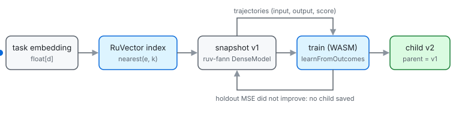

# @ruvector/weight-space

**Store ruv-fann neural-network weights as versioned snapshots in a RuVector index, keyed by a task embedding, so you can warm-start from the most similar past task, edit weights through a validated API, and fine-tune from recorded outcomes.**



```bash
npm i @ruvector/weight-space
```

## Supported environments

- Node.js 20.9 or later, ESM (`import`) and CommonJS (`require`).
- Any OS/architecture Node runs on. The networks run on [`ruv-fann`](https://www.npmjs.com/package/ruv-fann) 0.1.0, which is WebAssembly (SIMD when available), not a native addon.
- Vector index: [`@ruvector/core`](https://www.npmjs.com/package/@ruvector/core) (native Rust; Linux x64/arm64, macOS x64/arm64, Windows x64) when it is installed. It is detected at runtime and its API checked, and it was tested with 0.1.38. It is deliberately not a declared peer: an exact-pinned optional peer makes `npm install` fail with ERESOLVE whenever any other core version is present. Without it, a built-in exact in-memory index is used, so the package works everywhere ruv-fann does.

## Quickstart (tested)

```js
// quickstart.mjs
import { WeightRegistry, createMlp } from '@ruvector/weight-space';

// An append-only registry on disk; snapshots are keyed by a task embedding.
const reg = await WeightRegistry.open({ path: 'weights.jsonl' });
const base = await reg.save(createMlp([2, 8, 1], { seed: 1 }), [1, 0, 0], { task: 'product' });

// Outcomes from using the model: the input, the output that worked, and a score.
const trajectories = Array.from({ length: 64 }, (_, i) => {
  const a = Math.sin(i * 1.7), b = Math.cos(i * 2.3);
  return { input: [a, b], output: [a * b], score: 1 };
});

// Train with ruv-fann; a child is saved only if MSE on held-out trajectories improves.
const result = await reg.learnFromOutcomes(base.id, trajectories, { epochs: 400, learningRate: 0.2 });
console.log('accepted:', result.accepted, 'holdout MSE', result.holdoutMse.before.toFixed(4), '->', result.holdoutMse.after.toFixed(4));

// Warm-start a similar task from its nearest snapshot.
const [hit] = await reg.nearest([0.9, 0.1, 0], 1);
console.log('nearest:', hit.record.task, 'v' + hit.record.version, hit.similarity.toFixed(3));
console.log('lineage:', reg.lineage(hit.id).map((r) => `v${r.version}:${r.op}`).join(' -> '));
console.log('index:', reg.storeKind);
await reg.close();
```

```bash
npm init -y && npm i @ruvector/weight-space && node quickstart.mjs
```

Expected output (clean install, no `@ruvector/core`, Node 22, Linux x64):

```
accepted: true holdout MSE 0.7173 -> 0.0019
nearest: product v2 0.994
lineage: v1:save -> v2:finetune
index: flat
```

With `@ruvector/core` installed, the last line reads `index: ruvector-core` and the index is persisted to `weights.jsonl.index.db`.

## API

| Area | Functions |
|---|---|
| Registry | `WeightRegistry.open({ path?, dimensions?, store? })`, `save(model, taskEmbedding, meta)`, `nearest(taskEmbedding, k, { compatibleWith? })`, `get(id)`, `lineage(id)`, `childrenOf(id)`, `recordOutcome(id, score, note?)`, `list()`, `close()` |
| Editing (pure, validated) | `getLayer(model, i)`, `setLayer(model, i, patch)`, `perturb(model, { scale, seed, layers, relative })`, `diff(a, b)` |
| Editing (versioned) | `registry.setLayer(id, i, patch)`, `registry.perturb(id, opts)`, `registry.commit(parentId, model)`, `registry.diff(idA, idB)` |
| Fine-tuning | `registry.learnFromOutcomes(id, trajectories, opts)` / `learnFromOutcomes(registry, id, ...)` |
| ruv-fann helpers | `loadFann()`, `trainWithinBudget(runtime, model, inputs, targets, rows, opts)`, `meanSquaredError(...)`, `createMlp(sizes)`, `validateModel(json)`, `LIMITS` |
| Index | `FlatVectorStore`, `RuvectorVectorStore`, `openStore(dims, 'auto' \| 'flat' \| 'ruvector-core')`; `store: 'auto'` (default) picks `@ruvector/core` when it loads |

**How it behaves:**

- **Immutable snapshots.** Stored models are frozen. Every edit or fine-tune writes a child with `parent`, `version = parent.version + 1`, an `op` (`save`, `setLayer`, `perturb`, `finetune`, `commit`), and a sha256 `hash` of the canonical model JSON.
- **Validated input.** Models, layers and embeddings are checked against ruv-fann's `LIMITS` (layer count, dimensions, parameter count, JSON bytes) and the row-major `[outputs, inputs]` weight layout. `setLayer` can never change a layer's shape. Errors are `WeightSpaceError` with a `code` (`EINVALID`, `ESHAPE`, `ERANGE`, `ENOTFOUND`, `EINTEGRITY`, `ENOFANN`, `ENOCORE`, `EBUDGET`).
- **Event-sourced log.** The registry is a JSON-lines event log (`snapshot`, `outcome`), replayed on open. Replay re-verifies every hash, id and parent link, so a hand-edited log is rejected (`EINTEGRITY`). A torn last line from a crash is skipped.
- **Nearest search.** `nearest` returns cosine similarity (higher is closer). A child shares its parent's embedding, so ties resolve to the newer version. `compatibleWith` keeps only snapshots whose topology matches a model you are about to train.
- **Fine-tuning from outcomes.** `learnFromOutcomes` trains on successful trajectories (`score >= 0.5`) toward the output produced, and on failures toward their `correction`. Failures without a correction are skipped and counted. A seeded holdout split decides: the child is saved only if holdout MSE drops by at least `minImprovement` (default 1%). Otherwise nothing is written and the result says why.
- **Training within budget.** ruv-fann caps one `train()` call at 1e8 work units. `trainWithinBudget` packs several epochs into one call when the data fits, and mini-batches across calls when it does not. Each call starts a fresh optimiser, so `sgd` is the default.

## Measured results

<!-- weaver:measured:start -->

All numbers are from ruvultra (Linux x64, 32 cores, shared machine, Node 22.23, ruv-fann backend `wasm-simd`). The scripts are in `eval/` and `bench/`, and the raw JSON is in `eval/results/`.

### Warm-start from `nearest()` (eval/warmstart.mjs)

This is a **synthetic** task family: y = c·sin(a·x0 + b) + d·x1, with the task embedding set to the centred parameter vector. Setup:

- A library of 40 tasks per seed is trained and saved.
- 20 new tasks per seed, over 3 seeds, are each trained from three starting points.
- The model is [2, 16, 1], trained with SGD at learning rate 0.1. The target is training MSE ≤ 0.01, capped at 600 epochs.

| Start from | Reached target | Median epochs to target | Mean test MSE before training | after 50 epochs |
|---|---|---|---|---|
| Random init | 44 / 60 | 410 | 0.487 | 0.054 |
| `nearest()` snapshot | 59 / 60 | 105 | 0.060 | 0.030 |
| Random library snapshot (control) | 58 / 60 | 142.5 | 0.223 | 0.048 |

In paired comparisons, `nearest()` needed fewer epochs than random init on 55 of 60 tasks (1 loss, 4 ties). Against a random library snapshot it won 37, lost 14 and tied 9. Some of the gain comes from starting with any trained model, and nearness adds more on top.

### Latency (bench/bench.mjs, p50 / p95 in ms)

| Operation | Size | p50 | p95 |
|---|---|---|---|
| `registry.nearest(k=5)`, flat index | 10,000 snapshots × 384-d | 1.87 | 2.28 |
| `registry.save` (in-memory registry, no log append) | [16, 32, 4] model, 384-d key | 0.160 | 0.216 |
| `WeightRegistry.open` + `nearest` (log on disk, replayed) | 1,000 snapshots | 202 | 217 |
| `WeightRegistry.open` + `nearest` (log on disk, replayed) | 10,000 snapshots | 2,173 | 2,199 |
| Index search, built-in flat | 10,000 × 384-d | 1.88 | 2.38 |
| Index search, `@ruvector/core` exact | 10,000 × 384-d | 4.37 | 5.17 |
| Index search, `@ruvector/core` HNSW (m=16, ef=64) | 10,000 × 384-d | 0.123 | 0.202 |
| `predictInto`, reused prepared model | [16, 32, 4], 1 row | 0.0026 | 0.0032 |
| `predictInto`, reused prepared model | [64, 128, 64], 1 row | 0.0136 | 0.0162 |
| `trainWithinBudget` | [16, 32, 4], 256 rows, 50 epochs | 31.9 | 33.3 |
| `trainWithinBudget` (mini-batched) | [384, 16, 384], 550 rows, 1 epoch | 68.9 | 71.3 |

Memory: 10,000 snapshots of a [16, 32, 4] model with 384-d keys added 199 MB of heap (238 MB RSS).

`open` replays and re-verifies the whole JSON-lines log, at about 0.2 ms per snapshot here, and most of that is JSON parsing. This is the cost of each `ruvector weights` CLI call, so the format suits registries of hundreds to low thousands of snapshots. With `@ruvector/core`, the persisted index is reused when it already holds the log's ids; otherwise it is rebuilt with `insertBatch`.

**HNSW recall.** On real MiniLM embeddings (1,244 vectors from this repo's ADRs), HNSW top-5 matched exact search 100% of the time at m=16/ef=64 (bench/hnsw-recall.mjs). On uniform random 384-d vectors, the adversarial case, it matched 43.3% of the time at m=16/ef=64 and 92.4% at m=32/ef=200. The default `@ruvector/core` index is therefore its exact mode; HNSW is opt-in via `ruvector: { hnsw: {...} }`.

### Optimizations (before → after, p50)

| Hot path | Before | After |
|---|---|---|
| Index search, 10k × 384 | 5.37 ms (array of arrays, full sort) | 1.88 ms (one `Float32Array`, partial top-k) |
| Predict [64, 128, 64], 1 row | 2.17 ms (`prepare` + `predict` per call) | 0.0136 ms (prepared once, `predictInto`) |
| Predict [16, 32, 4], 1 row | 0.090 ms | 0.0026 ms |
| Train [16, 32, 4], 50 epochs | 66.0 ms (one `train()` call per epoch) | 31.9 ms (epochs packed per call within budget) |
| Open with `@ruvector/core`, 3,000 snapshots | 548 ms (index rebuilt each open) | 501 ms (persisted index reused) |

### Query reshaping: measured, NOT shipped on

`QueryReshaper` is a residual 384→h→384 MLP. It is identity at init and trained with ruv-fann on (query, relevant, irrelevant) feedback. It was evaluated on a paraphrase task built from real repo data (eval/adr-corpus.mjs, eval/reshape.mjs):

- **Corpus:** 325 ADR titles from `docs/adr`.
- **Queries:** 919 sentences from the ADR bodies. A query never contains its ADR's title or another ADR's number.
- **Embedder:** all-MiniLM-L6-v2 via ruvector's ONNX embedder.
- **Splits:** 60/20/20, 3 seeds. Hyper-parameters were tuned on val over 24 configurations.
- **Gate (pre-registered):** pooled test recall@5 must improve with a 95% bootstrap CI that excludes 0.

| Protocol (test) | recall@1 base → reshaped | recall@5 base → reshaped (Δ, 95% CI) | recall@10 base → reshaped |
|---|---|---|---|
| Held-out queries, known docs | 0.295 → 0.324 | 0.480 → 0.495 (+0.014, [-0.009, +0.038]) | 0.558 → 0.585 |
| Held-out docs | 0.302 → 0.306 | 0.492 → 0.479 (-0.013, [-0.031, +0.005]) | 0.571 → 0.564 |

The recall@5 CI includes 0, so reshaping **fails the gate and is not part of the main API**. Nothing in `ruvector` uses it. The class remains available, unsupported, at `@ruvector/weight-space/experimental` for anyone who wants to re-run the eval. Recall@1 and recall@10 on held-out queries did improve (+0.029, CI [+0.005, +0.053]; +0.027, CI [+0.002, +0.054]), but those were not the pre-registered metric. On held-out documents there is no gain. Most seeds picked the largest learning rate in the grid, so the sweep may be too narrow; that was not explored.

### Install size

| Package | Packed | Unpacked |
|---|---|---|
| `@ruvector/weight-space` 0.1.0 | 31.7 kB | 175 kB (36 files) |
| plus `ruv-fann` + `ruv-fann-wasm` (dependency) | | about 1.5 MB |

<!-- weaver:measured:end -->

## Works with / Used by

- **Depends on:** [`ruv-fann`](https://www.npmjs.com/package/ruv-fann) `0.1.0` (runtime). Uses [`@ruvector/core`](https://www.npmjs.com/package/@ruvector/core) when present (not a declared dependency).
- **Used by:** [`ruvector`](https://www.npmjs.com/package/ruvector) 0.3.24 and later, as an optional peer, behind `ruvector weights save|nearest|diff|lineage|get` and the `weights_*` MCP tools.

## Next

To drive the registry from a CLI or an MCP-speaking agent, install [`ruvector`](https://www.npmjs.com/package/ruvector) next to it: `npm i ruvector @ruvector/weight-space`, then `npx ruvector weights --help`.

---

MIT · [ruv.io](https://ruv.io) · [source](https://github.com/ruvnet/ruvector/tree/main/npm/packages/weight-space) · [issues](https://github.com/ruvnet/ruvector/issues)
